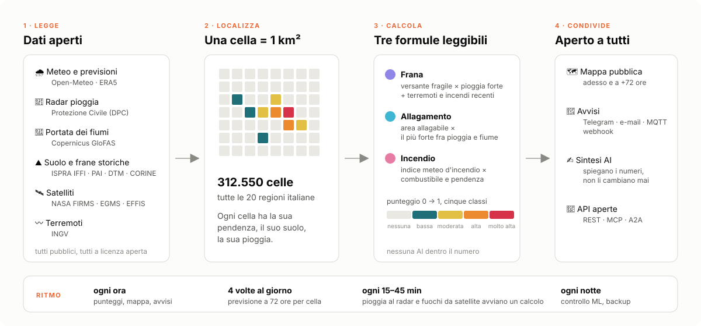
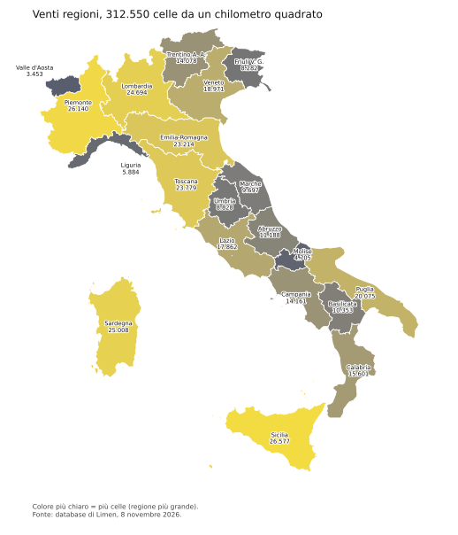
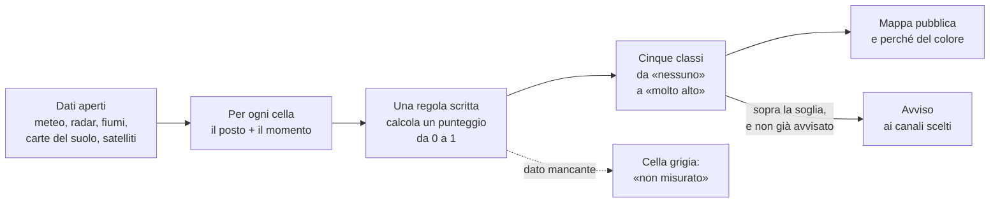
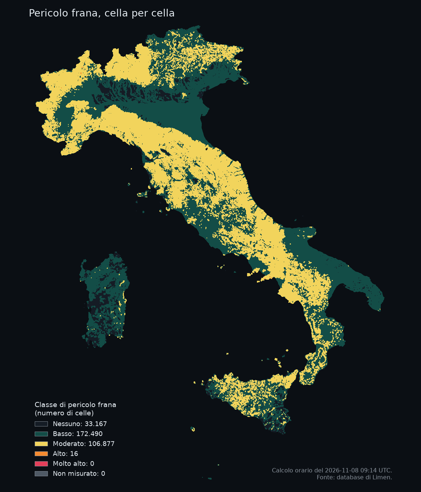
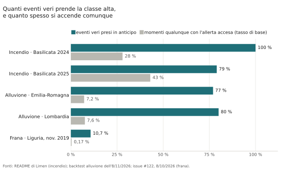

# 1. Il problema e cosa fa Limen

!!! abstract "In breve"
    - L'Italia ha più di 721.000 frane censite, 6,8 milioni di persone in zone
      che un fiume può allagare e incendi ogni estate. Le allerte ufficiali
      danno un colore per zona, e una zona comprende decine di Comuni.
    - Limen scende al chilometro quadrato: 312.550 celle, ricalcolate ogni ora,
      tre pericoli (frana, alluvione, incendio), cinque classi, uno sguardo ai
      tre giorni successivi.
    - Non sostituisce la Protezione civile. Dice *dove dentro la zona*,
      *perché* e *cosa arriva*, accanto al bollettino ufficiale.
    - L'obiettivo è diventare uno strumento affidabile di monitoraggio del
      territorio, e l'affidabilità si misura sugli eventi veri.
    - Le misure, anche quelle andate male: l'**incendio** è misurato e sta
      migliorando; l'**alluvione** prende circa otto allagamenti su dieci ma
      con molti falsi allarmi; la **frana** ancora no.

## Un Paese fragile, guardato a grana grossa

L'Italia è uno dei Paesi europei più esposti a frane e alluvioni. L'archivio
nazionale delle frane, curato dall'Istituto superiore per la protezione e la
ricerca ambientale (ISPRA) con le Regioni, ne conta **721.365**[^iffi].
Secondo lo stesso istituto, **6,8 milioni di persone**, l'11,5 % degli
italiani, vivono in zone che un fiume può allagare con una piena attesa in
media una volta ogni cento-duecento anni: quella che i tecnici chiamano
«pericolosità idraulica media»[^ispra]. E ogni estate gli incendi bruciano
decine di migliaia di ettari, che il servizio europeo per gli incendi
boschivi disegna dal satellite[^effis].

Questi rischi hanno due metà. Una è **il posto**: un versante ripido di
argilla che è già franato, una pianura accanto a un argine, una pineta su un
pendio esposto a sud. L'altra è **il momento**: tre giorni di pioggia su un
terreno già zuppo, un fiume che sale, una settimana di caldo secco e vento.
Il posto cambia in decenni, il momento in poche ore.

In Italia le allerte le emettono il Dipartimento della Protezione Civile e i
Centri Funzionali delle Regioni. Ogni giorno pubblicano un bollettino con un
colore (verde, giallo, arancione, rosso) per **zona di allerta**. Una zona è
un'area dove il tempo si comporta in modo simile, e comprende di solito
decine di Comuni. È la scelta giusta per il suo scopo, che è mettere in moto
i soccorsi su un'area. Ma lascia aperta una domanda che chi abita, lavora o
amministra un territorio si fa ogni volta: *dentro la zona gialla, dove?*

## Cosa fa Limen

Limen prova a rispondere a quella domanda.

*Schema generale. Fonte: immagine del progetto, novembre 2026.*

In concreto:

- **Divide l'Italia in 312.550 celle**, quadrati da un chilometro di lato,
  in tutte le venti regioni.
- **Ogni ora**, per ogni cella, si fa tre domande, una per pericolo:
    - **frana**: *questo versante è fragile, e sta ricevendo troppa pioggia?*
    - **alluvione**: *l'acqua può arrivare qui, e sta arrivando?*
    - **incendio**: *se qui partisse un fuoco oggi, attecchirebbe e
      correrebbe?*
- Risponde con un **punteggio fra 0 e 1**, che diventa una di **cinque
  classi**: nessuno, basso, moderato, alto, molto alto. I colori seguono
  l'ordine di quelli della Protezione civile, perché sono quelli che le
  persone conoscono.
- Guarda anche **avanti**: con la pioggia e il tempo previsti, mostra come
  cambierà la mappa nei **tre giorni** successivi.
- Quando una cella supera una soglia, manda un **avviso** sui canali scelti da
  chi installa Limen (per esempio un messaggio Telegram o una email), senza
  ripeterlo ogni ora per la stessa cella.
- Mette tutto su una **mappa pubblica**, senza registrazione. Ogni cella si
  apre e mostra *perché* ha quel colore: quanto pesa la pioggia, quanto la
  pendenza, quanto il fiume.

*Le venti aree monitorate e quante celle da un chilometro quadrato contiene
ciascuna: dalle 3.453 della Valle d'Aosta alle 26.577 della Sicilia. Fonte:
archivio di Limen, 8 novembre 2026.*

### Dal dato all'avviso

Il giro che Limen ripete ogni ora si può raccontare in cinque passi.

Il passo in basso, quello tratteggiato, è importante e ci torniamo fra poco:
quando un dato non arriva, la cella non diventa «calma», diventa **grigia**.

### Come appare

Ecco come appariva la mappa della frana la mattina dell'8 novembre 2026.

*Quasi tutta l'Italia appenninica e alpina è in classe «moderata»; solo 16
celle sono in classe «alta». Senza piogge forti in corso, il colore lo decide
soprattutto il terreno: dove è ripido e già franato, la cella parte più in
alto. Fonte: archivio di Limen, calcolo orario dell'8 novembre 2026,
09:14 UTC (le 10:14 in Italia).*

Questa immagine dice già una cosa che il libro ripeterà spesso: un colore
non è una previsione di disastro. «Moderato» qui vuol dire «terreno fragile
in una giornata qualunque», non «domani frana». Il capitolo 4 spiega come si
legge, il capitolo 5 perché proprio questo è il punto debole della frana.

### Tre storie vere

Tre esempi, presi dalle misure e dagli eventi registrati nel progetto,
danno l'idea di che cosa vuol dire tutto questo.

**Faenza, settembre 2024.** Fra il 17 e il 19 settembre sono caduti quasi
209 millimetri di pioggia. La previsione emessa il giorno prima ne dava 157,
quella di tre giorni prima 101. A quell'epoca il motore dell'alluvione
cominciava a preoccuparsi da 80 millimetri in tre giorni, quindi la
previsione di tre giorni prima sarebbe stata un silenzio e quella del giorno
prima un allarme. Per questo, quando Limen si mette alla prova sulle
alluvioni passate, usa la previsione **come fu emessa allora**, non la
pioggia poi caduta: quella sarebbe una previsione perfetta che nessuno ha mai
avuto davvero[^faenza].

**Melito di Porto Salvo, 10 ottobre 2026.** La mattina la previsione dava 20
millimetri. Il radar della Protezione civile ne aveva già misurati 152 nelle
ventiquattro ore. Un sistema che guarda solo al futuro non vede il nubifragio
mentre sta cadendo. Da allora Limen conta anche la pioggia già caduta: la
cella di Melito passa da 0 a 0,79, cioè da «nessuno» ad «alto»[^melito].

**Gli incendi in Sicilia, estati 2024 e 2025.** Il punteggio dell'incendio
mette insieme un indice meteo usato in tutto il mondo (quanto il tempo
favorisce il fuoco), il tipo di vegetazione e la pendenza. A novembre 2026 il
peso dei diversi tipi di vegetazione è stato rivisto sugli incendi veri. Nella
classe «molto alto» la Sicilia passa dall'8,0 all'11,4 % degli incendi presi
nel 2024 e dal 6,2 al 9,0 % nel 2025, senza peggiorare la classe «alto»[^sicilia].
Il capitolo 5 racconta come si è arrivati a quel cambio, e perché un'altra
versione, più ambiziosa, è stata scartata.

## A chi serve

**A un Comune e alla sua Protezione civile.** Quando le segnalazioni arrivano
tutte insieme, l'ufficio tecnico deve decidere dove mandare la squadra. Limen
mette in fila comuni e celle per pericolo, con il motivo accanto: non «zona
arancione», ma «pioggia molto sopra la soglia su un versante con frane
censite a poche centinaia di metri».

**A chi abita o lavora in un posto esposto.** La domanda è sempre la stessa:
«stanotte piove forte, devo preoccuparmi qui?». Il bollettino risponde per
una zona vasta; due versanti della stessa valle possono comportarsi in modo
molto diverso. Limen scende al chilometro e fa vedere quanto pesa la pioggia
e quanto il posto.

**A chi coltiva un terreno in pendio o cura un bosco.** Il danno arriva
raramente di sorpresa: arriva dopo settimane in cui il terreno si è riempito
d'acqua, o dopo un'estate che ha seccato il sottobosco. Limen tiene il conto
di questo accumulo giorno per giorno.

**A chi fa ricerca o informazione.** Ogni punteggio si può ricostruire: per
ogni cella si possono leggere tutti i numeri che lo hanno composto. Le prove
sugli eventi passati si rifanno da capo. Ricercatori, giornalisti, studenti e
tecnici possono controllare, contestare e proporre correzioni in pubblico.

**A chi vuole replicarlo.** Il programma è libero, i dati sono aperti, il
sistema gira su un solo computer. Una Regione, un consorzio di bonifica o un
Paese vicino può installarne una copia per il proprio territorio.

## Cosa Limen non fa

Mettiamo i limiti qui, all'inizio, perché in fondo sarebbero un modo elegante
di nasconderli.

- **Non è un'allerta ufficiale.** Nessun avviso di Limen ha valore legale. Se
  Limen e il bollettino regionale non coincidono, vale il bollettino.
- **Non predice la frana.** Nessuno sa dire «domani alle 15 quel versante
  cede». Limen stima quanto quel posto, oggi, somiglia alle condizioni in cui
  in Italia le frane sono davvero avvenute.
- **Non è un avviso di piena.** La portata dei fiumi viene dal servizio
  europeo di previsione delle piene, e la sua licenza chiede di dirlo accanto
  ai dati e di non presentarli mai come un avviso di piena[^cems]. Limen fa
  entrambe le cose su ogni pagina che mostra l'alluvione.
- **Non vede sotto terra.** Non sa se un muro di sostegno è fatto bene, se un
  tombino è intasato, se un cantiere ha scavato il piede di un versante.
- **Non è un assistente con cui chiacchierare.** L'intelligenza artificiale
  non decide nessun colore sulla mappa: scrive solo il breve riassunto che lo
  accompagna.

## I principi

Sette scelte attraversano tutto il progetto. Tornano in ogni capitolo, quindi
conviene fissarle subito.

**1. Dati aperti.** Ogni dato viene da una fonte pubblica: ISPRA, il
programma europeo di osservazione della Terra Copernicus, la Protezione
civile, l'Istituto nazionale di geofisica e vulcanologia (INGV), la NASA, il
Consiglio nazionale delle ricerche (CNR), la mappa libera OpenStreetMap, il
servizio meteo aperto Open-Meteo. Nessun dato a pagamento, nessun accordo
riservato. Il capitolo 3 li elenca uno per uno, con la loro licenza.

**2. Un computer proprio.** Limen gira su un server del progetto, non sui
servizi a noleggio dei grandi fornitori. Anche il meteo viene da una copia di
Open-Meteo tenuta accanto: il servizio pubblico permette diecimila richieste
al giorno, e il giro orario di Limen ne chiedeva molte di più[^openmeteo].
Anche l'intelligenza artificiale può girare in casa.

**3. Una regola scritta decide.** Il punteggio che colora la mappa viene da
una **regola fissa**: una formula con pesi e soglie scritti in chiaro in file
leggibili da chiunque, che dà lo stesso risultato ogni volta che la si rifà.
Nel progetto la chiamiamo «il campione». Non si toglie e non si indebolisce.

**4. Il modello che impara guarda, non decide.** Accanto al campione gira
ogni notte un modello di apprendimento automatico (*machine learning*: un
programma che impara dagli esempi passati invece di seguire una regola
scritta). È lo «sfidante». Calcola il suo punteggio e lo mette da parte, ma
non tocca la mappa né gli avvisi. Può prendere il posto del campione solo se
lo batte su due prove diverse, e solo per decisione di una persona. Il
capitolo 6 spiega perché.

**5. L'intelligenza artificiale scrive parole, mai numeri.** Un modello di
linguaggio (come quelli dietro ai programmi di conversazione più noti)
trasforma il risultato in un breve testo per regione. Non può cambiare un
punteggio: un controllo automatico lo verifica a ogni modifica del programma.
Gli avvisi non passano mai da lì.

**6. «Non misurato» non è «nessun pericolo».** Se una fonte non risponde, il
calcolo darebbe zero, e sulla mappa zero sembra una cella tranquilla. È
successo davvero il 29 settembre 2026: finite le richieste al servizio meteo,
alluvione e incendio valevano zero su tutta Italia. Da allora ogni punteggio
dice se il dato è arrivato, e una cella non misurata si disegna in **grigio**,
come una cella non valutata[^nonmisurato].

**7. Misurare prima di cambiare.** Nessun peso e nessuna soglia cambiano senza
una prova sugli eventi veri. E accanto a ogni prova c'è sempre il **tasso di
base**: quante volte il sistema avrebbe acceso l'allerta comunque, in un
giorno qualunque. Un sistema che dice «pericolo» ogni giorno d'estate prende
tutti gli incendi e non serve a niente. Il capitolo 5 è dedicato a questo.

## A che punto siamo

Limen copre tutta Italia per tutti e tre i pericoli. Le prime regioni su cui
è stato provato sono Puglia e Basilicata. La figura riassume le misure
principali con una domanda doppia: *quanti eventi veri aveva preso in
anticipo la classe alta?* e *quanto spesso era accesa comunque, in un
momento qualunque?* Un sistema utile ha la prima barra lunga e la seconda
corta.

*Barre scure: eventi veri presi in anticipo. Barre chiare: momenti qualunque
con l'allerta accesa. Fonti: sezione «Does it work?» del README (incendio,
Basilicata, perimetri delle aree bruciate dal satellite); prova sulle
alluvioni dell'8 novembre 2026 con la previsione come fu emessa, contro le
aree allagate cartografate dal servizio europeo di emergenza (Emilia-Romagna
e Lombardia); issue #122, misura dell'8 ottobre 2026 (frana, Liguria, 131
frane datate del novembre 2019).*

Come si leggono:

- **L'incendio è misurato, e migliora.** In Basilicata la classe alta ha
  preso il 79 % degli incendi del 2025 e tutti quelli del 2024, contro il 43
  e il 28 % dei giorni in cui era accesa comunque. È meglio del caso, ma
  d'estate la classe alta si accende spesso. La ricalibrazione di novembre
  2026 ha alzato la quota di incendi presi in classe «molto alto» in Sicilia,
  da 8,0 a 11,4 % nel 2024 e da 6,2 a 9,0 % nel 2025[^sicilia].
- **L'alluvione prende la maggior parte degli eventi, ma con molti falsi
  allarmi.** In Emilia-Romagna e in Lombardia la classe alta aveva preso in
  anticipo il 77 e l'80 % delle celle poi allagate, accendendosi in poco più
  del 7 % dei giorni qualunque. Ma fra le allerte che si possono controllare,
  quelle senza un allagamento osservato sono il 78 % in Emilia-Romagna e il
  43 % in Lombardia[^alluvione]. Il motivo: dentro l'area di un'alluvione
  piove su tutti allo stesso modo, e quali case finiscono sott'acqua lo
  decide il percorso dell'acqua, che oggi Limen non conosce abbastanza bene.
- **La frana non funziona ancora, e lo diciamo.** Sulle 131 frane datate della
  Liguria del novembre 2019, la classe alta ne aveva prese in anticipo solo 14,
  l'11 %[^frana]. Il punteggio mette in ordine bene le celle dentro una
  regione, ma la pioggia, così come Limen la legge oggi, raramente basta a
  spingere una cella in classe alta. Nelle Marche, sulle 172 frane del maggio
  2014, nessuna era in classe alta. È il lavoro più grosso che resta.
- **Il modello che impara batte la regola scritta sulla frana**, quando lo si
  prova su zone che non ha visto durante l'addestramento. Resta comunque in
  prova finché non la batte anche sugli eventi veri: due prove, non una.

??? note "Per chi sviluppa"
    - I tre motori: `src/limen/core/scoring/` (`engine.py` per la frana,
      `flood/`, `wildfire/`), con pesi e soglie in
      `src/limen/config/hazards/{landslide,flood,wildfire}.yaml`.
    - Il flag «misurato»: `measured()` sui breakdown in
      `src/limen/core/models/`, salvato in `risk_assessments.measured` e
      `latest_risk.measured`; il grigio è `COLORE_IGNOTO` in
      `frontend/src/lib/risk-colors.ts`.
    - Le prove sugli eventi passati: `limen backtest`, `limen backtest-flood`,
      `limen backtest-wildfire`; la verifica sulla cronaca:
      `limen verifiche-report`.
    - Le figure di questo capitolo: `scripts/libro/cap01_regioni.py`,
      `cap01_mappa_frana.py` (letture in sola lettura su `aoi`,
      `grid_cells`, `latest_risk`), `cap01_misure.py` (numeri con la fonte in
      testa allo script).
    - Le regole che il codice non può violare sono nella tabella *Locked
      invariants* di
      [`CLAUDE.md`](https://github.com/agent-engineering-studio/limen/blob/main/CLAUDE.md).

## Gap e come chiuderli

Qui sotto, in breve, quello che manca per arrivare all'obiettivo. Il registro
completo, per tutto il libro, è l'[appendice D](appendice-d-gap.md).

**La classe alta della frana si raggiunge quasi mai.** Anche nei giorni delle
frane vere, la pioggia letta da Limen non basta a far salire la cella: è il
motivo dell'11 % in Liguria e dello zero nelle Marche. Senza questo, la frana
non è uno strumento di monitoraggio.
*Dato aperto che aiuterebbe:* le piogge orarie dei pluviometri regionali,
pubblicate come dati aperti e con continuità (alcune Regioni lo fanno già,
per esempio l'Emilia-Romagna con il servizio
[Dext3r di ARPAE](https://simc.arpae.it/dext3r/); le condizioni d'uso vanno
verificate regione per regione).
(issue: #345)

**Pochi eventi veri per misurare.** Per dire «funziona al 90 %» servono
centinaia di eventi datati e localizzati con cura; il catalogo delle frane
datate usato oggi si ferma al 2021, e la raccolta dalle notizie è appena
cominciata.
*Dato aperto che aiuterebbe:* un aggiornamento dopo il 2021 del catalogo
nazionale delle frane innescate dalla pioggia
[e-ITALICA del CNR-IRPI](https://doi.org/10.5281/zenodo.14204473) (licenza
CC BY 4.0), e i registri degli eventi di Comuni e Regioni pubblicati con data,
ora e luogo.
(issue: #345)

**Troppi falsi allarmi per l'alluvione.** Limen sa quanto piove, ma non sa
abbastanza bene dove va l'acqua dopo. Per questo, dentro l'area di
un'alluvione, accende l'allerta anche su celle che restano asciutte.
*Dato aperto che c'è già:* il
[modello del terreno a 5 metri del CNR-IRPI](https://zenodo.org/records/18921767)
(licenza CC BY 4.0), che Limen usa già per la pendenza. Da lì si può
calcolare quanto ogni cella sta più in alto del corso d'acqua più vicino:
chi sta pochi metri sopra il fiume si allaga, chi sta trenta metri sopra no.
([#474](https://github.com/agent-engineering-studio/limen/issues/474))

## Per approfondire

- *Limen in una pagina*, la scheda divulgativa da cui parte questo capitolo:
  [docs/divulgazione/01-limen-in-una-pagina.md](https://github.com/agent-engineering-studio/limen/blob/main/docs/divulgazione/01-limen-in-una-pagina.md).
- ISPRA, *Dissesto idrogeologico in Italia: pericolosità e indicatori di
  rischio*, edizione 2024 (Rapporti 415/2025):
  <https://www.isprambiente.gov.it/it/pubblicazioni/rapporti/dissesto-idrogeologico-in-italia-pericolosita-e-indicatori-di-rischio-edizione-2024>;
  edizione 2021:
  <https://www.isprambiente.gov.it/it/pubblicazioni/rapporti/dissesto-idrogeologico-in-italia-pericolosita-e-indicatori-di-rischio-edizione-2021>.
- ISPRA, gli indicatori di rischio nazionali:
  <https://www.isprambiente.gov.it/it/attivita/suolo-e-territorio/dissesto-idrogeologico/indicatori-di-rischio>.
- La piattaforma IdroGEO di ISPRA (frane censite e aree a pericolosità):
  <https://idrogeo.isprambiente.it>.
- Il servizio europeo per gli incendi boschivi (EFFIS):
  <https://forest-fire.emergency.copernicus.eu>.
- Il servizio europeo di mappatura delle emergenze (Copernicus EMS):
  <https://mapping.emergency.copernicus.eu>.
- Il servizio europeo di previsione delle piene (GloFAS):
  <https://www.globalfloods.eu>.
- Il radar meteo della Protezione civile: <https://radar.protezionecivile.it>.

[^iffi]: Inventario dei Fenomeni Franosi in Italia (IFFI), ISPRA, sulla
    piattaforma IdroGEO, licenza CC BY-SA 4.0; il numero è nel catalogo dei
    dati di Limen,
    [`src/limen/config/dati.yaml`](https://github.com/agent-engineering-studio/limen/blob/main/src/limen/config/dati.yaml),
    voce `iffi`.
[^ispra]: ISPRA, pagina
    [*Indicatori di rischio*](https://www.isprambiente.gov.it/it/attivita/suolo-e-territorio/dissesto-idrogeologico/indicatori-di-rischio),
    consultata l'8 novembre 2026: 6,8 milioni di abitanti a rischio alluvioni
    nello scenario di pericolosità idraulica media (11,5 % della
    popolazione), dati del rapporto *Dissesto idrogeologico in Italia:
    pericolosità e indicatori di rischio*, edizione 2024 (Rapporti 415/2025).
    Lo stesso valore era nell'edizione 2021 (Rapporti 356/2021).
[^effis]: Limen legge i perimetri delle aree bruciate dal servizio europeo
    EFFIS, che è pubblico e non chiede credenziali; li usa come verità per
    misurare il motore dell'incendio.
[^faenza]: Spiegazione in testa al programma che rigioca le alluvioni passate,
    [`src/limen/cli/backtest_flood.py`](https://github.com/agent-engineering-studio/limen/blob/main/src/limen/cli/backtest_flood.py).
[^melito]: Commento alla pioggia osservata nel file di configurazione
    dell'alluvione,
    [`flood.yaml`](https://github.com/agent-engineering-studio/limen/blob/main/src/limen/config/hazards/flood.yaml),
    e issue #199.
[^sicilia]: Prova sugli incendi 2024-25 pubblicata nella issue #295 e
    adottata con la versione `wildfire-v1.1.0` (PR #462), novembre 2026.
[^alluvione]: Prova dell'8 novembre 2026, sola pioggia, previsione come fu
    emessa, contro le aree allagate di Copernicus EMS: Emilia-Romagna 77 %
    delle celle allagate prese, 7,2 % di allerte nei giorni qualunque, 78 %
    di falsi allarmi; Lombardia 80 %, 7,6 %, 43 %. Le misure precedenti sono
    nei commenti di `flood.yaml` (Emilia-Romagna: 77 %, 7,3 %, 79 %). I falsi
    allarmi si contano solo dove il satellite ha davvero guardato.
[^frana]: Issue #122, commento dell'8 ottobre 2026: 10,7 % delle frane
    prese con lo 0,17 % delle celle-ora in allerta, pioggia dell'archivio
    meteo ERA5 e pioggia antecedente calcolata come in produzione. La prima
    misura, del 18 settembre 2026 e prima di queste correzioni, dava il
    7,6 %.
[^cems]: Licenza del servizio Copernicus per le piene (CEMS-Floods);
    l'attribuzione è in `frontend/src/lib/attribuzioni.ts`.
[^openmeteo]: Issue #142.
[^nonmisurato]: Issue #143.
