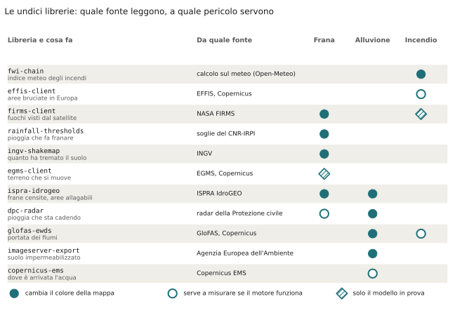
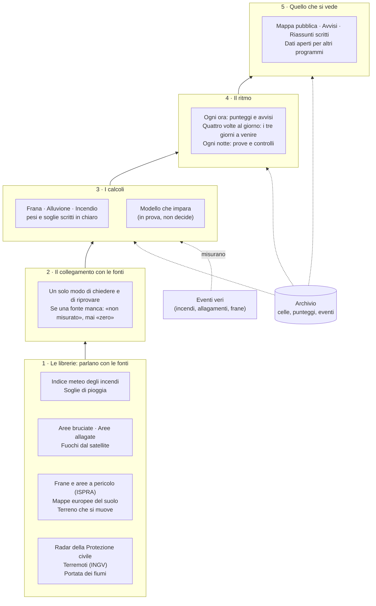

# 2. I mattoni: le librerie e perché ci sono

!!! abstract "In breve"
    - Una **libreria** è un pezzo di programma riutilizzabile che fa una cosa
      sola, come un attrezzo in una cassetta. Limen ne usa di due tipi:
      **undici nate dentro Limen** e poi messe a disposizione di tutti, e
      molti **strumenti liberi** costruiti da altri (l'archivio dei dati, la
      mappa, l'apprendimento automatico).
    - Le undici librerie fanno il lavoro più ingrato: **parlare con le fonti
      dei dati**. Formati poco documentati, servizi che rispondono «zero»
      invece di dire che c'è un errore, un'acciaieria che dal satellite sembra
      un incendio.
    - Sono separate da Limen perché servono anche ad altri (enti, ricercatori,
      altri progetti), con una licenza che permette di usarle liberamente.
    - Limen ne usa solo le parti che fanno i conti. Come comportarsi quando
      una fonte non risponde lo decide Limen, in un posto solo.
    - Ogni strumento esterno è lì per un motivo scritto; spesso il motivo è
      anche *perché non un'alternativa più nota*.

## Perché partire dai mattoni

Un sistema come Limen fa tre cose: **raccoglie** dati da decine di fonti, li
**trasforma** in un punteggio per ogni cella e li **mostra** su una mappa.
Delle tre, la prima è la più fragile. Un servizio cambia formato, il numero
di richieste permesse finisce, un file da più di un gigabyte si interrompe a
metà. E un errore qui non si vede: se la fonte della pioggia risponde vuoto,
il calcolo legge «zero pioggia» e la mappa sembra tranquilla. Il capitolo 1
racconta che è successo davvero, il 29 settembre 2026.

Per questo il lavoro di «parlare con le fonti» è stato chiuso in librerie
piccole, ognuna con un compito preciso e provata contro i dati veri. Ognuna
risolve un problema una volta sola, per Limen e per chiunque altro.

La figura mostra le undici librerie, la fonte che ciascuna legge e a quale
dei tre pericoli serve.

*Cerchio pieno: il dato cambia il colore della mappa. Cerchio vuoto: il dato
serve a controllare se Limen ha previsto bene. Rombo: il dato alimenta solo il
modello che impara, ancora in prova. Fonte: il codice di Limen, stato all'8
novembre 2026.*

Si notano due cose. La prima: l'alluvione e la frana dipendono da molte più
fonti dell'incendio, perché l'acqua e il terreno sono più complicati del
tempo secco. La seconda: quattro librerie su undici servono, in tutto o in
parte, a **controllare** Limen, non a calcolare. È una scelta: un sistema che
non si misura non è affidabile.

## Le librerie nate da Limen

Sono tutte pubblicate nell'archivio pubblico dei programmi in linguaggio
Python e sulla piattaforma GitHub, con una licenza aperta (Apache-2.0) che
permette a chiunque di usarle, anche in prodotti commerciali, citando la
fonte. Limen tiene ferma la versione di ognuna: un cambiamento importante in
una libreria arriva in Limen solo per scelta, non da solo.

### fwi-chain: l'indice meteo degli incendi

*Documentazione: [agentengineering.it/fwi-chain](https://agentengineering.it/fwi-chain/) · codice su [GitHub](https://github.com/agent-engineering-studio/fwi-chain).*

**Il problema.** Il servizio forestale canadese ha costruito negli anni
Ottanta un indice che dice quanto il tempo favorisce un incendio: il *Fire
Weather Index* (FWI). Oggi è lo standard internazionale, usato anche dal
servizio europeo per gli incendi. Non è un numero del giorno: è una
**catena**. Quanto è secco il sottobosco oggi dipende da quanto lo era ieri,
e ieri dall'altro ieri, come un conto corrente dove ogni giorno di sole è un
prelievo e ogni pioggia un versamento.

**Cosa fa.** Calcola la catena con le formule pubblicate (Van Wagner, 1987),
senza bisogno di collegarsi a niente: numeri in ingresso, numeri in uscita. È
verificata sul giorno di esempio pubblicato fino alla nona cifra decimale.

**Come la usa Limen.** Tiene una catena per ogni punto della griglia del
meteo, circa uno ogni nove chilometri, e la aggiorna ogni giorno. Le costanti
delle formule stanno nella libreria perché sono uno standard pubblicato, non
una scelta di Limen.

### effis-client: le aree bruciate in Europa

*Documentazione: [agentengineering.it/effis-client](https://agentengineering.it/effis-client/) · codice su [GitHub](https://github.com/agent-engineering-studio/effis-client).*

**Il problema.** Per sapere se Limen prevede bene gli incendi servono gli
incendi veri. Il sistema europeo d'informazione sugli incendi boschivi
(EFFIS) disegna dal satellite il contorno di ogni area bruciata e lo
pubblica. Ma il servizio ha molte sorprese: un indirizzo sbagliato non dà
errore ma resta appeso, un filtro viene ignorato in silenzio, due filtri
insieme chiudono la comunicazione.

**Cosa fa.** Chiede i contorni delle aree bruciate e le mappe ufficiali
dell'indice meteo degli incendi, nel modo che il servizio accetta davvero.

**Come la usa Limen.** I contorni sono la «verità» con cui si misura il
punteggio dell'incendio e con cui si sono ricalibrati i pesi della
vegetazione (capitolo 5). Le mappe ufficiali servono a confrontare l'indice
calcolato da Limen con quello europeo.

**Una lezione.** Per un anno il progetto ha creduto che EFFIS richiedesse un
accreditamento, e l'archivio degli incendi è rimasto vuoto. Il problema era
nel modo in cui Limen faceva la domanda, non nelle credenziali. Da qui una
regola: un servizio che risponde zero è un'ipotesi da verificare, non una
conclusione.

### rainfall-thresholds: la pioggia che fa franare

*Documentazione: [agentengineering.it/rainfall-thresholds](https://agentengineering.it/rainfall-thresholds/) · codice su [GitHub](https://github.com/agent-engineering-studio/rainfall-thresholds).*

**Il problema.** Una frana superficiale parte quando piove abbastanza forte
per abbastanza tempo. Un temporale di un'ora e una pioggia di tre giorni
fanno danni diversi. Nel 1980 il geografo Nel Caine ha disegnato la curva che
separa le piogge innocue da quelle che fanno franare (la **soglia
intensità-durata**). In Italia l'Istituto di ricerca per la protezione
idrogeologica del CNR (CNR-IRPI) l'ha ricalcolata sulle frane italiane.

**Cosa fa.** Riconosce gli episodi di pioggia in una serie di misure ora per
ora e dice se hanno superato la soglia, o la ricalcola sui dati.

**Come la usa Limen.** Nel termine «pioggia» del punteggio della frana, con
soglie diverse per Nord, Centro e Sud.

### ispra-idrogeo: frane censite e aree allagabili

*Documentazione: [agentengineering.it/ispra-idrogeo](https://agentengineering.it/ispra-idrogeo/) · codice su [GitHub](https://github.com/agent-engineering-studio/ispra-idrogeo).*

**Il problema.** ISPRA pubblica sulla piattaforma IdroGEO quello che l'Italia
sa di frane e alluvioni: l'archivio delle 721.365 frane censite, le mappe
nazionali delle aree a pericolo tratte dai piani di bacino delle Regioni e
gli indicatori di rischio per Comune. Sono file grandi (fino a 1,2 gigabyte)
pieni di codici da decifrare.

**Cosa fa.** Scarica i file e li riscarica solo se sono cambiati, interroga il
servizio di ISPRA e traduce in parole i codici: per esempio, l'elenco
«15, 22, 25» sotto «strumenti» diventa «inclinometro, misure topografiche,
radar dal satellite».

**Come la usa Limen.** Per scaricare, quando si installa Limen, le frane
censite e le aree a pericolo di ogni regione: sono la parte del punteggio che
dice quanto *il posto* è fragile.

### copernicus-ems: dove è arrivata davvero l'acqua

*Documentazione: [agentengineering.it/copernicus-ems](https://agentengineering.it/copernicus-ems/) · codice su [GitHub](https://github.com/agent-engineering-studio/copernicus-ems).*

**Il problema.** Per misurare il punteggio dell'alluvione servono le aree
allagate vere. Il servizio europeo di mappatura delle emergenze (Copernicus
EMS) le disegna da immagini satellitari poche ore dopo un disastro: per
esempio l'Emilia-Romagna nel maggio 2023.

**Cosa fa.** Elenca gli interventi e scarica, per ciascuno, **dove c'era
l'acqua** e **dove il satellite ha guardato davvero**.

**Come la usa Limen.** Costruisce la verità per le alluvioni: 14 interventi
italiani e quasi 16.000 aree allagate in 9 regioni. Il secondo dato conta
quanto il primo. Dove il satellite ha guardato e non c'è acqua, la cella era
*asciutta*. Dove non ha guardato, un'allerta di Limen non è sbagliata: è
**non controllabile**. Senza questa distinzione il Piemonte risultava con il
100 % di falsi allarmi, solo perché in quell'intervento il satellite aveva
guardato appena 0,3 chilometri quadrati, una quarantina di campi da
calcio[^piemonte].

### egms-client: il terreno che si muove

*Documentazione: [agentengineering.it/egms-client](https://agentengineering.it/egms-client/) · codice su [GitHub](https://github.com/agent-engineering-studio/egms-client).*

**Il problema.** I satelliti radar europei misurano di quanti millimetri
all'anno si muove il suolo, punto per punto. Il servizio europeo di
monitoraggio dei movimenti del terreno (EGMS) pubblica questo archivio, ma
dietro un accesso con una chiave e in formati diversi.

**Cosa fa.** Gestisce l'accesso, la ricerca e lo scaricamento delle mappe e
delle serie storiche.

**Come la usa Limen.** Scarica per tutta Italia le mappe del movimento
verticale e orizzontale, circa 420 megabyte la prima volta, e per ogni cella
tiene i punti che si muovono di più. Oggi questo dato alimenta solo il modello
che impara, non la mappa.

### firms-client: i fuochi visti dallo spazio

*Documentazione: [agentengineering.it/firms-client](https://agentengineering.it/firms-client/) · codice su [GitHub](https://github.com/agent-engineering-studio/firms-client).*

**Il problema.** La NASA pubblica con il servizio FIRMS ogni fuoco acceso
visto dai satelliti dal 2000. Ma un punto caldo non è sempre un incendio: può
essere un'acciaieria, un vulcano, la fiamma di una raffineria.

**Cosa fa.** Scarica gli archivi annuali e le rilevazioni quasi in tempo reale,
e **distingue un incendio di vegetazione da una fonte di calore fissa**.

**Come la usa Limen.** In due modi. Lo **storico**: quasi 392.000 rilevazioni
italiane diventano, per ogni cella, quanto spesso brucia; servono al modello
che impara e a capire se un versante è già bruciato, perché un versante senza
più vegetazione frana più facilmente. Senza il filtro, il luogo «più
bruciato» d'Italia era l'acciaieria di Taranto. Il **tempo reale**: quando in
una regione compaiono nuovi fuochi, Limen la ricalcola subito invece di
aspettare l'ora successiva.

### imageserver-export: le mappe europee del suolo

*Documentazione: [agentengineering.it/imageserver-export](https://agentengineering.it/imageserver-export/) · codice su [GitHub](https://github.com/agent-engineering-studio/imageserver-export).*

**Il problema.** L'Agenzia Europea dell'Ambiente pubblica le mappe del
territorio del programma Copernicus con un dettaglio di 10 metri: dove il
suolo è coperto di cemento e asfalto, dove ci sono alberi, prati, acqua. Ma
il servizio le consegna a tessere, e rimetterle insieme senza errori è facile
da sbagliare.

**Cosa fa.** Ricompone un'area qualunque in un'unica immagine, senza mai
confondere «nessun dato» con un valore vero, e la salva solo quando tutte le
tessere sono arrivate. Se lo scaricamento si interrompe, riparte da dove era
rimasto.

**Come la usa Limen.** Per la mappa del **suolo impermeabilizzato**: dove la
pioggia non può entrare nel terreno, scorre in superficie, e in città un
temporale allaga più facilmente.

### ingv-shakemap: quanto ha tremato il suolo

*Documentazione: [agentengineering.it/ingv-shakemap](https://agentengineering.it/ingv-shakemap/) · codice su [GitHub](https://github.com/agent-engineering-studio/ingv-shakemap).*

**Il problema.** Dopo un terremoto forte i versanti sono più fragili. L'INGV
pubblica per ogni terremoto una mappa di quanto ha tremato il suolo punto per
punto, chiamata ShakeMap.

**Cosa fa.** Elenca i terremoti e legge queste mappe, restituendo per ogni
punto quanto forte è stata la scossa.

**Come la usa Limen.** Per il termine «terremoto» del punteggio della frana,
e per studiare i mesi dopo il terremoto del Centro Italia del 2016.

### dpc-radar: il radar della Protezione civile

*Documentazione: [agentengineering.it/dpc-radar](https://agentengineering.it/dpc-radar/) · codice su [GitHub](https://github.com/agent-engineering-studio/dpc-radar).*

**Il problema.** Il radar meteo nazionale della Protezione civile vede la
pioggia ogni pochi minuti, con un dettaglio di un chilometro. È il dato che
dice cosa sta cadendo *adesso*, mentre le previsioni dicono cosa cadrà.

**Cosa fa.** Legge i prodotti aperti del radar: la pioggia di questo momento,
quella accumulata nelle ultime ore (il radar corretto con i pluviometri a
terra), l'archivio e i bollettini di allerta.

**Come la usa Limen.** Per la pioggia già caduta nel punteggio
dell'alluvione (il caso di Melito, capitolo 1), per ricalcolare subito una
regione sotto un temporale e per confrontare Limen con i bollettini
ufficiali. Sa anche riconoscere un'immagine radar rovinata: l'11 ottobre 2026
un errore del prodotto mostrava 7.348 millimetri di pioggia in un giorno, più
di quanto cade in cinque anni in molte città italiane.

### glofas-ewds: la portata dei fiumi

*Documentazione: [agentengineering.it/glofas-ewds](https://agentengineering.it/glofas-ewds/) · codice su [GitHub](https://github.com/agent-engineering-studio/glofas-ewds).*

**Il problema.** Il sistema europeo GloFAS prevede quanta acqua porteranno i
fiumi di tutto il mondo. I suoi dati stanno nell'archivio delle allerte del
programma Copernicus, in file tecnici; chi li serve in forma più comoda li
attribuisce al punto **accanto**, un passo più a est di quello giusto. Su un
fiume come il Toce, sbagliare punto vuol dire sbagliare la portata di dieci
volte.

**Cosa fa.** Scarica la previsione e lo storico di GloFAS, e l'indice meteo
degli incendi calcolato da Copernicus, e legge il valore nel punto giusto.

**Come la usa Limen.** Per il ramo «fiume» del punteggio dell'alluvione: la
portata prevista di ogni punto divisa per la sua **piena ordinaria**, cioè
quanto quel fiume porta in un giorno di piena normale. Così un torrente e il
Po diventano confrontabili.

!!! info "Gli assistenti di intelligenza artificiale"
    Due librerie (quella di ISPRA e quella delle mappe europee del suolo)
    includono un collegamento per gli assistenti di intelligenza artificiale,
    con uno standard aperto chiamato MCP (*Model Context Protocol*). Si può
    chiedere a un assistente «quante persone vivono in aree a pericolo di
    frana elevato a Sarno?», e il numero lo legge la libreria dai dati di
    ISPRA, non lo inventa il modello. È la stessa regola dei riassunti di
    Limen: il modello di linguaggio scrive, ma i numeri vengono da un calcolo.

??? note "Per chi sviluppa"
    - Versioni fissate con `~=` e gruppi opzionali in
      [`pyproject.toml`](https://github.com/agent-engineering-studio/limen/blob/main/pyproject.toml);
      l'elenco con licenze e link è nell'[appendice C](appendice-c-librerie.md).
    - Dove sono usate:
        - `fwi-chain`: `cli/fwi_backfill.py`, `cli/backtest_wildfire.py`, `ml/fire_features.py`;
        - `effis-client`: `integrations/effis/`;
        - `rainfall-thresholds`: `core/scoring/caine.py`;
        - `ispra-idrogeo`: `integrations/idrogeo/`, `integrations/geoserver_source/dati_base.py`, `api/jobs/dati_download.py`;
        - `copernicus-ems`: `integrations/copernicus_ems/`, `cli/backtest_flood.py`;
        - `egms-client`: `integrations/egms/` (`limen sync-egms`);
        - `firms-client`: `integrations/firms/`;
        - `imageserver-export`: `integrations/imperviousness/fetch.py`;
        - `ingv-shakemap`: `integrations/ingv/`;
        - `dpc-radar`: `integrations/dpc/`;
        - `glofas-ewds`: `integrations/copernicus/`.
    - La regola d'uso (riga *External HTTP* di `CLAUDE.md`): ogni chiamata
      esce da `limen.integrations._http` (un client `httpx` condiviso,
      4 tentativi con attesa crescente fino a 60 s, ripetizione solo su
      errori di rete, 5xx e 429). Una libreria riceve il client di Limen con
      `send=` oppure lavora con `retries=0` (`ispra-idrogeo`). Il **degrado
      neutro** (una lettura fallita restituisce un risultato vuoto e scrive
      `integration.degraded`) e tutte le costanti di calibrazione restano in
      Limen.
    - Lo spostamento di un passo a est di GloFAS via Open-Meteo:
      `cella_open_meteo` in `integrations/copernicus/`.

### Perché librerie separate

Tre ragioni, in ordine di importanza.

1. **Servono ad altri.** Un ricercatore che studia le soglie di pioggia, una
   Regione che vuole le aree bruciate, un'università che lavora sul radar:
   non devono installare Limen per avere il pezzo che serve a loro.
2. **Si provano meglio.** Una libreria piccola si controlla contro i dati
   veri, e quella prova vale per tutti quelli che la usano.
3. **Limen resta leggibile.** Il programma di Limen si occupa di rischio, non
   di come si interroga ciascun servizio.

C'è anche una regola su cosa **non** separare. Restano dentro Limen le parti
che cambiano ancora spesso, e quelle che hanno senso solo dentro Limen, come
il collegamento al servizio meteo e il caricamento dei dati del territorio
nelle celle.

## Gli strumenti degli altri

Sotto le librerie di Limen ci sono progetti liberi molto più grandi,
costruiti e mantenuti da comunità in tutto il mondo. Limen li usa così come
sono. Eccoli per ruolo, raccontati a parole; i nomi precisi sono nei riquadri
richiusi.

**L'archivio.** Ogni numero di Limen vive in un **database**, un archivio
ordinato di tabelle: le celle, i punteggi, gli eventi, la storia. Limen usa
PostgreSQL, il più diffuso fra quelli liberi, con un'estensione (PostGIS) che
gli insegna la geografia: sa dire se un punto sta dentro un comune, quanto
dista un fiume, quanto è grande un'area. Le domande all'archivio sono scritte
a mano, in chiaro, perché chiunque possa leggerle e controllarle. E ogni
modifica alla struttura dell'archivio è un file numerato che, una volta
applicato, non si cambia più: così si può sempre ricostruire com'era.

**I calcoli.** Le mappe del territorio (pendenze, vegetazione, cemento)
arrivano come **immagini** in cui ogni pixel è un valore, oppure come
**forme** (il contorno di un comune, di un'area bruciata). Strumenti
specializzati le leggono, le tagliano sulle celle e fanno i conti. Una regola
vale ovunque: le posizioni si salvano in latitudine e longitudine, ma
distanze e aree si calcolano in un sistema di coordinate europeo dove un
metro vale un metro ovunque, dalla Valle d'Aosta a Lampedusa.

**Il servizio.** Un programma risponde alle domande della mappa; un altro,
separato, fa i calcoli di ogni ora, di ogni notte e dei tre giorni a venire.
Sono due perché uno solo non riuscirebbe a servire una mappa pubblica e a
ricalcolare 312.000 celle nello stesso momento. Gli avvisi partono su canali
diversi e indipendenti: se uno non funziona, gli altri partono comunque.

**Il modello che impara.** Si installa solo dove serve. Usa strumenti che
costruiscono «alberi di decisione» (una catena di domande sì/no imparate
dagli esempi passati), che cercano da soli la regolazione migliore e che
spiegano, per ogni previsione, quanto ha pesato ogni dato, in modo che anche
il modello mostri il suo «perché» come la regola scritta. Il capitolo 6
racconta come lavorano insieme e perché la prova si fa su zone che il
modello non ha mai visto: le celle vicine si somigliano, e mescolarle fra
studio ed esame darebbe un voto troppo bello per essere vero.

**L'intelligenza artificiale che scrive.** Un unico punto d'ingresso sceglie
quale modello di linguaggio usare, tiene il conto della spesa e passa a un
modello che gira in casa se quello esterno non risponde. Il tetto di spesa
per i modelli esterni è di 10 dollari al mese, controllato a ogni richiesta:
se il conto non si può leggere, la richiesta non parte.

**La mappa.** Gira nel browser, senza bisogno di un server dedicato perché è
pubblica e si limita a mostrare. Usa strumenti liberi che non chiedono chiavi
d'accesso a nessun fornitore. La scala dei colori è controllata da una prova
automatica: ogni coppia di classi deve restare distinguibile anche sopra la
mappa scura e per chi ha una delle tre forme più comuni di daltonismo.

**Il contorno.** Ogni pezzo gira in un suo «contenitore» (un pacchetto che
porta con sé tutto ciò che gli serve), così un solo server basta e
l'installazione si può rifare uguale su un altro. Accanto girano la copia del
servizio meteo, un archivio per i file grandi e le copie di sicurezza, e
facoltativamente i cruscotti per controllare che tutto funzioni.

??? note "Per chi sviluppa: le dipendenze, per ruolo"
    | Ruolo | Componenti | Note |
    |---|---|---|
    | Database | PostgreSQL 16, PostGIS, pg_tileserv, asyncpg; pgvector e pg_cron facoltativi | niente ORM; migrazioni SQL numerate e immutabili (SHA-256); `pg_cron` facoltativo, lo stesso lavoro gira con APScheduler |
    | Calcolo | rasterio (GDAL), shapely, geopandas, numpy, pandas, pydantic, pydantic-settings, PyYAML | EPSG:4326 in archivio, EPSG:3035 per distanze e aree |
    | Servizio | FastAPI, uvicorn, httpx, tenacity, APScheduler, structlog, OpenTelemetry, aiomqtt, aiosmtplib, cryptography, pmtiles | API e `worker` in processi separati, il worker a una replica |
    | ML (gruppo `ml`, `dl`) | LightGBM, scikit-learn, Optuna, SHAP, MLflow, ONNX Runtime; PyTorch, ONNX | validazione a blocchi spaziali; promozione manuale |
    | LLM | LiteLLM (gateway), llama.cpp e llama-swap, SDK Anthropic (gruppo `agents`) | tetto mensile in `agents/llm_factory/budget.py` |
    | Mappa | React, Vite, Mantine, MapLibre GL, PMTiles | niente Next.js; test di contrasto in `frontend/src/__tests__/risk-colors.test.ts` |
    | Contorno | Docker Compose, Open-Meteo (istanza propria), MinIO, Caddy, GeoServer e `mcp-geo-server` facoltativi, Grafana LGTM facoltativo | porte sul loopback |

    Versioni minime e licenze: [appendice C](appendice-c-librerie.md).

## Come si incastrano i pezzi

Lo schema riassume i livelli, dal basso verso l'alto. Ogni livello usa solo
quello sotto, e l'archivio sta accanto a tutti.

Rispetto a un semplice elenco di pezzi, lo schema mostra due cose. Al secondo
livello c'è la regola che impedisce l'errore più pericoloso, scambiare un dato
mancante per una giornata tranquilla. E a destra c'è un ingresso che non
calcola niente ma tiene onesti i calcoli: gli eventi veri.

Il prossimo capitolo sale di un livello: quali dati arrivano attraverso
queste librerie, cosa misurano e con quale licenza si possono usare.

??? note "Per chi sviluppa: lo stesso schema con i moduli"
    1. Librerie (Apache-2.0, PyPI) →
    2. `src/limen/integrations/` (`_http`, degrado neutro) →
    3. `src/limen/core/scoring/` (registro a due dimensioni pericolo ×
       implementazione; YAML in `config/hazards/`), `core/scoring/ml_engine.py` →
    4. `src/limen/agents/` (workflow) e `src/limen/api/jobs/` (cadenze del
       `worker`) →
    5. `src/limen/api/`, `frontend/`, `src/limen/notifications/`,
       `src/limen/mcp/`, `src/limen/a2a/`.

    La verità per le prove: `limen backtest*`, `limen verifiche-report`.

## Gap e come chiuderli

In breve; il registro completo è l'[appendice D](appendice-d-gap.md).

**La piena ordinaria dei fiumi mescola due fonti.** Il ramo «fiume»
dell'alluvione confronta la portata prevista con la piena ordinaria di ogni
punto, ma questa può venire da due archivi diversi che non danno gli stessi
numeri: due fiumi nella stessa situazione possono risultare diversi solo per
la fonte.
(issue: #448)

**Il terreno che si muove non entra ancora nella mappa.** I satelliti radar
dicono quali versanti si stanno muovendo, ma oggi Limen usa solo la velocità
media e solo nel modello in prova. Un versante che accelera è un segnale
diverso da uno che scivola piano da anni.
*Dato aperto che c'è già:* il servizio europeo
[EGMS](https://egms.land.copernicus.eu) (gratuito, programma Copernicus)
pubblica anche l'accelerazione e la stagionalità del movimento.
(issue: #380)

**Nessuno avvisa quando una libreria ha una versione nuova.** Limen tiene
ferme le versioni delle librerie per prudenza, ma nessun controllo automatico
segnala quando ne esce una nuova, né quando una contiene una correzione di
sicurezza. Oggi ci si accorge a mano.
([#465](https://github.com/agent-engineering-studio/limen/issues/465))

## Per approfondire

- Le librerie su GitHub: <https://github.com/agent-engineering-studio>, e
  l'[appendice C](appendice-c-librerie.md) con licenze e link per ciascuna.
- La sezione *The companion libraries* del
  [README](https://github.com/agent-engineering-studio/limen/blob/main/README.md),
  con una scheda più tecnica per ciascuna.
- Van Wagner, C. E. (1987). *Development and structure of the Canadian Forest
  Fire Weather Index System*. Canadian Forestry Service, Forestry Technical
  Report 35, Ottawa.
- Caine, N. (1980). The rainfall intensity–duration control of shallow
  landslides and debris flows. *Geografiska Annaler: Series A, Physical
  Geography* 62(1-2), 23-27. <https://doi.org/10.1080/04353676.1980.11879996>
- Guzzetti, F., Peruccacci, S., Rossi, M., Stark, C. P. (2008). The rainfall
  intensity–duration control of shallow landslides and debris flows: an
  update. *Landslides* 5, 3-17. <https://doi.org/10.1007/s10346-007-0112-1>
- Brunetti, M. T. et al. (2010). Rainfall thresholds for the possible
  occurrence of landslides in Italy. *Natural Hazards and Earth System
  Sciences* 10, 447-458. <https://doi.org/10.5194/nhess-10-447-2010>
- Peruccacci, S. et al. (2017). Rainfall thresholds for possible landslide
  occurrence in Italy. *Geomorphology* 290, 39-57.
  <https://doi.org/10.1016/j.geomorph.2017.03.031>
- Brunetti, M. T. et al. (2024). *e-ITALICA (enhanced ITAlian
  rainfall-induced LandslIdes CAtalogue)*. Zenodo.
  <https://doi.org/10.5281/zenodo.14204473>
- Le fonti dei dati citate: EFFIS <https://forest-fire.emergency.copernicus.eu>,
  NASA FIRMS <https://firms.modaps.eosdis.nasa.gov>, EGMS
  <https://egms.land.copernicus.eu>, ShakeMap INGV <https://shakemap.ingv.it>,
  radar della Protezione civile <https://radar.protezionecivile.it>, GloFAS
  <https://www.globalfloods.eu>, CORINE Land Cover
  <https://land.copernicus.eu/en/products/corine-land-cover>, Open-Meteo
  <https://open-meteo.com>.
- Model Context Protocol: <https://modelcontextprotocol.io>.

[^piemonte]: Commento alle soglie di verifica nel file di configurazione
    dell'alluvione,
    [`flood.yaml`](https://github.com/agent-engineering-studio/limen/blob/main/src/limen/config/hazards/flood.yaml):
    10.021 avvisi contro 12 celle di verità, perché l'intervento EMSR800
    aveva cartografato 0,3 km².
