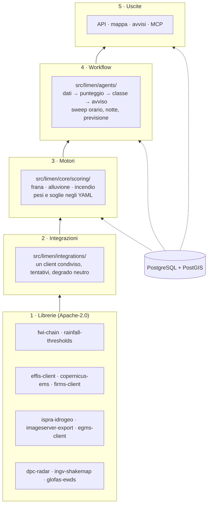

# 2. I mattoni: le librerie e perché ci sono

!!! abstract "In breve"
    - Una libreria è un pezzo di codice riusabile che fa una cosa sola. Limen
      ne usa due tipi: **undici librerie nate dentro Limen** e poi pubblicate
      a parte, e le **dipendenze di terze parti** (database, server web, mappe,
      machine learning).
    - Le undici librerie fanno il lavoro più ingrato: **parlare con le fonti
      dei dati**. Formati non documentati, servizi che rispondono «zero»
      invece di un errore, un'acciaieria che dal satellite sembra un incendio.
    - Sono separate da Limen perché servono anche ad altri (enti, ricercatori,
      altri progetti), con una licenza permissiva (Apache-2.0).
    - Limen ne usa solo le parti «pure»: le chiamate di rete, i tentativi
      ripetuti e il comportamento quando una fonte manca restano decisi da
      Limen, in un posto solo.
    - Ogni dipendenza di terze parti è lì per un motivo scritto; spesso il
      motivo è anche *perché non un'alternativa più nota*.

## Perché partire dalle librerie

Un sistema come Limen fa tre cose: **raccoglie** dati da decine di fonti,
li **trasforma** in un punteggio per cella e li **mostra** su una mappa.
Delle tre, la prima è la più fragile. Un servizio cambia formato, una quota si
esaurisce, un file da 1,2 GB si interrompe a metà. E un errore qui non si vede:
se la fonte della pioggia risponde vuoto, il motore calcola «zero pioggia» e la
mappa sembra tranquilla. Il capitolo 1 racconta che è successo davvero, il 29
settembre 2026.

Per questo il lavoro di «parlare con le fonti» è stato isolato in librerie
piccole, tipizzate (ogni dato ha un tipo dichiarato, controllato prima
dell'esecuzione) e provate contro i dati veri. Ognuna risolve un problema
preciso e lo risolve una volta sola, per Limen e per chiunque altro.

## Le librerie nate da Limen

Sono tutte pubblicate su **PyPI** (l'archivio pubblico dei pacchetti Python) e
su GitHub nell'organizzazione `agent-engineering-studio`, con licenza
**Apache-2.0**: chiunque può usarle, anche in prodotti commerciali, citando la
fonte. Limen fissa la versione di ognuna con `~=` (per esempio `~=0.7.0`): un
aggiornamento importante richiede una scelta esplicita, non arriva da solo.

### fwi-chain: l'indice meteo degli incendi

**Il problema.** Il *Fire Weather Index* canadese (FWI) è lo standard
internazionale per dire quanto il tempo favorisce un incendio. Non è un
numero del giorno: è una **catena**. L'umidità del sottobosco di oggi dipende
da quella di ieri, e ieri da l'altro ieri. Le formule sono pubblicate (Van
Wagner, 1987) ma piene di dettagli: tabelle per latitudine, il valore di
mezzogiorno, i casi limite.

**Cosa fa.** Calcola la catena FWI in modo puro: nessuna rete, nessun
database, solo numeri in ingresso e in uscita. È verificata contro il giorno
di riferimento pubblicato fino alla nona cifra decimale.

**Come la usa Limen.** Il motore incendio tiene una catena per ogni nodo della
griglia meteo (circa 9 km) e la aggiorna ogni giorno; `limen fwi-backfill` la
ricostruisce dall'archivio meteo. Le costanti di Van Wagner stanno nella
libreria perché sono uno standard pubblicato, non una scelta di Limen; quello
che un'installazione può decidere (per esempio la normalizzazione) sta nel
file `wildfire.yaml`.

### effis-client: i perimetri degli incendi europei

**Il problema.** Per sapere se il motore incendio funziona servono gli incendi
veri. Il sistema europeo EFFIS li disegna dal satellite e li pubblica, ma
attraverso un servizio (MapServer) con molte sorprese: un indirizzo sbagliato
non dà errore ma si blocca, un filtro viene ignorato in silenzio, due filtri
insieme chiudono la connessione.

**Cosa fa.** Chiede i perimetri delle aree bruciate e le mappe ufficiali
dell'FWI, nel modo che il servizio accetta davvero, e li restituisce come dati
ordinati.

**Come la usa Limen.** I perimetri sono la «verità» del backtest incendio
(`limen backtest-wildfire`) e della ricalibrazione del combustibile (capitolo
5); le mappe ufficiali servono a confrontare la catena FWI di Limen con quella
di Copernicus (`limen fwi-confronto`).

**Una lezione.** Per un anno il progetto ha creduto che EFFIS richiedesse un
accreditamento, e la tabella degli incendi è rimasta vuota. Il problema era
nel client di Limen, non nelle credenziali. Da qui una regola: un servizio che
risponde zero è un'ipotesi da verificare, non una conclusione.

### rainfall-thresholds: la pioggia che fa franare

**Il problema.** Una frana superficiale parte quando piove abbastanza forte per
abbastanza tempo. La relazione classica è la **soglia intensità-durata** di
Caine (1980): per ogni durata di pioggia, l'intensità oltre la quale le frane
cominciano. In Italia è stata ricalcolata sui cataloghi nazionali del CNR-IRPI.

**Cosa fa.** Riconosce gli eventi di pioggia in una serie oraria e calcola,
o adatta ai dati, le soglie intensità-durata.

**Come la usa Limen.** Nel termine «pioggia» del motore frane
(`src/limen/core/scoring/caine.py`). I parametri delle soglie per macroregione
stanno in `landslide.yaml`.

### ispra-idrogeo: frane e mappe di pericolosità

**Il problema.** ISPRA pubblica su IdroGEO quello che l'Italia sa di frane e
alluvioni: l'inventario IFFI (721.365 frane), i mosaici nazionali dei Piani di
Assetto Idrogeologico (PAI), gli eventi datati e un'API con gli indicatori di
rischio per Comune. Sono file grandi (fino a 1,2 GB) e codici da decifrare.

**Cosa fa.** Scarica i file, li tiene in cache e li riscarica solo se sono
cambiati; interroga l'API; traduce i 73 elenchi di codici in parole (per
esempio `strumentazione = [15, 22, 25]` diventa inclinometro, monitoraggio
topografico, interferometria radar). Ha anche un comando da terminale
(`idrogeo`) e un server MCP (vedi il riquadro più sotto) per gli assistenti AI.

**Come la usa Limen.** Per scaricare IFFI e i mosaici PAI di ogni regione
durante l'installazione (`limen geodati-sync`) e per i download dalla pagina
di installazione. Limen usa il client direttamente, perché i file vanno
scritti su disco mentre arrivano, ma con i tentativi ripetuti spenti
(`retries=0`) e affidati alla politica di Limen.

### copernicus-ems: dove è arrivata davvero l'acqua

**Il problema.** Per misurare il motore alluvione servono le aree allagate
vere. Il servizio Copernicus EMS *Rapid Mapping* le disegna da immagini
satellitari entro poche ore da un disastro. Ogni intervento ha un codice (per
esempio `EMSR664`, Emilia-Romagna, maggio 2023).

**Cosa fa.** Elenca le attivazioni, scarica gli **strati dell'evento** (dove
c'era l'acqua) e le **maschere di osservazione** (dove il satellite ha
guardato davvero).

**Come la usa Limen.** Costruisce la verità del backtest alluvione: 14
attivazioni italiane e 15.865 poligoni allagati in 9 regioni. La maschera
conta quanto i poligoni: dentro la maschera, «nessun poligono» vuol dire
*asciutto osservato*; fuori, un'allerta non è falsa ma **non verificabile**.
Senza questa distinzione il Piemonte risultava con il 100 % di falsi allarmi,
solo perché il satellite aveva guardato 0,3 km².

### egms-client: il terreno che si muove

**Il problema.** I satelliti radar Sentinel-1 misurano di quanti millimetri
all'anno si muove il suolo. Il servizio europeo EGMS pubblica questo archivio,
ma dietro un accesso con chiave di servizio e in formati diversi per livello di
prodotto.

**Cosa fa.** Gestisce l'accesso, la ricerca e lo scaricamento dei prodotti
EGMS, le mappe e le serie storiche.

**Come la usa Limen.** `limen sync-egms` scarica per l'Italia le tessere
verticali ed est-ovest a 100 m (circa 420 MB la prima volta) e calcola per
cella il 90° percentile della velocità. Oggi alimenta solo le variabili del
modello ML della frana, non la mappa.

### firms-client: gli incendi visti dallo spazio

**Il problema.** La NASA pubblica con FIRMS ogni fuoco attivo visto dai
satelliti dal 2000. Ma un punto caldo non è sempre un incendio: è anche
un'acciaieria, un vulcano, una torcia di raffineria.

**Cosa fa.** Scarica gli archivi annuali per Paese (senza chiave) e la
rilevazione quasi in tempo reale (con una chiave gratuita), e **distingue un
incendio di vegetazione da una sorgente fissa**.

**Come la usa Limen.** Due modi. Lo **storico**: 391.987 rilevazioni italiane
diventano la densità di incendi per cella, usata dal modello ML e per pesare un
versante già bruciato. Senza il filtro, il luogo «più bruciato» d'Italia era
l'acciaieria di Taranto. Il **tempo reale**: ogni 45 minuti, nuovi punti caldi
in una regione fanno ricalcolare subito quella regione, e il termine «frana
dopo l'incendio» si accende in ore invece che attendere il perimetro ufficiale.

### imageserver-export: le mappe europee del suolo

**Il problema.** L'Agenzia Europea dell'Ambiente pubblica, su un server
aperto, le mappe Copernicus del territorio a 10 m: suolo impermeabilizzato,
copertura arborea, prati, acqua e zone umide. Ma il server restituisce
tessere, e incollarle bene è facile da sbagliare.

**Cosa fa.** Trasforma un'area qualunque in un unico file raster allineato al
pixel, senza mai mescolare i valori «nessun dato» con quelli veri, e scrive il
file solo quando tutte le tessere sono arrivate. Uno scaricamento interrotto
riparte dalle tessere già prese.

**Come la usa Limen.** Per il raster del **suolo impermeabilizzato**, da cui
viene il fattore per cella che amplifica l'alluvione da pioggia nelle città.
È anche la libreria usata nelle misure del capitolo 5 sugli strati HRL di
prati, alberi e acqua.

### ingv-shakemap: quanto ha tremato il suolo

**Il problema.** Dopo un terremoto forte i versanti sono più fragili. INGV
pubblica per ogni evento la **ShakeMap**, la mappa di quanto ha accelerato il
suolo punto per punto, in un formato XML a griglia.

**Cosa fa.** Elenca i terremoti (servizio FDSN) e legge le griglie ShakeMap,
restituendo per ogni punto l'accelerazione di picco.

**Come la usa Limen.** Per il termine sismico del motore frane e per i
backtest che studiano il periodo dopo il terremoto del Centro Italia del 2016
(issue #441).

### dpc-radar: il radar della Protezione civile

**Il problema.** Il radar meteo nazionale della Protezione civile vede la
pioggia ogni pochi minuti, a un chilometro. È il dato che dice cosa sta
cadendo *adesso*, mentre le previsioni dicono cosa cadrà.

**Cosa fa.** Legge i prodotti aperti del radar: l'intensità istantanea (SRI),
la cumulata «Merging» (radar corretto con i pluviometri), l'archivio storico e
i bollettini di allerta.

**Come la usa Limen.** Per la pioggia già caduta nel motore alluvione (il caso
di Melito, capitolo 1), per ricalcolare subito una regione sotto un temporale,
e per confrontare Limen con i bollettini ufficiali. Ha anche un controllo che
riconosce un fotogramma corrotto: l'11 ottobre 2026 un errore del prodotto
mostrava 7.348 mm in 24 ore.

### glofas-ewds: la portata dei fiumi

**Il problema.** GloFAS è il sistema europeo che prevede la portata dei fiumi
in tutto il mondo. I suoi dati stanno sull'Early Warning Data Store (EWDS) di
Copernicus, in file NetCDF, e chi li serve in forma più comoda (Open-Meteo)
li etichetta con la coordinata **un passo più a est** di quella vera.
Sbagliare cella, su un fiume come il Toce, vale un fattore dieci.

**Cosa fa.** Scarica la previsione e lo storico di GloFAS e l'FWI di
Copernicus dall'EWDS, e legge il valore sulla cella giusta.

**Come la usa Limen.** Per il ramo fluviale del motore alluvione: la portata
prevista di ogni nodo divisa per la sua **piena ordinaria** (il 90° percentile
della sua storia), così un fosso e il Po diventano confrontabili.

!!! info "Gli assistenti AI e il protocollo MCP"
    Due librerie (`ispra-idrogeo` e `imageserver-export`) includono un server
    **MCP** (*Model Context Protocol*), lo standard con cui un assistente AI
    usa strumenti esterni. Con `idrogeo-mcp` si può chiedere a un assistente
    «quante persone vivono in aree a pericolosità di frana elevata a Sarno?»:
    il numero viene dalla libreria, non dal modello. È la stessa regola dei
    riassunti di Limen.

!!! note "Per chi sviluppa"
    - Pin e gruppi opzionali: [`pyproject.toml`](https://github.com/agent-engineering-studio/limen/blob/main/pyproject.toml).
    - Dove sono usate:
        - `fwi-chain`: `cli/fwi_backfill.py`, `cli/backtest_wildfire.py`, `ml/fire_features.py`;
        - `effis-client`: `integrations/effis/`;
        - `rainfall-thresholds`: `core/scoring/caine.py`;
        - `ispra-idrogeo`: `integrations/idrogeo/`, `integrations/geoserver_source/dati_base.py`, `api/jobs/dati_download.py`;
        - `copernicus-ems`: `integrations/copernicus_ems/`, `cli/backtest_flood.py`;
        - `egms-client`: `integrations/egms/`;
        - `firms-client`: `integrations/firms/`;
        - `imageserver-export`: `integrations/imperviousness/fetch.py`;
        - `ingv-shakemap`: `integrations/ingv/`;
        - `dpc-radar`: `integrations/dpc/`;
        - `glofas-ewds`: `integrations/copernicus/`.
    - La regola d'uso, in `CLAUDE.md` alla riga *External HTTP*: ogni chiamata
      esce da `limen.integrations._http` (un client condiviso, 4 tentativi con
      attesa crescente fino a 60 s, ripetizione solo sugli errori di rete e sui
      codici 5xx e 429). Una libreria riceve il client di Limen attraverso un
      aggancio (`send=`) oppure lavora con `retries=0`. Il **degrado neutro**
      (una lettura che fallisce restituisce un risultato vuoto e scrive
      `integration.degraded`, senza fermare il sistema) e tutte le costanti di
      calibrazione restano in Limen.

### Perché librerie separate

Tre ragioni, in ordine di importanza.

1. **Servono ad altri.** Un ricercatore che studia le soglie di pioggia, una
   Regione che vuole i perimetri EFFIS, un'università che lavora sul radar: non
   devono installare Limen per avere il pezzo che serve a loro. Ogni libreria
   ha una sola dipendenza o quasi, e una licenza che permette tutto.
2. **Si provano meglio.** Una libreria piccola si verifica contro i dati veri
   (`fwi-chain` contro il giorno di riferimento pubblicato, `ingv-shakemap`
   bit per bit contro il codice di Limen su tre griglie reali) e quella prova
   vale per tutti quelli che la usano.
3. **Limen resta leggibile.** Il codice di Limen si occupa di rischio, non di
   come si interroga un MapServer.

C'è anche una regola su cosa **non** estrarre. Restano in Limen il codice che
cambia ancora spesso, e quello che ha senso solo dentro Limen: per esempio il
client di Open-Meteo e il caricamento dei dati statici nelle celle.

## Le dipendenze di terze parti

Sotto le librerie di Limen ci sono progetti open source molto più grandi.
Eccoli raggruppati per ruolo, con quello che fanno qui e, quando c'è, il
motivo della scelta.

### Il database: dove vive ogni numero

| Componente | A cosa serve in Limen | Perché questo |
|---|---|---|
| **PostgreSQL 16** | il database: celle, punteggi, eventi, storico | maturo, libero, gira in un container |
| **PostGIS** | geometrie e calcoli spaziali dentro il database (intersezioni, distanze, aree) | standard di fatto per i dati geografici in SQL |
| **pg_tileserv** | serve le tessere vettoriali della mappa direttamente dal database | la mappa legge la stessa tabella dei punteggi, senza copie |
| **asyncpg** | il collegamento fra Python e PostgreSQL | veloce e asincrono. **Niente ORM** (un livello che traduce oggetti in tabelle): le query sono SQL scritto a mano, leggibile e controllabile |
| **pgvector**, **pg_cron** | estensioni opzionali | `pg_cron` può programmare i lavori nel database, ma lo stesso lavoro deve funzionare anche senza (vedi APScheduler) |

Le **migrazioni** (i cambiamenti allo schema del database) sono file SQL
numerati, applicati una volta e mai più modificati: ognuno ha un'impronta
SHA-256, e cambiarne anche un commento rompe il controllo.

### Il calcolo: dal raster al numero

| Componente | A cosa serve in Limen |
|---|---|
| **rasterio** (sopra **GDAL**) | legge i raster: il modello del terreno a 5 m, CORINE, il suolo impermeabilizzato |
| **shapely**, **geopandas** | geometrie in Python e tabelle di geometrie |
| **numpy**, **pandas** | calcolo numerico e tabelle, soprattutto nei backtest e nel ML |
| **pydantic**, **pydantic-settings** | definiscono la forma di ogni dato e di ogni file di configurazione, e la controllano: uno YAML con un peso fuori posto non parte |
| **PyYAML** | legge i file `config/hazards/*.yaml` dove stanno tutti i pesi e le soglie |

Una regola che attraversa tutto: le geometrie si salvano in coordinate
geografiche (EPSG:4326), ma distanze e aree si calcolano nella proiezione
europea a uguale area (EPSG:3035), dove un metro è un metro ovunque.

### Il servizio: API, lavori pianificati, osservabilità

| Componente | A cosa serve in Limen | Perché questo |
|---|---|---|
| **FastAPI**, **uvicorn** | l'API pubblica che la mappa interroga | tipizzata, documentazione automatica in `/docs` |
| **httpx**, **tenacity** | le chiamate verso le fonti esterne e la politica dei tentativi | un solo client condiviso e una sola politica per tutte le fonti |
| **APScheduler** | i lavori pianificati: lo sweep orario, la notte, i download | funziona anche dove `pg_cron` non c'è. Gira nel processo `worker`, separato dall'API, perché un solo processo non può servire una mappa pubblica e ricalcolare 312.000 celle insieme |
| **structlog** | i log strutturati (ogni riga è un dato leggibile da una macchina) | un solo modo di scrivere log in tutto il codice |
| **OpenTelemetry** | tracce e metriche delle richieste e delle query | standard aperto, nessun fornitore obbligato |
| **aiomqtt**, **aiosmtplib** | gli avvisi via MQTT e via email | ogni canale è indipendente: se uno fallisce, gli altri partono comunque |
| **cryptography** | la firma della chiave di servizio di Copernicus (EGMS) | |
| **pmtiles** | le mappe statiche (rilievo, strati) in un unico file servito senza server di tessere | |

### Il machine learning (gruppo opzionale)

Il gruppo `ml` si installa solo dove gira il modello sfidante.

| Componente | A cosa serve |
|---|---|
| **LightGBM** | il modello: alberi di decisione «a gradiente», veloci e adatti a dati in tabella |
| **scikit-learn** | metriche e strumenti di validazione |
| **Optuna** | la ricerca automatica degli iperparametri (le manopole del modello) |
| **SHAP** | spiega quanto ogni variabile ha pesato in una previsione, in modo che il modello mostri il suo «perché» come il motore deterministico |
| **MLflow** | registro dei modelli e delle prove; la promozione di un modello resta un comando manuale |
| **ONNX Runtime** | esegue il modello addestrato in modo portabile |
| **PyTorch**, **ONNX** (gruppo `dl`) | i modelli di deep learning in prova |

Il capitolo 6 spiega come questi pezzi lavorano insieme, e perché la
validazione è **spaziale** (le celle vicine si somigliano, e mescolarle fra
addestramento e prova darebbe un risultato troppo bello per essere vero).

### L'intelligenza artificiale che scrive

| Componente | A cosa serve | Perché questo |
|---|---|---|
| **LiteLLM** | un unico punto d'ingresso per ogni modello linguistico: sceglie il modello, applica il tetto di spesa, passa al modello locale se quello in cloud non risponde | tutta la logica di instradamento in un posto |
| **llama.cpp** e **llama-swap** | eseguono un modello linguistico **sul server di Limen**, senza servizi esterni | il modello predefinito è locale; un modello in cloud (per esempio Claude) si usa solo se configurato |
| **SDK Anthropic** | i lotti di revisione dei testi (un secondo modello controlla che il riassunto sia fedele ai numeri) | |

Il tetto di spesa mensile per i modelli in cloud è 10 dollari, controllato a
ogni chiamata: se il conto non si può leggere, la chiamata non parte.

### La mappa

| Componente | A cosa serve | Perché questo |
|---|---|---|
| **React** | l'interfaccia della mappa | |
| **Vite** | costruisce l'applicazione in file statici | la mappa è pubblica e in sola lettura: **non serve un server Node** come con Next.js |
| **Mantine** | i componenti grafici (pannelli, menu, moduli) | |
| **MapLibre GL** | disegna la mappa nel browser | libero, senza chiavi d'accesso |
| **PMTiles** | legge le mappe statiche da un unico file | |

La scala di colori è verificata da un test: ogni coppia di classi deve restare
distinguibile anche sopra la mappa scura e per chi ha una delle tre forme più
comuni di daltonismo.

### Il contorno: container, meteo, geodati

| Componente | A cosa serve |
|---|---|
| **Docker** e **Docker Compose** | ogni pezzo gira nel suo container; un solo server basta |
| **Open-Meteo** (istanza propria) | previsioni e archivio meteo serviti in casa, senza il tetto del servizio pubblico |
| **MinIO** | archivio di oggetti compatibile S3 per backup e file grandi, sul server stesso |
| **Caddy** | il proxy davanti alla mappa, con i certificati HTTPS |
| **GeoServer**, `mcp-geo-server` (opzionali) | pubblicano gli strati ISPRA come mappe WMS; i punteggi non dipendono da loro |
| **Grafana LGTM** (opzionale) | cruscotti per log, metriche e tracce |

## Come si incastrano i pezzi

Lo schema riassume i livelli, dal basso verso l'alto. Ogni livello usa solo
quello sotto.

Il prossimo capitolo sale di un livello: quali dati arrivano attraverso queste
librerie, cosa misurano e con quale licenza si possono usare.

## Per approfondire

- Le librerie su GitHub: <https://github.com/agent-engineering-studio>
  (`fwi-chain`, `effis-client`, `rainfall-thresholds`, `ispra-idrogeo`,
  `copernicus-ems`, `egms-client`, `firms-client`, `imageserver-export`,
  `ingv-shakemap`, `dpc-radar`, `glofas-ewds`) e su PyPI con lo stesso nome.
- La sezione *The companion libraries* del
  [README](https://github.com/agent-engineering-studio/limen/blob/main/README.md),
  con una scheda più tecnica per ciascuna.
- Van Wagner, C. E. (1987). *Development and structure of the Canadian Forest
  Fire Weather Index System*. Canadian Forestry Service, Forestry Technical
  Report 35, Ottawa.
- Caine, N. (1980). The rainfall intensity–duration control of shallow
  landslides and debris flows. *Geografiska Annaler: Series A, Physical
  Geography* 62(1-2), 23-27. <https://doi.org/10.1080/04353676.1980.11879996>
- Guzzetti, F., Peruccacci, S., Rossi, M., Stark, C. P. (2008). The rainfall
  intensity–duration control of shallow landslides and debris flows: an
  update. *Landslides* 5, 3-17. <https://doi.org/10.1007/s10346-007-0112-1>
- Brunetti, M. T. et al. (2010). Rainfall thresholds for the possible
  occurrence of landslides in Italy. *Natural Hazards and Earth System
  Sciences* 10, 447-458. <https://doi.org/10.5194/nhess-10-447-2010>
- Peruccacci, S. et al. (2017). Rainfall thresholds for possible landslide
  occurrence in Italy. *Geomorphology* 290, 39-57.
  <https://doi.org/10.1016/j.geomorph.2017.03.031>
- Brunetti, M. T. et al. (2024). *e-ITALICA (enhanced ITAlian
  rainfall-induced LandslIdes CAtalogue)*. Zenodo.
  <https://doi.org/10.5281/zenodo.14204473>
- Fonti dei dati citate: EFFIS <https://forest-fire.emergency.copernicus.eu>,
  NASA FIRMS <https://firms.modaps.eosdis.nasa.gov>, EGMS
  <https://egms.land.copernicus.eu>, ShakeMap INGV <https://shakemap.ingv.it>,
  radar DPC <https://radar.protezionecivile.it>, GloFAS
  <https://www.globalfloods.eu>, CORINE Land Cover
  <https://land.copernicus.eu/en/products/corine-land-cover>, Open-Meteo
  <https://open-meteo.com>.
- Model Context Protocol: <https://modelcontextprotocol.io>.
