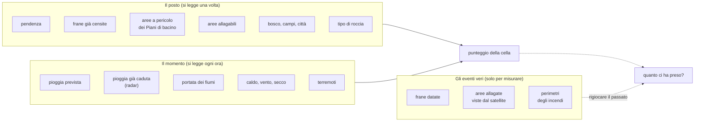
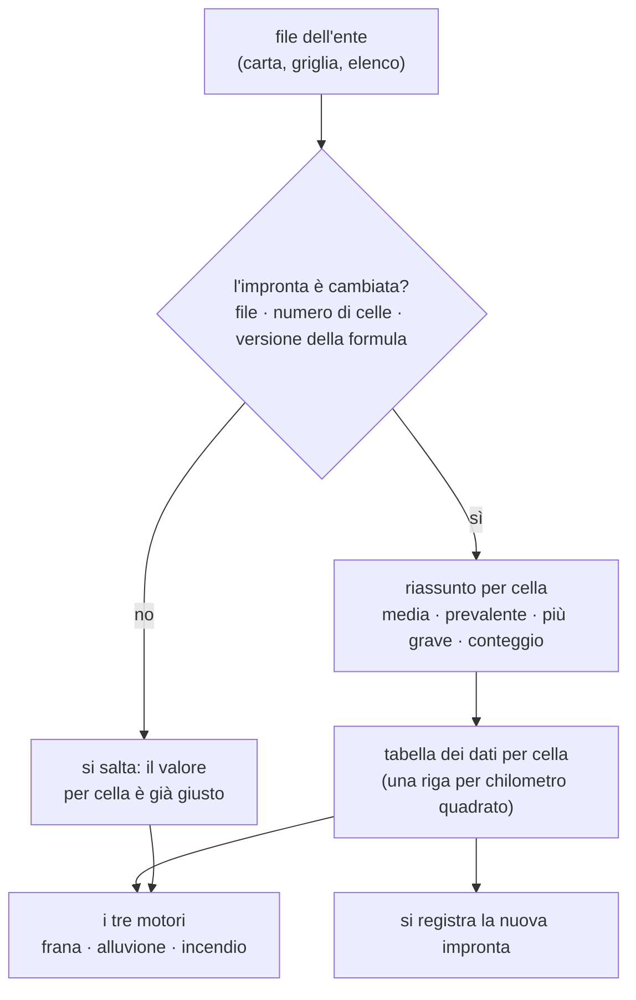
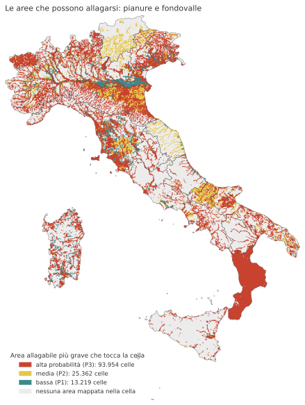
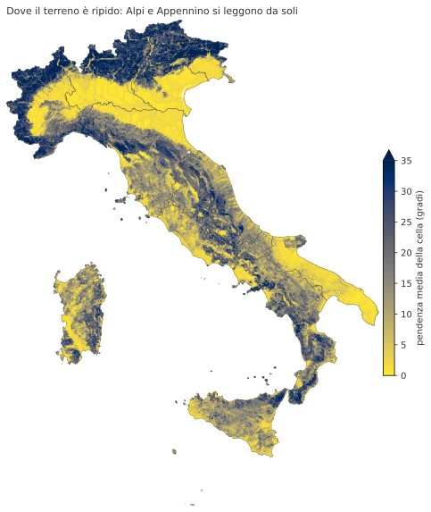
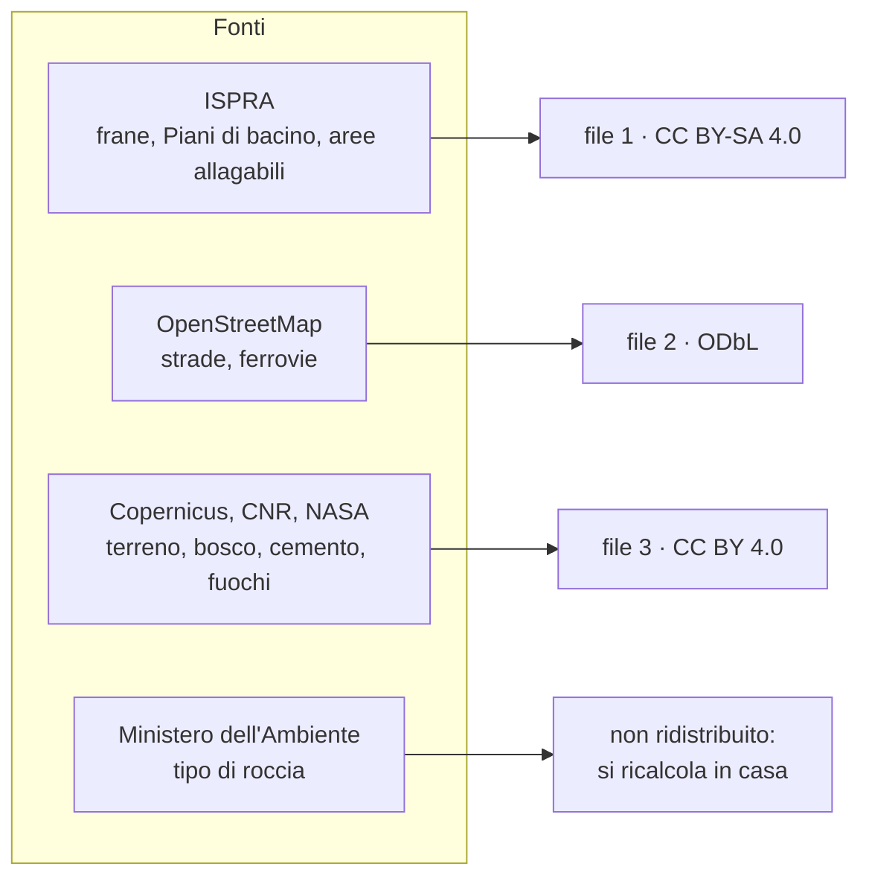
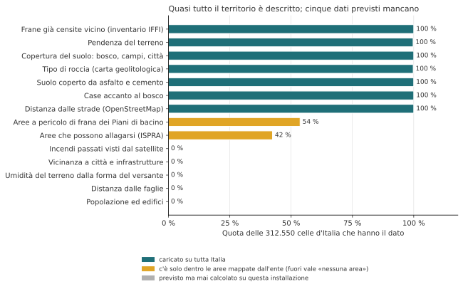

# 3. I dati: cosa misurano, da dove vengono, con quale licenza

!!! abstract "In breve"
    - Limen non produce dati propri: mette insieme **dati pubblici** di enti
      italiani ed europei (ISPRA, Protezione civile, CNR, INGV, ISTAT,
      Copernicus, NASA, OpenStreetMap) e li riassume per ogni cella da un
      chilometro.
    - I dati sono di due tipi: quelli che descrivono **il posto** (pendenze,
      frane già avvenute, aree allagabili, boschi), che cambiano in decenni, e
      quelli che descrivono **il momento** (pioggia, fiumi, caldo, vento,
      terremoti), che cambiano in ore. Un terzo gruppo, gli **eventi veri**,
      serve solo a misurare se Limen ci ha preso.
    - Ogni dato ha una licenza, e alcune non si possono mescolare: per questo
      i dati già calcolati di Limen escono in tre file separati.
    - Oggi, su tutta Italia, quasi ogni cella ha i suoi dati del territorio.
      Mancano cinque dati previsti, e uno di quelli caricati (le aree
      allagabili in Calabria) va letto con cautela.
    - Quando un dato manca, Limen non scrive «zero»: scrive **«non
      misurato»**. È la lezione più cara pagata dal progetto.

## Due metà: il posto e il momento

Il [capitolo 1](01-il-problema.md) ha detto che ogni rischio ha due metà. Questo capitolo
racconta da dove vengono i dati che le riempiono.

Pensiamo a un versante sopra un paese dell'Appennino lucano. Per dire se oggi
è in pericolo di frana servono due tipi di informazione.

- **Il posto.** Quanto è ripido? Di che roccia è fatto? Ci sono già state
  frane? Il Piano di bacino lo considera pericoloso? Queste cose cambiano
  lentamente: un versante di argilla resta di argilla per secoli. Si leggono
  **una volta** e si aggiornano quando l'ente che le produce pubblica una
  nuova versione.
- **Il momento.** Quanto ha piovuto negli ultimi giorni? Quanto pioverà
  domani? Il terreno è già zuppo? C'è stato un terremoto? Queste cose cambiano
  di ora in ora, e Limen le rilegge **ogni ora**.

Poi c'è un terzo gruppo di dati che non entra mai nel calcolo di oggi: **gli
eventi veri** del passato (frane datate, aree allagate fotografate dal
satellite, perimetri degli incendi). Servono a una cosa sola, ma essenziale:
rigiocare il passato e misurare quante volte Limen avrebbe dato l'allarme al
posto giusto. Il [capitolo 5](05-misurare.md) racconta come.

## Una parola sulla cella

Limen divide l'Italia in **312.550 quadrati** da un chilometro di lato. Ma i
dati arrivano nelle forme più diverse: la pendenza è una griglia fittissima di
punti ogni cinque metri; un'area allagabile è un poligono disegnato su una
carta; una frana censita è un punto o un contorno; la pioggia prevista è una
griglia con maglie da sette a venticinque chilometri.

Per usarli insieme, ogni dato va **riassunto per cella**: per la pendenza si
fa la media dei quarantamila punti che cadono nel quadrato; per il bosco si
prende la copertura che occupa più spazio; per le aree allagabili si guarda
qual è la più grave che tocca il quadrato; per le frane si contano quelle
entro 500 metri. È un passaggio che sembra tecnico e invece decide molto, come
vedremo nel caso della Calabria.

Il riassunto per cella dei dati del posto è il lavoro più lungo
dell'installazione: la prima volta si scaricano circa **25 GB** (22 solo per
il modello del terreno) e il calcolo su tutta Italia ha richiesto **circa
sette ore** la sera del 3 novembre 2026[^pacchetto]. Per non rifarlo ogni volta,
Limen tiene per ogni regione e per ogni dato un'**impronta**: una specie di
timbro con la data e la dimensione del file d'origine, il numero di celle
della regione e la versione della formula usata. Se all'avvio successivo il
timbro è lo stesso, il passo si salta. Se cambia il file, se si aggiunge una
regione o se cambia il modo di calcolare, si rifà solo quello che serve:
aggiungere una regione calcola quella, non le altre diciannove[^407].

??? note "Per chi sviluppa"
    - Il riassunto per cella dei dati statici è
      `src/limen/integrations/static_bootstrap/orchestrator.py`
      (`bootstrap_static_for_aoi`); le impronte sono in
      `static_bootstrap/fingerprint.py`, con `STEP_VERSION` da incrementare
      quando cambia la *formula* e non il dato (è successo per la litologia,
      versione 2). La chiave è `(aoi_id, passo)` dentro `dataset_versions`.
    - I valori finiscono in `cell_static_factors`, una riga per cella.
      Le regole di riassunto: `slope_deg` media del DTM; `landuse_code`
      classe CORINE prevalente; `pai_class_norm` e `flood_hazard_norm` il
      **massimo** dei poligoni che intersecano la cella (`ST_Intersects`
      sulle tabelle `*_subdiv`, suddivise a 256 vertici); `iffi_density_500`
      il conteggio entro 500 m.
    - Unica strada per caricare i dati statici: `scripts/load_static_data.sh`
      (usato da `make up`, `make init`, `make static-data` e dal worker dopo
      i download della pagina `#/installazione`). Non aggiungerne un'altra.
    - `uv run limen data-status` dice quante celle hanno ogni dato; con
      `--force` o `LIMEN_BOOTSTRAP_FORCE=1` il bootstrap ricalcola anche a
      impronta invariata.

## Il posto: i dati del territorio

La tabella riassume i dati del posto. Le schede che seguono raccontano a cosa
serve ciascuno e cosa succede se manca.

| Dato | Chi lo produce | Dettaglio | Licenza | Serve a |
|---|---|---|---|---|
| Frane già censite (inventario IFFI) | ISPRA con Regioni e Province autonome | 721.365 frane | CC BY-SA 4.0 | frana |
| Aree a pericolo di frana dei Piani di bacino | ISPRA (mosaico nazionale 2020-21) | poligoni in 4-5 classi | CC BY-SA 4.0 | frana |
| Aree allagabili | ISPRA (mosaico nazionale 2020) | alta, media, bassa probabilità | CC BY-SA 4.0 | alluvione |
| Pendenza del terreno | CNR-IRPI, modello del terreno a 5 m | un punto ogni 5 m | CC BY 4.0 | frana, incendio |
| Bosco, campi, città (CORINE 2018) | Copernicus, distribuito da ISPRA | pixel da 100 m | dati Copernicus, liberi con citazione | incendio |
| Suolo coperto da asfalto e cemento | Copernicus (2018) | pixel da 10-20 m | dati Copernicus, liberi con citazione | alluvione |
| Tipo di roccia | Ministero dell'Ambiente (carta 1:500.000) | poligoni | CC BY 4.0, con una clausola ambigua | frana |
| Strade e ferrovie | OpenStreetMap | linee | ODbL | importanza dell'avviso |
| Confini dei comuni | ISTAT (2023) | poligoni | CC BY 4.0 | classifica dei comuni, avvisi |

*Fonte: catalogo dei dati di Limen e tabella delle licenze verificate fonte per
fonte nella issue #406 (novembre 2026).*

### Le frane già avvenute

**Cosa misura.** Dove la terra è già franata. L'Inventario dei Fenomeni
Franosi in Italia (in sigla IFFI) è il censimento nazionale curato da ISPRA,
l'istituto nazionale per l'ambiente, con le Regioni: 721.365 frane, ognuna con
posizione, forma e tipo.

**Perché conta.** Un versante che è già franato tende a franare di nuovo: è
uno degli indizi più forti che si conoscano. Per ogni cella Limen conta le
frane censite entro 500 metri e misura la distanza dalla più vicina. Oggi il
**56 % delle celle** italiane ha almeno una frana censita entro mezzo
chilometro.

**Se manca.** Il motore frane non sa quali versanti hanno una storia, e il
punteggio perde il suo ingrediente più pesante fra quelli lenti.

**Licenza.** CC BY-SA 4.0, una licenza Creative Commons che permette di usare
e ridistribuire il dato citando la fonte, a patto che anche ciò che se ne
ricava esca con la stessa licenza (*share-alike*, «condividi allo stesso
modo»). Ogni Regione ha il suo documento di licenza: sono stati letti tutti e
ventuno[^iffi-licenze]. La citazione chiesta è «ISPRA – Regione …, Inventario
dei Fenomeni Franosi in Italia (IFFI), idrogeo.isprambiente.it».

### Le aree a pericolo dei Piani di bacino

**Cosa misurano.** Le Autorità di bacino distrettuale disegnano nei loro Piani
(i Piani di Assetto Idrogeologico, PAI) le aree a pericolo di frana e quelle
allagabili. ISPRA le riunisce in due mosaici nazionali: frane (versione 4.0,
2020-21) e alluvioni (versione 5.0, 2020). Le aree allagabili sono divise per
probabilità: **alta** (un'alluvione ogni 20-50 anni circa), **media** (ogni
100-200 anni) e **bassa** (eventi rari ed estremi).

**Perché contano.** Sono la valutazione ufficiale del territorio. Per
l'alluvione sono la base di tutto: il motore moltiplica la pioggia e il fiume
per quanto la cella è allagabile, perché l'acqua scende e un crinale non si
allaga qualunque cosa piova.

**Quante celle.** Il 54 % delle celle tocca almeno un'area a pericolo di
frana, il 42 % almeno un'area allagabile. Il resto non è «senza dato»: è
fuori dalle aree studiate.

**Se mancano.** Per l'alluvione ogni cella prende lo stesso valore di riserva,
basso ma non nullo (perché «non studiato» non vuol dire «non allagabile»), e
la mappa diventa uniforme: leggibile, e inutile.

**Licenza.** CC BY-SA 4.0. I mosaici sono opere tecnico-scientifiche: hanno
valore legale solo le carte delle Autorità di bacino.

*Fonte: mosaico ISPRA della pericolosità idraulica (v. 5.0, 2020), riassunto
sulle celle di Limen; misura dal database dell'installazione locale,
8 novembre 2026. Ogni cella ha il colore dell'area più grave che la tocca.*

!!! warning "La Calabria tutta rossa"
    Nella mappa la Calabria è quasi interamente in alta probabilità di
    alluvione: **15.310 celle su 15.601**, il 98 %. Le aree ad alta
    probabilità del mosaico che toccano la regione coprono in tutto circa
    2.650 km², meno di un quinto della sua superficie. La differenza viene
    dal modo di riassumere: in Calabria le aree allagabili sono strisce
    sottili lungo quasi ogni corso d'acqua, e un quadrato da un chilometro ne
    tocca quasi sempre una. Con la regola «vale l'area più grave che tocca la
    cella», basta un filo rosso per colorare il chilometro intero. Lo stesso
    accade, in misura minore, in Valle d'Aosta (75 % delle celle). È un
    effetto del metodo, non del dato, e va corretto: lo spieghiamo fra i gap
    in fondo al capitolo.

### La pendenza

**Cosa misura.** Quanto è inclinato il terreno. Viene da un modello digitale
del terreno: una griglia di quote, una ogni cinque metri, pubblicata dall'
Istituto di Ricerca per la Protezione Idrogeologica del CNR (Panza e colleghi,
versione 1.2).

**Perché conta.** Per la frana, un versante ripido cede più facilmente di
una pianura. Per l'incendio, il fuoco corre più in fretta in salita. Per
l'alluvione, una cella piatta e costruita è più esposta di una in pendio.

**Se manca.** La frana non distingue un versante da una pianura; l'incendio
diventa solo meteo.

**Licenza.** CC BY 4.0: si usa e si ridistribuisce citando autori, titolo e
identificativo della versione. Il 6 novembre 2026 è uscita la versione 1.3,
che Limen non usa ancora.

*Fonte: modello del terreno CNR-IRPI a 5 m (v1.2), media per cella; misura dal
database dell'installazione locale, 8 novembre 2026.*

### Bosco, campi, città

**Cosa misura.** Cosa copre il terreno: bosco di latifoglie o di conifere,
macchia, prato, vigneto, città, roccia nuda. È la carta europea CORINE Land
Cover 2018, prodotta dal programma Copernicus e distribuita in Italia da
ISPRA, con pixel da 100 metri. Su tutta Italia il 52 % delle celle è
prevalentemente agricolo, il 41 % bosco o vegetazione naturale, il 4 %
costruito.

**Perché conta.** Per l'incendio dice quanto «combustibile» c'è: una pineta
brucia diversamente da un campo di grano. Da qui Limen ricava anche le **case
accanto al bosco** (l'interfaccia fra città e vegetazione, dove un incendio
diventa un pericolo per le persone) e la presenza di centri abitati e
infrastrutture vicino a una cella, che rende un avviso più urgente.

**Se manca.** Il punteggio dell'incendio vale quanto il solo indice meteo.

**Licenza.** Dati Copernicus, accesso libero e gratuito per regolamento
europeo, con la frase «Generated using European Union's Copernicus Land
Monitoring Service information».

### Il suolo impermeabilizzato

**Cosa misura.** Quanta parte del suolo è coperta da asfalto, cemento e tetti
(Copernicus, 2018).

**Perché conta.** Dove il suolo è sigillato la pioggia non si infiltra e
scorre: è il meccanismo degli allagamenti improvvisi in città. Per questo
pesa solo sull'allagamento da pioggia intensa, non sulla piena dei fiumi.

**Licenza.** Dati Copernicus, liberi con la stessa citazione.

### Il tipo di roccia

**Cosa misura.** La Carta geolitologica d'Italia in scala 1:500.000, del
Ministero dell'Ambiente: argille, calcari, flysch (alternanze di strati
diversi), sabbie, lave.

**Perché conta.** Argille e flysch franano molto più dei calcari compatti.
Ogni tipo di roccia diventa un peso fra 0 e 1.

**Due limiti.** Il primo è la scala: a 1:500.000 un poligono è largo
chilometri, e due versanti vicini di roccia diversa finiscono nello stesso
colore. Il secondo è il peso: la tabella che traduce la roccia in numero sta
in `landslide.yaml` e ha tutte le 23 classi della carta, ma **15 classi (il
30 % delle celle)** pesano 0,5, il valore neutro. Non è più una svista: è una
scelta misurata. Contando dove cadono le frane IFFI, i complessi caotici
franano 2,6 volte la media e le lave un terzo; eppure, provando questi pesi,
la suscettibilità statica non distingue meglio le celle delle frane datate
(0,725 contro 0,729), perché le frane IFFI sono già nel punteggio. Con un
peso di 0,10 su S, la roccia conta poco, e i numeri non si cambiano per
avere una tabella più bella.

**Licenza.** La pagina del servizio dice CC BY 4.0, ma le note legali del
Geoportale parlano anche di uso «ai soli fini istituzionali». Nel dubbio,
Limen la usa ma non la ridistribuisce: chi installa Limen la ricalcola da
sé[^pacchetto].

### Strade, ferrovie, confini

Le **strade e le ferrovie** vengono da OpenStreetMap, la mappa del mondo
costruita da volontari. Non cambiano il pericolo, ma l'importanza di un avviso:
una frana vicino a una statale interrompe di più di una frana su un pascolo.
La licenza è la ODbL (*Open Database License*), che chiede di citare
«© OpenStreetMap contributors».

I **confini dei comuni** vengono da ISTAT (2023, licenza CC BY 4.0). Non
toccano i punteggi: servono a dire *dove*. Nessuno sa a memoria in che cella
abita, ma tutti sanno in che comune.

??? note "Per chi sviluppa"
    - Il catalogo di questi dati, con licenza, attribuzione, peso del
      download e cosa succede se manca, è `src/limen/config/dati.yaml`
      (#401). `limen data-status`, la pagina `#/installazione` e i download
      del worker lo leggono: aggiungere un dato è una voce lì.
    - Le integrazioni: `src/limen/integrations/idrogeo/` (IFFI, PAI, mosaico
      idraulico; i vettori ISPRA si caricano nello schema `sorgenti` con
      `limen carica-vettori`, #426), `dem/` (pendenza, esposizione,
      curvatura; tile del rilievo con `limen dem-tiles`), `corine/`,
      `imperviousness/`, `geological/` (pesi in `landslide.yaml`, `static.lithology`),
      `osm/`.
    - Colonne: `iffi_density_500`, `distance_to_iffi_m`, `pai_class_norm`,
      `flood_hazard_norm`/`flood_hazard_class`, `slope_deg`, `aspect_deg`,
      `curvature`, `elevation_m`, `landuse_code`, `wui_proximity_norm`,
      `imperviousness_norm`, `lithology`/`litho_weight`,
      `distance_to_road_m`/`distance_to_rail_m`/`nearest_road_class`.

## Il momento: i dati che cambiano ogni ora

| Dato | Chi lo produce | Dettaglio | Ogni quanto lo legge Limen | Licenza | Serve a |
|---|---|---|---|---|---|
| Pioggia, umidità del suolo, caldo, vento previsti | modelli europei ECMWF e DWD, serviti da Open-Meteo | maglie da circa 7 a 25 km | ogni ora | CC BY 4.0 | tutti e tre |
| Il tempo del passato | Copernicus (rianalisi ERA5, ERA5-Land, CERRA) | maglie da 5,5 a 25 km circa | ogni ora (ultimi 30 giorni) e per i backtest | licenza Copernicus | tutti e tre |
| Pioggia vista dal radar | Protezione civile | 1 km, ogni 5 minuti | ogni 15 minuti | CC BY-SA 4.0 | alluvione, incendio, sveglia della frana |
| Portata dei fiumi | Copernicus, sistema GloFAS | nodi ogni 0,1 gradi (circa 10 km) | una corsa al giorno | licenza CEMS-Floods | alluvione |
| Indice meteo degli incendi (FWI) | calcolato da Limen sul meteo | nodi ogni 0,25 gradi | ogni giorno, a mezzogiorno solare | come il meteo | incendio |
| Fuochi attivi dal satellite | NASA FIRMS | 375 m e 1 km | di continuo (serve una chiave gratuita) | uso libero con citazione | incendio, frana dopo un incendio |
| Terremoti e scuotimento | INGV | eventi da magnitudo 3,5, ultimi 7 giorni | ogni ora | CC BY 4.0 | frana |
| Movimento del suolo | Copernicus EGMS (radar da satellite) | 100 m | aggiornamento annuale | dati Copernicus | modello in ombra della frana |
| Sensori sul territorio | enti e cittadini | un punto | ogni pochi minuti | CC BY 4.0 per i sensori dei cittadini | frana (solo i sensori istituzionali) |

*Fonte: README del progetto, pagina «Fonti» della mappa, issue #406.*

### La pioggia prevista e il meteo

**Cosa misura.** Pioggia ora per ora, umidità del suolo a due profondità,
neve, temperatura, umidità dell'aria, vento: oggi e per i prossimi giorni.
Vengono dai modelli meteo pubblici europei, il Centro europeo per le
previsioni a medio termine (ECMWF, modello IFS) e il servizio meteo tedesco
(DWD, modello ICON-EU), attraverso Open-Meteo, un servizio aperto che li
rende facili da interrogare.

**A cosa serve.** È quasi tutto il «momento». Per la frana: la pioggia oltre
la soglia oltre la quale in Italia le frane cominciano, la pioggia dei trenta
giorni prima, l'umidità del suolo. Per l'alluvione: la pioggia delle 72 ore.
Per l'incendio: caldo, secco e vento che alimentano l'indice FWI.

**La lezione della quota.** Il servizio pubblico di Open-Meteo è gratuito, ma
ha un tetto di **10.000 chiamate al giorno**. Ogni giro orario di Limen ne
chiedeva circa diecimila da solo, ventiquattro volte al giorno. Il **29
settembre 2026** il tetto è saltato: senza dati, i motori di alluvione e
incendio hanno dato zero su ogni cella d'Italia, e la mappa si è colorata
come se fosse tutto tranquillo[^142]. Da quel giorno valgono due regole:

1. **Un'istanza propria.** Open-Meteo pubblica i suoi dati in un archivio
   aperto, e chiunque può tenerne una copia sul proprio server. Limen lo fa:
   le previsioni ECMWF e ICON si aggiornano da sole accanto al sistema, senza
   tetto. Chi installa Limen senza ospitare il meteo usa il servizio
   pubblico.
2. **«Non misurato» non è «nessun pericolo».** Ogni punteggio dice se il dato
   del momento è arrivato. Se non è arrivato, la cella è grigia, come una
   cella non valutata, e non entra nella classifica dei comuni[^143].

**Licenza.** CC BY 4.0 («Weather data by Open-Meteo.com»). Per i dati ECMWF va
aggiunta la frase con cui il Centro europeo declina ogni responsabilità per
errori od omissioni.

### Il tempo del passato

Le **rianalisi** sono ricostruzioni del tempo che ha fatto, ora per ora, per
decenni all'indietro, ottenute combinando osservazioni e modelli. Copernicus
pubblica ERA5 (mondiale), ERA5-Land (per il suolo) e CERRA (per l'Europa, con
maglie da 5,5 km). Limen le usa per la pioggia dei trenta giorni precedenti,
per avviare la catena dell'indice incendi e soprattutto per **rigiocare il
passato** nei backtest.

Vale una cautela, che il capitolo 5 riprende: la pioggia con cui si verifica
il sistema non è sempre quella con cui il sistema lavora ogni giorno, e su un
temporale localizzato le due possono differire molto.

### La pioggia vista dal radar

**Cosa misura.** La rete radar nazionale della Protezione civile misura la
pioggia che sta cadendo, su tutta Italia, a un chilometro e ogni cinque
minuti. Il prodotto «Merging» la corregge con i pluviometri a terra.

**A cosa serve.** È la **pioggia già caduta**, che le previsioni non vedono.
A Melito di Porto Salvo, il 10 ottobre 2026, la previsione dava 20 mm e il
radar ne aveva già misurati 152[^199]. Da allora l'alluvione usa il maggiore
fra la pioggia prevista e quella già caduta più quella prevista per le ore
che restano. Il radar fa anche da **sveglia**: oltre 30 mm all'ora su un
pezzo di regione, quella regione si ricalcola subito senza aspettare l'ora.

**La lezione del dato impossibile.** Dall'11 ottobre al 3 novembre 2026 una
delle serie del radar è arrivata a tratti corrotta: l'11 ottobre una cella
segnava 7.348 mm in un giorno. Un singolo
pixel sbagliato si toglie facilmente; qui l'errore era una «campana» intera,
che un filtro semplice lasciava passare ai bordi. Limen ora confronta ogni
mappa con quella di mezz'ora prima e, se il salto è implausibile, la scarta e
usa la precedente[^429]. Un dato pubblico va sempre controllato, anche quando
viene dalla fonte più autorevole.

**Licenza.** CC BY-SA 4.0.

### La portata dei fiumi

**Cosa misura.** Quanta acqua porterà un fiume nei prossimi giorni, dal
sistema europeo GloFAS (servizio Copernicus per le emergenze). Limen confronta
la portata prevista con la **piena ordinaria di quel fiume** in quel punto
(quella superata solo in un giorno su dieci negli ultimi due anni): un rapporto
di 1,6 accende il ramo «fiume» dell'alluvione, 10 lo porta al massimo.

**Perché la piena ordinaria è di quel fiume.** Il Po porta in un giorno
normale più acqua del Lamone in piena. Dividere tutto per una cifra regionale
spegneva i fiumi piccoli: in Emilia-Romagna 101 punti su 105 risultavano muti,
compresi i torrenti che hanno allagato la Romagna[^108].

**Le lezioni della quota, di nuovo.** GloFAS non si può ospitare in casa come
il meteo, e il servizio pubblico ha un limite: un solo rifiuto per troppe
richieste sospende GloFAS fino a mezzanotte. Calcolare la piena ordinaria
dentro il giro orario esauriva la quota giornaliera alle 00:18[^200]. Ora la
si costruisce di notte, poco per volta. C'è poi una via ufficiale, il
servizio dati di Copernicus (EWDS), con una chiave gratuita: su questa
installazione la chiave non c'è ancora, e una verifica importante sul
confronto fra le due fonti è ferma per questo[^448].

**Licenza.** Licenza CEMS-Floods: chi pubblica dati derivati deve scrivere
«Contains modified Copernicus Emergency Management Service information
[anno]» e **non deve mai presentarli come un avviso di piena**. Limen lo
scrive su ogni pagina che mostra l'alluvione.

### Caldo, secco e vento: l'indice FWI

L'indice meteo degli incendi (FWI, *Fire Weather Index*, lo standard
canadese) non è un dato che si scarica: Limen lo **calcola** dal meteo di
mezzogiorno, ogni giorno, su una griglia di punti ogni 0,25 gradi. È una
catena: l'umidità del sottobosco di oggi dipende da quella di ieri. Per
questo, dopo un'installazione nuova, ci vuole un mese di «rodaggio» prima che
l'indice sia affidabile, e Limen lo ricostruisce dall'archivio meteo. Il
[capitolo 2](02-le-librerie.md) racconta la libreria che lo calcola.

### Fuochi, terremoti, movimento del suolo, sensori

- **I fuochi attivi** (NASA FIRMS) sono i punti dove i satelliti vedono una
  sorgente di calore anomala, con poche ore di ritardo. Servono ad accorgersi
  in fretta di un incendio e di un versante appena bruciato, che frana più
  facilmente. Una lezione: senza filtrare il tipo di sorgente, la cella più
  «incendiata» d'Italia era l'acciaieria di Taranto, con 3.308 giorni di
  fuoco.
- **I terremoti** (INGV) entrano nella frana: lo scuotimento al suolo di un
  evento forte, che si attenua con il passare dei giorni.
- **Il movimento del suolo** (Copernicus EGMS) misura dal satellite, al
  millimetro, quanto si sposta il terreno. Per ora serve solo al modello di
  apprendimento automatico che gira in ombra ([capitolo 6](06-ml-e-ai.md)), non alla mappa.
- **I sensori sul territorio** (pluviometri, inclinometri, misuratori di
  umidità) possono essere di un ente o di un cittadino. Quelli dei cittadini
  passano per tre livelli di fiducia e non decidono mai da soli un avviso: il
  [capitolo 9](09-cosa-manca.md) ne parla a lungo.

??? note "Per chi sviluppa"
    - Meteo: `src/limen/integrations/openmeteo/`; l'istanza propria è il
      profilo compose `meteo` (`infra/docker/docker-compose.meteo.yml`,
      modelli `ecmwf_ifs025` e `dwd_icon_eu`), indirizzi in
      `OPENMETEO__FORECAST_URL`/`__ARCHIVE_URL` (vuoti = API pubblica).
      `make meteo-check` dice quali variabili rispondono davvero.
    - Radar: `integrations/dpc/` sopra la libreria `dpc-radar`; il controllo
      sul salto fra due mappe è `pluvial.observed.max_step_mm` in
      `config/hazards/flood.yaml` (#429).
    - Fiumi: `integrations/copernicus/` (EWDS, con `COPERNICUS__EWDS_KEY`) e
      la Flood API di Open-Meteo come ripiego; tabelle `glofas_previsione`
      (migrazione 071) e `glofas_riferimento` (oggi 301 nodi su questa
      installazione). Attenzione: Open-Meteo restituisce i valori della
      cella EWDS **un passo più a est** (`cella_open_meteo`).
    - FWI: `fwi_state` per `(node_lon, node_lat, day)`, passo in
      `wildfire.yaml` (`fwi.node_spacing_deg: 0.25`), `limen fwi-backfill`.
    - Fuochi: `integrations/firms/`; storico con `limen ingest-fire-history`
      (nessuna chiave, ~35 MB per l'Italia 2000-2024). Terremoti:
      `integrations/ingv/`. Movimento del suolo: `integrations/egms/`,
      tabella `cell_insar_features`. Sensori: `integrations/iot/`.
    - Tutte le chiamate di rete passano da `limen.integrations._http`; una
      lettura che fallisce restituisce un risultato neutro e scrive
      `integration.degraded`, e il breakdown dice `measured()`.

## Gli eventi veri: i dati per misurare

Un sistema che stima il rischio va **controllato contro ciò che è successo
davvero**. Limen usa quattro raccolte di eventi, nessuna delle quali entra nel
punteggio di oggi:

| Raccolta | Cosa contiene | Chi la produce | Licenza | Misura |
|---|---|---|---|---|
| Frane datate (catalogo e-ITALICA) | 6.312 frane innescate dalla pioggia, 1996-2021, con data | CNR-IRPI | CC BY 4.0 | frana |
| Aree allagate viste dal satellite | 14 attivazioni italiane, 15.865 poligoni, con le zone che il satellite ha guardato | Copernicus, servizio di mappatura rapida | libero con citazione | alluvione |
| Perimetri degli incendi | 4.097 perimetri su questa installazione | EFFIS, sistema europeo sugli incendi | CC BY 4.0 | incendio |
| Verifiche dalla cronaca | eventi letti sui giornali e confrontati con ciò che Limen aveva previsto | Limen | — | tutti e tre |

Due dettagli fanno la differenza fra una misura onesta e una che si illude.

- **Dove il satellite ha guardato.** Un'allerta in un posto che il satellite
  non ha fotografato non è un falso allarme: è un'allerta non verificabile.
  Le mappe di Copernicus dicono anche dove si è guardato, e Limen ne tiene
  conto.
- **Un anno perso per una conclusione sbagliata.** Per un anno il progetto
  ha creduto che i perimetri EFFIS richiedessero un accreditamento, e la
  tabella degli incendi è rimasta vuota. Il servizio non chiede nessuna
  credenziale: l'errore era nel programma di Limen. Da allora la regola è che
  un servizio che risponde «zero» è un'ipotesi da verificare, non una
  conclusione.

??? note "Per chi sviluppa"
    Tabelle: `landslide_events` (e-ITALICA, 6.312 righe), `flood_events` e
    `flood_observation_masks` (Copernicus EMS, libreria `copernicus-ems`),
    `fire_perimeters` (EFFIS, `effis-client`), `verifiche_eventi` e
    `candidati_eventi` (cronaca, `limen raccolta-eventi`, #347; vuote su
    questa installazione, perché la raccolta usa Claude e la chiave è stata
    rifiutata). I backtest: `limen backtest`, `backtest-flood`,
    `backtest-wildfire`, `verifiche-report`.

## Le licenze: cosa si può ridistribuire, e come

Tutti i dati di Limen sono aperti, ma «aperto» non vuol dire «senza regole».
Ogni licenza chiede almeno di **citare la fonte**; alcune chiedono di più.

- **CC BY 4.0** (Copernicus, CNR, ISTAT, INGV, EFFIS, Open-Meteo): si può
  fare quasi tutto, anche usi commerciali, citando la fonte e dicendo cosa si
  è modificato.
- **CC BY-SA 4.0** (ISPRA, radar della Protezione civile): come sopra, ma ciò
  che si ricava deve uscire **con la stessa licenza**.
- **ODbL** (OpenStreetMap): un database ricavato resta sotto ODbL.
- **CEMS-Floods** (GloFAS): citazione obbligatoria e divieto di presentare il
  risultato come un avviso di piena.

Le prime due e la terza **non si possono mescolare** in uno stesso file: un
solo dato «share-alike» renderebbe share-alike anche tutto il resto, e la
licenza di ISPRA e quella di OpenStreetMap non sono compatibili fra loro.
Per questo il **pacchetto rapido** di Limen (i dati per cella già calcolati,
che un'installazione nuova scarica in pochi minuti invece di 25 GB e sette
ore) è fatto di **tre file, con tre licenze e tre elenchi di citazioni**, e
pesa circa **22 MB** per tutta Italia. Restano fuori, e si ricalcolano in
casa, la carta delle rocce (licenza ambigua) e i valori che mescolano fonti
con licenze diverse[^pacchetto].

Nella mappa, il riquadro di ogni cella mostra i **dati di base** con la fonte
e la licenza accanto[^422].

??? note "Per chi sviluppa"
    - Il pacchetto: `src/limen/data/pacchetto_statico.py`, comandi
      `limen static-snapshot pacchetto --uscita DIR` e
      `limen static-snapshot import --da-url <manifest.json>` (PR #464).
      Formato CSV compresso da `COPY`, un `manifest.json` con versioni,
      `STEP_VERSION`, impronte e licenze, e un file `ATTRIBUZIONI-<risorsa>`
      generato da `dati.yaml`. Una colonna nuova senza licenza assegnata
      ferma l'export.
    - Le attribuzioni Copernicus sulla mappa: `frontend/src/lib/attribuzioni.ts`;
      nel PDF delle regioni: `src/limen/report/regioni_pdf.py`.

## Quanto è coperto oggi

Ecco la misura su un'installazione completa, con tutte le venti regioni, l'8
novembre 2026.

*Fonte: database dell'installazione locale di Limen, misura in sola lettura
dell'8 novembre 2026 (dati del territorio aggiornati il 7 novembre).*

Come si legge:

- **I dati principali coprono tutta Italia.** Pendenza, bosco e città, tipo di
  roccia, cemento, frane censite, strade: il 99,7-100 % delle celle. Le poche
  celle senza pendenza (821) o senza roccia (676) sono quasi tutte d'acqua:
  mare, lagune e laghi.
- **Le aree dei Piani di bacino coprono la metà delle celle, ed è giusto
  così.** Il resto non è un dato mancante: è territorio fuori dalle aree
  perimetrate.
- **Cinque dati previsti non sono mai stati calcolati** su questa
  installazione: gli incendi passati visti dal satellite, la vicinanza a centri
  abitati e infrastrutture, l'umidità del terreno stimata dalla forma del
  versante, la distanza dalle faglie, e i dati su popolazione ed edifici.
  Nessuno di questi cambia oggi il colore della mappa, ma due toccano gli
  avvisi e il modello in ombra: sono nei gap qui sotto.

Una cautela sul modo di contare. «Ha il dato» vuol dire che la cella ha un
valore, anche zero. Per le frane censite è il 100 %, ma le celle con almeno una
frana vicina sono il 56 %. Il conteggio dei soli valori non nulli ha già
nascosto una volta un'intera regione: il Trentino-Alto Adige aveva zero frane
in ogni cella perché il file andava letto dalle due Province autonome, e
risultava «caricato»[^454].

??? note "Per chi sviluppa"
    Le tre figure del capitolo si rifanno con
    `uv run --no-project --with matplotlib --with numpy --with pandas python -I scripts/libro/cap03_dati.py`
    (legge il database in sola lettura). La query della copertura replica `copertura_repo.leggi`
    (`count(colonna)` su `grid_cells LEFT JOIN cell_static_factors`,
    raggruppato per `aoi_id`) ed è estesa a tutte le colonne di
    `cell_static_factors`. Numeri dell'8 novembre 2026: 312.550 celle;
    `slope_deg` 311.729; `landuse_code` 312.547; `litho_weight` 311.874
    (93.483 al valore neutro 0,5); `imperviousness_norm` 312.487;
    `iffi_density_500` 312.550 (175.482 > 0); `pai_class_norm` 167.693;
    `flood_hazard_norm` 132.535 (P3 93.954, P2 25.362, P1 13.219);
    `wui_proximity_norm` e `distance_to_road_m` 312.550; a zero
    `fire_density > 0`, `near_urban`, `near_infra`, `twi`,
    `dist_faults_m`, `population_count`, `buildings_count`,
    `infra_density_norm`, `land_cover`. Tabelle: `fire_perimeters` 4.097,
    `fire_events` 0, `landslide_events` 6.312, `flood_events` 15.865,
    `comuni` 7.901, `cell_insar_features` 0, `sensor_devices` 0.

## Gap e come chiuderli

Un riassunto breve; il dettaglio tecnico di ogni punto è nella issue
corrispondente.

- **Le aree allagabili «gonfiate» in Calabria e Valle d'Aosta.** Con la regola
  «vale l'area più grave che tocca la cella», il 98 % della Calabria risulta ad
  alta probabilità di alluvione, mentre le aree che lo sono davvero coprono
  meno di un quinto della regione. Conta perché quel valore moltiplica il
  punteggio dell'alluvione. Pesare l'area per la parte di cella che copre è
  stato provato e scartato: toglie allerte ma perde alluvioni vere. Funziona
  meglio guardare **quanto la cella sta sopra il fondo valle**: dentro le aree
  più pericolose le celle allagate stanno in media 4 metri sopra il punto più
  basso dei dintorni, quelle rimaste asciutte 15. Abbassando di una classe le
  celle alte, le allerte calano del 10 % (della metà in Molise e Puglia) quasi
  senza perdere alluvioni. Il calcolo è pronto ma spento: prima va provato
  sulle fiumare calabresi, con le mappe d'acqua viste dal satellite.
  *([#469](https://github.com/agent-engineering-studio/limen/issues/469))*
- **La vicinanza a centri abitati e infrastrutture non era mai stata
  ricalcolata** *(chiuso)*. Fu calcolata una volta sola, quando Limen copriva
  solo Puglia e Basilicata, e valeva «no» in tutte le celle d'Italia. Ora si
  ricalcola a ogni caricamento della copertura del suolo: su tutta Italia
  una cella su tre ha case entro circa 2 km, una su nove una strada, una
  ferrovia o una zona industriale (misura dell'8 novembre 2026).
  *([#473](https://github.com/agent-engineering-studio/limen/issues/473))*
- **Gli incendi passati visti dal satellite non sono nel catalogo dei dati.**
  L'archivio NASA 2000-2024 (35 MB, nessuna chiave) non viene scaricato da
  un'installazione nuova, così la storia degli incendi di ogni cella è vuota e
  il modello in ombra dell'incendio non ha le sue etichette.
  *([#472](https://github.com/agent-engineering-studio/limen/issues/472))*
- **La tabella delle rocce** *(chiuso)*. Riconosceva il 30 % delle celle
  solo per sottostringa, e i pesi stavano nel codice. Ora stanno in
  `landslide.yaml`, con tutte le classi della carta scritte per intero; le 15
  al valore neutro hanno accanto la misura che lo giustifica. Resta il limite
  della scala. *Proposta di open data:* le carte geologiche CARG 1:50.000 di
  ISPRA, più dettagliate (copertura e licenza da verificare, vedi il capitolo
  9). *([#471](https://github.com/agent-engineering-studio/limen/issues/471))*
- **La licenza della carta delle rocce è ambigua.** Finché il Ministero non
  chiarisce la clausola sugli usi istituzionali, il dato non si ridistribuisce.
  *([#495](https://github.com/agent-engineering-studio/limen/issues/495); contesto nella #406)*
- **La chiave per i dati ufficiali dei fiumi manca.** Senza, Limen usa la
  copia di Open-Meteo, e il confronto fra le due serie della piena ordinaria è
  fermo. *(issue: #448)*
- **Bosco e città erano codici, non nomi** *(chiuso)*. Nel riquadro della
  cella si leggeva «CORINE class 312»; ora si legge «Boschi di conifere
  (CORINE 312)», in italiano e in inglese, dalla legenda ufficiale delle 44
  classi (nomi inglesi di Copernicus, italiani di ISPRA, CC BY 4.0) in
  `config/corine_classi.yaml`. La colonna `land_cover` resta vuota apposta: il
  nome si ricava dal codice quando serve, e toglierla cambierebbe il formato
  del pacchetto rapido. *([#470](https://github.com/agent-engineering-studio/limen/issues/470))*
- **Corretto: le pagine sulle fonti non erano allineate al catalogo.** La
  pagina «Fonti» della mappa dava l'inventario delle frane come CC BY 4.0 (è
  CC BY-SA 4.0) e il modello del terreno come quello dell'INGV (è quello del
  CNR-IRPI); la scheda divulgativa sulle fonti aveva licenze «da verificare»
  già verificate. Ora pagina, scheda e README ripetono il catalogo, e un
  controllo automatico confronta la pagina «Fonti» con il catalogo a ogni
  modifica. *([#491](https://github.com/agent-engineering-studio/limen/issues/491))*
- **Contare «ha il dato» non bastava** *(chiuso)*. Il controllo di prontezza
  contava i valori presenti, anche zero: così una regione con zero frane
  ovunque sembrava a posto. Ora per le frane censite, le aree a pericolo,
  la mappa idraulica, il suolo impermeabilizzato e l'interfaccia urbano-bosco
  si contano anche i valori positivi, e una regione molto sotto le altre
  compare come «da verificare». Il confine è il 5 % della quota tipica: la
  Puglia, con poche frane vere (6,8 % delle celle), non viene segnalata.
  *([#467](https://github.com/agent-engineering-studio/limen/issues/467))*
- **Dati previsti e mai riempiti.** Popolazione, edifici, umidità del terreno
  dalla forma del versante e distanza dalle faglie hanno un posto nella
  tabella ma nessun passo che li calcoli. *Proposta di open data:* la griglia
  europea della popolazione a 1 km (Eurostat, GEOSTAT) o il livello
  popolazione del JRC (GHSL), licenze da verificare; l'umidità topografica si
  ricava dal modello del terreno già caricato.
  *([#466](https://github.com/agent-engineering-studio/limen/issues/466))*
- **Nuova versione del modello del terreno.** La 1.3 del CNR-IRPI è uscita il 6
  novembre 2026; Limen usa la 1.2. Prima di cambiare, va misurato quanto
  cambiano le pendenze. *([#468](https://github.com/agent-engineering-studio/limen/issues/468))*

## Per approfondire

- [Il catalogo dei dati](https://github.com/agent-engineering-studio/limen/blob/main/src/limen/config/dati.yaml),
  con licenze e attribuzioni.
- La scheda divulgativa [*Le fonti dati: tutte aperte, tutte a costo zero*](https://github.com/agent-engineering-studio/limen/blob/main/docs/divulgazione/04-fonti-dati-open.md).
- La tabella delle licenze verificate fonte per fonte, nella issue
  [#406](https://github.com/agent-engineering-studio/limen/issues/406).
- ISPRA, piattaforma IdroGEO (IFFI e mosaici): <https://idrogeo.isprambiente.it>.
- Panza et al., *HR-DTM of Italy 5 m*, CNR-IRPI, Zenodo:
  <https://zenodo.org/records/18921767>.
- CORINE Land Cover: <https://land.copernicus.eu/en/products/corine-land-cover>;
  Imperviousness: <https://land.copernicus.eu/en/products/high-resolution-layer-imperviousness>;
  politica dei dati Copernicus Land: <https://land.copernicus.eu/en/data-policy>.
- Open-Meteo e la sua licenza: <https://open-meteo.com/en/licence>; ECMWF open
  data: <https://www.ecmwf.int/en/forecasts/datasets/open-data>.
- Radar della Protezione civile: <https://radar.protezionecivile.it>.
- GloFAS e la licenza CEMS-Floods: <https://ewds.climate.copernicus.eu>.
- NASA FIRMS: <https://firms.modaps.eosdis.nasa.gov>; EFFIS:
  <https://forest-fire.emergency.copernicus.eu>; Copernicus Rapid Mapping:
  <https://rapidmapping.emergency.copernicus.eu>.
- INGV, terremoti e ShakeMap: <https://terremoti.ingv.it>,
  <https://shakemap.ingv.it>.
- Brunetti, M. T. et al. (2024). *e-ITALICA*. Zenodo.
  <https://doi.org/10.5281/zenodo.14204473>
- OpenStreetMap, copyright e licenza: <https://www.openstreetmap.org/copyright>.
- ISTAT, note legali e licenza: <https://www.istat.it/note-legali/>.

[^pacchetto]: Issue #406 e PR #464 (pacchetto rapido in tre file, circa 22 MB,
    unita l'8 novembre 2026); il modulo
    `src/limen/data/pacchetto_statico.py` spiega le esclusioni.
[^407]: Issue #407 e PR #461: una regione nuova costa circa 22 minuti di
    vettori nazionali e un minuto di fattori per cella.
[^iffi-licenze]: PR #460: una licenza per area, tutte CC BY-SA 4.0, nei PDF
    sul sito di IdroGEO e non dentro i file scaricati.
[^142]: Issue #142.
[^143]: Issue #143 e la regola «"Non misurato" non è "nessun pericolo"» di
    `CLAUDE.md`.
[^199]: Issue #199 e commento al blocco `pluvial.observed` di
    `src/limen/config/hazards/flood.yaml`.
[^429]: Issue #429.
[^108]: Issue #108, citata in `CLAUDE.md` alla regola «Flood signals are per
    node».
[^200]: Issue #200.
[^448]: Issue #448, aperta.
[^422]: Issue #422 e PR #463.
[^454]: PR #454.
