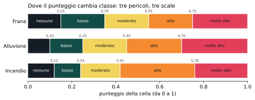
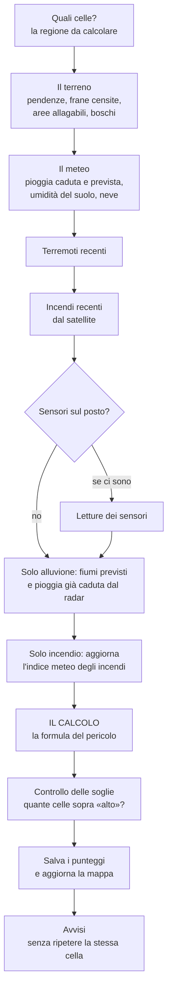
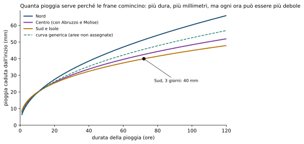
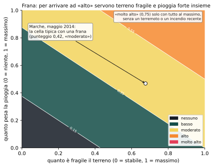
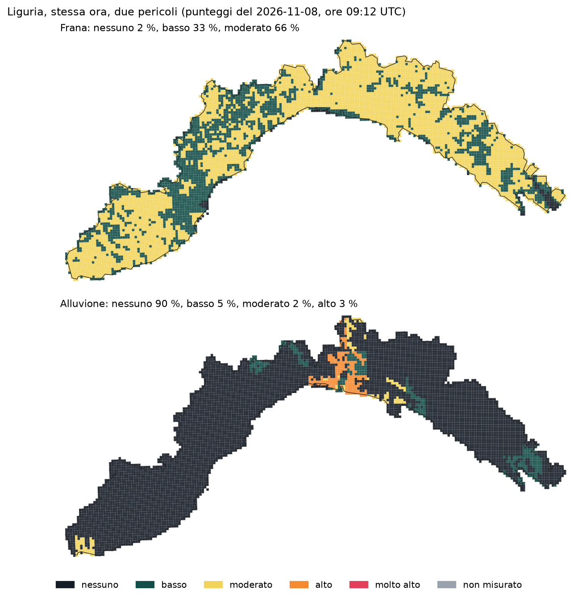
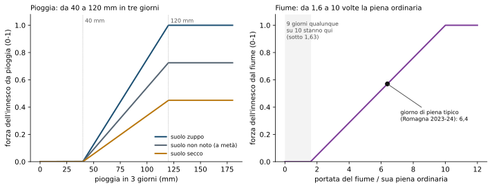
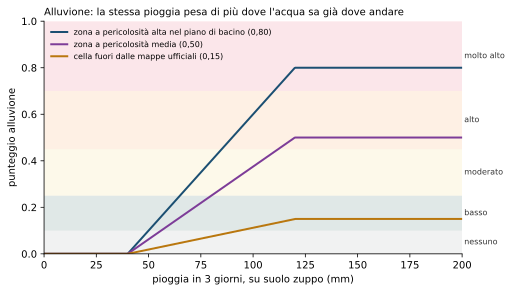
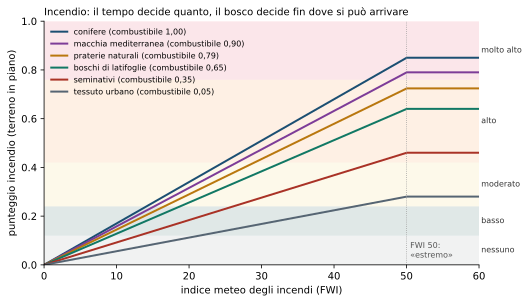

# 4. Dal dato al punteggio: frana, alluvione, incendio

!!! abstract "In breve"
    - Per ogni chilometro quadrato e per ogni pericolo Limen calcola un
      **numero fra 0 e 1**. Quel numero cade in una di **cinque classi**
      (nessuno, basso, moderato, alto, molto alto), che sulla mappa hanno i
      colori delle allerte della Protezione civile.
    - Ogni pericolo ha la **sua ricetta**, scritta per intero in un file di
      configurazione leggibile: niente numeri nascosti nel programma.
    - **Frana**: si sommano, con pesi diversi, quanto è fragile il terreno e
      quanta pioggia sta arrivando (più terremoti, incendi passati, fiumi).
    - **Alluvione**: quanto un posto è allagabile, moltiplicato per la **più
      forte** delle due minacce: la pioggia sul posto o il fiume che arriva da
      monte.
    - **Incendio**: il meteo decide quanto; bosco, prato o campo e la pendenza
      decidono fin dove si può arrivare. Sotto la pioggia di gennaio, nessun
      bosco è in pericolo.

Il [capitolo 3](03-i-dati.md) ha raccontato i dati: le pendenze, le frane già
censite, le aree allagabili, i boschi, la pioggia prevista e quella misurata
dal radar. Questo capitolo racconta che cosa ci fa Limen: come quei dati
diventano, ogni ora, un colore su un quadratino della mappa.

## Dal numero al colore

Immaginiamo un termometro con una scala da 0 a 1. Lo zero vuol dire «qui,
oggi, per questo pericolo non c'è niente da segnalare»; l'uno vuol dire «tutte
le condizioni che conosciamo sono al massimo». Ogni ora Limen legge questo
termometro su **312.550 celle** (quadrati di un chilometro per lato) e per
**tre pericoli**: oltre novecentomila letture.

Un numero con quattro decimali non serve a chi deve decidere. Per questo la
scala è tagliata in **cinque classi**, e ogni classe ha un colore:

| Classe | Colore sulla mappa di Limen | Corrisponde all'allerta della Protezione civile |
|---|---|---|
| nessuno | quasi invisibile, scuro come il fondo | verde |
| basso | verde petrolio spento | verde |
| moderato | giallo | gialla |
| alto | arancio | arancione |
| molto alto | rosso | rossa |

L'ordine dei colori è quello delle allerte ufficiali, perché è quello che le
persone conoscono già. Ma **un colore di Limen non è un'allerta ufficiale**:
dice che le condizioni di quella cella somigliano a quelle in cui, in passato,
quel pericolo si è davvero manifestato. «Alto» non vuol dire «franerà»; vuol
dire «guarda qui».

I tagli fra una classe e l'altra **non sono gli stessi** per i tre pericoli,
e non per capriccio: ognuno ha i suoi motivi, che vedremo.


*Fonte: file di configurazione dei tre pericoli nel repository (versioni in
uso all'8 novembre 2026).*

- Per l'**alluvione** le classi alte scattano prima (alto da 0,45) perché un
  allagamento è un fenomeno «a soglia»: o l'acqua esce dall'argine o non esce.
- Per l'**incendio** i tagli sono scelti perché coincidano con le fasce di
  pericolo del servizio europeo EFFIS: chi conosce quella scala può leggere
  la mappa di Limen allo stesso modo.

La mappa non usa il colore da solo: accanto c'è sempre la parola (basso,
moderato…) e i colori sono stati scelti perché restino distinguibili anche da
chi non vede bene il rosso o il verde.

??? note "Per chi sviluppa"
    - Le soglie di classe stanno nel blocco `classes` di
      `src/limen/config/hazards/{landslide,flood,wildfire}.yaml`; il
      validatore Pydantic rifiuta buchi o sovrapposizioni
      (`core/scoring/regional_thresholds.py`).
    - La corrispondenza con i colori della Protezione civile è il blocco
      `pc_alert`: solo etichette, non cambia punteggi né classi.
    - La rampa della mappa è in `frontend/src/lib/risk-colors.ts`; il test
      `risk-colors.test.ts` verifica che **ogni coppia** di classi resti sopra
      1,5:1 di contrasto anche in simulazione di daltonismo, con le celle al
      70 % sopra il fondo scuro.

## Una regola sola per tutti e tre: misurato prima di colorare

C'è un caso in cui il numero zero mente. Se la fonte della pioggia non
risponde, un motore che moltiplica per la pioggia dà zero, e lo zero sulla
mappa sembra una cella tranquilla. È successo il 29 settembre 2026: finita la
quota giornaliera del servizio meteo, alluvione e incendio valevano zero su
tutta Italia (lo racconta il [capitolo 1](01-il-problema.md)).

Da allora ogni punteggio porta con sé un'informazione in più: **il dato è
arrivato o no?** Se non è arrivato, la cella si disegna **in grigio**, come
una cella mai valutata, e non conta nelle classifiche dei comuni. «Non
misurato» non è «nessun pericolo».

??? note "Per chi sviluppa"
    Ogni breakdown espone `measured()`: per l'incendio è
    `fire_weather is not None`, per l'alluvione `rain_mm or discharge_ratio`,
    per la frana `True` (un pericolo che poggia sul terreno è misurato anche
    senza meteo). Il flag viaggia su `risk_assessments.measured` e
    `latest_risk.measured` ed esce dall'indice di attenzione per comune.

## Ogni ora, in quest'ordine

Prima delle tre ricette conviene vedere la cucina. Ogni ora, per ogni regione
e per ogni pericolo, Limen esegue la stessa catena di passi. Ogni passo fa una
cosa sola e passa il risultato al successivo.



*Il percorso orario. I testi scritti dall'intelligenza artificiale non sono
in questa catena: arrivano dopo, a parte, e non toccano i numeri (vedi il
[capitolo 6](06-ml-e-ai.md)).*

Il passo che conta in questo capitolo è **«il calcolo»**. Ha una proprietà
importante: è una **funzione pura**. Riceve un fascicolo di numeri già
preparati (terreno, pioggia, terremoti…) e restituisce un punteggio, senza
guardare il database, senza chiamare Internet, senza chiedere niente a un
modello linguistico. Stessi numeri in ingresso, stesso punteggio in uscita,
oggi come fra dieci anni. È questo che permette a chiunque di rifare un
calcolo e controllarlo.

??? note "Per chi sviluppa"
    - Il workflow è costruito in `src/limen/agents/workflows/main_workflow.py`.
      I passi, nell'ordine, sono gli executor di `src/limen/agents/executors/`:
      `AreaResolver` → `StaticFactors` → `MeteoFetch` → `SeismicCheck` →
      `FireCheck` → `SensorFetch` (condizionale, `add_if`) →
      `FloodForecastFetch` (obbligatorio per l'alluvione, opzionale per la
      frana) → `ObservedRain` (solo alluvione) → `FwiUpdate` (solo incendio)
      → `RiskScoring` → `ShadowChallenger` (solo notturno) → `EscalationGate`
      → `PersistResult` → `AlertDispatch`.
    - Con `profile="hourly"` non ci sono nodi LLM né shadow; con
      `profile="nightly"` niente persistenza né avvisi.
    - **Purezza**: `ScoringEngine.score(bundle) -> RiskScore[...]` non fa I/O.
      Il fascicolo è un `CellFeatureBundle` assemblato da
      `core/features/assembler.py`; il motore non sa da dove venga.

## La frana: un versante fragile che riceve troppa pioggia

### L'idea

Una frana superficiale scatta quando un versante già predisposto riceve più
acqua di quanta ne può sopportare. Servono quindi due cose: **un posto
fragile** e **un momento sbagliato**. Limen misura le due metà e le somma,
dando a ciascuna un peso.

Pensiamo a due colline dell'Appennino marchigiano sotto la stessa pioggia.
Una è ripida, fatta di argille, e ha già franato tre volte negli ultimi
decenni. L'altra è dolce, su roccia compatta, e non ha mai dato problemi. La
pioggia è identica, il pericolo no.

### La ricetta, a parole

Il punteggio della frana è una **somma pesata** di cinque ingredienti:

| Ingrediente | Peso | Che cosa misura |
|---|---|---|
| **Il terreno** | 35 % | quanto il versante è fragile, a prescindere dal tempo |
| **La pioggia** | 40 % | quanta acqua sta arrivando e quanta ce n'è già nel terreno |
| **I terremoti** | 15 % | una scossa forte negli ultimi giorni |
| **Gli incendi passati** | 7 % | un versante bruciato da qualche mese |
| **I fiumi** | 3 % | se la cella sta in un'area allagabile e una piena è prevista |

**Il terreno** a sua volta mette insieme quattro cose: quante frane già
censite ci sono nel raggio di 500 metri (il peso maggiore, 37,5 %), quanto è
ripido (30 %), che cosa dice il Piano di assetto idrogeologico della zona
(22,5 %) e il tipo di roccia (10 %).

**La pioggia** mette insieme tre cose:

- **la soglia d'innesco** (45 %): la pioggia di questi giorni ha superato
  quella che, storicamente, fa partire le frane?
- **la pioggia del mese prima** (30 %): il terreno era già carico d'acqua?
- **l'umidità del suolo** (25 %): quanto è bagnato in superficie adesso?

Se c'è neve al suolo e ci piove sopra, si aggiunge un piccolo supplemento:
la neve che si scioglie è acqua in più.

### La soglia di pioggia

La soglia d'innesco viene da un'idea del geografo Nel Caine (1980), poi
ritarata per l'Italia dai ricercatori del CNR-IRPI: **più a lungo piove, meno
intensa deve essere la pioggia** per far partire le frane. Un temporale
violento di un'ora e tre giorni di pioggia leggera ma continua possono avere
lo stesso effetto.

Le curve di Limen sono state ricalcolate a luglio 2026 su quasi seimila frane
italiane datate, con la pioggia misurata dai pluviometri, una curva per Nord,
Centro e Sud. La curva precedente lasciava sotto soglia il 36 % delle frane
vere[^caine].


*Le quattro curve dal file di configurazione della frana (taratura sul
catalogo e-ITALICA, luglio 2026). Al Sud bastano circa 40 mm in tre giorni.*

Al Sud bastano circa **40 mm in tre giorni**; al Nord, dove piove di più e i
versanti sono abituati, ne servono di più. Abruzzo e Molise stanno con il
Centro, non con il Sud: è il raggruppamento su cui le curve sono state
calcolate.

### Terremoti, incendi, sensori

- **Terremoti.** Una scossa abbastanza forte da essere «avvertita forte»
  (dalla mappa di scuotimento dell'INGV) alza il punteggio, e l'effetto si
  dimezza in un paio di giorni. Onestamente: la misura sulla sequenza
  sismica 2016-17 in Marche e Abruzzo ha trovato **nessuna frana in più**
  presa su 40, con le ore di allerta moltiplicate per 23 nelle Marche. Per
  questo l'aggiornamento automatico dei terremoti resta spento[^sisma]. Una
  proposta migliore è aperta: dopo un terremoto forte non aggiungere punti, ma
  **abbassare la soglia di pioggia** per mesi, perché un versante scosso
  frana con meno acqua (issue #441).
- **Incendi passati.** Un versante bruciato perde le radici che lo tengono e
  si impermeabilizza. L'effetto cresce nei primi mesi, è massimo verso il
  sesto e si spegne dopo due anni. Un incendio molto intenso conta più di una
  bruciatura di stoppie: l'intensità viene dal calore misurato dal satellite.
- **Sensori sul posto.** Dove un versante ha strumenti che ne misurano lo
  spostamento, quella lettura entra con un peso del 20 % e, se il versante
  accelera, fa scattare l'allerta a prescindere dal resto (il capitolo 3 e
  la guida ai sensori ne parlano).

??? note "Per chi sviluppa: la frana in simboli"
    ```
    rischio = 0,35·S + 0,40·M + 0,15·E + 0,07·F + 0,03·H
    S = 0,375·frane_IFFI_500m + 0,30·pendenza + 0,225·PAI + 0,10·litologia
    M = 0,45·innesco_Caine + 0,30·API + 0,25·suolo + 0,15·neve
    soglia Caine:  I = α · D^(−β)     (mm/h, ore; α, β per macroregione)
    innesco_Caine = clamp01(log10(I_evento) − log10(I_soglia(D_evento)))
    ```
    - Motore: `src/limen/core/scoring/engine.py`
      (`MultiFactorScoringEngine`); Caine in `caine.py` e nel pacchetto
      `rainfall-thresholds`; API in `api.py`; sismica in `seismic_decay.py`;
      post-incendio in `post_fire.py`; cinematica K in `kinematic.py`.
    - Con sensori cinematici: `rischio = w_K·K + (1 − w_K)·(somma V1)`, con
      `kinematic.weights.k = 0,20`.
    - L'unica costante nel codice è `_CAINE_LOG_EXCESS_CAP = 1.0` (una decade
      sopra soglia vale 1): è una normalizzazione interna, commentata come tale.
    - Esistono due blocchi opzionali **non attivi** nello YAML di produzione:
      `cumulata` (#243, provato e non promosso) e `seismic.soglia_pioggia`
      (#441, aperta). Senza blocco, il motore è byte-identico al V1.
    - La macroregione viene da `macroregion_by_aoi`; un'AOI non elencata
      ricade su `italy_default`.

### Perché la frana arriva raramente ad «alto»

Qui bisogna essere onesti, perché è il punto debole di Limen. Facciamo i
conti con la ricetta: terremoti, incendi e fiumi in una giornata normale
valgono zero. Restano terreno e pioggia, che insieme pesano il 75 %. Anche con
terreno e pioggia entrambi al massimo il punteggio si ferma a 0,75, che è
proprio la porta di «molto alto». E per arrivare ad «alto» (0,55) servono
terreno molto fragile **e** pioggia molto forte insieme.


*Il punteggio frana quando terremoti, incendi e fiumi valgono zero, con i
pesi del file di configurazione. Il punto bianco è la cella tipica con una
frana nelle Marche, maggio 2014 (misura nella issue #122).*

Nelle Marche, a maggio 2014, ci sono state 172 frane datate. Nelle 72 ore
prima, la cella tipica con una frana aveva un terreno fragile (0,68) ma una
pioggia di appena 0,47: punteggio **0,42**, «moderato», come mezza regione
nello stesso momento. Il motivo principale l'abbiamo trovato misurando: la
pioggia che arriva al motore è quella dei modelli meteo, che in media vede il
**62 %** della pioggia misurata dai pluviometri, e nelle Marche appena il
41 %[^pioggia]. Le soglie sono state tarate sui pluviometri; il motore riceve
una pioggia più bassa. Il [capitolo 5](05-misurare.md) racconta tutte le
strade provate per correggerlo, e perché nessuna, finora, ha retto la prova.

La mappa della Liguria di questa mattina mostra l'altra faccia dello stesso
problema: una domenica di novembre senza piogge forti, due terzi delle celle
sono in «moderato». Non perché stia per succedere qualcosa, ma perché quasi
tutta la Liguria è fragile, e il terreno da solo basta a portarla lì.


*Punteggi dell'8 novembre 2026, ore 09:12 UTC, letti in sola lettura dal
database di Limen; colori della mappa pubblica; in grigio le celle non
misurate (qui nessuna).*

Sotto, l'alluvione nella stessa ora: quasi tutta la regione in «nessuno», e
una macchia arancione intorno a Genova. Non viene dalla pioggia (22 mm
previsti in tre giorni, niente dal radar) ma dal ramo dei fiumi: il servizio
europeo prevede una portata 8,6 volte la piena ordinaria di quel tratto. È un
numero da verificare, e la issue #448 tratta proprio un possibile difetto nel
modo in cui si calcola «la piena ordinaria». Lo mostriamo perché è il genere
di cosa che una mappa aperta permette a chiunque di notare e chiedere.

## L'alluvione: un posto allagabile e l'acqua che arriva

### L'idea

Una cella finisce sott'acqua per due strade diverse:

- **la pioggia sul posto** (allagamento «pluviale»): piove più di quanto il
  terreno e le fogne riescano a smaltire. È il sottopasso allagato, la strada
  che diventa un torrente;
- **il fiume che arriva da monte** (allagamento «fluviale»): ha piovuto, anche
  lontano, e il fiume esce dagli argini.

E poi c'è **il posto**: un crinale non si allaga, qualunque pioggia faccia; la
piana accanto a un argine sì. Le mappe ufficiali delle aree allagabili,
raccolte dall'ISPRA, dicono quali zone sono a pericolosità alta, media o
bassa.

### La ricetta, a parole

**Il punteggio è: quanto è allagabile il posto, moltiplicato per la più forte
delle due minacce, pioggia o fiume.**

Perché **la più forte** e non la somma? Perché sono due modi diversi di
finire sott'acqua, e una cella non è «più allagata» perché potrebbero
succedere entrambi: conta il peggiore, che è quello su cui un sindaco deve
organizzarsi. Una somma, invece, farebbe nascere un pericolo grave da due
segnali moderati.

Perché **moltiplicato** e non sommato? Perché l'acqua va in basso. Se il posto
non è allagabile, nessuna pioggia lo rende tale: sotto una certa soglia di
allagabilità il punteggio è zero.

**E le celle che le mappe ufficiali non coprono?** Le mappe coprono i bacini
studiati, non tutta Italia. «Non studiato» non vuol dire «non allagabile»:
queste celle ricevono un valore basso (0,15) ma non zero, abbastanza per
restare visibili, non abbastanza per arrivare ad «alto» con la sola pioggia.
C'è un'eccezione pensata per le città: una cella fuori mappa, molto costruita
e pianeggiante, sale fino a 0,8 per la sola minaccia della pioggia. È il caso
di Anzio, 9 ottobre 2026: 92 mm previsti, e prima di questa correzione la
cella restava in «nessuno»[^anzio].

### La minaccia della pioggia

La pioggia conta dai **40 mm in tre giorni** in su e raggiunge il massimo a
**120 mm**. Questi due numeri non sono scelti a occhio: vengono dalle celle
davvero allagate in Emilia-Romagna e Toscana fra il 2023 e il 2025. Quaranta è
appena sotto la pioggia del 10 % meno bagnato delle celle allagate; 120 mette
la cella allagata tipica esattamente sul confine di «alto»[^soglie-flood].

Il suolo conta: un terreno secco si beve la prima pioggia, un terreno zuppo la
fa scorrere tutta. Se l'umidità del suolo non è nota, Limen non sceglie il
caso peggiore né il migliore, ma la via di mezzo: indovinare «zuppo» inventerebbe
allerte su un'intera regione, indovinare «secco» ne spegnerebbe di vere. Il
cemento amplifica la pioggia (fino a 1,6 volte), non il fiume.


*A sinistra la minaccia della pioggia, con il suolo zuppo, secco o non noto; a
destra quella del fiume. Parametri dal file di configurazione dell'alluvione
(flood-v1.3.0).*

**La pioggia già caduta conta.** La previsione guarda le prossime 72 ore, e
un nubifragio in corso «esce» dalla previsione mentre cade. A Melito di Porto
Salvo, la mattina del 10 ottobre 2026, la previsione dava 20 mm e il radar
della Protezione civile ne aveva già misurati 152. Da allora Limen usa la più
alta fra due letture: la pioggia prevista nelle 72 ore, oppure quella già
misurata nelle ultime 24 più quella prevista nelle 48 che restano. La cella di
Melito passa da 0,00 a 0,79. Un radar guasto non deve inventare alluvioni: un
fotogramma che salta di più di 150 mm in mezz'ora viene scartato[^melito].

### La minaccia del fiume

Il fiume si giudica rispetto a **sé stesso**: la portata prevista nei prossimi
sette giorni, divisa per la **piena ordinaria di quel tratto** (il valore
superato solo un giorno su dieci negli ultimi due anni). Un rapporto di 2 vuol
dire «il doppio di una piena normale per questo fiume».

Non è stato sempre così, e la storia è istruttiva. Prima il confronto era con
la media del mese precedente, e un fosso e il Po diventavano indistinguibili:
il rapporto esplodeva sui rigagnoli. La toppa (scartare i corsi d'acqua piccoli
rispetto al più grande della regione) in Emilia-Romagna lasciava 4 punti su
105, perché il 10 % del Po vale 186 m³/s: Lamone, Senio e Montone, i fiumi
esondati nel 2023 e nel 2024, erano fra gli scartati[^po]. Con la piena
ordinaria di ogni tratto il filtro non serve più.

La minaccia del fiume parte da **1,6 volte** la piena ordinaria (sopra quasi
tutti i giorni normali) e arriva al massimo a **10 volte**; il giorno di piena
tipico in Romagna valeva 6,4. Un punto per cui la piena ordinaria non è nota
non dice «fiume basso», dice «non so quanto è grande questo fiume», e la
minaccia resta zero.


*La stessa pioggia su tre celle diverse: in zona ad alta pericolosità, media,
o fuori dalle mappe ufficiali. Suolo zuppo, senza cemento.*

### Che cosa questa ricetta non sa fare

Dentro l'area di un'alluvione ha piovuto su tutti più o meno allo stesso
modo. Quello che decide **quali** celle finiscono sott'acqua è dove l'acqua si
incanala: la quota rispetto al corso d'acqua più vicino, gli avvallamenti, le
opere. Limen oggi non ha questo dato. Per questo molte celle in allerta
restano asciutte (in Emilia-Romagna circa otto allerte su dieci non trovano un
allagamento osservato) e nessuna scelta delle soglie lo corregge: lo dice il
file di configurazione stesso, e lo misura il [capitolo 5](05-misurare.md).

??? note "Per chi sviluppa: l'alluvione in simboli"
    ```
    rampa(x, a, b)  = 0 sotto a, 1 sopra b, lineare in mezzo
    pioggia        = max(prevista_72h, osservata_24h + prevista_48h)
    pluviale       = rampa(pioggia, 40, 120) · (0,45 + 0,55·umidità) · (1 + 0,6·cemento) · cascata_incendio
    fluviale       = rampa(picco_7g / q90_nodo, 1,6, 10)
    punteggio      = max(susc · fluviale, susc_pioggia · pluviale)   (0 se susc < 0,05)
    susc           = mosaico ISPRA normalizzato, 0,15 se fuori mappa
    susc_pioggia   = fuori mappa: da 0,15 verso 0,8 con cemento e pianura
    ```
    - Trigger puri in `src/limen/core/scoring/flood/trigger.py`; motore in
      `flood/engine.py` (`FloodScoringEngine`).
    - `umidità` = `min(suolo / wet_soil, 1)`, 0,5 se ignota.
    - La finestra della soglia è quella del dato: `pluvial.window_hours` è
      ciò che `_flood_signals_step` chiede come `horizon_hours`.
    - Segnali **per nodo** a 0,1°, mai uno per AOI: `per_node=True`.
      Riferimento q90 in `glofas_riferimento`, riempito di notte entro il
      budget `SCHEDULER__GLOFAS_CHIAMATE_PER_NOTTE`.
    - Il blocco `pluvial.local` (soglie relative al clima del nodo) esiste nel
      codice ma è **spento**: provato il 7 ottobre 2026 e non promosso
      (capitolo 5).
    - Attribuzione Copernicus obbligatoria su ogni superficie che mostra
      l'alluvione (`frontend/src/lib/attribuzioni.ts`).

## L'incendio: il tempo decide, il bosco modula

### L'idea

Perché un incendio sia pericoloso servono tre cose insieme: **un tempo da
incendio** (caldo, secco, ventoso, dopo settimane senza pioggia), **qualcosa
che bruci** e **un pendio** che lo faccia correre. Ma la prima è la porta: a
gennaio, sotto un acquazzone, una pineta non è in pericolo, per quanto sia
infiammabile.

### Il tempo da incendio: una catena di giorni

Il tempo da incendio si misura con l'**indice meteo canadese degli incendi**
(FWI, *Fire Weather Index*), lo standard internazionale che usa anche
l'Europa. Ha una caratteristica che lo distingue dalla temperatura o dalla
pioggia: **ha memoria**. Quanto è secco il sottobosco oggi dipende da quanto
lo era ieri, e ieri dall'altro ieri. Il terreno profondo «ricorda» la siccità
per circa due mesi.

Per questo Limen tiene una **catena** di giorni per ogni punto di una griglia
meteo di circa 25 km, la fa ripartire ogni primavera dal 1° aprile e la
allunga di un giorno alla volta. Una catena troppo giovane (meno di trenta
giorni) viene dichiarata «in assestamento». Il campione meteo del giorno è
quello di mezzogiorno solare (le 11 in tempo universale), come fa Copernicus:
fino a ottobre 2026 Limen usava le 12, un'ora più calda e secca, e la
correzione ha avvicinato il suo indice a quello ufficiale[^ora]. Per i giorni
già passati la pioggia viene dal radar della Protezione civile e non dal
modello: a Montegiordano, fra settembre e ottobre 2026, il modello vedeva 9 mm
dove ne erano caduti 35-45, e l'indice segnava 50 invece di 26.

### La ricetta, a parole

**Il punteggio è: l'indice meteo (portato su una scala da 0 a 1, dove 1 è
il livello «estremo»), moltiplicato per un fattore del terreno.**

Il fattore del terreno è fatto di tre parti che sommano a uno:

- **una base fissa** (25 %): il pericolo che arriva da fuori. Anche la roccia
  nuda, in condizioni estreme, ha un fuoco che può arrivarle addosso dal
  bosco accanto;
- **il combustibile** (60 %): che cosa c'è a terra. Le conifere sono il
  riferimento (1), la macchia mediterranea vale 0,9, i boschi di latifoglie
  0,65, i seminativi 0,35, il tessuto urbano 0,05, l'acqua zero;
- **la pendenza** (15 %): il fuoco risale i versanti; l'effetto è massimo
  dai 35 gradi in su.

Il risultato è che una pineta ripida vale **esattamente** il suo indice
meteo, e le classi di Limen si leggono come le fasce di pericolo europee.

Perché un prodotto e non una somma? Una somma darebbe a una pineta un
punteggio di fondo che non dipende dal tempo: sotto la pioggia di gennaio
leggerebbe «moderato», che è falso.


*Sei coperture del suolo in piano, con i pesi in uso (wildfire-v1.1.0).
Oltre l'indice 50 la scala satura.*

Il grafico dice una cosa non ovvia: **non tutte le coperture possono
arrivare al rosso.** In piano, conifere e macchia lo raggiungono, le praterie
no (servono un po' di pendenza), i seminativi mai. Il rosso è pensato per i
fuochi che corrono in boschi e macchia.

### I pesi del combustibile, ritoccati sugli incendi veri

I pesi del combustibile nascono da un ordine fisico (le conifere bruciano
meglio delle latifoglie, che bruciano meglio dei campi). Confrontati con gli
incendi davvero avvenuti, alcuni erano fuori posto: **praterie, prati e
vegetazione rada bruciano più spesso di quanto dicesse l'ordine fisico**. A
novembre 2026 quattro classi sono salite (prati stabili da 0,45 a 0,64,
vegetazione rada da 0,30 a 0,73, praterie da 0,70 a 0,79, aree già percorse
dal fuoco da 0,60 a 0,67), mentre foreste, macchia e campi sono rimasti dove
erano. È la versione 1.1.0 del motore. Prima di arrivarci, una versione più
ambiziosa che cambiava tutti i pesi è stata **scartata**, perché toglieva il
rosso a pinete e macchia; anche un errore di calcolo nella prima misura è
stato trovato e corretto in pubblico. Il [capitolo 5](05-misurare.md)
racconta tutta la storia.

??? note "Per chi sviluppa: l'incendio in simboli"
    ```
    fwi_norm  = min(FWI / 50, 1)                  (0 se la catena manca)
    terreno   = 0,25 + 0,60·combustibile(CORINE) + 0,15·min(pendenza/35°, 1)
    punteggio = min(fwi_norm · terreno, 1)
    ```
    - Motore: `src/limen/core/scoring/wildfire/engine.py`
      (`WildfireScoringEngine`). La catena di Van Wagner è il pacchetto
      `fwi-chain`: i coefficienti sono uno standard pubblicato e **non**
      stanno nello YAML.
    - Combustibile: `fuel.by_clc_prefix`, prefisso CORINE più lungo vince;
      copertura ignota = `fuel.default` 0,35, non zero.
    - Catena per nodo in `fwi_state`, chiave `(node_lon, node_lat, day)` in
      NUMERIC sulla griglia **globale** `build_snapped_nodes` a
      `fwi.node_spacing_deg` 0,25°; uno stato più vecchio di `max_gap_days`
      (5) si scarta. La conservazione non deve mai cancellare giorni passati.
    - Esiste un blocco opzionale `very_high` (regola «rosso se FWI ≥ soglia e
      terreno ≥ minimo», #301): non è configurato in produzione, perché la
      misura della #295 ha mostrato che alza il carico più degli incendi
      presi.

## Più pericoli insieme

### Le cascate

Un pericolo può preparare il terreno a un altro. Limen ne tiene conto in tre
punti, con regole scritte in un file a parte:

- **Incendio → alluvione.** Un suolo bruciato diventa idrorepellente: la
  stessa pioggia scorre invece di infiltrarsi. Per 18 mesi dopo un incendio la
  minaccia della pioggia viene amplificata, al massimo di 1,6 volte verso il
  quarto mese. Solo la pioggia: un incendio non fa crescere un fiume a monte.
- **Incendio → frana.** È l'ingrediente «incendi passati» della ricetta della
  frana, con una finestra più lunga (24 mesi): le radici perdono presa più a
  lungo di quanto il suolo resti idrorepellente.
- **Pioggia estrema → frana e alluvione insieme.** Se la stessa cella è in
  «alto» per entrambi nelle stesse sei ore, chi riceve gli avvisi riceve **un**
  messaggio con due rischi, non due messaggi che sembrano eventi distinti.

### Un numero per comune: l'indice di attenzione

Nella lista dei comuni ogni pericolo ha il suo punteggio, e accanto c'è un
numero solo che dice **quali comuni guardare per primi**. Non è una somma:
sommando, un comune con tre pericoli blandi (0,40 ciascuno, totale 1,20)
passerebbe davanti a uno con un versante a 0,80, che è l'unico dei due dove
sta per succedere qualcosa.

L'indice prende il **pericolo peggiore** del comune, tenendo conto di che cosa
c'è intorno (case, strade, ferrovie, e per l'incendio le case affacciate sul
bosco). Se due o più pericoli sono almeno «moderati», aggiunge il 15 % per
ognuno oltre il primo: due pericoli insieme sono una notizia diversa da uno
solo, ma non il doppio. I pericoli **non misurati** restano fuori dal conto; se
non c'è niente di misurato l'indice è «non misurato», mai zero.

??? note "Per chi sviluppa"
    - Regole in `src/limen/config/hazards/cascades.yaml`, funzioni pure in
      `src/limen/core/cascades/` (`rules.py`, `attention.py`).
    - Priorità per pericolo: `punteggio · (1 + esposizione)`, con
      l'esposizione dal blocco `exposure` di ciascuno YAML (cappata a 2).
    - `attention = max(priorità) · (1 + 0,15·(n_oltre_moderato − 1))` sui soli
      pericoli misurati; `None` se nessuno lo è.

## Le regole che tengono onesto il calcolo

Quattro scelte di progetto valgono per tutti e tre i motori.

1. **Nessun numero nascosto.** Pesi, soglie, curve, tagli di classe: tutto
   sta nei file di configurazione, con un commento che dice da quale misura
   viene. Chi vuole cambiare un numero deve cambiarlo lì, dove tutti lo vedono.
2. **Il calcolo non guarda fuori.** Riceve i numeri e restituisce il
   punteggio; non va su Internet, non legge il database, non chiede niente a
   un'intelligenza artificiale.
3. **Ogni pericolo racconta i suoi perché.** Accanto al punteggio Limen salva
   gli ingredienti (quanto pesava la pioggia, quanto il terreno, quanto il
   fiume). Aprendo una cella sulla mappa si vedono; il [capitolo
   8](08-trasparenza.md) spiega come rifare il conto a mano.
4. **La ricetta in produzione si cambia solo con una misura.** Le ricette
   descritte qui sono i «campioni» in uso. Un nuovo peso o una nuova soglia
   entra solo se batte il campione sugli eventi veri, con il tasso di base
   accanto: è il tema del [capitolo 5](05-misurare.md).

??? note "Per chi sviluppa: registro, breakdown, configurazione"
    - **Registro a due dimensioni.** I motori si registrano per (pericolo,
      implementazione) in `src/limen/core/scoring/registry.py`: `(landslide,
      deterministic)`, `(landslide, ml)`, `(flood, deterministic)`,
      `(wildfire, deterministic)`… Aggiungere un pericolo = una factory
      registrata + `config/hazards/<pericolo>.yaml` con il suo schema in
      `SCHEMA_BY_HAZARD`. `resolver.py` legge `SCORING__ENGINE` e ricade sul
      V1 a ogni errore del V2, senza sollevare.
    - **Breakdown per pericolo.** `RiskScore` è generico su un
      `HazardBreakdown` (`ComponentBreakdown`, `FloodBreakdown`,
      `WildfireBreakdown`) con TypeVar **covariante**: niente sintassi PEP 695
      qui, inferirebbe un parametro invariante. I consumatori leggono
      attraverso le proiezioni `components()`, `factors_payload()`,
      `predisposition()`, `measured()`, mai i campi appiattiti.
    - **Nessuna costante fuori dagli YAML**: i test lo verificano
      sovrascrivendo lo YAML. L'eccezione dichiarata sono i coefficienti di
      Van Wagner (standard pubblicato, nel pacchetto `fwi-chain`).
    - **Avvisi sotto «alto».** Una cella sotto «alto» genera un avviso solo
      se la sua predisposizione statica supera `ALERT__MIN_STATIC_S` (0,5,
      in `config/settings.py`), la stessa soglia per i tre pericoli.

??? note "Per chi sviluppa: come rifare le figure di questo capitolo"
    - Grafici delle funzioni (leggono solo gli YAML dei pericoli):
      `uv run --no-project --with matplotlib --with numpy --with pyyaml python -I scripts/libro/cap04_funzioni.py`
    - Mappa della Liguria (sola lettura dal database, transazione `READ ONLY`
      su `latest_risk`, `grid_cells`, `aoi`):
      `uv run --no-project --with matplotlib --with shapely python -I scripts/libro/cap04_mappa.py`

## Gap e come chiuderli

Ogni riga è un pezzo che manca o che non funziona ancora come dovrebbe. Il
dettaglio tecnico sta nelle issue del progetto.

| Che cosa manca | Perché conta | Come chiuderlo | Stato |
|---|---|---|---|
| **La frana arriva di rado ad «alto»** | La pioggia che arriva al motore è circa il 60 % di quella dei pluviometri, e terreno e pioggia insieme toccano «alto» solo al limite. | Pioggia misurata (radar corretto con i pluviometri) al posto del modello, man mano che l'archivio cresce; un catalogo più ampio di frane datate. **Open data**: il catalogo e-ITALICA del CNR-IRPI (CC BY 4.0) è la verità di oggi; servirebbero le frane datate dei servizi geologici regionali, pubblicate nello stesso formato. | #345 |
| **Dopo un terremoto forte la soglia di pioggia non scende** | Il termine sismico di oggi non ha preso nessuna frana in più nella sequenza 2016-17; il rischio vero è nei mesi successivi. | Abbassare la soglia di pioggia per mesi invece di aggiungere punti. | #441 |
| **L'alluvione non sa dove l'acqua si incanala** | Otto allerte su dieci in Emilia-Romagna non trovano un allagamento osservato. | Un indicatore di quota sopra il corso d'acqua più vicino. **Open data**: il reticolo idrografico europeo EU-Hydro di Copernicus (accesso libero), con un modello del terreno. | ([#474](https://github.com/agent-engineering-studio/limen/issues/474)) |
| **«Piena ordinaria» del fiume da due fonti diverse** | Lo stesso fiume può dare rapporti diversi a seconda della fonte; muove i punteggi. | Una fonte sola per il riferimento, poi una misura. | #448 |
| **Pochi dati sui nubifragi in città** | La regola per le celle urbane fuori mappa è tarata su alluvioni di fiume, non su allagamenti urbani. | **Open data**: un catalogo aperto e datato degli allagamenti urbani (Comuni, vigili del fuoco), oggi non disponibile a livello nazionale. | ([#475](https://github.com/agent-engineering-studio/limen/issues/475)) |
| **Incendio al Nord e d'inverno** | Al Nord «alto» non scatta quasi mai d'estate, e un terzo degli incendi del Nord avviene fra dicembre e aprile, fuori dalla stagione misurata. | Misurare il Nord tutto l'anno, valutare pesi separati Nord/Sud. | ([#476](https://github.com/agent-engineering-studio/limen/issues/476)) |
| **Una soglia unica per gli avvisi sotto «alto»** | Lo stesso 0,5 per tre pericoli diversi, fuori dai file dei pericoli e mai misurato: con i nuovi pesi del combustibile apre gli avvisi a più celle. | Portarla nei file dei pericoli e misurarla per ciascuno. | ([#477](https://github.com/agent-engineering-studio/limen/issues/477)) |
| **Documentazione tecnica del motore frana non aggiornata** | Alcuni pesi e criteri di accettazione descritti nei documenti tecnici non sono più quelli in uso. | Allineare i documenti al file di configurazione. | ([#493](https://github.com/agent-engineering-studio/limen/issues/493)) |

## Per approfondire

- [*Come si calcola il rischio della tua cella*](https://github.com/agent-engineering-studio/limen/blob/main/docs/divulgazione/02-come-si-calcola-il-rischio.md), la scheda divulgativa.
- I file di configurazione dei tre pericoli, con i commenti che spiegano ogni
  numero:
  [frana](https://github.com/agent-engineering-studio/limen/blob/main/src/limen/config/hazards/landslide.yaml),
  [alluvione](https://github.com/agent-engineering-studio/limen/blob/main/src/limen/config/hazards/flood.yaml),
  [incendio](https://github.com/agent-engineering-studio/limen/blob/main/src/limen/config/hazards/wildfire.yaml),
  [effetti a cascata](https://github.com/agent-engineering-studio/limen/blob/main/src/limen/config/hazards/cascades.yaml).
- Caine, N. (1980). The rainfall intensity–duration control of shallow
  landslides and debris flows. *Geografiska Annaler: Series A* 62(1-2),
  23-27. <https://doi.org/10.1080/04353676.1980.11879996>
- Brunetti, M. T. et al. (2010). Rainfall thresholds for the possible
  occurrence of landslides in Italy. *Natural Hazards and Earth System
  Sciences* 10, 447-458. <https://doi.org/10.5194/nhess-10-447-2010>
- Peruccacci, S. et al. (2017). Rainfall thresholds for possible landslide
  occurrence in Italy. *Geomorphology* 290, 39-57.
  <https://doi.org/10.1016/j.geomorph.2017.03.031>
- Brunetti, M. T. et al. (2024). *e-ITALICA (enhanced ITAlian
  rainfall-induced LandslIdes CAtalogue)*. Zenodo, CC BY 4.0.
  <https://doi.org/10.5281/zenodo.14204473>
- Van Wagner, C. E. (1987). *Development and structure of the Canadian Forest
  Fire Weather Index System*. Canadian Forestry Service, Forestry Technical
  Report 35, Ottawa.
- EFFIS, il sistema europeo d'informazione sugli incendi boschivi:
  <https://forest-fire.emergency.copernicus.eu>.
- GloFAS, il sistema globale di previsione delle piene:
  <https://www.globalfloods.eu>.
- Copernicus EU-Hydro, il reticolo idrografico europeo:
  <https://land.copernicus.eu/en/products/eu-hydro>.

[^caine]: Commento al blocco `caine` di
    [`landslide.yaml`](https://github.com/agent-engineering-studio/limen/blob/main/src/limen/config/hazards/landslide.yaml):
    5.974 eventi del catalogo e-ITALICA, inviluppo al 5° percentile.
[^sisma]: Commento al blocco `seismic` di `landslide.yaml` (backtest #287,
    sequenza 2016-17, Marche e Abruzzo).
[^pioggia]: Issue #122, commento del 12 ottobre 2026: 637 eventi in dodici
    regioni, pioggia di rianalisi contro pioggia al pluviometro.
[^anzio]: Commento al blocco `pluvial_susceptibility` di
    [`flood.yaml`](https://github.com/agent-engineering-studio/limen/blob/main/src/limen/config/hazards/flood.yaml)
    (issue #198).
[^soglie-flood]: Commento al blocco `pluvial` di `flood.yaml` (issue #64):
    1.999 celle allagate e 24.993 celle osservate asciutte, perimetri
    Copernicus EMS 2023-2025.
[^melito]: Commento al blocco `pluvial.observed` di `flood.yaml` (issue #199,
    #235, #429).
[^po]: Commento al blocco `fluvial` di `flood.yaml` (issue #108).
[^ora]: Commento a `fwi.ora_osservazione_utc` di
    [`wildfire.yaml`](https://github.com/agent-engineering-studio/limen/blob/main/src/limen/config/hazards/wildfire.yaml)
    (issue #289).
