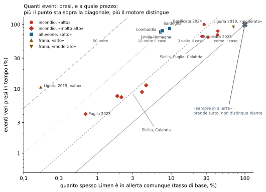
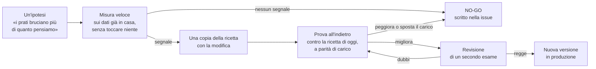
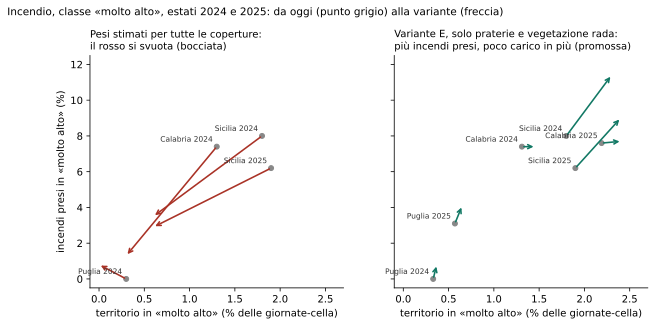
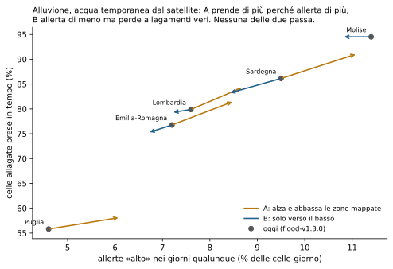

# 5. Misurare prima di cambiare: backtest, tasso di base, esempi veri

!!! abstract "In breve"
    - Dire «Limen ha previsto l'80 % degli incendi» non significa niente, se
      non si dice anche **quanto spesso Limen era in allerta comunque**. Chi
      dà l'allarme tutti i giorni le prende tutte.
    - Per questo ogni misura di Limen mette accanto due numeri: gli **eventi
      presi** e il **tasso di base**, e il loro rapporto dice quanto il motore
      distingue davvero.
    - Si misura **rigiocando il passato** (il *backtest*): si rifà girare il
      motore sui giorni prima di frane, alluvioni e incendi veri, con i dati
      che c'erano allora.
    - Nessuna regola cambia senza questa prova. In questo capitolo ci sono le
      misure vere della stagione 2026, **comprese quelle andate male**: un
      errore di calcolo corretto in pubblico, due idee bocciate, una promossa.
    - Incendio e alluvione distinguono bene (2-10 volte meglio del caso). La
      frana non ha ancora superato la prova, e lo diciamo.

Il [capitolo 4](04-i-motori.md) ha descritto le ricette. Una ricetta, però,
si giudica assaggiando. Questo capitolo racconta come Limen «assaggia» le sue
ricette, perché è questo il punto su cui si gioca la sua affidabilità: non
quanto è sofisticata la formula, ma quanto bene sappiamo dire **se funziona**,
e quanto siamo disposti a scartarla quando non funziona.

## L'indovino che non sbaglia mai

Immaginiamo un amico che, ogni mattina d'estate, dice: «Oggi in Sicilia
scoppia un incendio». Da giugno a settembre avrà ragione quasi sempre. Se
contiamo solo gli incendi che «ha previsto», il suo punteggio è vicino al
100 %. Eppure non ci ha detto niente che non sapessimo.

Ora un secondo amico, che parla solo una volta su venti, e quando parla indica
un posto preciso. Prende meno incendi, diciamo la metà; ma quando parla, ha
ragione molto più spesso del caso. È lui quello utile.

La differenza fra i due non si vede guardando un numero solo. Servono due
numeri:

- **gli eventi presi**: su cento incendi veri, quanti avevano un'allerta
  prima che scoppiassero? In inglese *hit rate*;
- **il tasso di base**: quanto spesso Limen era in allerta **comunque**,
  in giorni e posti qualunque.

Il primo amico ha 100 % di eventi presi e 100 % di tasso di base: il
rapporto fa 1, come il caso. Il secondo ha 50 % e 5 %: rapporto 10, dieci
volte meglio del caso. **Il rapporto fra i due è la misura che conta.**

Lo stesso discorso, per un Comune, si dice con una parola: **carico**. Quanta
parte del territorio, e per quante giornate, è in allerta. Un sistema che
tiene in giallo mezza regione per mezzo anno non serve a decidere dove
mandare una squadra, anche se «prende» tutto.


*Le misure di questa stagione. La diagonale grigia continua è il caso; più un
punto sta in alto a sinistra, più il motore distingue. Fonti: issue #295
(incendio, backtest del 7 novembre 2026), report dei backtest incendio
(7 novembre 2026), issue #420 (alluvione, 8 novembre 2026), issue #122
(frana, ottobre 2026), guida di progetto nel repository (Basilicata). Le definizioni di tasso di base
cambiano un poco fra un pericolo e l'altro: il grafico confronta ordini di
grandezza, non decimali.*

Il grafico racconta in un colpo d'occhio lo stato di Limen:

- gli **incendi** in «alto» stanno fra 2 e 3,5 volte il caso; in «molto
  alto» prendono meno incendi, ma distinguono di più;
- le **alluvioni** stanno intorno a 10 volte il caso;
- la **frana** in «alto» distingue moltissimo (più di 60 volte il caso) ma
  prende appena una frana su dieci; e appena si scende a «moderato» le prende
  quasi tutte **perché è quasi sempre in allerta**: il punto finisce vicino
  all'indovino dell'estate.

## Le altre parole della misura

Oltre ai due numeri principali, nei report di Limen ricorrono alcune parole.
Ecco che cosa vogliono dire, con un esempio.

- **Falsi allarmi** (in inglese FAR, *false alarm ratio*). Su cento allerte,
  quante non sono state seguite da niente? Attenzione: a volte «niente»
  vuol dire solo che nessuno ha guardato. Per le alluvioni, un'allerta su una
  zona che il satellite non ha fotografato non è un falso allarme: è «non
  verificabile». In Piemonte, prima di questa distinzione, i falsi allarmi
  risultavano il 100 % perché il satellite aveva mappato 0,3 km²[^far].
- **Preavviso**. Quante ore prima dell'evento la cella era già in allerta.
  Per le frane l'obiettivo è almeno 18 ore, per le alluvioni 12: l'acqua che
  riempie un fiume arriva in ore, non in giorni.
- **Un voto unico per cella** (in inglese CSI, *critical success index*). Mette
  insieme in un numero solo presi, mancati e falsi allarmi, contando cella per
  cella. È severo: lo usano i servizi meteo per le previsioni di pioggia.
- **Il voto sull'ordine** (in inglese AUC). Si prende a caso una cella colpita
  e una non colpita: quante volte il punteggio della colpita è più alto? Il
  50 % è il caso, il 100 % è l'ordine perfetto. Limen lo calcola **a parità di
  meteo e di quota**: confronta solo celle con lo stesso tempo e alla stessa
  altitudine, così il voto misura il terreno e non il fatto che in Sicilia
  d'estate fa caldo.
- **A parità di carico.** Quando si confrontano due versioni di una ricetta,
  la più «allarmista» vince sempre sugli eventi presi. Il confronto giusto è:
  con la **stessa quantità** di territorio in allerta, quale delle due prende
  più eventi? È la regola che ha deciso tutti i casi di questo capitolo.
- **Fuori campione.** Una regola tarata sugli incendi del 2021-2023 si prova
  sugli incendi del 2024-2025, che non ha visto. Altrimenti è come
  correggersi il compito da soli.

C'è un ultimo trucco, che vale soprattutto per l'apprendimento automatico: le
celle vicine si somigliano. Se si insegna a un modello con una cella e lo si
prova sulla cella accanto, il modello sembra bravissimo ma ha solo
«copiato». Per questo le prove si fanno **a blocchi geografici**: si impara su
alcune zone e si prova su zone lontane. Il [capitolo 6](06-ml-e-ai.md) lo
racconta per esteso.

??? note "Per chi sviluppa: dove stanno le metriche"
    - `limen backtest` (frana): hit rate, FAR, preavviso, **discriminazione**
      (hit rate / quota di celle in allerta, gate ≥ 2,0), **colte a parità di
      carico** (`carico_riferimento: 0,05`), e il metro **per comune** della
      #352 (comune colto se ≥ Moderato nelle 72 h prima, con al più il 10 % di
      comuni-giorno in allerta). Gate in `landslide.yaml`, blocco
      `calibration.backtest`: `hit_rate_min` e `far_max` sono `null` per
      scelta (#122, #243).
    - `limen backtest-flood`: hit rate, tasso di base, rapporto, FAR sui soli
      giorni-cella **osservati** (`unobserved_predicted` a parte), preavviso, e
      CSI/POD/bias per cella dal pacchetto `copernicus_ems.ml`. Gate in
      `flood.yaml` (`hit_rate_min 0,70`, `far_max 0,30`, `lead_time 12 h`).
    - `limen backtest-wildfire`: hit rate, tasso di base sulla **sola
      stagione** (mai sui giorni di spin-up), discriminazione, carico meteo,
      carico per cella, discriminazione spaziale, giorno peggiore, preavviso.
      Il FAR non è misurato: il replay guarda solo le celle bruciate.
    - L'AUC «dentro nodo meteo × fascia di quota» delle misure offline (#295,
      #419, #420) è `limen misura`, in sola lettura.
    - Ogni comando di misura chiude il report con la sezione «Provenienza»
      (commit, `model_version` dei tre pericoli, comando, manopole d'ambiente)
      e la ripete in un `.provenienza.json` accanto; `limen archivia-report`
      copia report e provenienza in `docs/misure` e ne riscrive l'indice.

## Rigiocare il passato

Il modo più onesto di sapere se una ricetta funziona è farla girare **sui
giorni prima di eventi veri**, con i dati che c'erano allora, e guardare che
cosa avrebbe detto. Si chiama *backtest*, «prova all'indietro». Limen ne ha
uno per pericolo, più due strumenti per gli eventi della cronaca.

| Prova | Che cosa rigioca | Contro quale verità |
|---|---|---|
| Frana | ora per ora, una regione in una finestra di settimane | le frane datate del catalogo nazionale e-ITALICA (CNR-IRPI) |
| Alluvione | giorno per giorno, le regioni con alluvioni osservate | le aree allagate fotografate dal satellite dal servizio europeo Copernicus per le emergenze |
| Incendio | la catena meteo degli incendi su un'estate | i perimetri delle aree bruciate del servizio europeo EFFIS |
| Verifiche dalla cronaca | il comune di un evento riportato dai giornali | notizie verificate su almeno due testate |
| Anticipo | un singolo evento | quante ore prima Limen l'aveva visto |

### Previsione «come fu emessa»

Per l'alluvione c'è una sottigliezza che decide tutto. La minaccia della
pioggia guarda la pioggia **prevista**. Se nel backtest si mette la pioggia
poi **caduta**, si misura un Limen con una previsione perfetta, che nessuno
ha mai avuto.

L'esempio di Faenza, settembre 2024, lo mostra: 208,7 mm caduti fra il 17 e il
19, ma la previsione del giorno prima ne dava 157,1 e quella di tre giorni
prima 101,3[^faenza]. Per questo il backtest dell'alluvione gira **due
volte**:

- con la **previsione come fu emessa** quel giorno: è quello che Limen avrebbe
  detto davvero;
- con la **pioggia poi caduta**: è il tetto, quello che si potrebbe ottenere
  con una previsione perfetta. Serve a capire dove conviene investire, se
  sulle soglie o sui dati in ingresso.

L'archivio delle previsioni emesse parte da febbraio 2024: per l'alluvione di
maggio 2023 in Emilia-Romagna si può misurare solo il tetto, e il report lo
dice.

??? note "Per chi sviluppa: i comandi"
    ```bash
    # Frana (env: LIMEN_BACKTEST_AOI / _START / _END / _HIGH_LEVEL,
    #        _PIOGGIA=modello|radar|merging, _ANTECEDENT=regione|nodo)
    uv run limen backtest
    # Alluvione (env: LIMEN_BACKTEST_FLOOD_AOI / _START / _END / _LEVEL,
    #            _MODE=issued|observed|both, _SOGLIE=locali|nazionali)
    uv run limen backtest-flood
    # Incendio (env: LIMEN_BACKTEST_WILDFIRE_AOI / _START / _END / _LEVEL)
    uv run limen backtest-wildfire
    # Eventi della cronaca registrati in verifiche_eventi (migrazione 074)
    uv run limen verifiche-report
    uv run limen anticipo 077014 wildfire 2026-10-10T15:00+02:00
    ```
    - `issued` legge `precipitation_previous_dayN` dall'archivio Open-Meteo.
    - I report finiscono in `reports/` (variabile `LIMEN_REPORTS_DIR`), fuori
      dal controllo di versione.
    - `verifiche-report` affianca a ogni evento il suo **sfondo** (la classe
      del comune da 10 a 4 giorni prima): solo l'esito `anticipata` è una
      previsione sopra lo sfondo.

## Il ciclo: ipotesi, misura, prova, decisione

Ogni cambio di una ricetta segue lo stesso percorso. Non è burocrazia: è il
modo per non farsi ingannare dai propri desideri.



Due cose di questo ciclo meritano una sottolineatura:

- **Il «no» è un risultato** (in gergo *NO-GO*). Un'idea scartata con i numeri è un'informazione
  che resta, scritta in pubblico, e risparmia a chi viene dopo di rifare la
  stessa strada. Molte delle righe dei file di configurazione di Limen sono
  proprio questo: il racconto di che cosa è stato provato e perché non è
  entrato.
- **Il criterio si fissa prima di guardare i numeri.** «Promuovere solo se sale
  il totale senza perdere regioni», «solo se migliora a parità di carico»:
  scritto prima, così non lo si piega al risultato dopo.

??? note "Per chi sviluppa: il ciclo nel repository"
    - La misura veloce è in sola lettura (export, transazione `READ ONLY`);
      la prova all'indietro gira sul codice del branch, con il meteo
      scaricato una volta e uguale per tutte le varianti.
    - La revisione la fa il sub-agente `scoring-analyst` (opus, sola lettura)
      prima di toccare `config/hazards/*.yaml`; gli invarianti li controlla
      `invariant-reviewer`.
    - Ogni promozione cambia `model_version` nello YAML (es.
      `wildfire-v1.0.0` → `wildfire-v1.1.0`) e, se il modello ML in ombra
      legge la feature toccata, va riaddestrato.

## Casi di studio della stagione 2026

### 1. I pesi del combustibile: un errore, una bocciatura, una promozione

**L'ipotesi.** Nel motore incendio, il peso di ogni copertura del suolo
(conifere, macchia, prati…) veniva da un ordine fisico. Ma confrontando con
gli incendi veri del 2021-2026, i **prati e le praterie bruciavano più del
doppio** di quanto ci si aspettasse, i boschi di latifoglie meno[^c295a].

**Primo tentativo, 20 ottobre.** Una tabella di pesi stimata dagli incendi
migliorava il voto sull'ordine (da 0,51 a 0,59), ma a parità di carico il
guadagno era piccolo e, soprattutto, svuotava il rosso: le pinete non ci
arrivavano più. **Non promossa.**

**Secondo tentativo, 7 novembre.** Con mappe del suolo e delle pendenze
finalmente caricate su tutta Italia, la misura veloce sembrava dire: con i
nuovi pesi il rosso prende **più** incendi con **meno** territorio in allerta.

**L'errore.** Qualche ora dopo, una rettifica pubblica nella stessa
discussione: nella simulazione l'indice meteo non era «tappato» al livello
estremo come fa il motore vero. Su «alto» cambiava poco; sul rosso **ribaltava
la conclusione**. Con i conti giusti, i nuovi pesi toglievano il rosso a
tutte le pinete e a tutta la macchia, e lo davano ai fuochi d'erba[^c295b].
È il motivo per cui una misura veloce non basta mai: va rifatta con il motore
vero.

**La prova all'indietro.** Il backtest ufficiale sulle estati 2024 e 2025, in
Sicilia, Puglia e Calabria, lo ha confermato: la tabella completa prendeva su
«alto» più incendi solo allertando più territorio, e nel rosso ne prendeva da
metà a un quinto. **Bocciata.**

**La variante E.** Allora si è cambiato pochissimo: solo quattro classi
(praterie, prati stabili, vegetazione rada, aree già bruciate), lasciando
foreste, macchia e campi dove erano. Risultato, sulle stesse estati: in
Sicilia il rosso prende **il 40-45 % di incendi in più** (dall'8,0 all'11,4 %
nel 2024, dal 6,2 al 9,0 % nel 2025) senza perdere in distinzione; «alto»
resta neutro; pinete e macchia restano in rosso come prima. **Promossa** come
versione 1.1.0 del motore incendio[^c295c].


*Classe «molto alto», estati 2024 e 2025 in Sicilia, Puglia e Calabria. A
sinistra la tabella stimata per tutte le coperture: il rosso si svuota. A
destra la variante E: più incendi presi con poco territorio in più. Fonte:
commenti della issue #295 del 7 novembre 2026.*

Resta un prezzo, scritto anche quello: la soglia che decide gli avvisi sotto
«alto» ora lascia passare più celle (dal 37 al 41 % d'Italia, stima). È uno
dei gap del [capitolo 4](04-i-motori.md#gap-e-come-chiuderli).

### 2. Prati e chiome dal satellite: NO-GO

**L'ipotesi.** Le mappe ad alta risoluzione di Copernicus dicono, dentro ogni
cella, quanto è prato, quanto è densa la chioma degli alberi, quanti alberi
sono conifere. Forse migliorano il combustibile.

**La misura veloce**, sugli incendi del 2021-2023 per stimare e del 2024-2026
per verificare: il guadagno sul voto dell'ordine è **+0,02** in Italia, e al
Nord il voto **peggiora**. Il segnale grosso era la classe di copertura, e la
versione 1.1.0 lo aveva già preso. Per due centesimi non vale la pena
aggiungere tre mappe nazionali al caricamento di ogni installazione.
**NO-GO**, con un'unica pista lasciata scritta: le chiome molto dense
bruciano meno, e potrebbero un giorno attenuare il combustibile[^c419].

### 3. L'acqua temporanea: segnale vero, motore che non migliora

Questo è il caso più istruttivo, perché la prima misura era buona.

**L'ipotesi.** Una mappa europea del 2018 dice dove, fra il 2009 e il 2015, il
terreno è stato temporaneamente coperto d'acqua o umido. Dove l'acqua è già
stata, tornerà?

**La misura veloce.** Dentro le aree che i piani ufficiali considerano
allagabili, la risposta è sì, e netta: il voto sull'ordine sale da 0,61 a 0,69
in Emilia-Romagna e da 0,71 a 0,81 nel resto d'Italia, quattro volte il
guadagno dei prati sull'incendio. Fuori da quelle aree, invece, non si può
rispondere: delle celle davvero allagate, fuori dai piani ce ne sono solo
**31**[^c420a].

**La prova all'indietro.** Due modi di usarlo nel motore alluvione, provati in
nove regioni contro la ricetta di oggi:

- **A**, che alza le celle più bagnate e abbassa le altre: prende più
  allagamenti, ma **solo perché dà più allerte**. In Lombardia i falsi allarmi
  salgono dal 43 al 52 %.
- **B**, che può solo abbassare: meno allerte, ma **perde allagamenti veri**
  (18 celle in Emilia-Romagna, 5 su 10 in Toscana).


*Alluvione, previsione come fu emessa, classe «alto». Ogni freccia va dalla
ricetta di oggi alla variante. Fonte: commento della issue #420
dell'8 novembre 2026.*

**Verdetto**: il segnale c'è, ma nessun modo di usarlo nel motore regge la
prova. La ricetta resta com'è. Con un limite onesto di questa prova: quel
giorno il servizio delle portate dei fiumi ha risposto vuoto (probabilmente
per la quota giornaliera), quindi si è misurato solo il ramo della
pioggia[^c420b].

### 4. Le soglie di pioggia «locali» per l'alluvione: scartate

A Trieste 105 mm in tre giorni capitano circa una volta l'anno, e con le
soglie nazionali davano «molto alto» a un autunno normale mentre il bollettino
regionale non dava allerta. L'idea: soglie relative alla pioggia abituale di
ciascun posto.

La prova all'indietro, 7 ottobre 2026: meno allerte a vuoto, ma alluvioni vere
perse. In Lombardia gli allagamenti presi scendono dal 73 al 64 %, in Toscana
da 5,6 a zero. Il criterio fissato prima era «senza perderne», e non passa. Il
codice resta, spento; la pioggia abituale di ogni posto serve già a dire sulla
mappa quanto è rara una pioggia in quel luogo[^locali].

### 5. Il terremoto che non aggiunge niente

Nella sequenza sismica del 2016-17 in Marche e Abruzzo, aggiungere la scossa
alla ricetta della frana non ha preso **nessuna** frana in più su 40, e ha
moltiplicato per 23 le ore di allerta nelle Marche. Il pezzo resta nel motore
ma l'aggiornamento automatico dei terremoti è spento. L'idea che si prova
adesso è diversa: non punti in più, ma una soglia di pioggia più bassa per
mesi (issue #441)[^sisma].

### 6. Gli incendi: quello che funziona

Il motore incendio è il più maturo. Le misure ufficiali sulle estati, per
singolo incendio:

| Estate | Regione | Incendi | Presi in «alto» | Tasso di base | Rapporto | Preavviso medio |
|---|---|---|---|---|---|---|
| 2024 | Basilicata | | 100 % | 28 % | 3,6 | |
| 2025 | Basilicata | | 79 % | 43 % | 1,8 | |
| 2024 | Sicilia | 572 | 63,6 % | 31,6 % | 2,0 | 65 h |
| 2024 | Puglia | 386 | 65,3 % | 26,1 % | 2,5 | 52 h |
| 2024 | Calabria | 391 | 55,5 % | 24,2 % | 2,3 | 54 h |
| 2025 | Sicilia | 1.631 | 68,9 % | 42,5 % | 1,6 | 58 h |

*Fonti: CLAUDE.md (Basilicata, versione 1.0.0) e issue #295 (versione 1.0.0,
backtest del 7 novembre 2026). Con la 1.1.0 «alto» cambia di 0-2 punti.*

Due cose da notare. Il preavviso è di **due-tre giorni**: la catena meteo
degli incendi vede la siccità che si accumula. E nel 2025 in Sicilia il
rapporto scende a 1,6, perché l'estate è stata così secca che quasi metà
delle giornate era in «alto»: è il caso dell'indovino, e il tasso di base lo
rende visibile invece di nasconderlo.

### 7. Le alluvioni: molto presi, troppi allarmi a vuoto

La misura più recente (8 novembre 2026, solo pioggia, previsione come fu
emessa): in **Emilia-Romagna** il 77 % delle celle allagate aveva un'allerta
«alto» prima, con il 7,2 % di allerte nei giorni qualunque; in **Lombardia**
l'80 % con il 7,6 %. Dieci volte meglio del caso, con circa **50 ore** di
preavviso.

Ma i falsi allarmi sono il **78 %** in Emilia-Romagna e il 43 % in
Lombardia, contro un obiettivo del 30 %. Il motivo l'abbiamo visto nel
[capitolo 4](04-i-motori.md): dentro un'alluvione ha piovuto su tutti, e
Limen non sa ancora dove l'acqua si incanala. Prima della ritaratura delle
soglie (da 80-250 a 40-120 mm), gli allagamenti presi erano il **4 %**: la
taratura ha rimesso i numeri nell'ordine di grandezza del fenomeno, la
distinzione fine non poteva darla[^soglie].

### 8. La frana: la prova non è ancora superata

È il capitolo meno lusinghiero, e per questo il più importante da raccontare.

**Liguria, novembre 2019**, il mese delle alluvioni del 23-24: 131 frane
datate. In «alto» Limen ne prendeva l'11 % con lo 0,17 % del territorio in
allerta: quando parla ha ragione molto più del caso, ma parla troppo poco.
Scendendo a «moderato» ne prende il 91 %, ma con il 70 % del territorio in
allerta: è l'indovino[^lig].

Da lì, una serie di prove, tutte scritte in pubblico, tutte con lo stesso
esito:

- **una prima misura sbagliata**: il backtest girava senza pioggia (il
  servizio meteo rispondeva con valori vuoti, letti come zero millimetri).
  Trovato, corretto, e il report precedente rettificato;
- **spostare la soglia di «alto»** per tutta Italia: tarata su sei regioni,
  sulle altre sei non prende quasi niente (da 0 a 2,4 %);
- **una soglia per ogni regione**: a parità di territorio in allerta fa
  **peggio** di quella nazionale;
- **la pioggia del radar** al posto del modello: 27 frane prese contro 26 su
  372;
- **la pioggia del mese prima calcolata punto per punto**: 147 comuni presi
  contro 153 su 313;
- **un riferimento di pioggia abituale per ogni punto**: +3 comuni su 313,
  tutti in una regione. Non basta[^frana-prove].

La diagnosi più solida è quella del [capitolo 4](04-i-motori.md): la pioggia
che arriva al motore è circa il 60 % di quella misurata dai pluviometri, e
nelle Marche del 2014 il 41 %. Le 172 frane di quel mese non si staccano dal
rumore di fondo perché la pioggia che le ha innescate **non arriva** al
motore. Il lavoro continua sull'obiettivo dichiarato del progetto: prevedere
entro 72 ore il 90 % degli eventi riportati dalla cronaca, con al massimo il
10 % dei comuni-giorno in allerta[^obiettivo]. Oggi, sulle dodici finestre di
prova, la frana prende il 49 % dei comuni colpiti con quel carico.

!!! info "Perché raccontare quello che non funziona"
    Un finanziatore, un ente o un ricercatore che legge solo i successi non
    ha modo di sapere quanto fidarsi. Un registro pubblico delle prove
    fallite, con il metodo fissato prima e i numeri accanto, è la garanzia
    che i successi non sono stati scelti a posteriori. È anche il modo più
    rapido per chi arriva di capire **dove serve aiuto**: nel caso della
    frana, servono pioggia misurata e frane datate.

## Le verifiche dalla cronaca

C'è un'ultima prova, la più vicina a chi abita un territorio: gli eventi dei
giornali. Una notizia di frana, alluvione o incendio viene verificata su
almeno due testate, si registra il comune e l'ora, e si chiede a Limen:
**quel comune era in allerta prima, sopra il suo livello abituale?**

La parte «sopra il suo livello abituale» è essenziale. A Melito di Porto
Salvo, San Lorenzo e Roccaforte del Greco, il 10 ottobre 2026, i comuni erano
in «moderato» da 74-80 ore prima delle frane. Sembra un ottimo anticipo; ma
lo erano anche nei giorni precedenti, senza che succedesse niente. Era lo
sfondo, non una previsione[^cronaca].

Al 29 ottobre 2026 gli eventi verificati erano otto (quattro frane, quattro
alluvioni) e nessuno risultava previsto sopra lo sfondo. Otto eventi sono un
aneddoto, non una statistica: il primo lavoro è allargare il registro.

??? note "Per chi sviluppa: come rifare le figure di questo capitolo"
    `uv run --no-project --with matplotlib --with numpy python -I scripts/libro/cap05_grafici.py`
    ridisegna i tre grafici dai numeri trascritti nello script, ciascuno con
    la sua fonte (issue #122, #295, #420, report `backtest_wildfire_*` del
    7 novembre 2026 in `limen-data/reports/`). Non rifà le misure: quelle
    costano ore di replica e quote delle API esterne.

## Gap e come chiuderli

| Che cosa manca | Perché conta | Come chiuderlo | Stato |
|---|---|---|---|
| **La frana non supera la prova** | 49 % dei comuni colpiti presi con il 10 % di carico, contro un obiettivo del 90 %. | Pioggia misurata in ingresso e più eventi veri. **Open data**: frane datate dai servizi geologici regionali e dai Comuni, nello stesso formato aperto del catalogo e-ITALICA (CC BY 4.0). | #345 |
| **Pochi eventi verificati dalla cronaca** | Con otto eventi non si misura niente. | Raccolta regolare su tutte le regioni e i tre pericoli; segnalazioni di enti e cittadini. | #345 |
| **Alluvione: troppi falsi allarmi** | 78 % in Emilia-Romagna contro un obiettivo del 30 %. | Un dato sull'incanalamento dell'acqua (capitolo 4). | ([#474](https://github.com/agent-engineering-studio/limen/issues/474)) |
| **Il ramo dei fiumi non si misura nei backtest** | Quando la quota giornaliera del servizio delle portate finisce, la prova misura solo la pioggia, come l'8 novembre. | Salvare una volta le portate storiche delle finestre di prova e rileggerle da disco. | ([#478](https://github.com/agent-engineering-studio/limen/issues/478)) |
| **I report delle prove non sono nel repository** | Chi arriva non trova i numeri citati nelle issue, e non può confrontare una nuova prova con la precedente. | Chiuso in parte: ogni report dichiara commit, versioni dei motori, comando e ambiente, e `limen archivia-report` lo porta in `docs/misure` con un indice; la PR che cambia una `model_version` lo chiede nel suo modello. Mancano i report di riferimento veri (incendio, alluvione, le dodici finestre della frana), da rifare con la provenienza. | ([#481](https://github.com/agent-engineering-studio/limen/issues/481)) |
| ~~**Le misure veloci non sono riproducibili**~~ | Chiuso in parte: `limen misura` rifà in sola lettura AUC stratificata per nodo meteo e fascia di quota e osservate/attese, con stima e verifica in anni diversi, per ogni colonna numerica dei fattori per cella contro EFFIS o Copernicus EMS. | Manca il punteggio calcolato dal motore vero, che vuole il meteo di ogni giorno. | ([#480](https://github.com/agent-engineering-studio/limen/issues/480)) |
| **L'incendio è misurato su poche regioni, solo d'estate** | Tre-quattro regioni del Sud, giugno-settembre; falsi allarmi non misurati; la quota dell'archivio meteo interrompe le prove. | Prova su tutte le venti regioni e tutto l'anno, con il meteo storico salvato una volta. | ([#479](https://github.com/agent-engineering-studio/limen/issues/479)) |

## Per approfondire

- [*Cosa fanno ML e AI, e cosa no*](https://github.com/agent-engineering-studio/limen/blob/main/docs/divulgazione/03-cosa-fanno-ml-e-ai.md), la scheda divulgativa.
- Le discussioni con tutte le misure di questo capitolo, in ordine:
  [#295](https://github.com/agent-engineering-studio/limen/issues/295)
  (pesi del combustibile),
  [#419](https://github.com/agent-engineering-studio/limen/issues/419)
  (prati e chiome),
  [#420](https://github.com/agent-engineering-studio/limen/issues/420)
  (acqua temporanea),
  [#122](https://github.com/agent-engineering-studio/limen/issues/122) e
  [#243](https://github.com/agent-engineering-studio/limen/issues/243)
  (la frana),
  [#345](https://github.com/agent-engineering-studio/limen/issues/345)
  (l'obiettivo del 90 %).
- Brunetti, M. T. et al. (2024). *e-ITALICA (enhanced ITAlian
  rainfall-induced LandslIdes CAtalogue)*. Zenodo, CC BY 4.0.
  <https://doi.org/10.5281/zenodo.14204473>
- Copernicus Emergency Management Service, mappatura rapida delle
  emergenze: <https://mapping.emergency.copernicus.eu>.
- EFFIS, i perimetri delle aree bruciate:
  <https://forest-fire.emergency.copernicus.eu>.
- Copernicus Land, strato ad alta risoluzione «Water and Wetness»:
  <https://land.copernicus.eu/en/products/high-resolution-layer-water-and-wetness>.

[^far]: Commento al blocco `calibration` di
    [`flood.yaml`](https://github.com/agent-engineering-studio/limen/blob/main/src/limen/config/hazards/flood.yaml).
[^faenza]: Docstring di
    [`src/limen/cli/backtest_flood.py`](https://github.com/agent-engineering-studio/limen/blob/main/src/limen/cli/backtest_flood.py).
[^c295a]: Issue #295, commento del 20 ottobre 2026: rapporto osservati/attesi
    2,13 per i prati stabili, 1,69 per le praterie, 0,81 per le latifoglie.
[^c295b]: Issue #295, «Rettifica al commento precedente», 7 novembre 2026: con
    i conti giusti il rosso prende il 2,9 % delle celle bruciate invece del
    4,2 %, zero su conifere e macchia.
[^c295c]: Issue #295, «Variante E», 7 novembre 2026; promossa con
    `wildfire-v1.1.0` (PR #462).
[^c419]: Issue #419, misura del 7 novembre 2026: voto sull'ordine 0,559 →
    0,581 in Italia, 0,520 → 0,473 al Nord.
[^c420a]: Issue #420, misura dell'8 novembre 2026: 28.837 celle osservate,
    2.632 allagate, 31 fuori dalle aree dei piani.
[^c420b]: Issue #420, backtest dell'8 novembre 2026, nove regioni.
[^locali]: Commento al blocco `pluvial` di `flood.yaml`, «Soglie relative al
    clima del nodo: provate e non accese (7 ottobre 2026)».
[^sisma]: Commento al blocco `seismic` di
    [`landslide.yaml`](https://github.com/agent-engineering-studio/limen/blob/main/src/limen/config/hazards/landslide.yaml)
    (backtest #287).
[^soglie]: Commento al blocco `pluvial` di `flood.yaml` (issue #64).
[^lig]: Issue #122, commenti del 7 e dell'8 ottobre 2026.
[^frana-prove]: Issue #122 (commenti dell'8-14 ottobre 2026), #243 e #357.
[^obiettivo]: Issue #345 e commento finale della #357: 153 comuni su 313 con
    la ricetta di oggi.
[^cronaca]: Docstring di
    [`src/limen/cli/verifiche_report.py`](https://github.com/agent-engineering-studio/limen/blob/main/src/limen/cli/verifiche_report.py)
    e issue #345 (punto di partenza del 29 ottobre 2026).
