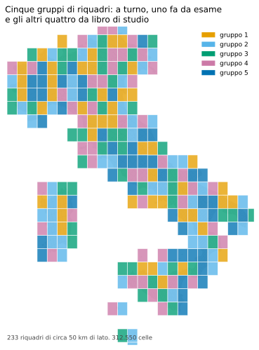
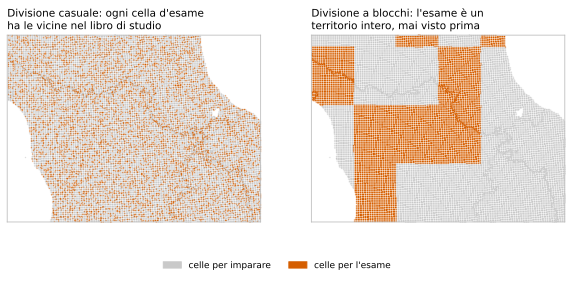
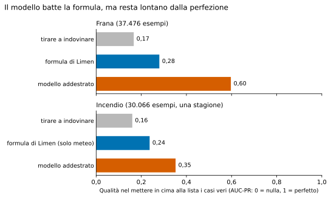
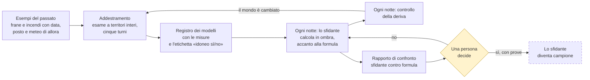
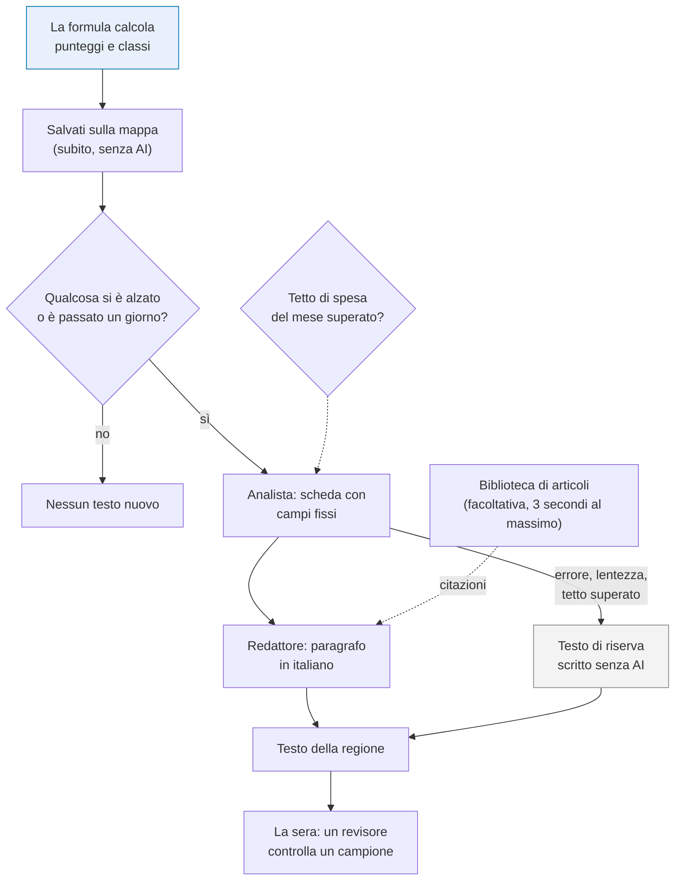

# 6. Machine learning e AI: cosa fanno e cosa no

!!! abstract "In breve"
    - Il colore di una cella lo decide **sempre la formula scritta** del
      capitolo 4. L'apprendimento automatico e l'intelligenza artificiale
      lavorano accanto, ma non toccano il numero.
    - Limen ha due **modelli addestrati sugli esempi** (uno per le frane, uno
      per gli incendi). Sulle prove fatte durante lo sviluppo vanno meglio
      della formula: 0,60 contro 0,28 per le frane, 0,35 contro 0,24 per gli
      incendi. Restano comunque **in panchina**.
    - Perché un modello entri in campo servono quattro cose che oggi mancano:
      un esame finale che si possa davvero superare, più eventi veri con data
      e luogo, alcune settimane di prova in parallelo alla formula e una
      persona che lo decida.
    - Il **modello linguistico** (quello che scrive testi) fa una cosa sola:
      spiega a parole i numeri già calcolati. Un controllo automatico verifica
      a ogni modifica del programma che non possa cambiarli. Nella stessa
      installazione, l'8 novembre 2026, **tutti i 26 testi delle regioni**
      sono il testo di riserva scritto senza AI, perché la chiave del servizio
      è stata rifiutata.
    - Tutta la spesa per l'AI in cloud ha un **tetto di 10 dollari al mese**,
      controllato prima di ogni richiesta.

Nei capitoli precedenti abbiamo visto da dove vengono i dati
([capitolo 3](03-i-dati.md)), come diventano un punteggio
([capitolo 4](04-i-motori.md)) e come si misura se il punteggio funziona
([capitolo 5](05-misurare.md)). Questo capitolo parla delle due parole che
oggi si mettono dappertutto, *machine learning* e *intelligenza artificiale*,
e dice con precisione che cosa fanno in Limen. Soprattutto, che cosa **non**
fanno.

## La regola prima di tutto: l'AI non decide un numero

Una regola vale per tutto il capitolo: **nessun programma che impara da
solo, e nessun programma che scrive testi, decide il colore di una cella.**

Il colore viene da una formula scritta: pochi numeri, pesi dichiarati, un
risultato che chiunque può rifare con carta e penna. È il motore che nel
progetto si chiama **campione**, il titolare. Tutto il resto gli gira intorno:

- un **modello addestrato** prova a fare meglio della formula, ma lavora in
  disparte e i suoi risultati finiscono in un registro a parte;
- un **modello linguistico** riceve i numeri già calcolati e li racconta in
  italiano, senza poterli toccare.

Perché tanta prudenza? Perché Limen vuole essere uno strumento di cui un
Comune o un volontario di Protezione civile si possano fidare. Se domani un
tecnico comunale contesta un avviso, la risposta deve essere un foglio con
sei numeri e qualche moltiplicazione, non «l'ha deciso il modello». Una
formula scritta fa sempre quello che c'è scritto. Un modello addestrato,
invece, può peggiorare in silenzio quando il mondo cambia.

Questo non vuol dire che l'apprendimento automatico non serva. Vuol dire che
deve **guadagnarsi il posto** con una prova onesta, scritta prima, che oggi
non ha ancora superato.

## Imparare dagli esempi, spiegato da zero

### Un modello che impara è come un medico che fa esperienza

Pensiamo a un giovane medico di pronto soccorso. All'inizio applica le
regole del manuale: febbre sopra i 39 gradi, pressione bassa, allora
ricovero. Con gli anni vede migliaia di pazienti e comincia a riconoscere
combinazioni che il manuale non dice: quel tipo di dolore, in quella persona,
con quella storia, di solito vuol dire una certa malattia.

Un **modello di apprendimento automatico** (in inglese *machine learning*)
fa la stessa cosa con i numeri. Non riceve una regola: riceve **esempi**, e
da quelli ricava la regola da solo.

Per Limen, ogni esempio è un pezzo di territorio in un giorno preciso:

- **le caratteristiche** (gli esperti dicono *feature*): com'era fatto quel
  posto e che tempo aveva fatto. Pendenza del versante, tipo di roccia, frane
  già censite nei dintorni, pioggia caduta nelle 24 ore, nelle 72 ore, nei 30
  giorni prima;
- **l'esito** (gli esperti dicono *etichetta*): quel giorno, in quel posto,
  la frana c'è stata oppure no.

Il modello guarda decine di migliaia di questi esempi e impara quali
combinazioni di caratteristiche vanno insieme alle frane. Si chiama
apprendimento **supervisionato** perché ogni esempio porta con sé la
risposta giusta, come un quaderno di esercizi con le soluzioni in fondo.

### Un esempio italiano: la Liguria nell'autunno 2019

Fra novembre e dicembre 2019 la Liguria ha avuto centinaia di frane dopo
settimane di pioggia. Per un modello, ciascuna di quelle frane datate è un
esempio positivo: «versante ripido, argille, 300 mm in un mese, frana sì».
Le celle vicine che non sono franate, negli stessi giorni, sono esempi
negativi. Mettendo insieme frane di tutta Italia e di molti anni, il modello
impara per esempio che la stessa pioggia pesa diversamente su una roccia
compatta e su un terreno argilloso.

La formula di Limen sa già alcune di queste cose, perché qualcuno le ha
scritte. Il modello può scoprirne altre, o pesarle meglio. È questa la sua
promessa.

!!! note "Il trucco del campione: i negativi si scelgono"
    Le frane sono rare. Se si prendessero tutte le celle d'Italia per tutti i
    giorni, ci sarebbe una frana ogni milione di esempi, e il modello
    imparerebbe che la risposta più sicura è sempre «no». Per questo Limen
    costruisce il quaderno di esercizi così: per ogni frana vera, **cinque
    esempi senza frana** scelti a caso altrove. Il modello vede quindi una
    frana su sei esempi. È un accorgimento comune (si chiama campionamento
    *caso-controllo*) e ha una conseguenza da ricordare: i numeri misurati su
    questo quaderno non sono quelli che si vedrebbero sulla mappa vera, dove
    le frane sono molto più rare.

??? note "Per chi sviluppa"
    - Estrazione degli esempi: `src/limen/ml/feature_store.py`
      (`extract_training_samples`). Le frane con data vengono dalla tabella
      `landslide_events` (catalogo e-ITALICA), non dall'inventario IFFI, che
      non ha date. Il rapporto fra negativi e positivi è
      `TRAINING__BACKGROUND_RATIO` (default 5).
    - Le caratteristiche del modello frane sono in
      `src/limen/ml/dataset.py`, `CANONICAL_FEATURES`: otto fattori fissi
      della cella, tre del satellite che misura i movimenti del terreno,
      quattro di pioggia antecedente ricostruita dall'archivio CERRA
      (`ml/rain_features.py`). Quelle dell'incendio sono in
      `WILDFIRE_FEATURES`: indici del meteo d'incendio, combustibile,
      vicinanza alle case, storia degli incendi, pendenza, pioggia di 30
      giorni.
    - Gli esempi si costruiscono con lo stesso codice che prepara i dati per
      la formula (`assemble_bundles`): quello che il modello vede in
      addestramento è quello che vedrebbe in esercizio.

### Il tranello dei vicini: perché l'esame si fa su territori interi

Torniamo al medico. Se gli facciamo l'esame finale con gli **stessi pazienti**
che ha visto in reparto, prenderà dieci e lode, ma non sapremo se ha imparato
la medicina o se si ricorda le facce.

Con il territorio succede una cosa simile, più sottile. Due celle vicine, a
un chilometro di distanza, si somigliano moltissimo: stessa roccia, stessa
pioggia, spesso la stessa frana che le attraversa tutte e due. Se si
mescolano a caso tutte le celle e se ne mette da parte un quinto per
l'esame, quasi ogni cella d'esame ha la sua gemella fra quelle studiate. Il
modello riconosce **il posto**, non il fenomeno, e i risultati sembrano
splendidi. Poi, su una valle mai vista, crollano.

Gli statistici lo chiamano *fuga di informazione* (in inglese *leakage*). La
soluzione usata da Limen è semplice da dire: **l'esame si fa su territori
interi mai visti**. L'Italia viene divisa in riquadri di circa 50 chilometri
di lato. I riquadri vengono distribuiti in cinque gruppi. A turno, un gruppo
fa da esame e gli altri quattro da libro di studio. Nessun riquadro sta mai
a cavallo fra le due cose.

*Fonte: le 312.550 celle di Limen (database dell'installazione, sola
lettura, 8 novembre 2026), con lo stesso metodo di divisione usato
nell'addestramento.*

La differenza si vede bene da vicino. A sinistra, una divisione a caso: le
celle d'esame (arancio) sono sparse in mezzo a quelle di studio, e ognuna ha
le vicine «già viste». A destra, la divisione a blocchi: l'esame è fatto di
territori interi.

*Fonte: come sopra, ritaglio fra Toscana, Emilia-Romagna e Umbria; ogni
punto è una cella da 1 km.*

È una scelta più severa di quella che si vede spesso, e dà numeri più bassi.
Ma sono numeri più veri: dicono quanto il modello sa fare dove non è mai
stato. La letteratura scientifica lo raccomanda da tempo per i dati
geografici[^roberts].

??? note "Per chi sviluppa"
    - Riquadri: `SpatialBlockGrid` in `src/limen/ml/feature_store.py`, lato
      `TRAINING__SPATIAL_BLOCK_DEG` (0,5°). Il riquadro di ogni esempio si
      scrive al momento dell'estrazione nella colonna `split_block`, così
      nessuno può dividere a caso dopo.
    - Gruppi: `spatial_block_folds` (ordinamento, rimescolamento con seme 42,
      assegnazione a turno su `TRAINING__SPATIAL_CV_FOLDS`, default 5). La
      divisione casuale è vietata dagli invarianti del progetto
      («No spatial leakage»).
    - La stessa fuga può essere **nel tempo**. Nell'addestramento del modello
      incendio, la caratteristica «quante volte questa cella è bruciata»
      contava anche il giorno dell'esempio stesso: il modello leggeva la
      risposta. Corretto contando solo il passato, la sua misura è scesa da
      0,388 a 0,352 (issue #68). È un buon esempio di perché una spiegazione
      del modello serve.

### Le misure: una lista ordinata, non un voto unico

Come si giudica un modello che deve trovare eventi rari? Non basta contare
le risposte giuste: un modello che dice sempre «niente frana» avrebbe
ragione il 99,9 % delle volte e non servirebbe a nulla.

Limen usa una misura che risponde a una domanda pratica. Immaginiamo di
mettere in fila tutti i casi, dal più sospetto al meno sospetto, e di
controllarli scendendo lungo la lista. **Quanti di quelli segnalati sono
frane vere, man mano che si scende?** Il numero che riassume questa curva si
chiama *area sotto la curva precisione-richiamo* (in sigla AUC-PR, dall'
inglese). Vale 1 per un modello perfetto. Per chi tira a indovinare vale
quanto la quota di casi veri nel campione: nel nostro quaderno, una frana su
sei, cioè circa 0,17[^saito].

*Fonti: frana, addestramento del luglio 2026 su 37.476 esempi (issue #5:
0,597 ± 0,042) e misura della formula sullo stesso esame (README, tabella
delle misure: 0,28); incendio, una stagione estiva 2024, 30.066 esempi di
cui 4.814 incendi (issue #68).*

Letto in parole semplici: scendendo lungo la lista dei casi più sospetti,
dove la formula delle frane trova una frana ogni tre o quattro segnalazioni,
il modello ne trova una ogni due circa. Per gli incendi il vantaggio è più
piccolo. Sono differenze vere, ottenute con l'esame severo a blocchi. E
nessuno dei due è vicino alla perfezione.

!!! warning "Un limite di questi numeri"
    Sono misure fatte **durante lo sviluppo**, su un'altra macchina, e non
    si possono rifare sull'installazione attuale: l'archivio degli esempi e il
    registro dei modelli non sono stati portati con il trasloco (vedi «Gap e
    come chiuderli»). Sono anche misurate sul quaderno con una frana ogni sei
    esempi, non sulla mappa vera.

??? note "Per chi sviluppa"
    - Metriche: `src/limen/ml/metrics.py` (AUC-PR, Brier, hit rate e falsi
      allarmi a una soglia, TSS, curva dei punti di lavoro a richiamo
      50/70/90 %).
    - L'addestramento (`src/limen/ml/train.py`, comando `limen train`;
      `LIMEN_TRAIN_HAZARD=wildfire` per l'incendio) registra in MLflow anche
      il confronto fra tre famiglie di algoritmi sulla stessa divisione a
      blocchi. Incendio, issue #68: Random Forest 0,367, gradient boosting
      0,352, regressione logistica 0,284, formula 0,237.
    - Altra misura dalla issue #5: a parità di richiamo al 90 %, il TSS del
      modello frane è 0,63 contro 0,33 della formula e 0,0 della sola soglia
      di Caine.

### Eventi rari: dare più peso a chi è raro

Un modello che vede una frana ogni sei esempi tende comunque a sbilanciarsi
verso il «no». Per correggere, durante l'addestramento Limen dà **più peso
agli errori sugli eventi rari**: sbagliare una frana vera costa cinque volte
più che sbagliare un giorno tranquillo. È come un insegnante che, in una
classe dove quasi tutti rispondono bene alle domande facili, fa contare di
più quelle difficili.

### Dire «70 %» e intendere 70 %: la calibrazione

Un modello non dice solo sì o no: dà una probabilità. Ma quella probabilità
è onesta? Il servizio meteorologico che dice «70 % di pioggia» è affidabile
se, prendendo tutti i giorni in cui l'ha detto, ha piovuto davvero circa
sette volte su dieci.

Il modello di Limen, dopo l'addestramento, passa per un aggiustamento che si
chiama **calibrazione**: si confrontano le probabilità che ha dato con quello
che è successo davvero negli esami, e si corregge la scala perché «0,7»
voglia dire davvero sette su dieci[^zadrozny]. Il risultato si misura con un
numero che punisce le probabilità sbagliate (il *punteggio di Brier*[^brier]):
0 è perfetto. Il modello frane, dopo la calibrazione, ottiene 0,094.

??? note "Per chi sviluppa"
    - Pesi delle classi: `_class_weight` e `scale_pos_weight` in
      `src/limen/ml/train.py`.
    - Calibrazione: regressione isotonica sulle previsioni fuori dal gruppo
      d'esame (`_fit_isotonic`), salvata come `calibrator.pkl` accanto al
      modello. Il Brier calibrato è `brier_calibrated` in MLflow.
    - Ricerca degli iperparametri con Optuna (campionatore TPE, seme fisso,
      50 prove, obiettivo AUC-PR)[^optuna]; modello finale LightGBM.
    - Sono calcolati anche dei quantili «conformi» (`conformal.json`) che
      darebbero una forbice di incertezza: oggi non arrivano sulla mappa.

### Perché il modello dice quello che dice: le spiegazioni

Un modello che dà un numero senza spiegarlo non si può usare in protezione
civile. Per ogni previsione, Limen chiede al modello **quanto ha pesato ogni
caratteristica**: la pioggia di 72 ore ha spinto in su di tanto, la pendenza
di tanto, la roccia ha tirato in giù. Il metodo si chiama **SHAP**, dal nome
dei valori di Shapley della teoria dei giochi[^lundberg]: l'idea è dividere
il risultato fra i «giocatori» in modo equo, come si dividerebbe un premio
fra i membri di una squadra in base a quanto ha contribuito ciascuno.

Le spiegazioni non sono solo per chi legge la mappa: servono a **scoprire gli
errori**. Il caso dell'incendio è istruttivo. Alla prima prova, una
caratteristica pesava dieci volte più di tutte le altre: la storia degli
incendi della cella. Un peso così fuori scala è un campanello. Guardando
meglio, quella storia comprendeva anche il giorno dell'incendio che il
modello doveva indovinare: leggeva la risposta. Corretto l'errore, la
spiegazione è tornata sensata, e ne è venuta fuori un'altra cosa
interessante: per il modello, il combustibile «pesa al contrario». Gli
incendi del campione stavano su terreni più piatti e meno boscosi. Il motivo
è che i satelliti vedono anche le **stoppie bruciate nei campi**, che sono
fuochi veri ma non incendi boschivi. Il modello imparava bene quello che gli
si mostrava, che non era del tutto la domanda giusta (issue #68).

??? note "Per chi sviluppa"
    - Spiegatore: `shap.TreeExplainer` costruito in `_build_shap_explainer`
      e salvato come `shap_explainer.pkl`. Nel motore ML
      (`src/limen/core/scoring/ml_engine.py`) l'attribuzione per cella si
      calcola solo per le `SCORING__SHADOW_SHAP_TOP_K` celle più alte di ogni
      regione (default 50): sulle altre 312.000 sarebbe solo costo.
    - Il ragionamento sul combustibile è lo stesso che ha portato alla
      revisione dei pesi della formula (issue #295, versione
      `wildfire-v1.1.0`), raccontata nel [capitolo 5](05-misurare.md).

### Quando il mondo cambia: la deriva

Un modello impara da esempi del passato. Se il presente cambia, per esempio
perché le piogge diventano più intense o perché un dato di ingresso cambia
fonte, il modello continua a rispondere con sicurezza, ma sulla base di un
mondo che non c'è più. È come un navigatore con le mappe vecchie: ti guida
con la stessa voce tranquilla anche su una strada chiusa.

Questo fenomeno si chiama **deriva** (in inglese *drift*)[^gama]. Limen la
sorveglia ogni notte: confronta la distribuzione di una grandezza chiave (la
pioggia di 72 ore) negli esempi di addestramento con quella dei giorni
recenti, e controlla se le probabilità medie del modello si stanno spostando.
Se la differenza supera una soglia, il sistema **segnala** che servirebbe un
nuovo addestramento. Può anche riaddestrare da solo, se lo si accende. Ma
non promuove mai il nuovo modello: quello resta un gesto umano.

??? note "Per chi sviluppa"
    - Misure di deriva in `src/limen/ml/monitoring/drift.py`: indice di
      stabilità della popolazione (PSI, avviso 0,1, allarme 0,25), distanza
      di Kolmogorov-Smirnov (allarme 0,2), deriva della probabilità media
      (allarme 0,15). Soglie in `MonitoringSettings`.
    - Il segnale è `RetrainingTrigger` (`ml/monitoring/trigger.py`). Il
      passo `retrain` della notte lancia `limen train` in un processo a parte
      solo se `TRAINING__AUTO_RETRAIN=true` (default `false`).
    - Oggi la deriva guarda **una sola** grandezza (`rain.rain_72h_mm`).

## Il titolare e lo sfidante

### Due motori, uno solo in campo

Nel progetto i due motori hanno un nome preso dallo sport. La formula è il
**campione**, il titolare. Il modello addestrato è lo **sfidante**. Lo
sfidante gira «in ombra» (in inglese *shadow*): vede gli stessi dati del
campione, calcola la sua probabilità per ogni cella, la scrive in un registro
a parte e si ferma lì. Non colora nulla, non manda avvisi. Se si rompe, la
mappa non se ne accorge.

Lo sfidante gira **una volta per notte**, non ogni ora. Il motivo è
pratico: calcolare un modello e le sue spiegazioni su 312.000 celle ogni ora
costerebbe molto, per un verdetto che oggi è «non ancora».

*Il ciclo notturno dell'apprendimento automatico. Il riquadro tratteggiato
non è mai successo: oggi la formula è il campione.*

??? note "Per chi sviluppa"
    - Selezione: `SCORING__ENGINE=deterministic|ml` (chi è campione) e
      `SCORING__MODE=champion_only|shadow` (se l'altro gira in ombra). Il
      risolutore (`src/limen/core/scoring/resolver.py`) torna alla formula se
      il modello non si carica, senza mai sollevare errori.
    - Lo sfidante scrive solo in `model_runs` (`role='challenger'`) tramite
      `ShadowChallengerExecutor`; i suoi errori di scrittura vengono
      inghiottiti (invariante «Shadow never mutates state»).
    - La notte: `src/limen/api/jobs/nightly.py`, passi `shadow_ml` →
      `drift_monitor` → `retrain` nell'ordine; ogni passo ha la sua riga in
      `job_runs` e un fallimento non ferma i successivi.
    - Il rapporto: `limen shadow-report` e `/api/shadow/summary`, entrambi da
      `src/limen/ml/shadow.py` (aggregazione in SQL).

### Cosa ha detto l'unica prova in ombra

Nel luglio 2026 lo sfidante delle frane ha girato accanto alla formula su
tutta Italia. Il rapporto ha messo a confronto un milione e mezzo di coppie
di valori (1.547.088), ma su **soli tre giorni**, dal 7 all'11 luglio, perché
il servizio si è poi fermato. Questi i numeri (issue #4):

| Che cosa | Valore |
|---|---|
| Probabilità media data dal modello | 0,022 |
| Punteggio medio dato dalla formula | 0,197 |
| Quanto vanno d'accordo (correlazione, da 0 a 1) | 0,34 (debole) |
| Celle con la stessa classe | 43 % |
| Frane vere nella finestra | **nessuna** |

Il verdetto, scritto nella issue, è stato **non promuovere**. Senza frane
vere nella finestra non si può sapere chi dei due abbia ragione. Il modello
era molto più «tranquillo» della formula: in una settimana secca d'estate
può voler dire che è giustamente prudente, oppure che sta mancando il
rischio. Tre giorni senza eventi non distinguono le due cose.

C'è anche un problema di confronto: il modello dà una **probabilità** (quante
possibilità ci sono che una frana avvenga), la formula dà un **indice** (quanto
la situazione è seria su una scala da 0 a 1). Confrontarli classe per classe
è come confrontare gradi Celsius e Fahrenheit: dicono cose collegate, su
scale diverse. Un rapporto più onesto dovrebbe confrontarli su ciò che conta
davvero, cioè gli eventi trovati e gli allarmi a vuoto.

### Che cosa serve perché il modello entri in campo

Il progetto ha scritto **prima** le regole della promozione. Lo sfidante deve
superarle tutte, misurate sullo stesso esame a blocchi della formula:

| Condizione | Soglia |
|---|---|
| batte la formula | sì |
| qualità nel mettere in cima i casi veri (AUC-PR) | almeno 0,55 |
| probabilità oneste (Brier dopo la calibrazione) | al massimo 0,20 |
| eventi trovati | almeno 70 % |
| allarmi a vuoto | al massimo 30 % |
| anticipo medio | almeno 18 ore |

E anche superandole tutte, il modello riceve solo l'etichetta «idoneo». A
metterlo in campo è **una persona**, con un comando. Non esiste un percorso
per cui un modello si promuove da solo durante la notte.

Leggendo il codice per scrivere questo libro abbiamo trovato una cosa che va
detta: **oggi l'esame non si può superare.** L'anticipo, cioè quante ore
prima dell'evento il modello lo segnalava, non viene ancora calcolato e il
programma lo mette a zero, mentre la soglia è 18 ore. Il commento nel codice
lo dichiara («la risposta onesta finché non arriva la finestra dinamica»),
ma la conseguenza è che nessun modello può risultare idoneo. Va corretto
prima di ogni promozione.

??? note "Per chi sviluppa"
    - Il controllo è `_check_promotion` in `src/limen/ml/train.py`; le soglie
      sono `SCORING__PROMOTION_*` in `ScoringSettings`. La chiamata passa
      `lead_time_hours=0.0` (riga 532), contro
      `promotion_lead_time_hours_min=18.0`: `promoted` è sempre `False`.
    - Eventi trovati e allarmi a vuoto sono misurati alla soglia 0,5 sul
      quaderno con una frana ogni sei esempi, quindi non sono confrontabili
      con quelli del backtest della formula (capitolo 5). Il confronto
      corretto è rigiocare il modello nel backtest, sugli stessi giorni e
      sulle stesse celle della formula.
    - Promozione vera: `mlflow models transition-stage` e poi
      `SCORING__ENGINE=ml`. Nessun job lo fa.

### Quanto tempo e quanti dati servono

L'obiettivo di Limen è un'affidabilità altissima ottenuta con calcoli
**provati**. Per arrivarci con l'apprendimento automatico la strada è chiara,
e non è breve. In ordine:

1. **Correggere l'esame**: calcolare l'anticipo vero e rigiocare lo sfidante
   nello stesso backtest della formula, così che i due si confrontino su
   eventi trovati e allarmi a vuoto, non su numeri diversi. Lavoro di
   programmazione: alcune settimane.
2. **Rimettere insieme il quaderno**: ripristinare o rigenerare i circa
   37.500 esempi di frana e i 30.000 di incendio sull'installazione attuale,
   e riaddestrare l'incendio con i nuovi pesi del combustibile. Lavoro di
   calcolo: giorni.
3. **Lasciarlo girare in ombra a lungo**: la issue #4 chiedeva da due a
   quattro settimane. Per le frane, che vengono soprattutto in autunno e in
   inverno, serve **una stagione piovosa intera**, da ottobre a marzo, con
   eventi veri registrati. Per gli incendi, un'estate.
4. **Avere più eventi veri, con data e luogo.** Il catalogo delle frane
   datate caricato oggi conta 6.312 eventi dal 1996 al 2021. Sono pochi per
   un Paese che ne ha censite più di 721.000 (senza data, vedi il
   [capitolo 1](01-il-problema.md)), e soprattutto sono **incompleti**:
   una frana in un bosco, che non tocca né strade né case, spesso non entra in
   nessun registro. Un modello che impara da un registro incompleto impara
   anche le sue lacune.

Detto in un'altra forma: **la parte che manca di più non è il calcolo, sono
i dati.** È qui che enti, ricercatori e cittadini possono fare la
differenza (vedi il [capitolo 10](10-partecipare.md)).

## Il modello che scrive: spiegare, non decidere

### Che cos'è un modello linguistico, in due righe

Un **modello linguistico** (in inglese *Large Language Model*, LLM) è un
programma che ha letto moltissimi testi e sa continuare una frase in modo
plausibile. È bravissimo a scrivere in un italiano chiaro. Ha però un difetto
noto: può scrivere cose **false con grande sicurezza**, perché il suo
mestiere è produrre frasi plausibili, non frasi vere.

Per questo, in Limen, il modello linguistico ha un compito stretto e ben
recintato: **raccontare in italiano i numeri che la formula ha già
calcolato.**

### Come nasce un testo spiegato

Ogni ora la formula ricalcola le tre mappe. Questo calcolo non aspetta mai il
modello linguistico: la mappa deve essere pronta in pochi minuti, e scrivere
i testi è molto più lento. Su una regione di 10.353 celle il calcolo vero
richiede meno di un secondo, mentre i due passaggi di scrittura ne
richiedevano 140.

Così i testi si scrivono **dopo**, con calma, e solo per le regioni dove
qualcosa si è alzato. Due «addetti» lavorano uno dopo l'altro:

- il primo, l'**analista**, legge i numeri e compila una scheda con campi
  fissi: la causa principale (scelta da un elenco chiuso), il livello di
  fiducia, gli elementi esposti. Non scrive prosa libera, e non può
  inventare una causa che non sta nell'elenco;
- il secondo, il **redattore**, trasforma la scheda in un paragrafo in
  italiano.

Ogni pericolo ha le sue istruzioni: quelle per le frane chiedono di spiegare
il rischio di frana, quelle per l'incendio parlano di meteo e combustibile.
Se un pericolo non avesse le sue istruzioni, il testo **non verrebbe scritto
affatto**: meglio il silenzio che un esperto di frane che racconta un
incendio.

*Come nasce il testo di una regione. I numeri (in blu) nascono prima e non
passano mai dall'AI. Ogni freccia che va storta finisce nel testo di
riserva.*

??? note "Per chi sviluppa"
    - Il lavoro asincrono è `briefing_enrichment`
      (`src/limen/api/jobs/briefing_enrichment.py`), ogni
      `LLM__BRIEFING_INTERVAL_MINUTES`; una regione si riscrive solo se
      cambia la classe dominante o dopo `LLM__BRIEFING_MIN_HOURS` (24). I
      testi stanno in `spiegazioni_regione` (migrazione 064), una riga per
      regione e pericolo, con `ripiego = true` quando sono il testo
      deterministico: la mappa allora non li attribuisce all'AI.
    - Prompt: `src/limen/agents/chat_agents/prompts/<agente>.<pericolo>.it.md`;
      `has_narrative(hazard)` in `prompts_registry.py` decide se un pericolo
      ha il racconto. L'elenco chiuso delle cause è l'enum `driver` dello
      schema JSON del RiskAnalyst.
    - Il calcolo orario (`profile="hourly"`) non contiene nodi LLM: misura
      del progetto, 140,3 s su 156 s di sweep spesi nei due nodi narrativi
      contro 0,88 s di calcolo vero.

### La prova che i numeri non cambiano

«Il modello non tocca i numeri» non è una promessa: è una **prova
automatica** che gira a ogni modifica del programma. Il test fa calcolare a
Limen una zona con e senza i due addetti dell'AI, e controlla che il
punteggio, la classe e ogni singolo fattore siano identici. Se un cambiamento
del codice permettesse al testo di spostare un numero anche di un millesimo,
la prova fallirebbe e il cambiamento non entrerebbe.

Anche gli avvisi (Telegram, email e gli altri canali) sono scritti **senza
AI**: il testo di un avviso si costruisce con regole fisse a partire dai
numeri. Un modello linguistico non può inventare una cifra in un messaggio di
allerta, perché non partecipa a quel messaggio.

??? note "Per chi sviluppa"
    - Test di invarianza: `test_llm_does_not_change_numeric_breakdown` in
      `tests/e2e/test_full_workflow.py`.
    - Avvisi: `AlertPayload.summary_it` è costruito in modo deterministico
      dall'`AggregateAssessment` (invariante «Alerts never invent figures»).

### Il revisore e il tetto di spesa

Ogni sera un **secondo modello**, diverso da quello che ha scritto, rilegge
un piccolo campione di testi (quattro) e controlla che siano **fedeli ai
numeri**: che non citino cause assenti, che non esagerino, che non rassicurino
a torto. È come far rileggere un articolo a un collega che non l'ha scritto.
Il revisore lavora in differita, con il servizio «a lotti» di Anthropic, che
costa la metà e restituisce le risposte entro qualche ora. Se non risponde in
tempo, il testo resta **senza giudizio**, mai promosso a «fedele» d'ufficio.

Tutta la spesa per i modelli in cloud ha un **tetto: 10 dollari al mese**.
Ogni richiesta viene registrata con il modello che ha risposto davvero e i
caratteri consumati. Prima di ogni richiesta, Limen somma la spesa del mese:
se il tetto è raggiunto, la richiesta non parte e si usa il testo di
riserva. Se la spesa non si riesce a leggere, la richiesta non parte lo
stesso. Il consumo (non i dollari) è pubblico: in alto sulla mappa compare
«AI in pausa» quando il tetto è raggiunto.

??? note "Per chi sviluppa"
    - Revisore: `src/limen/api/jobs/fedelta_racconti.py`, Message Batches
      API tramite l'SDK `anthropic`, modello `LLM__MODELS__FEDELTA` (Sonnet
      5.5, diverso dall'autore Haiku 5.5), campione `LLM__FEDELTA_CAMPIONE`
      (4) alle `LLM__FEDELTA_ORA_UTC` (21), attesa massima
      `LLM__FEDELTA_ATTESA_MASSIMA_MINUTI` (120). È l'unica chiamata che non
      passa dal gateway.
    - Tetto: `LLM__ANTHROPIC_BUDGET_MENSILE_USD` (10),
      `src/limen/agents/llm_factory/budget.py`, `BudgetSuperatoError`;
      registro `spesa_llm` (migrazione 083). I dollari si leggono solo con
      `limen llm-spesa`; i token sono in `/api/status/llm`.

### Dove gira il modello: in casa o in cloud

Limen non ospita i modelli dentro di sé. Parla con **un solo sportello**, un
programma di smistamento (il *gateway* LiteLLM) che decide a chi passare la
richiesta: a un modello piccolo che gira sul server stesso, con il motore
open source **llama.cpp**, oppure a Claude di Anthropic in cloud. Lo
sportello tiene anche il conto della spesa e, se il modello locale non
risponde, passa a quello in cloud.

Il modello locale ha bisogno di una scheda grafica. Sul server di
riferimento c'era; sull'installazione attuale, un computer Mac con
processore Intel, no. Per questo oggi i testi dipendono dalla chiave di
Claude. E qui sta il dato più onesto di questo capitolo: **l'8 novembre 2026
tutti i 26 testi delle regioni sono il testo di riserva**, scritto senza AI,
perché la chiave è stata rifiutata dal servizio. La mappa e gli avvisi
funzionano lo stesso, con le spiegazioni scritte a regole. È esattamente
quello per cui il sistema è stato progettato, ma vuol dire che oggi la parte
«intelligente» dei testi è spenta.

??? note "Per chi sviluppa"
    - Gateway su `:8091`, llama-swap su `:8083`, embedding su `:8082`; dai
      container l'host è `host.docker.internal`. Ruoli e modelli:
      `docs/inference.md`; compose in `infra/docker/docker-compose.inference.yml`
      (profilo `gpu` per llama-swap, `litellm.cpu.yaml` senza GPU).
    - Ordine di scelta del fornitore: `LLM__PROVIDER` se impostato, poi
      `ANTHROPIC_API_KEY`, `OPENAI_API_KEY`, Foundry, llama.cpp
      (`resolve_llm_factory`).
    - Misura: `SELECT ripiego, count(*) FROM spiegazioni_regione` → 26 righe,
      tutte `ripiego = true`, scritte l'8/11/2026 alle 10:05 UTC con modello
      richiesto `claude-haiku-5-5`; `spesa_llm` vuota; revisore di fedeltà
      con `total = 0` il 6 e il 7 novembre.

### La biblioteca di articoli: solo citazioni

Un testo spiegato è più utile se dice **da dove viene** quello che afferma:
«le frane superficiali in Liguria si innescano tipicamente dopo piogge
intense su suoli già saturi (Autore, anno)». Limen può collegarsi a un
servizio esterno, una specie di biblioteca organizzata (in inglese
*knowledge graph*, grafo della conoscenza), che restituisce articoli
scientifici pertinenti alla regione e al tipo di fenomeno.

Le regole sono strette. La biblioteca **aggiunge citazioni in fondo al
testo**, non cambia mai un numero. Viene interpellata in parallelo alla
scrittura, con un tempo massimo di tre secondi: se è lenta o spenta, il testo
esce senza citazioni. Oggi, sull'installazione attuale, il servizio non è
attivo.

??? note "Per chi sviluppa"
    - `src/limen/agents/grounding/` (`GroundingService`), configurazione
      `KG__ENABLED`, `KG__TIMEOUT_SECONDS` (3), cache per (regione,
      meccanismo) anche dei risultati vuoti. Dettagli in `docs/grounding.md`.

### Parlare con altri programmi: MCP e A2A

Limen non ha una chat, e non per pigrizia: una risposta conversazionale su un
rischio è proprio il punto in cui un modello linguistico può inventare con
più sicurezza. Però Limen **si fa interrogare** da altri programmi, compresi
gli assistenti AI di chi lo usa, attraverso due linguaggi comuni:

- **MCP** (*Model Context Protocol*), uno standard aperto con cui un
  assistente AI può chiedere a un servizio dei dati precisi: «quali sono le
  dieci celle più a rischio in Calabria?», «perché questa cella è alta?».
  Limen risponde con i suoi numeri, non con frasi inventate;
- **A2A** (*Agent to Agent*), uno standard per far parlare fra loro
  programmi autonomi: un sistema regionale potrebbe chiedere a Limen il
  riepilogo nazionale o i comuni più esposti.

Le domande sono pubbliche come la mappa. Le poche azioni che **cambiano**
qualcosa, come lanciare un ricalcolo, chiedono una parola d'ordine; se la
parola d'ordine non è impostata, quelle azioni restano spente.

??? note "Per chi sviluppa"
    - MCP: `src/limen/mcp/tools.py`, dodici strumenti; tre amministrativi
      (`tool_run_monitor`, `tool_build_report`, `tool_forecast_history`)
      dietro `MCP_ADMIN_TOKEN`, spenti se la variabile è vuota.
    - A2A: `src/limen/a2a/` (scheda dell'agente e sette competenze:
      `national_report`, `risk_summary`, `top_risk_cells`, `cell_breakdown`,
      `recent_alerts`, `top_comuni`, `comune_risk`).

## Lo stato vero, in una tabella

Per chi vuole sapere com'è oggi, senza giri di parole. Misure fatte sull'
installazione attuale l'8 novembre 2026, in sola lettura.

| Pezzo | Stato |
|---|---|
| Formula (il campione) | in funzione, calcola le tre mappe ogni ora |
| Modello frane addestrato | misurato in sviluppo (0,60 contro 0,28); non presente su questa installazione |
| Modello incendio addestrato | misurato in sviluppo (0,35 contro 0,24); non presente; addestrato con i vecchi pesi del combustibile |
| Sfidante in ombra | spento: il passo notturno risulta «saltato» il 7 e l'8 novembre |
| Controllo della deriva | gira ogni notte, ma senza sfidante non ha niente da confrontare |
| Promozione | mai avvenuta; oggi impossibile finché l'esame non calcola l'anticipo |
| Testi spiegati | 26 su 26 di riserva, senza AI |
| Revisore di fedeltà | nessun testo da rivedere |
| Biblioteca di articoli | non attiva |

??? note "Per chi sviluppa"
    Le misure, tutte in sola lettura: `training_samples` 0 righe;
    `model_runs` 0 righe; database `mlflow` senza tabelle; `job_runs`
    `limen-nightly/shadow_ml` con `{"reason": "scoring mode is not shadow"}`
    il 2026-11-07 e il 2026-11-08; `drift_monitor` con
    `{"triggered": false}` in 5-20 ms; `fire_events` 0 righe;
    `landslide_events` 6.312 righe (6.293 dal 2000); `cell_insar_features`
    0 righe. Nel container del worker LightGBM, SHAP, Optuna e MLflow
    sono installati, PyTorch no.

## Gap e come chiuderli

Che cosa manca, in breve. Il dettaglio tecnico sta nella issue indicata.

- **L'esame di promozione non si può superare.** L'anticipo non viene
  calcolato e vale zero contro una soglia di 18 ore; eventi trovati e allarmi
  a vuoto sono misurati sul quaderno di esercizi, non sulla mappa vera, e il
  rapporto in ombra confronta una probabilità con un indice. Finché è così,
  nessun modello può diventare campione. ([#483](https://github.com/agent-engineering-studio/limen/issues/483))
- **Il quaderno e il registro dei modelli non hanno fatto il trasloco.**
  Sull'installazione attuale mancano i 37.476 esempi di frana, i 30.066 di
  incendio, i modelli addestrati e la storia degli incendi rilevati dai
  satelliti; lo sfidante è spento. Senza, nessuna misura del capitolo si può
  rifare. ([#486](https://github.com/agent-engineering-studio/limen/issues/486))
- **Il modello incendio è rimasto ai vecchi pesi del combustibile.** Legge
  il combustibile con le regole correnti della formula, che con la versione
  1.1.0 sono cambiate: va riaddestrato e rimisurato prima di ogni confronto.
  ([#485](https://github.com/agent-engineering-studio/limen/issues/485))
- **Al quaderno mancano i dati più nuovi.** Il modello frane non vede i
  terremoti recenti, la pioggia misurata dal radar, le due direzioni del
  movimento del terreno che il satellite europeo ora fornisce, né il suolo
  impermeabile; l'alluvione non ha ancora un suo sfidante. *Proposta di
  dati aperti:* il servizio europeo di monitoraggio dei movimenti del
  terreno (EGMS, Copernicus), gratuito con licenza aperta, che Limen già
  scarica (<https://egms.land.copernicus.eu>). (issue: #380 per il movimento
  del terreno; [#482](https://github.com/agent-engineering-studio/limen/issues/482))
- **Le frane con data sono poche e incomplete.** 6.312 eventi datati dal
  1996 al 2021, mentre le frane che non toccano strade o case spesso non si
  registrano. *Proposta di dati aperti:* il catalogo nazionale delle frane
  innescate dalla pioggia del CNR-IRPI (e-ITALICA, licenza aperta su
  Zenodo, <https://doi.org/10.5281/zenodo.14204473>) aggiornato oltre il
  2021, e i registri degli interventi dei Comuni e delle Province, se
  pubblicati con data, luogo e licenza aperta. ([#500](https://github.com/agent-engineering-studio/limen/issues/500))
- **Il piccolo modello sulla pioggia non si può addestrare su questa
  macchina, e non è collegato a niente.** La libreria che serve non esiste
  più per i Mac con processore Intel, e il modello finale non viene usato da
  nessun passo del calcolo. ([#487](https://github.com/agent-engineering-studio/limen/issues/487))
- **Oggi nessun testo è scritto dall'AI.** La chiave del servizio in cloud è
  rifiutata e la macchina non ha la scheda grafica per il modello locale:
  tutti i testi sono quelli di riserva. Non cambia nessun numero, ma la
  spiegazione a parole è spenta. ([#488](https://github.com/agent-engineering-studio/limen/issues/488))
- **Il numero non dice quanto è sicuro.** Una cella con tutti i dati e una
  con metà dei dati mancanti si presentano allo stesso modo; l'addestramento
  calcola già una forbice di incertezza, ma non arriva sulla mappa.
  ([#484](https://github.com/agent-engineering-studio/limen/issues/484))

## Per approfondire

- [*Cosa fanno ML e AI, e cosa no*](https://github.com/agent-engineering-studio/limen/blob/main/docs/divulgazione/03-cosa-fanno-ml-e-ai.md), la scheda divulgativa da cui parte questo
  capitolo.
- La documentazione tecnica del progetto (in inglese): [apprendimento
  automatico](https://github.com/agent-engineering-studio/limen/blob/main/docs/ml.md), [biblioteca di
  articoli](https://github.com/agent-engineering-studio/limen/blob/main/docs/grounding.md), [modelli
  linguistici](https://github.com/agent-engineering-studio/limen/blob/main/docs/inference.md).
- Le issue con le misure: [#4](https://github.com/agent-engineering-studio/limen/issues/4)
  (prova in ombra), [#5](https://github.com/agent-engineering-studio/limen/issues/5)
  (addestramento frane), [#68](https://github.com/agent-engineering-studio/limen/issues/68)
  (sfidante incendio).
- Strumenti: LightGBM <https://lightgbm.readthedocs.io>, SHAP
  <https://shap.readthedocs.io>, MLflow <https://mlflow.org/docs/latest/>,
  LiteLLM <https://docs.litellm.ai>, llama.cpp
  <https://github.com/ggml-org/llama.cpp>, Message Batches di Anthropic
  <https://docs.claude.com/en/docs/build-with-claude/batch-processing>,
  Model Context Protocol <https://modelcontextprotocol.io>, protocollo A2A
  <https://a2a-protocol.org/latest/>.

[^roberts]: Roberts, D. R. et al. (2017). Cross-validation strategies for
    data with temporal, spatial, hierarchical, or phylogenetic structure.
    *Ecography* 40(8), 913-929. <https://doi.org/10.1111/ecog.02881>. Sullo
    stesso tema, per chi usa R: Valavi, R. et al. (2019). blockCV: An R
    package for generating spatially or environmentally separated folds for
    k-fold cross-validation of species distribution models. *Methods in
    Ecology and Evolution* 10(2), 225-232.
    <https://doi.org/10.1111/2041-210X.13107>.
[^saito]: Saito, T., Rehmsmeier, M. (2015). The Precision-Recall Plot Is More
    Informative than the ROC Plot When Evaluating Binary Classifiers on
    Imbalanced Datasets. *PLOS ONE* 10(3), e0118432.
    <https://doi.org/10.1371/journal.pone.0118432>.
[^zadrozny]: Zadrozny, B., Elkan, C. (2002). Transforming classifier scores
    into accurate multiclass probability estimates. *Proceedings of the 8th
    ACM SIGKDD Conference*, 694-699.
    <https://doi.org/10.1145/775047.775151>.
[^brier]: Brier, G. W. (1950). Verification of forecasts expressed in terms
    of probability. *Monthly Weather Review* 78(1), 1-3.
    <https://doi.org/10.1175/1520-0493(1950)078%3C0001:VOFEIT%3E2.0.CO;2>.
[^optuna]: Akiba, T. et al. (2019). Optuna: A Next-generation
    Hyperparameter Optimization Framework. *Proceedings of the 25th ACM
    SIGKDD Conference*, 2623-2631. <https://doi.org/10.1145/3292500.3330701>.
[^lundberg]: Lundberg, S. M., Lee, S.-I. (2017). A Unified Approach to
    Interpreting Model Predictions. *Advances in Neural Information
    Processing Systems 30*. <https://doi.org/10.48550/arXiv.1705.07874>. Per
    i modelli ad albero come quelli di Limen: Lundberg, S. M. et al. (2020).
    From local explanations to global understanding with explainable AI for
    trees. *Nature Machine Intelligence* 2, 56-67.
    <https://doi.org/10.1038/s42256-019-0138-9>.
[^gama]: Gama, J. et al. (2014). A survey on concept drift adaptation. *ACM
    Computing Surveys* 46(4), 1-37. <https://doi.org/10.1145/2523813>.
