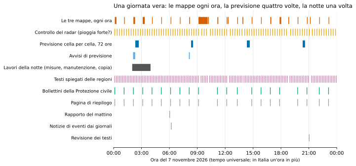
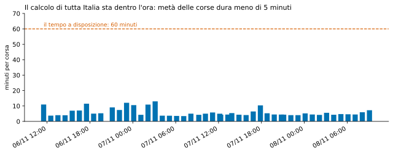
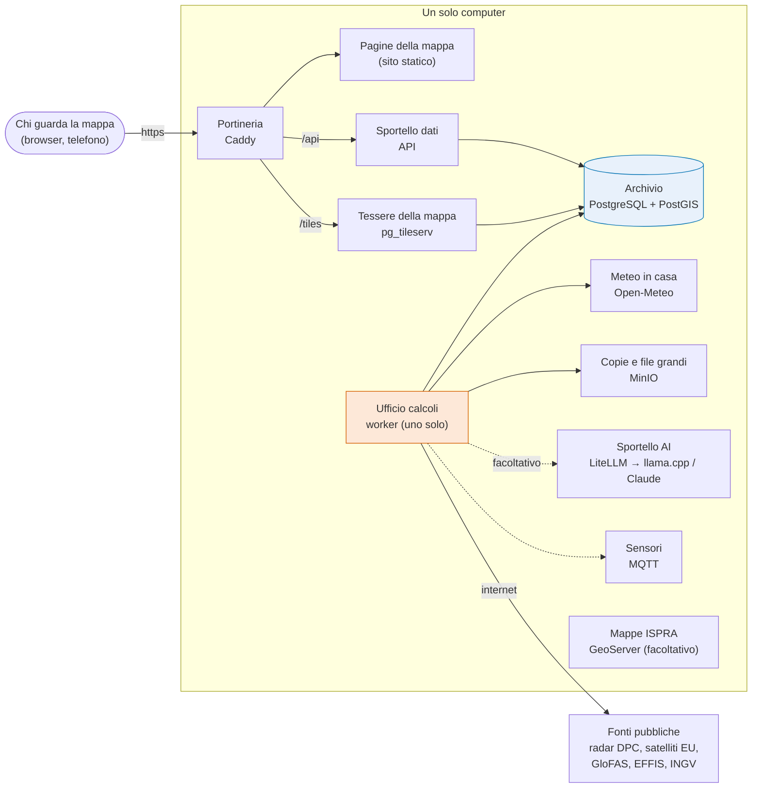
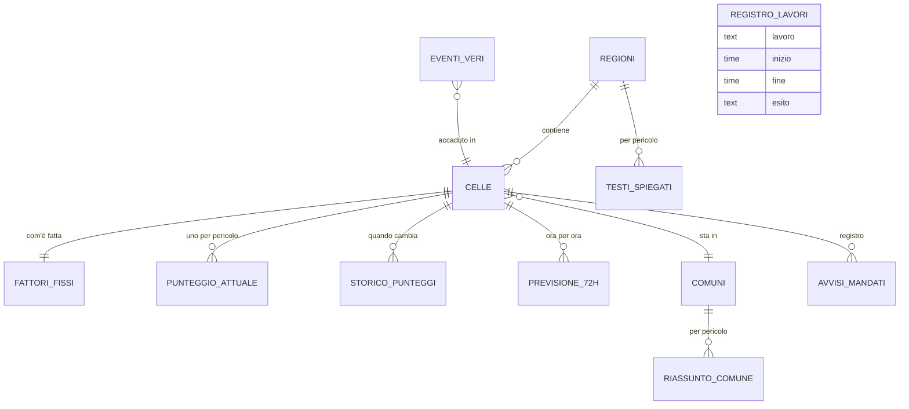
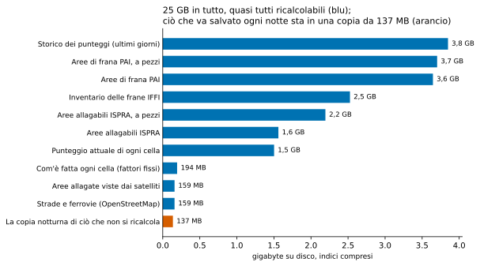

# 7. Come gira: worker, cadenze, database, mappa

!!! abstract "In breve"
    - Limen ha **tre ritmi**: ogni ora ricalcola le tre mappe di tutta
      Italia; quattro volte al giorno calcola la previsione cella per cella
      per le 72 ore successive; ogni notte fa misure e manutenzione.
    - Il calcolo di tutta Italia, 312.550 celle per tre pericoli, dura di
      solito **circa cinque minuti** su un'ora a disposizione (misura del 6-8
      novembre 2026).
    - Tutto gira su **un solo computer**, diviso in una decina di
      «scatole» (container): il database, chi risponde alla mappa, chi fa i
      calcoli in sottofondo, il meteo in casa, l'archivio delle copie.
    - La mappa è **pubblica e senza registrazione**. Le uniche azioni
      riservate, come scaricare nuovi dati, chiedono una parola d'ordine.
    - Il database pesa 25 GB, ma quasi tutto si ricalcola. Ciò che non si
      ricalcola sta in una **copia notturna di circa 140 MB**, che oggi però
      resta sulla stessa macchina.

I capitoli precedenti hanno spiegato *che cosa* calcola Limen. Questo
racconta *come* lo fa, giorno dopo giorno: chi lavora, quando, dove tiene i
dati, come arrivano sulla mappa che vedi nel browser. È il capitolo più
vicino alla «sala macchine», ma si può leggere senza sapere niente di
informatica: basta pensare a un piccolo ufficio con turni e archivi.

## Una giornata di Limen

Prendiamo una giornata vera, il 7 novembre 2026, e seguiamola dal registro
in cui Limen annota ogni lavoro che fa. Gli orari sono in tempo universale:
in Italia, d'inverno, bisogna aggiungere un'ora.

*Fonte: registro dei lavori dell'installazione attuale (venti regioni), sola
lettura, misura dell'8 novembre 2026. La barra lunga delle mappe verso le
9 è una corsa interrotta da un riavvio.*

**Mezzanotte.** Le tre mappe vengono ricalcolate, come a ogni ora. Il
programma chiede il meteo per tutta Italia al proprio servizio meteo
«in casa», legge com'è fatto ogni chilometro quadrato, applica le tre
formule del [capitolo 4](04-i-motori.md) e salva il risultato. Se una cella
supera la soglia, parte un avviso sui canali configurati, ma non più di una
volta ogni tre ore per la stessa cella.

**Ogni quarto d'ora**, nel frattempo, un controllo guarda l'ultima immagine
del radar della Protezione civile. Se vede pioggia forte su una regione, la
ricalcola subito senza aspettare il turno dell'ora: è il motivo per cui la
riga arancione della figura è così fitta.

**Le 2 del mattino: la notte.** Parte la catena dei lavori notturni, uno dopo
l'altro, e un errore in uno non ferma i successivi:

- aggiorna la memoria del meteo che serve all'incendio con la pioggia
  davvero caduta;
- se è acceso, fa girare in ombra il modello addestrato e controlla la
  deriva (lo spiega il [capitolo 6](06-ml-e-ai.md));
- prepara le «pagine» del database per i giorni successivi e butta quelle
  troppo vecchie;
- controlla quanto spazio resta sul disco;
- fa la **copia di sicurezza** dello stato;
- scarica i nuovi perimetri degli incendi e delle aree allagate osservate
  dai satelliti europei;
- infine, il lavoro più lungo: per ogni punto sui fiumi calcola qual è la
  portata «normale alta», con cui il motore alluvione confronta la piena
  prevista. Lo fa a piccoli passi, per non superare il numero di richieste
  che il servizio europeo concede in un giorno. Da solo occupa quasi due ore
  delle due che dura la notte.

**Le 2:20, le 8:20, le 14:20, le 20:20: la previsione.** Quattro volte al
giorno Limen ricalcola le tre mappe **per le 72 ore successive**, ora per
ora, con il meteo previsto. È ciò che si vede spostando il cursore del tempo
sulla mappa. Una volta lo faceva solo di notte, ma il 7 ottobre 2026 una
previsione calcolata alle 2 del mattino ha mostrato la Basilicata «molto
alta» per l'incendio per tutto il giorno, mentre le corse meteo del mattino
portavano pioggia: la stessa formula, con il meteo aggiornato, dava zero. Da
allora la previsione si rinnova ogni sei ore. Ogni corsa dura fra i 12 e i 22
minuti.

**Ogni dieci minuti** un altro addetto guarda se in qualche regione la
situazione si è alzata, e in quel caso chiede al modello linguistico un
testo che la spieghi (il [capitolo 6](06-ml-e-ai.md) racconta come, e perché
oggi quel testo è quello di riserva).

**La mattina** si prepara un rapporto riassuntivo e si leggono i giornali
online in cerca di notizie di frane, alluvioni e incendi, per confrontarle
con quello che Limen aveva previsto. **Ogni ora** si scaricano i bollettini
di allerta della Protezione civile e si aggiorna una pagina di riepilogo.
**La sera alle 21** un revisore rilegge un campione dei testi del giorno.

E il calcolo dell'ora, quanto dura? Questo è il grafico di tutte le corse
nazionali di due giorni.

*Fonte: registro dei lavori, 48 corse complete fra il 6 e l'8 novembre
2026, installazione attuale.*

Metà delle corse dura meno di cinque minuti, la più lunga tredici. C'è
margine. Non è sempre stato così: quando dentro il calcolo orario c'era
anche la scrittura dei testi con l'AI, una sola regione richiedeva 156
secondi, di cui 140 per i testi e meno di uno per le formule. Togliere i
testi dal calcolo dell'ora è stata la decisione che ha reso possibile
coprire tutta Italia.

??? note "Per chi sviluppa"
    - Le tre cadenze sono un invariante (#78): profilo `hourly` (solo
      formula, salvataggio, avvisi; niente LLM, niente ombra), lavoro
      asincrono `briefing_enrichment`, pipeline notturna `limen-nightly`
      (`src/limen/api/jobs/nightly.py`, ordine in `STEPS`). La previsione
      per cella è `limen-forecast-history` a
      `SCHEDULER__FORECAST_CELLS_HOURS_UTC` (02/08/14/20, minuto 20).
    - Altri lavori: `limen-nowcast-monitoring` (radar DPC, ogni
      `NOWCAST__INTERVAL_MINUTES`, 15), `limen-forecast-monitoring` (avvisi
      PREVISIONE a 48 h, ogni `FORECAST__INTERVAL_HOURS`, 6),
      `limen-dpc-bollettini`, `limen-html-report`, `limen-daily-report`
      (`REPORT__HOUR_UTC`, 6), `limen-raccolta-eventi`,
      `limen-fedelta-racconti` (21 UTC), `limen-alert-digest`,
      `limen-partitions`, `limen-worker-heartbeat`. Elenco e ultimo esito:
      `uv run limen jobs`.
    - Numeri del 6-8 novembre 2026 (`job_runs`, ultimi 7 giorni): sweep
      orario nazionale 48 corse ok, media 353 s, massimo 779 s; notte media
      6.973 s, di cui `glofas_riferimenti` 6.769 s; previsione per cella
      744-1.324 s.
    - Il registro: tabella `job_runs` (una riga per lavoro e per regione,
      con `metrics` in JSON). Una corsa lasciata a metà da un riavvio viene
      chiusa al riavvio successivo con l'errore «interrotto: il worker … si
      è fermato senza chiudere la corsa».

## Le scatole: come è fatto il sistema

### Un solo computer, una decina di container

Limen gira su **un solo computer**, senza servizi cloud. Il computer è
diviso in **container**: pensali come stanze separate dello stesso ufficio,
ognuna con il suo mestiere e la sua porta. Se una stanza ha un problema, le
altre continuano a lavorare, e ogni stanza si può rifare da capo senza
toccare le altre.

*I container di Limen e chi parla con chi. Le linee tratteggiate sono pezzi
facoltativi.*

Le stanze, una per una:

- **L'archivio** è il database PostgreSQL con l'estensione PostGIS, che
  sa trattare le forme geografiche: celle, confini, aree allagabili. Tutto
  quello che Limen sa sta qui.
- **L'ufficio calcoli** (in gergo *worker*) è il programma che fa tutti i
  lavori a orario della giornata vista sopra. Non risponde a nessuno da
  fuori: lavora e scrive nell'archivio.
- **Lo sportello dati** (in gergo *API*) risponde alle domande della mappa:
  «com'è questa cella?», «quali comuni sono più a rischio?». Non calcola
  niente di nuovo: legge dall'archivio.
- **Le tessere della mappa**: una mappa web non arriva tutta insieme, ma a
  quadratini (in inglese *tiles*, tessere) che il browser chiede man mano che
  si sposta lo sguardo. Un piccolo programma, pg_tileserv, le ritaglia
  direttamente dall'archivio.
- **Le pagine della mappa** sono il sito che si apre nel browser.
- **La portineria** (Caddy) è l'unica porta aperta verso internet: riceve
  ogni richiesta, la protegge con il lucchetto HTTPS e la passa alla stanza
  giusta.
- **Il meteo in casa** è una copia del servizio Open-Meteo che scarica ogni
  giorno i modelli meteo europei (del centro europeo ECMWF e del servizio
  tedesco DWD) e li serve a Limen. Esiste perché il servizio pubblico concede
  10.000 richieste al giorno, e il 29 settembre 2026 Limen le aveva finite:
  alluvione e incendio erano a zero su tutta l'Italia per mancanza di dati,
  non per calma.
- **L'archivio delle copie** (MinIO) è un magazzino di file compatibile con
  lo standard S3 usato da molti servizi: ci finiscono le copie di sicurezza.
- Facoltativi: lo **sportello dell'AI**, che smista le richieste di testo fra
  un modello locale e uno in cloud; il **ricevitore dei sensori** (MQTT) per
  le stazioni dei cittadini; **GeoServer**, che pubblica le mappe ISPRA come
  strati da sovrapporre. Nessun punteggio dipende da loro.

??? note "Per chi sviluppa"
    - Compose: `infra/docker/docker-compose.demo.yml` (postgres, api,
      worker, mcp, mosquitto, pg_tileserv, frontend-static, proxy Caddy),
      `docker-compose.meteo.yml` (Open-Meteo 1.6.0 più due sincronizzatori,
      IFS ed ICON), `docker-compose.backup.yml` (MinIO),
      `docker-compose.inference.yml` (LiteLLM, llama-swap, embedding),
      `docker-compose.geoserver.yml`, `docker-compose.observability.yml`,
      `docker-compose.sensori*.yml`.
    - Sull'installazione dell'8/11/2026 girano: `limen-postgres`,
      `limen-api`, `limen-worker`, `limen-pg-tileserv`,
      `limen-frontend-static`, `limen-proxy`, `limen-minio`,
      `limen-openmeteo` con `-sync-ifs` e `-sync-icon`, `limen-mosquitto`.
      Non girano MCP, LiteLLM, GeoServer, osservabilità.
    - API e worker sono la **stessa immagine** con comandi diversi
      (`limen serve`, `limen worker`). Le migrazioni le applica l'API
      all'avvio; il worker le aspetta.
    - Dai container l'host è `host.docker.internal`, mai `127.0.0.1`.

### Perché un solo ufficio calcoli

L'ufficio calcoli è **uno solo**, per scelta. Dentro, una specie di
semaforo impedisce che due calcoli nazionali partano insieme e si pestino i
piedi. Il semaforo funziona solo dentro lo stesso programma: con due uffici
calcoli ci sarebbero due semafori e due calcoli in parallelo. Invece di
costruire un semaforo condiviso, più complicato, il progetto ha scritto in
chiaro: **una sola copia**.

Lo sportello e l'ufficio calcoli sono separati per un'altra ragione. Una volta
erano un solo programma, e mentre macinava 312.000 celle la mappa pubblica
rispondeva lentamente. Ora lo sportello serve la mappa e basta.

Il prezzo della scelta è che, quando l'ufficio calcoli si riavvia (per un
aggiornamento, per esempio), il lavoro in corso si interrompe e riparte al
turno successivo. Nel registro del 6 e 7 novembre si vedono tre interruzioni
di questo tipo.

??? note "Per chi sviluppa"
    - `_sweep_lock` in `src/limen/api/jobs/hourly_monitoring.py` è un
      `asyncio.Lock` di processo; per questo `deploy.replicas: 1` nel
      compose (#77). `SCHEDULER__ENABLED=false` nel container `api`.
    - Concorrenza fra regioni dentro lo sweep:
      `SCHEDULER__SWEEP_CONCURRENCY` (default 4).

## L'archivio: dove stanno i dati

### Le tabelle principali

Un database è fatto di **tabelle**, come fogli di calcolo con righe e
colonne. Quelle che contano per capire Limen sono poche.

*Le tabelle principali, con nomi in italiano. I nomi veri sono nel riquadro
qui sotto.*

- **Le celle**: 312.550 quadrati da un chilometro, ciascuno con la sua
  regione e il suo comune.
- **I fattori fissi**: com'è fatta ogni cella, cioè pendenza, rocce, frane
  censite vicine, aree allagabili, boschi, strade. Si calcolano una volta,
  quando arrivano i dati del territorio ([capitolo 3](03-i-dati.md)).
- **Il punteggio attuale**: una riga per cella e per pericolo, cioè 937.650
  righe, riscritte a ogni calcolo dell'ora. È quello che vedi sulla mappa.
- **Lo storico dei punteggi**: non una fotografia ogni ora (sarebbero 19
  milioni di righe al giorno, ed è successo: hanno riempito il disco), ma
  una riga solo quando il punteggio di una cella **cambia** in modo visibile,
  più una riga di controllo al giorno anche per le celle ferme.
- **La previsione a 72 ore**: per ogni cella e pericolo, ora per ora.
- **Il riassunto per comune**: quanto è esposto ogni comune, che è
  l'unità con cui pensa chi riceve un'allerta.
- **Gli avvisi mandati**: un registro, consultato prima di ogni nuovo
  avviso per non ripetere lo stesso avviso ogni ora.
- **Gli eventi veri**: frane, alluvioni e incendi accaduti, che servono a
  misurare ([capitolo 5](05-misurare.md)).
- **Il registro dei lavori**: ogni corsa di ogni lavoro, con inizio, fine
  ed esito. Da qui vengono i grafici di questo capitolo.

??? note "Per chi sviluppa"
    | Nome nel libro | Tabella |
    |---|---|
    | Regioni | `aoi` |
    | Celle | `grid_cells` |
    | Fattori fissi | `cell_static_factors` |
    | Punteggio attuale | `latest_risk` (migrazione 048) |
    | Storico | `risk_assessments` (partizionata per giorno UTC) |
    | Previsione 72 h | `latest_forecast` |
    | Comuni, riassunto | `comuni`, `cell_comune`, `mv_comune_risk` |
    | Avvisi | `alert_dispatches`, `forecast_dispatches` |
    | Testi spiegati | `spiegazioni_regione` |
    | Eventi veri | `landslide_events`, `flood_events`, `fire_events`, `verifiche_eventi` |
    | Registro | `job_runs` |

    Lo schema completo è in `docs/data-model.md` e nelle migrazioni
    `src/limen/data/migrations/NNN_*.sql` (088 all'8/11/2026), che non si
    modificano mai una volta applicate. La soglia dello storico è
    `SCORING__HISTORY_MIN_DELTA` (0,02) con un battito di
    `SCORING__HISTORY_HEARTBEAT_HOURS` (24) (#135).

### Pagine per giorno, e la pulizia

Le due tabelle che crescono più in fretta, lo storico dei punteggi e i
risultati del modello in ombra, sono divise **per giorno**, come un
quaderno con una pagina per data. Quando una pagina è troppo vecchia (dopo
14 giorni per lo storico), la si strappa tutta intera invece di cancellare
le righe una a una: è molto più veloce e non lascia buchi. Ogni notte si
preparano le pagine dei giorni successivi, così il calcolo dell'ora trova
sempre una pagina pronta su cui scrivere.

*Fonte: catalogo del database dell'installazione attuale, sola lettura, 8
novembre 2026; copia notturna dell'8 novembre (registro dei lavori). Le
dimensioni sono su disco con gli indici; la copia è compressa.*

Il grafico dice una cosa importante per chi deve custodire Limen: dei 25 GB
dell'archivio, **quasi tutto si può ricalcolare**. Lo storico si riforma da
solo in pochi giorni; le aree di frana e di alluvione si riscaricano da
ISPRA; il punteggio attuale si riscrive al primo calcolo. Ciò che **non** si
ricalcola, perché costa settimane di richieste ai servizi esterni o perché è
lavoro umano, sta in una copia notturna di circa 140 MB: le verifiche degli
eventi, la memoria del meteo per l'incendio, le portate normali dei fiumi, i
testi, il registro degli avvisi, i sensori.

??? note "Per chi sviluppa"
    - Partizioni RANGE per giorno UTC su `computed_at` per
      `risk_assessments` e `model_runs`; `ensure_partitions()` prima di ogni
      sweep (job `limen-partitions`, registrato sempre), retention con
      `drop_expired_partitions()`, mai `DELETE`
      (`SCORING__ASSESSMENTS_RETENTION_DAYS`=14,
      `SCORING__MODEL_RUNS_RETENTION_DAYS`=30). Righe nella partizione
      `*_default` sono un bug.
    - Misura dell'8/11/2026: `risk_assessments` 3,85 GB in 13 partizioni,
      4.797.055 righe; `latest_risk` 1,5 GB; database 24,9 GB.

### Dal database alla mappa

Quando apri la mappa, il browser chiede le tessere della zona che stai
guardando. La portineria passa la richiesta al ritagliatore di tessere, che
chiede all'archivio le celle di quel riquadro con il loro punteggio attuale e
le restituisce in un formato compatto. Il browser le colora con la scala a
cinque classi del [capitolo 4](04-i-motori.md). Una cella che non ha ricevuto
il dato meteo che le serve si colora di **grigio**, lo stesso delle celle non
valutate: «non misurato» non è «nessun pericolo».

Spostando il cursore del tempo nel passato o nel futuro, il browser cambia
solo l'indirizzo delle tessere, senza ricaricare la pagina: il passato viene
dallo storico, il futuro dalla previsione a 72 ore.

La mappa è disegnata con **MapLibre**, una libreria libera per mappe web, ed
è **pubblica**: non c'è registrazione, non c'è login. Le pagine sono
leggibili da chiunque: la mappa, le regioni, i comuni, le verifiche degli
eventi, la guida, le fonti dei dati, la diagnostica del modello.

??? note "Per chi sviluppa"
    - Superfici delle tessere: la vista `v_risk_tiles` (frana, pericolo
      predefinito), la funzione `risk_at(z,x,y,hours_ago,hazard)` per gli
      altri pericoli e per il passato, `forecast_at(z,x,y,p_horizon,p_hazard)`
      per il futuro (migrazione 060, PL/pgSQL con `EXECUTE`). Caddy inoltra
      `/tiles/*` a `pg_tileserv:7800`.
    - `mv_latest_risk` dalla migrazione 048 **non è più una vista
      materializzata**: è una vista normale su `grid_cells` più
      `latest_risk`, scritta in upsert dallo stesso passo che salva lo sweep.
      `refresh_mv_latest_risk()` resta e aggiorna solo il riassunto per
      comune (`mv_comune_risk`, che invece è materializzato).
    - SPA: `frontend/` (Vite, React, Mantine, MapLibre). Rotte:
      `#/`, `#/regioni`, `#/dashboard`, `#/verifiche`, `#/come-funziona`,
      `#/integrazioni`, `#/fonti`, `#/modello`, `#/diagnostica-ml`,
      `#/sensori`, `#/documentazione`, `#/installazione`.

## Porte chiuse e una parola d'ordine

### Una sola porta verso l'esterno

Ogni stanza ha una porta, ma **solo la portineria è aperta verso
internet**. Tutte le altre porte rispondono soltanto dall'interno del
computer stesso. Sembra ovvio, ma non lo è: il programma che gestisce i
container scrive le sue regole di rete *prima* di quelle del firewall del
computer, quindi una porta aperta per sbaglio resterebbe aperta anche con il
firewall acceso. Per questo ogni porta di Limen nasce chiusa, e per aprirla
bisogna dirlo esplicitamente.

### La parola d'ordine dell'installazione

Limen non ha utenti né password personali: chi guarda la mappa non lascia
nessun dato. Esiste però una pagina, **Installazione**, da cui si può
chiedere di scaricare i dati del territorio di una regione e di caricarli
nelle celle. Guardare lo stato di quella pagina è libero; **avviare** un
download chiede una parola d'ordine unica, scritta nella configurazione del
server. Non è un login: non ci sono account, ruoli o sessioni. Se la parola
d'ordine non è impostata, quelle azioni sono semplicemente spente.

??? note "Per chi sviluppa"
    - Ogni `ports:` usa una variabile `LIMEN_*_BIND` con default
      `127.0.0.1`; solo `LIMEN_PROXY_BIND` è `0.0.0.0` (porte 80 e 443).
    - Token: `INSTALLAZIONE__TOKEN`, intestazione `X-Limen-Token`, confronto
      a tempo costante, mai nei log (`TokenInstallazioneDep` in
      `src/limen/api/dependencies.py`, #403). Generato da
      `scripts/nuovo_host.sh`. Lo stesso schema vale per `MCP_ADMIN_TOKEN`.
    - Niente autenticazione utente (epic #69): non reintrodurla per
      un'area operatore ipotetica.

## Le copie di sicurezza

Ogni notte Limen fa una **copia dello stato** che non si può ricalcolare: la
struttura di tutte le tabelle, i dati che contano, il registro dei modelli
addestrati e i loro file. La copia si chiude con un elenco firmato del suo
contenuto: una copia senza quell'elenco è considerata interrotta e non viene
usata. Il ripristino conta le righe e, se non tornano, si ferma con un
errore invece di fingere di essere riuscito.

Sull'installazione attuale la copia dell'8 novembre pesa 137 MB e richiede
20 secondi. Il punto debole è **dove** finisce: nel magazzino di file che sta
sullo stesso computer. Se si rompe il disco, si perdono insieme l'originale e
la copia. Il progetto prevede di mandarla fuori, su un servizio compatibile
con lo stesso standard, e non è ancora stato fatto. E una copia non è
davvero una copia finché qualcuno non l'ha usata per rimettere in piedi il
sistema su una macchina pulita: anche questa prova manca.

??? note "Per chi sviluppa"
    - Modulo: `src/limen/data/backup.py` (#304); comando `limen backup`
      (`make backup`, `make backup-elenco`); passo `backup` della notte.
      Contenuto: `limen.dump` (`pg_dump --format=custom`, dati esclusi per le
      tabelle di `BACKUP__SOLO_SCHEMA`), `ruoli.sql`, `mlflow.dump`,
      `mlruns.tar.gz`, `manifest.json` scritto per ultimo.
    - Misura dell'8/11/2026 (`job_runs`, `scope=backup`): 137.019.599 byte,
      19,8 s. `BACKUP__ENDPOINT_URL` punta al MinIO locale.
    - Allarme: `integration.degraded label=backup.stale` dopo
      `BACKUP__ETA_MASSIMA_ORE` (36).

## Dove gira oggi

L'installazione di cui si parla in questo libro, con le misure dell'8
novembre 2026, gira su un **computer Mac con processore Intel**, con tutte
le venti regioni caricate. Il progetto è nato su un server dedicato con una
scheda grafica, che serviva per il modello linguistico locale; il
trasferimento è descritto nel documento di passaggio del repository. Due
conseguenze, già viste nel capitolo 6: senza scheda grafica non c'è modello
linguistico in casa, e la libreria per il piccolo modello di rete neurale
sulla pioggia non esiste più per questi processori.

Per un ente che volesse ospitare Limen, il riferimento resta un **server
Linux di media potenza** con Docker. Per aggiungere una regione non serve
ricalcolare le altre: circa 22 minuti per gli strati nazionali e un minuto
per i fattori della regione (misura della issue #407). Un **pacchetto
rapido** con i fattori già calcolati per tutta Italia, circa 22 MB in tre
file con tre licenze diverse, accorcia ancora l'installazione: il programma
d'installazione lo sa già usare, ma il pacchetto non è ancora pubblicato e la
pagina Installazione non lo propone (issue #406).

??? note "Per chi sviluppa"
    - Installazione: `scripts/installa.sh`, `scripts/nuovo_host.sh`
      (`LIMEN_PACCHETTO_URL` per il pacchetto rapido, PR #464); dati:
      `limen dati scarica --tutte` nel worker, poi
      `scripts/load_static_data.sh` (l'unico percorso per i dati statici).
    - Il documento di passaggio è `docs/HANDOFF.md`; i runbook in
      `docs/runbook.md` e `docs/deployment.md`.

## Gap e come chiuderli

Che cosa manca, in breve. Il dettaglio tecnico sta nella issue indicata.

- **La copia di sicurezza resta sullo stesso computer.** Un guasto al disco
  porterebbe via l'originale e la copia insieme. Serve un magazzino fuori
  macchina, anche presso un ente partner. ([#490](https://github.com/agent-engineering-studio/limen/issues/490))
- **Il ripristino non è mai stato provato su una macchina pulita.** Finché
  non si rimette in piedi Limen da zero con la sola copia, «si può
  ripristinare» è un'ipotesi. (issue: #307)
- **Un solo ufficio calcoli, e i riavvii interrompono il lavoro.** È una
  scelta voluta, ma ogni aggiornamento interrompe il calcolo in corso; nel
  registro del 6 e 7 novembre ci sono tre interruzioni. (issue: #308)
- **Gli avvisi di previsione slittano a ogni riavvio.** Partono «ogni sei
  ore a contare dall'avvio» invece che a orari fissi: dopo i riavvii del 7
  novembre non sono partiti per 19 ore, dalle 8:05 alle 3:05 del giorno
  dopo. La previsione della mappa, che usa orari fissi, non ha questo
  problema. ([#489](https://github.com/agent-engineering-studio/limen/issues/489))
- **Il pacchetto rapido non è pubblicato né proposto dalla pagina di
  installazione.** Aspetta la verifica delle licenze regione per regione.
  *Proposta di dati aperti:* pubblicarlo su Zenodo, l'archivio aperto che dà
  a ogni versione un identificativo permanente (<https://zenodo.org>).
  (issue: #406)
- **La macchina di oggi non è un server.** Un computer Mac con processore
  Intel, senza scheda grafica: niente modello linguistico in casa, niente
  rete neurale sulla pioggia. Per un servizio a un ente serve un server
  Linux dedicato. (issue: #308)
- **Alcuni documenti tecnici descrivono il sistema di prima.** La guida
  operativa dice ancora che i lavori a orario girano nello sportello dati e
  li elenca con le cadenze vecchie; la guida di progetto chiama «vista
  materializzata» quella che dal settembre 2026 è una vista normale. Chi
  riprende il lavoro parte da informazioni sbagliate. ([#493](https://github.com/agent-engineering-studio/limen/issues/493))

## Per approfondire

- Documentazione tecnica nel repository:
  [architettura](https://github.com/agent-engineering-studio/limen/blob/main/docs/architecture.md),
  [archivio dei dati](https://github.com/agent-engineering-studio/limen/blob/main/docs/data-model.md),
  [installazione](https://github.com/agent-engineering-studio/limen/blob/main/docs/deployment.md),
  [guida operativa](https://github.com/agent-engineering-studio/limen/blob/main/docs/runbook.md),
  [modelli linguistici](https://github.com/agent-engineering-studio/limen/blob/main/docs/inference.md).
- Le issue citate: [#78](https://github.com/agent-engineering-studio/limen/issues/78)
  (le tre cadenze), [#77](https://github.com/agent-engineering-studio/limen/issues/77)
  (il worker separato), [#135](https://github.com/agent-engineering-studio/limen/issues/135)
  (lo storico che riempiva il disco), [#142](https://github.com/agent-engineering-studio/limen/issues/142)
  (il meteo in casa), [#304](https://github.com/agent-engineering-studio/limen/issues/304)
  (le copie), [#307](https://github.com/agent-engineering-studio/limen/issues/307),
  [#308](https://github.com/agent-engineering-studio/limen/issues/308),
  [#406](https://github.com/agent-engineering-studio/limen/issues/406),
  [#407](https://github.com/agent-engineering-studio/limen/issues/407).
- Componenti: PostgreSQL, partizioni
  <https://www.postgresql.org/docs/16/ddl-partitioning.html>; pg_tileserv
  <https://github.com/CrunchyData/pg_tileserv>; MapLibre
  <https://maplibre.org>; Open-Meteo <https://github.com/open-meteo/open-meteo>;
  Caddy <https://caddyserver.com>; MinIO <https://min.io>; llama-swap
  <https://github.com/mostlygeek/llama-swap>; LiteLLM
  <https://github.com/BerriAI/litellm>.
