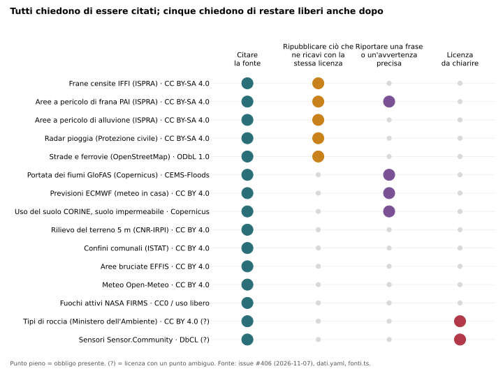
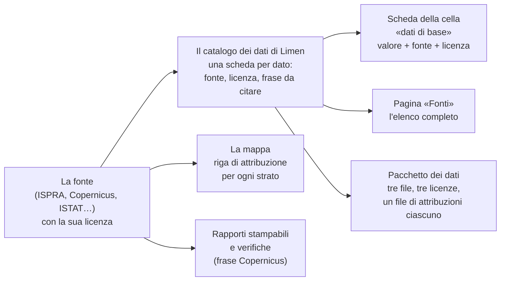
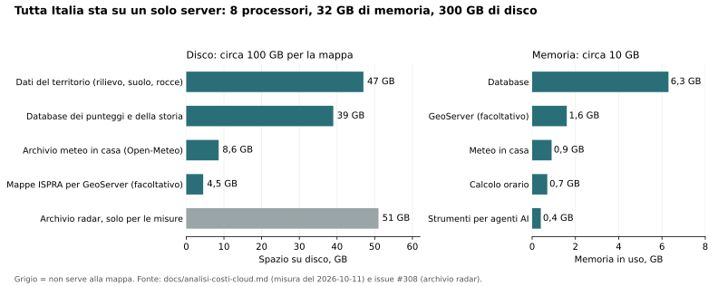
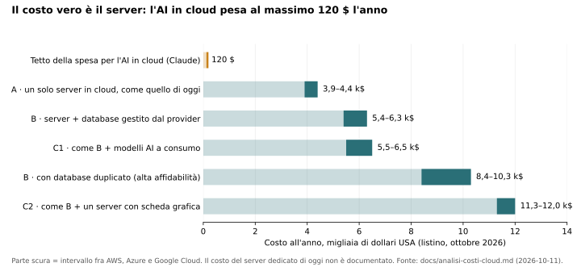

# 8. Trasparenza, licenze, riproducibilità, costi

!!! abstract "In breve"
    - Il codice di Limen è **libero**: chiunque può usarlo, studiarlo,
      cambiarlo e ridistribuirlo. Chi lo migliora, anche offrendolo come
      servizio su internet, deve restituire il miglioramento a tutti.
    - Ogni dato viene da un ente pubblico o da un progetto aperto, e **ogni
      fonte chiede di essere citata**. Limen lo fa sulla mappa, nella scheda
      di ogni cella e nei file che distribuisce. Alcune fonti chiedono di più,
      e il capitolo spiega cosa.
    - Ogni numero si può **rifare**: le regole del calcolo sono scritte in
      file leggibili e numerati per versione, la struttura dell'archivio non
      si può cambiare di nascosto, le misure si ripetono con un comando.
    - Tutta Italia sta su **un solo server** di media potenza. La spesa per
      l'intelligenza artificiale in cloud ha un tetto di **10 dollari al
      mese**, controllato a ogni richiesta.
    - Sulla mappa **non ci si registra** e non si lasciano dati personali. Le
      due eccezioni (chi registra un sensore, chi manda un contributo da
      esperto) sono dichiarate, e i dati non vengono mai pubblicati.

Il capitolo 1 ha promesso che ogni numero di Limen ha una formula scritta e
una fonte. Questo capitolo dice come si controlla quella promessa: chi può
usare il codice e i dati, a quali condizioni, come si rifà un calcolo da zero,
quanto costa tenere acceso il sistema e che cosa sa Limen di chi lo guarda.

## Il codice è libero, e resta libero

### Che cosa vuol dire «licenza»

Chi scrive un programma ne è l'autore, come chi scrive un libro. Senza un
permesso scritto, nessun altro potrebbe copiarlo o modificarlo. La
**licenza** è quel permesso: un testo che dice che cosa si può fare con il
programma e a quali condizioni.

Limen usa la **EUPL 1.2** (*European Union Public Licence*), la licenza
libera scritta dalla Commissione europea[^eupl]. Ha tre caratteristiche utili
a chi la sceglie in Italia:

- è valida **in italiano** come in tutte le altre lingue dell'Unione, quindi
  un Comune o una Regione la legge senza traduzioni giuridiche;
- permette a **chiunque** di usare, studiare, modificare e ridistribuire il
  codice, anche per un'attività che guadagna;
- chiede che **chi modifica Limen pubblichi le modifiche con la stessa
  licenza**, anche quando non distribuisce il programma ma lo offre come
  servizio su internet.

L'ultimo punto è il più importante. Un'azienda può prendere Limen, migliorarlo
e venderne la gestione a un ente: è previsto e va bene. Non può però tenere
per sé il miglioramento. Il motore che decide i colori della mappa non può
diventare una scatola chiusa.

**Una data da ricordare.** Limen è sotto EUPL dall'**11 ottobre 2026**. Fino
alla versione 0.6.0 era pubblicato con la licenza
**Apache 2.0**, più permissiva (non chiede di restituire le modifiche), e
quelle versioni restano Apache 2.0 per sempre: una licenza data non si
ritira.

### Il patto per chi contribuisce

Chi propone una modifica al codice di Limen accetta un breve accordo, scritto
in fondo alla guida per chi contribuisce[^cla] (in inglese si chiama *CLA*,
*Contributor License Agreement*). Dice quattro cose semplici:

1. chi contribuisce **resta autore** del proprio lavoro;
2. concede al curatore del progetto il permesso di distribuirlo **anche con
   una licenza diversa** dalla EUPL, per esempio commerciale;
3. ogni contributo accettato è **comunque pubblicato anche sotto EUPL**,
   quindi resta libero per tutti;
4. chi contribuisce garantisce di averne il diritto (per esempio, che il suo
   datore di lavoro è d'accordo).

Perché serve il secondo punto? Perché la EUPL non va bene a tutti. Un ente
che deve integrare Limen in un sistema proprio, che non può pubblicare,
avrebbe bisogno di un'altra licenza. Per offrirgliela, il curatore deve
poter dare in licenza **ogni riga** del progetto, anche quelle scritte da
altri. Senza il patto, basterebbe un solo contributo esterno per chiudere
questa strada. È la cosiddetta **doppia licenza**: libera per tutti, e su
richiesta anche a condizioni diverse per chi ne ha bisogno. Il terzo punto
garantisce che la versione libera non resti mai indietro.

??? note "Per chi sviluppa"
    - Testo della licenza: `LICENSE` nella radice del repository.
    - L'accordo è in fondo a `CONTRIBUTING.md`: si accetta scrivendo nella
      descrizione della prima pull request la riga
      «I have read the Contributor License Agreement in CONTRIBUTING.md and I accept it.»
    - La riga «License» nella tabella *Locked invariants* di `CLAUDE.md`
      fissa la data del cambio e il perché del CLA.

### Le librerie: una licenza più larga

Il capitolo 2 ha raccontato le undici librerie nate dentro Limen, quelle che
parlano con le fonti dei dati (gli incendi europei, le frane di ISPRA, il
radar della Protezione civile, e così via). Sono pubblicate con la licenza
**Apache 2.0**, non con la EUPL. La scelta è voluta: una libreria che scarica
i perimetri degli incendi serve a chiunque, anche a un programma che non ha
niente a che fare con Limen e che non può cambiare licenza. Con Apache 2.0
basta citare la fonte. Il cuore del sistema (il motore che decide) resta
EUPL; i mattoni riusabili sono il più liberi possibile.

## I dati: tutti chiedono di essere citati

### Una fonte, una licenza

Limen non produce dati sul territorio: li prende da chi li produce. ISPRA
per le frane censite e le aree pericolose, Copernicus (il programma europeo
di osservazione della Terra) per l'uso del suolo e la portata dei fiumi,
l'Istituto di ricerca per la protezione idrogeologica del CNR per il rilievo
del terreno, l'ISTAT per i confini dei Comuni, OpenStreetMap per strade e
ferrovie, la NASA per i fuochi visti dal satellite, e altri ancora. Il
capitolo 3 li racconta uno per uno.

Ognuno di questi dati ha la sua licenza. Le più comuni sono le **Creative
Commons**, una famiglia di licenze per opere e dati con nomi brevi:

- **CC BY** («attribuzione»): puoi fare quello che vuoi, purché citi la
  fonte e dica che cosa hai cambiato;
- **CC BY-SA** («attribuzione, condividi allo stesso modo»): come sopra, ma
  ciò che ricavi da quel dato va ripubblicato **con la stessa licenza**. È il
  principio della EUPL applicato ai dati.

Poi ci sono licenze proprie di alcune fonti: quella di **OpenStreetMap**
(ODbL), che funziona come CC BY-SA ma è scritta per le banche dati; quella di
**Copernicus**, che chiede una frase precisa; quella del servizio europeo per
le piene, che chiede di più, come vedremo subito.

*Fonte: tabella delle licenze verificate fonte per fonte nella issue #406
(7 novembre 2026), catalogo dei dati di Limen e elenco delle fonti della
mappa.*

La figura si legge per colonne.

- **Citare la fonte** lo chiedono tutti. Nessuna eccezione.
- **Ripubblicare con la stessa licenza** lo chiedono cinque fonti: le tre
  mappe di ISPRA (frane censite, aree a pericolo di frana, aree a pericolo
  di alluvione), il radar della pioggia della Protezione civile e
  OpenStreetMap. Chi distribuisce un dato *ricavato* da queste, per esempio
  «quante frane ci sono entro 500 metri da questa cella», deve distribuirlo
  con la loro stessa licenza.
- **Una frase o un'avvertenza precisa** la chiedono tre fonti, e una quarta
  aggiunge un limite d'uso. È la colonna da leggere con più attenzione.
- **Licenza da chiarire**: due casi, raccontati nella sezione sui gap.

### Le avvertenze che non si possono saltare

Alcune fonti non chiedono solo di essere nominate: chiedono di dire una cosa
precisa a chi guarda.

**La portata dei fiumi non è un avviso di piena.** La portata prevista dei
corsi d'acqua viene da GloFAS, il sistema globale di previsione delle piene
del servizio di emergenza di Copernicus. La sua licenza chiede due cose: la
frase «*Contiene informazioni modificate del Copernicus Emergency Management
Service*» con l'anno, e il divieto di presentare i dati come un avviso di
piena, perché quello spetta alle autorità nazionali e regionali[^cems]. Limen
mette entrambe le frasi in ogni pagina che mostra l'alluvione: sulla mappa,
nel piè di pagina, negli articoli delle verifiche, nei rapporti stampabili.
Togliere quella riga non sarebbe una scelta di stile, ma una violazione della
licenza.

**Le mappe di pericolo di ISPRA non hanno valore legale.** ISPRA unisce in una
sola mappa nazionale le aree pericolose dei Piani di Assetto Idrogeologico
(i piani con cui le autorità di bacino disegnano dove l'acqua o il versante
possono fare danni). La sua licenza ricorda che vale per legge solo la
cartografia originale delle autorità di bacino, non il mosaico. Per un
Comune vuol dire: la mappa di Limen aiuta a guardare, ma un vincolo
urbanistico si verifica sul piano ufficiale.

**Le previsioni meteo europee.** L'istanza meteo che Limen tiene in casa usa
i dati aperti del Centro europeo per le previsioni meteorologiche a medio
termine (ECMWF), che chiede l'attribuzione e una frase di non
responsabilità per eventuali errori. Oggi Limen la scrive nella pagina delle
fonti ma non riporta quella frase: è uno dei gap del capitolo.

**I satelliti di Copernicus per il suolo.** L'uso del suolo (CORINE) e il
suolo impermeabilizzato chiedono la frase «*Generated using European Union's
Copernicus Land Monitoring Service information*», e di non far credere che
l'Unione europea approvi il lavoro di chi li usa.

### Dove compare l'attribuzione

Un'attribuzione che sta solo in un file nascosto non serve. Limen la porta
fino a dove l'occhio arriva: lo schema mostra il percorso.

*Schema: dalla fonte all'attribuzione che chi guarda vede davvero.*

Tre di queste strade sono recenti e meritano due parole.

**I «dati di base» nella scheda della cella.** Da novembre 2026, aprendo una
cella sulla mappa, sotto il punteggio compare una sezione «Dati di base»: per
ogni dato che entra nel calcolo di quel pericolo, il **valore leggibile**
(per esempio «suolo impermeabilizzato 42 %») con accanto **fonte, licenza,
frase da citare e collegamento**[^dati-base]. Chi vuole sapere perché una
cella è arancione vede da dove viene ogni ingrediente. Se un dato manca, la
scheda lo dice con due parole diverse: «non caricato» (questa installazione
non ha quel dato per la regione) oppure «non presente qui» (la cella è fuori
dalla zona che quel dato copre, per esempio fuori dalle aree a pericolo
mappate da ISPRA). In nessun caso un dato mancante viene mostrato come zero:
è la stessa regola del capitolo 1, «non misurato non è nessun pericolo».

**La pagina «Fonti».** Un elenco unico di tutte le fonti, raggruppate per
ruolo (cosa entra nel calcolo, cosa serve a verificarlo, cosa è solo sfondo),
con la licenza di ciascuna. I loghi compaiono solo dove l'ente lo concede: oggi
solo OpenStreetMap. ISTAT, l'Agenzia europea dell'ambiente, ECMWF, NASA ed
EFFIS escludono i propri loghi dal riuso, e la Protezione civile li riserva
per legge.

**Il pacchetto in tre file.** Installare Limen da zero vuol dire scaricare
circa 25 GB di dati e ricalcolare per ore i fattori di 312.550 celle: la sera
del 3 novembre 2026 ci sono volute circa sette ore[^ore]. Per chi vuole solo
usarlo, Limen prepara un **pacchetto di dati già calcolati**. Il problema
erano proprio le licenze: i valori ricavati da ISPRA devono restare CC BY-SA,
quelli da OpenStreetMap ODbL, e le due licenze **non si possono mescolare
nello stesso file**. La soluzione è stata dividere il pacchetto in **tre
file con tre licenze**, ciascuno con il suo elenco di attribuzioni:

| File | Licenza | Che cosa contiene |
|---|---|---|
| ISPRA | CC BY-SA 4.0 | frane censite, aree a pericolo di frana, aree a pericolo di alluvione |
| OpenStreetMap | ODbL 1.0 | distanza da strade e ferrovie |
| tutto il resto | CC BY 4.0 | rilievo, uso del suolo, suolo impermeabile, storia degli incendi |

Per tutta Italia il pacchetto pesa circa **22 MB**, abbastanza poco da
allegarlo a una versione del codice su GitHub[^pacchetto]. Restano fuori, e
si ricalcolano in casa, tre cose: i tipi di roccia (la licenza del Ministero
è ambigua, vedi i gap), i valori che **mescolano** dati con licenze diverse
(come la predisposizione complessiva di una cella), e lo stato della catena
meteo degli incendi, che invecchia in pochi giorni. Se un domani qualcuno
aggiungesse un dato nuovo senza dire con che licenza va distribuito, la
preparazione del pacchetto si ferma: un dato non può finire in silenzio nel
file sbagliato.

??? note "Per chi sviluppa"
    - Catalogo dei dati con fonte, licenza, attribuzione, peso:
      `src/limen/config/dati.yaml`. «Aggiungere un dato = una voce qui»; i
      dati di base della cella, la pagina di installazione e il file
      `ATTRIBUZIONI` del pacchetto leggono lo stesso file.
    - Elenco delle fonti della SPA (`#/fonti`): `frontend/src/lib/fonti.ts`.
      Frasi Copernicus: `frontend/src/lib/attribuzioni.ts` e
      `src/limen/report/regioni_pdf.py`.
    - Dati di base (#422, PR #463): `src/limen/core/dati_di_base.py`
      (funzione pura) e `src/limen/data/repos/dati_di_base_repo.py`; esposti
      in `GET /api/cell/{cell_id}/breakdown` (campo `dati_di_base`) e nello
      strumento MCP `cell_breakdown`.
    - Pacchetto (#406, PR #464): `limen static-snapshot pacchetto --uscita DIR`
      e `limen static-snapshot import --da-url <manifest.json>`; verifica dello
      sha256 di ogni file, import in una transazione.

## Rifare un numero: la riproducibilità

Un numero si può **riprodurre** quando chiunque, con gli stessi ingredienti e
la stessa ricetta, ottiene lo stesso risultato. Per un sistema che dice «qui
c'è pericolo» è la condizione minima della fiducia: se non si può rifare il
conto, si può solo credere.

Limen si regge su quattro abitudini.

### 1. La ricetta è scritta in chiaro, e ha un numero di versione

Ogni peso, ogni soglia, ogni confine fra una classe e l'altra sta in un file
di configurazione leggibile, uno per pericolo, e non dentro il codice. In
cima a ogni file c'è un **numero di versione del modello**: per esempio
il modello dell'incendio è passato dalla versione 1.0.0 alla 1.1.0 quando, a
novembre 2026, sono cambiati i pesi del combustibile (capitolo 5). Ogni
punteggio salvato porta con sé il numero della versione che l'ha calcolato.
Chi legge un numero di ottobre e uno di dicembre sa se sono stati fatti con
la stessa ricetta.

Un test automatico cambia i pesi nel file e controlla che il risultato
cambi: è la prova che non esistono numeri nascosti nel codice.

### 2. La struttura dell'archivio non si cambia di nascosto

L'archivio di Limen (il database) cambia forma nel tempo: una tabella in
più, una colonna nuova. Ogni cambiamento è un file numerato, in ordine (oggi
sono 88). Quando un file è stato applicato, **non si può più toccare**,
nemmeno per correggere un commento: Limen ne ricorda un'impronta digitale (un
codice calcolato dal contenuto, che cambia se cambia anche una virgola) e si
ferma se non torna. Per correggere si aggiunge un file nuovo. Sembra una
pignoleria; è la ragione per cui due installazioni in due città diverse
hanno con certezza la stessa struttura.

### 3. I dati del territorio hanno un'impronta

Il calcolo dei fattori del territorio (pendenza, frane vicine, uso del suolo)
è lungo. Limen ricorda per ogni passo e per ogni regione un'impronta di tre
cose: il file di partenza (quando è stato modificato e quanto pesa), il
numero di celle della regione e la versione della formula. Se nessuna delle
tre è cambiata, il passo si salta; se una è cambiata, si rifà. Così
aggiungere la Calabria non ricalcola la Puglia, e un cambio di formula non
passa inosservato[^impronte].

### 4. Le misure si rifanno con un comando

Le misure del capitolo 5 (quanti incendi, alluvioni e frane veri Limen aveva
visto prima) si rifanno con un comando per pericolo. Ognuno rigioca il
passato giorno per giorno, come se non si sapesse com'è andata, e scrive un
rapporto leggibile con accanto il **tasso di base**, cioè quanto spesso il
sistema avrebbe dato l'allarme comunque.

### Che cosa serve per rifare una misura

Riprodurre un punteggio o una misura richiede cinque ingredienti. Non sono
tutti ugualmente facili da avere.

| Ingrediente | Dove si trova | Facile? |
|---|---|---|
| Il codice, a una versione precisa | GitHub, con il numero di versione | sì |
| La ricetta (pesi e soglie) | nei file di configurazione di quella versione | sì |
| I dati del territorio | dalle fonti pubbliche, o dal pacchetto in tre file | sì, con pazienza (7 ore) o in pochi minuti col pacchetto |
| Il meteo di allora | dagli archivi di Open-Meteo e del radar della Protezione civile | sì, ma da archivi esterni che Limen non controlla |
| La «verità»: gli eventi veri | perimetri EFFIS, aree allagate Copernicus, catalogo delle frane CNR; più il registro delle verifiche di Limen | i cataloghi pubblici sì; il registro di Limen solo da un salvataggio del database |

Le ultime due righe sono il punto debole, e lo diciamo. La pioggia «come fu
prevista» il giorno prima di un'alluvione viene dall'archivio di Open-Meteo,
che esiste solo da febbraio 2024: per l'Emilia-Romagna di maggio 2023 si può
misurare solo il caso ideale con la pioggia poi caduta, e il rapporto lo
dichiara[^faenza]. E i rapporti delle misure, oggi, non sono sempre salvati
nel repository insieme alla versione esatta dei dati usati: nel repository
ce ne sono due, mentre le altre misure sono nei commenti delle issue. È uno
dei gap qui sotto.

??? note "Per chi sviluppa"
    - Rifare tutto da zero: `make init` (migrazioni, griglia, eventi, dati
      statici via `scripts/load_static_data.sh`, calibrazione). Idempotente.
    - Verificare un punteggio: `GET /api/cell/{id}/breakdown`, poi
      `GET /api/legend` per le soglie caricate; la pagina `/docs` dell'API
      elenca tutto.
    - Versioni dei modelli: `model_version` in testa a
      `src/limen/config/hazards/{landslide,flood,wildfire}.yaml`
      (`limen-deterministic-v1`, `flood-v1.3.0`, `wildfire-v1.1.0`, prima
      `wildfire-v1.0.0`), salvata su ogni riga di `risk_assessments`
      (`explanation.model_version`, con `pipeline_version` e
      `dataset_versions`).
    - Migrazioni: `src/limen/data/migrations/NNN_*.sql` (001–088), checksum
      SHA-256 in `schema_migrations` (`src/limen/data/migrate.py`).
    - Impronte del bootstrap: `src/limen/integrations/static_bootstrap/fingerprint.py`
      (`STEP_VERSION`, da incrementare quando cambia la formula e non il
      dato); `--force` o `LIMEN_BOOTSTRAP_FORCE=1` per ricalcolare.
    - Misure: `limen backtest`, `limen backtest-flood`
      (`LIMEN_BACKTEST_FLOOD_MODE=issued|observed|both`),
      `limen backtest-wildfire`, `limen verifiche-report`; finestre e AOI
      con le variabili d'ambiente documentate in ciascun comando.
    - Il controllo prima di ogni modifica: `make check` (stile, tipi,
      test, copertura ≥ 80 %).

## Quanto costa tenerlo acceso

### Un solo server, nessun cloud

Limen gira su **un server proprio** (un server dedicato o un VPS, cioè un
server virtuale affittato), con tutti i pezzi in contenitori Docker: il
database, il calcolo orario, la mappa, l'archivio meteo. Non usa i grandi
fornitori di cloud (Amazon, Microsoft, Google). È una scelta scritta nelle
regole del progetto, per tre motivi: un ente può installarlo nel proprio
centro dati, nessun fornitore può alzare il prezzo o chiudere il servizio, e
il conto è prevedibile.

Quanto serve davvero? La misura dell'11 ottobre 2026 sul server di
produzione, con tutte le venti regioni:

*Fonte: analisi dei costi in cloud del progetto, sezione «Footprint misurato»
(11 ottobre 2026), e issue #308 per l'archivio radar.*

In parole:

- **Processore**: durante il calcolo orario un solo processore lavora a
  pieno, gli altri sono quasi fermi. Il calcolo dei punteggi vero e proprio
  dura meno di un secondo su 10.000 celle; il tempo se ne va ad aspettare le
  fonti esterne.
- **Memoria**: circa 10 GB in uso, più di metà per il database.
- **Disco**: circa 100 GB per far funzionare la mappa, più 51 GB di archivio
  radar che serve solo a rifare le misure.
- Il dimensionamento consigliato è **8 processori, 32 GB di memoria, circa
  300 GB di disco**. Una sola regione ne chiede circa la metà (4 processori,
  16 GB)[^offerta].
- **Nessuna scheda grafica** è necessaria: la mappa e i punteggi non ne
  usano.

### Quanto costerebbe in cloud

Il costo del server di oggi non è scritto in nessun documento del progetto,
e quindi non lo riportiamo. Esiste invece una stima di quanto costerebbe
spostare Limen su uno dei grandi cloud, preparata a ottobre 2026 per
valutare i programmi di crediti gratuiti per progetti aperti[^costi].

*Fonte: analisi dei costi in cloud del progetto (11 ottobre 2026), prezzi di
listino dei tre grandi fornitori di cloud nelle regioni italiane.*

Il messaggio è uno: **il costo vero è il server**, fra 4.000 e 12.000 dollari
all'anno secondo quanto lo si vuole robusto. Con un database duplicato per
non fermarsi mai si arriva a circa 10.000. L'intelligenza artificiale in
cloud, invece, è una riga quasi invisibile: al massimo 120 dollari l'anno.
Lo stesso documento conclude che una scheda grafica dedicata per far girare
in casa i modelli linguistici **non conviene**: costerebbe circa 480 dollari
al mese, e pareggerebbe i modelli a consumo solo con un traffico mille volte
più grande di quello di Limen.

### Il tetto alla spesa per l'intelligenza artificiale

Il capitolo 1 ha spiegato che l'intelligenza artificiale in Limen scrive
solo parole: il breve riassunto di ogni regione, mai un punteggio. Quel
testo lo può scrivere un modello che gira in casa oppure Claude, un modello
in cloud, se chi installa Limen lo sceglie.

La spesa per Claude ha un **tetto di 10 dollari al mese**, e il tetto è
controllato **prima di ogni richiesta**: Limen somma quanto ha già speso nel
mese e, se il tetto è raggiunto, la richiesta non parte. Al suo posto
compare il testo automatico, scritto con le stesse cifre ma senza
l'eleganza della prosa. Se il conto non si riesce a leggere, la richiesta
non parte lo stesso: meglio un testo semplice che una spesa senza controllo.
Quanti testi vengono scritti (i «gettoni», cioè i pezzetti di parola che il
modello conta) è pubblico, nella pagina di diagnostica e nell'avviso «AI in
pausa» in alto sulla mappa; i dollari no, perché un indirizzo pubblico con la
spesa di un progetto non serve a chi guarda la mappa.

Senza nessuna chiave per un modello in cloud, Limen funziona lo stesso: la
mappa, i punteggi e gli avvisi non cambiano, e i riassunti sono quelli
automatici.

??? note "Per chi sviluppa"
    - Tetto: `LLM__ANTHROPIC_BUDGET_MENSILE_USD` (default 10) in
      `src/limen/config/settings.py`; controllo in
      `src/limen/agents/llm_factory/budget.py`, che solleva
      `BudgetSuperatoError`; ogni chiamata scrive una riga in `spesa_llm`
      (migrazione 083). `limen llm-spesa` per i dollari, solo da terminale.
    - Tutte le chiamate ai modelli passano dal gateway LiteLLM; il suo
      `max_budget` **non** è applicato (manca un database dietro il
      gateway): il tetto vero è quello di Limen.
    - `docs/analisi-costi-cloud.md` cita ancora un tetto del gateway di
      50 $/30 giorni: è il valore di ottobre, superato dal tetto unico di
      10 $ al mese.
    - Analisi di offerta alla pubblica amministrazione (SaaS o installazione
      presso l'ente, costi e listino ipotetici):
      `docs/analisi-offerta-pa.md`.

## Chi guarda la mappa: privacy e sicurezza

### Nessun login, per scelta

Sulla mappa di Limen **non ci si registra**. Non ci sono account, password,
profili. Tutto quello che la mappa mostra (punteggi, avvisi, comuni, la
diagnostica del modello in ombra) è aperto a chiunque. La ragione è
semplice: i dati che la alimentano sono pubblici, e un login avrebbe protetto
la pagina, non i dati. Un login sarebbe anche un archivio di persone da
custodire, con tutti gli obblighi che comporta[^login].

### Le due eccezioni, dichiarate

In due punti Limen chiede dati personali, e lo dice.

- **Chi registra un sensore** (capitolo 10) lascia la propria email e la
  posizione esatta del sensore. L'email serve a rispondere e a cancellare
  tutto su richiesta; non è mai pubblicata. La posizione esatta serve a
  legare il sensore a una cella; sulla mappa compare **arrotondata a circa
  un chilometro**. Per cancellare tutto basta rispondere alla mail di Limen.
- **Chi manda un contributo da esperto** dalla scheda di una cella («Sei un
  esperto?») scrive nome, email e, se vuole, ente e profilo professionale.
  Questi dati **viaggiano solo nella mail** a chi cura il progetto e **non
  vengono salvati** né pubblicati.

C'è poi un terzo caso che non riguarda il pubblico: chi installa Limen
configura gli indirizzi a cui mandare gli avvisi (email, Telegram). Sono
dati dell'ente che lo usa, non di chi guarda la mappa.

### Il token d'installazione non è un login

Chi installa Limen su un server scarica i dati e li carica dalla pagina
d'installazione, nel browser. Le azioni che **cambiano** qualcosa (avviare
un download, ricaricare i dati) chiedono una parola segreta, il **token
d'installazione**, generata una volta sul server e conservata dal tecnico.
Guardare lo stato resta aperto a tutti, come il resto della mappa. Il token
non crea utenti, non salva nomi, non registra chi entra: se manca, le azioni
sono semplicemente spente. Lo stesso schema protegge i pochi comandi con cui
un assistente AI esterno può avviare un calcolo o un rapporto.

### Le porte chiuse verso l'esterno

Un server ha delle «porte» numerate, una per ogni servizio (il database, la
mappa, l'archivio meteo). Limen apre ognuna **solo verso il server stesso**;
il pubblico arriva alla mappa da un'unica porta sicura, quella del sito web
cifrato (HTTPS), attraverso un intermediario che smista le richieste. La
regola esiste perché Docker, che fa girare i contenitori, scavalca il
firewall del server: una porta aperta per sbaglio sarebbe raggiungibile da
internet anche se il firewall dice di no. Un controllo aveva trovato
un'eccezione, il pannello di monitoraggio facoltativo: ora è chiusa anche
quella, e una prova automatica ferma ogni modifica che riaprisse una porta.

??? note "Per chi sviluppa"
    - Token: `INSTALLAZIONE__TOKEN`, header `X-Limen-Token`, confronto a
      tempo costante, mai nei log (`TokenInstallazioneDep` in
      `src/limen/api/dependencies.py`); `MCP_ADMIN_TOKEN` per gli strumenti
      MCP che modificano lo stato. Variabile assente ⇒ azioni spente.
    - Porte: ogni `ports:` nei compose usa una variabile `LIMEN_*_BIND` con
      default `127.0.0.1`; l'osservabilità usa `LIMEN_GRAFANA_BIND` (3000)
      e `LIMEN_OTLP_BIND` (4317, 4318). `tests/unit/test_compose_porte.py`
      legge tutti i compose e fallisce su una porta senza indirizzo
      esplicito; l'unica eccezione ammessa è il proxy Caddy, che esiste per
      essere l'ingresso pubblico.
    - Contributi: `src/limen/api/endpoints/contributi.py` e
      `src/limen/core/contributi.py` (inviati per mail, non salvati; limite
      di invii per indirizzo). Sensori: `docs/guida/sensori.md`, sezione
      «Dati personali»; cancellazione con
      `limen sensore cancella-registrante <email>`.
    - Modello delle minacce: `SECURITY.md` e `.oss-scanner/threat_model.md`.
      Le vulnerabilità si segnalano per email, non con una issue pubblica.

## Gap e come chiuderli

Che cosa manca, in breve. Il dettaglio tecnico sta nella issue indicata.

- **Alcune attribuzioni sulla mappa sono sbagliate o mancano.** Gli strati
  ISPRA delle frane censite e delle aree a pericolo di frana sono attribuiti
  come «CC BY» invece di «CC BY-SA», e la pagina delle fonti fa lo stesso per
  le frane censite; i tipi di roccia sono attribuiti a ISPRA invece che al
  Ministero dell'Ambiente; la frase di non responsabilità chiesta da ECMWF non
  compare. Conta perché un errore di licenza si propaga a chi riusa i dati.
  ([#491](https://github.com/agent-engineering-studio/limen/issues/491))
- **La licenza dei tipi di roccia è ambigua.** Il Ministero dell'Ambiente
  pubblica la carta geolitologica con licenza CC BY 4.0, ma le note legali
  parlano anche di «utilizzi istituzionali». Finché non è chiaro, quel dato
  resta fuori dal pacchetto e si ricalcola in casa. Serve una risposta
  scritta del Ministero. ([#495](https://github.com/agent-engineering-studio/limen/issues/495); contesto nella #406)
- **Il pacchetto rapido non è ancora provato su un server pulito.** È il
  secondo criterio della #406: misurare il tempo da zero ai tre pericoli
  calcolati. (issue: #406, #307)
- **Le misure non sono sempre archiviate con i loro ingredienti.** Molti
  risultati vivono nei commenti delle issue, senza la versione esatta dei
  dati e del meteo usati; il meteo «come fu previsto» dipende da un archivio
  esterno. *Proposta di dati aperti:* depositare ogni rapporto di misura, con
  il proprio elenco di versioni, su **Zenodo**, l'archivio aperto del CERN
  che dà a ogni deposito un identificativo permanente (DOI), già usato dal
  catalogo delle frane e-ITALICA citato nel capitolo 2
  (<https://zenodo.org>). ([#481](https://github.com/agent-engineering-studio/limen/issues/481))
- **Documenti con informazioni superate.** L'analisi di offerta alla
  pubblica amministrazione dice ancora che Limen è Apache 2.0; la guida per
  chi contribuisce rimanda a un file di configurazione che non esiste più e
  a un flusso di pubblicazione su Azure, in contrasto con la scelta «nessun
  cloud»; l'analisi dei costi cita il vecchio tetto di spesa. ([#493](https://github.com/agent-engineering-studio/limen/issues/493))
- **Il costo di oggi non è misurato.** Mancano il costo del server attuale,
  il traffico reale della mappa e il volume mensile di testo generato: senza,
  nessuna offerta a un ente e nessuna domanda di finanziamento ha una base.
  ([#492](https://github.com/agent-engineering-studio/limen/issues/492))
- **Una porta del monitoraggio era aperta verso l'esterno.** Il pannello
  facoltativo di monitoraggio pubblicava tre porte su tutte le interfacce,
  contro la regola delle porte chiuse. **Corretto**: ora si aprono solo
  verso il server stesso, e una prova automatica controlla ogni porta di
  ogni file di avvio. ([#496](https://github.com/agent-engineering-studio/limen/issues/496))
- **Manca un'informativa privacy unica e pubblica.** Le regole sui dati
  personali sono scritte bene, ma sparse fra la guida dei sensori e il modulo
  dei contributi; non c'è una pagina che dica chi è il titolare del
  trattamento, per quanto tempo si conservano i dati e come esercitare i
  propri diritti. Serve prima di ogni uso da parte di un ente. ([#494](https://github.com/agent-engineering-studio/limen/issues/494))

## Per approfondire

- [*Trasparenza e riproducibilità*](https://github.com/agent-engineering-studio/limen/blob/main/docs/divulgazione/06-trasparenza-e-riproducibilita.md), la scheda divulgativa da cui parte questo
  capitolo.
- Testo ufficiale della EUPL 1.2, in tutte le lingue dell'Unione:
  <https://joinup.ec.europa.eu/collection/eupl/eupl-text-eupl-12>; tabella
  delle licenze compatibili:
  <https://joinup.ec.europa.eu/collection/eupl/matrix-eupl-compatible-open-source-licences>.
- Licenze Creative Commons in italiano: CC BY 4.0
  <https://creativecommons.org/licenses/by/4.0/deed.it>, CC BY-SA 4.0
  <https://creativecommons.org/licenses/by-sa/4.0/deed.it>.
- Open Database License di OpenStreetMap:
  <https://opendatacommons.org/licenses/odbl/1-0/> e
  <https://www.openstreetmap.org/copyright>.
- Politica dei dati del servizio Copernicus per il territorio:
  <https://land.copernicus.eu/en/data-policy>; licenza CEMS-Floods (GloFAS):
  <https://ewds.climate.copernicus.eu/licences/cems-floods>; licenza dei dati
  EFFIS: <https://forest-fire.emergency.copernicus.eu/about-effis/data-license>.
- Dati aperti ECMWF: <https://www.ecmwf.int/en/forecasts/datasets/open-data>;
  licenza Open-Meteo: <https://open-meteo.com/en/licence>.
- La tabella completa delle licenze, fonte per fonte, con i collegamenti ai
  testi letti: issue
  [#406](https://github.com/agent-engineering-studio/limen/issues/406).
- Analisi dei costi in cloud e di offerta alla pubblica amministrazione:
  [analisi dei costi](https://github.com/agent-engineering-studio/limen/blob/main/docs/analisi-costi-cloud.md),
  [analisi dell'offerta alla pubblica amministrazione](https://github.com/agent-engineering-studio/limen/blob/main/docs/analisi-offerta-pa.md).
- Riuso del software nella pubblica amministrazione: Developers Italia,
  <https://developers.italia.it>.

[^eupl]: Il file `LICENSE` del repository e la riga «License» di `CLAUDE.md`.
[^cla]: `CONTRIBUTING.md`, sezione *Contributor License Agreement*.
[^cems]: Licenza CEMS-Floods, revisione 1; le frasi sono in
    `frontend/src/lib/attribuzioni.ts`.
[^dati-base]: Issue #422, chiusa dalla PR #463 (novembre 2026).
[^ore]: Issue #406, sezione «Problema».
[^pacchetto]: PR #464: peso misurato su 312.550 celle; la storia dei fuochi
    satellitari era vuota in quella prova, e da sola pesa 83 MB non compressi.
[^impronte]: Issue #101 e #407 (PR #461).
[^faenza]: Docstring di `src/limen/cli/backtest_flood.py`: l'archivio delle
    previsioni emesse parte da inizio febbraio 2024.
[^offerta]: `docs/analisi-offerta-pa.md`, §4 «Requisiti per un'installazione
    regionale».
[^costi]: `docs/analisi-costi-cloud.md`, redatta l'11 ottobre 2026. Prezzi di
    listino on demand in dollari, mese di 730 ore; i listini cambiano.
[^login]: Epic #69, che ha tolto l'autenticazione; `SECURITY.md`, *Threat
    model snapshot*.
