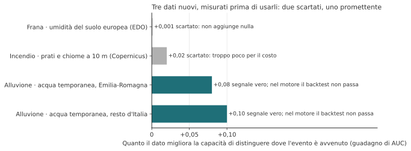
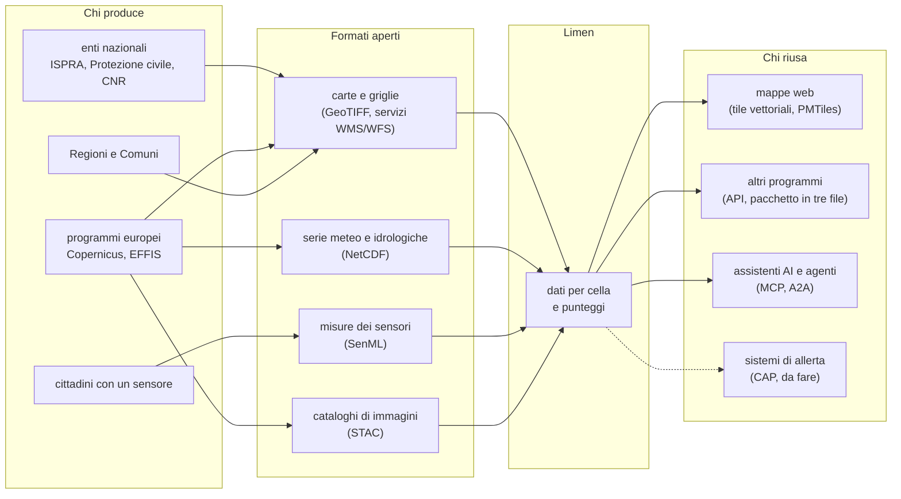
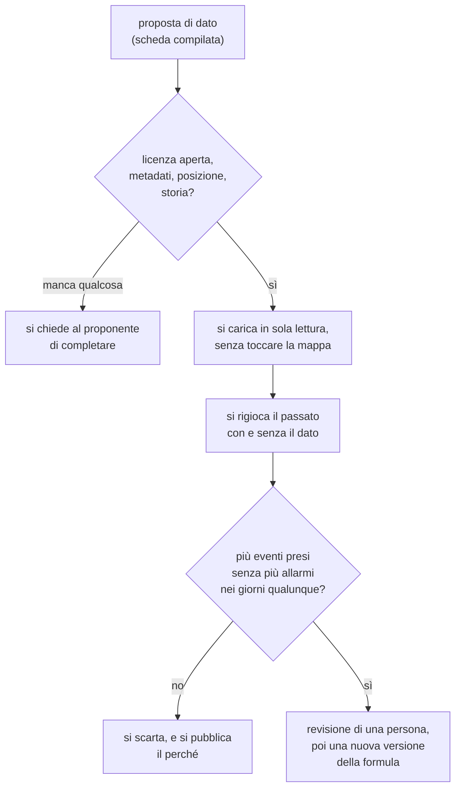

# 9. Cosa manca: dati da aggiungere, standard e formati da diffondere

!!! abstract "In breve"
    - Questo capitolo è una **ricognizione**, non un elenco di promesse: quali
      dati potrebbero rendere le previsioni di Limen più affidabili, chi li
      ha, in che forma, con quale licenza, e cosa li tiene oggi lontani.
    - Per ogni dato nuovo vale la stessa regola: **si misura prima di usarlo**.
      Dei tre dati nuovi provati finora, due non hanno aggiunto quasi nulla e
      il terzo dà un segnale vero che però, dentro il motore, non regge ancora
      la prova sugli eventi passati.
    - Molti dati utili esistono già in Italia, ma sono sparsi in venti formati
      regionali, in documenti non leggibili da un programma, o senza una
      licenza scritta. Il problema spesso non è produrli: è **renderli
      riusabili**.
    - Limen usa e propone **standard aperti** (per mappe, sensori, avvisi,
      agenti di intelligenza artificiale) che altri possono adottare: così un
      dato prodotto una volta serve a tutti.
    - Chiunque può contribuire un dato o uno studio: un ente, un ricercatore,
      un cittadino con un sensore. In fondo c'è una scheda pronta da compilare.

## Perché un capitolo su ciò che manca

Il [capitolo 3](03-i-dati.md) ha descritto i dati che Limen usa. Il [capitolo 5](05-misurare.md) ha raccontato
come si misura se funzionano. Questo capitolo guarda avanti: **cosa
servirebbe per sbagliare di meno**, e chi lo potrebbe dare.

Lo scriviamo per tre motivi.

1. **La frana è il punto debole di Limen, e lo è per i dati.** Il [capitolo 1](01-il-problema.md)
   l'ha detto: il punteggio della frana ordina bene i versanti dentro una
   regione, ma la pioggia che riceve non basta a far scattare la classe alta.
   Il 10 ottobre 2026, nel Reggino, il modello meteo vedeva 13-17 mm, il
   radar della Protezione civile corretto con i pluviometri ne misurava
   110-182[^122]. Nessuna formula recupera una pioggia che non le arriva.
2. **L'Italia ha molti più dati di quanti ne usi Limen.** Pluviometri e
   idrometri regionali, carte geologiche dettagliate, catasti degli incendi,
   inventari delle frane recenti. Spesso sono pubblici, ma non sono
   *riusabili*: un PDF, un portale che va consultato a mano, nessuna licenza
   scritta.
3. **Un dato condiviso bene serve a tutti, non solo a Limen.** Se una Regione
   pubblica i suoi pluviometri in un formato standard, con una licenza
   aperta, li possono usare la Protezione civile di un'altra Regione, un
   gruppo di ricerca, un'app di un Comune.

## Prima la regola: misurare prima di cambiare

Un dato nuovo è un'ipotesi: «se lo aggiungo, Limen sbaglia meno». Va
verificata **prima** di toccare la mappa, rigiocando il passato con e senza il
dato. Si guardano due cose insieme: quanti eventi veri in più finiscono nella
classe alta, e quanti allarmi in più si danno nei giorni qualunque (il **tasso
di base**, capitolo 5). Un dato che fa trovare più eventi solo perché fa
suonare l'allarme più spesso non serve.

Tre dati nuovi sono passati da questa prova nell'autunno 2026.



*Fonte: issue #282 (19 ottobre 2026), #419 (7 novembre 2026), #420 (8 novembre
2026). Il guadagno misura quanto il dato aiuta a separare i posti e i giorni
dove l'evento è avvenuto da quelli dove non è avvenuto: zero vuol dire nessun
aiuto.*

- **L'umidità del suolo europea per la frana** (Osservatorio europeo della
  siccità): letta con il ritardo con cui arriva davvero, separa le frane dai
  giorni tranquilli *peggio del caso*, e accanto all'umidità che Limen usa già
  non aggiunge nulla. Scartata.
- **Prati e chiome degli alberi a 10 metri per l'incendio** (strati ad alta
  risoluzione di Copernicus): un miglioramento minimo, che non vale il costo
  di tre carte nazionali in più da scaricare e aggiornare. Scartato, per ora.
- **L'acqua temporanea e le zone umide per l'alluvione** (Copernicus):
  dentro le aree allagabili dei Piani di bacino ordina bene le celle, con un
  guadagno quattro volte quello dei prati per l'incendio. Ma messo dentro il motore, alla soglia
  della classe alta, o aggiunge allarmi o perde eventi. È un **segnale vero
  che non ha ancora trovato il modo giusto di essere usato**.

Questa è la normalità, ed è giusto raccontarla: la maggior parte delle buone
idee non supera la misura. Il valore di una proposta di dato sta anche nel
dire *come la misureremo*.

## Parte 1. Dati che possono migliorare le previsioni

Per ogni dato: chi lo ha, in che forma, con quale licenza (quando la
conosciamo), cosa lo tiene lontano oggi, e come lo misureremmo prima di
usarlo. Dove non sappiamo, scriviamo **«da verificare»**: preferiamo una
casella vuota a una disponibilità inventata.

### Per la frana

| Dato | Chi lo ha | Forma e licenza | Cosa lo tiene lontano | Come lo misureremmo | Stato in Limen |
|---|---|---|---|---|---|
| **Pluviometri regionali** in tempo reale | Centri Funzionali regionali, agenzie ambientali regionali (ARPA) | varia da Regione a Regione; licenze da verificare | venti formati, accessi diversi; una parte entra già nel prodotto «Merging» della Protezione civile | rigiocare le frane datate con la pioggia dei pluviometri al posto del modello | [#505](https://github.com/agent-engineering-studio/limen/issues/505) |
| **Soglie di pioggia regionali** per le frane | Centri Funzionali, CNR-IRPI | spesso in documenti tecnici, non in tabelle; licenze da verificare | non leggibili da un programma | confronto con le soglie nazionali usate oggi, sulle stesse frane | [#506](https://github.com/agent-engineering-studio/limen/issues/506) |
| **Inventari delle frane recenti** (dopo il 2021) | Regioni, ISPRA, CNR-IRPI | vari; da verificare | il catalogo delle frane datate usato oggi si ferma al 2021 | più eventi per il backtest, soprattutto nel Sud | in parte, con la cronaca (#347); [#500](https://github.com/agent-engineering-studio/limen/issues/500) |
| **Carte geologiche dettagliate** 1:50.000 (progetto CARG) | ISPRA con Regioni e università | carte digitali; copertura e licenza da verificare | non tutta Italia è coperta; formati da armonizzare | sostituire la carta 1:500.000 e misurare se il punteggio del posto distingue meglio i versanti franati | [#497](https://github.com/agent-engineering-studio/limen/issues/497) |
| **Movimento del suolo** dal satellite (EGMS) | Copernicus | tabelle per punto, 100 m; dati Copernicus | serve una chiave gratuita; oggi usato solo dal modello in ombra | aggiungere accelerazione e stagionalità, e tenerle solo se migliorano il backtest | #380 |
| **Umidità del suolo dal satellite** a 1 km (radar Sentinel-1) | Copernicus Land | griglie quotidiane; licenza da verificare | il dato europeo a 5 km è stato scartato (#282); quello a 1 km non è stato provato | stessa prova della #282, con il ritardo reale di pubblicazione | [#507](https://github.com/agent-engineering-studio/limen/issues/507) |
| **Pluviometri dei cittadini** | reti amatoriali (MeteoNetwork), sensori di Limen | MeteoNetwork CC BY 4.0; i sensori di Limen CC BY 4.0 | MeteoNetwork non ha concesso l'accesso per regione (#248) | confronto notturno con il radar, poi un ingresso solo «in salita» | #249, #250 |

### Per l'alluvione

| Dato | Chi lo ha | Forma e licenza | Cosa lo tiene lontano | Come lo misureremmo | Stato in Limen |
|---|---|---|---|---|---|
| **Idrometri regionali** (livello dei fiumi) | Centri Funzionali, agenzie regionali | varia; da verificare | ogni stazione ha il suo «zero»: un livello non dice nulla senza la storia di quella stazione | trattarli come i fiumi di GloFAS: alto rispetto al solito *di quella stazione* | [#501](https://github.com/agent-engineering-studio/limen/issues/501) |
| **Idrometri dei cittadini** su torrenti minori | cittadini, associazioni | sensori di Limen, CC BY 4.0 | servono anni di storia per stazione | analisi «si o no» prima di qualunque codice | #259 |
| **Acqua temporanea e zone umide** | Copernicus Land | griglie a 10-20 m; dati Copernicus | dentro il motore il backtest non passa | un uso diverso: ordinare le celle dentro le aree già mappate | #420 |
| **Periodi di ritorno delle piene europee** (EFAS) | Copernicus | file scientifici (NetCDF); licenza CEMS | serve un account e un formato in più; non implementato di proposito | confronto con il rapporto sulla piena ordinaria usato oggi | da aprire |
| **Aree allagabili aggiornate** | Autorità di bacino distrettuale | il mosaico nazionale è del 2020 | aggiornamenti per distretto, in tempi diversi | ricalcolo e confronto con le aree allagate viste dal satellite | da verificare |

### Per l'incendio

| Dato | Chi lo ha | Forma e licenza | Cosa lo tiene lontano | Come lo misureremmo | Stato in Limen |
|---|---|---|---|---|---|
| **Catasto delle aree percorse dal fuoco** | ogni Comune, per legge (n. 353 del 2000) | molto vario: carte, elenchi, portali; da verificare | non esiste una raccolta nazionale aperta che conosciamo | aggiungere incendi piccoli, sotto la soglia dei satelliti, al backtest | [#498](https://github.com/agent-engineering-studio/limen/issues/498) |
| **Storico dei fuochi visti dal satellite** | NASA | tabelle annuali, nessuna chiave; uso libero con citazione | non è nel catalogo dei dati di Limen (capitolo 3) | è già misurato: serve solo caricarlo | [#472](https://github.com/agent-engineering-studio/limen/issues/472) |
| **Carta europea dei combustibili** | EFFIS | griglia; CC BY 4.0 | una prova simile ha dato un guadagno minimo | stessa prova della #419 | in valutazione |
| **Prati e chiome a 10 m** | Copernicus | griglie; dati Copernicus | guadagno troppo piccolo | — | #419, scartato per ora |

### Per tutti e tre

- **Popolazione ed edifici per chilometro quadrato.** Servono a dire quanto
  conta un avviso, non quanto è pericolosa una cella. Esistono griglie
  europee della popolazione a 1 km (Eurostat) e del JRC; le licenze per la
  ridistribuzione sono da verificare.
- **Segnalazioni dalla cronaca.** Ogni giorno Limen legge i giornali e
  raccoglie frane, alluvioni e incendi da verificare (#347). Sono la verità più
  fresca che esista, ma vanno controllate una per una.
- **Bollettini ufficiali di allerta.** La Protezione civile pubblica i
  bollettini di criticità in formato aperto; Limen li mostra accanto ai suoi
  punteggi. Confrontarli in modo sistematico, giorno per giorno, è un lavoro
  da fare.

??? note "Per chi sviluppa"
    - Le prove citate: #282 (EDO, `scoring-analyst`, 1.117 frane contro 5.171
      controlli appaiati), #419 (HRL, AUC dentro nodo × quota, 2021-23 contro
      2024-26), #420 (WaterWetness, una copia del database, `backtest-flood`
      contro `main`). Il backtest frane con la pioggia del radar è la #239,
      riassunta nell'ultimo commento della #122.
    - Le reti cittadine: #248 (chiusa: MeteoNetwork senza token BULK,
      Sensor.Community senza pioggia), #249, #250; gli idrometri #259.
    - Le fonti «in valutazione» della pagina Fonti della mappa sono in
      `frontend/src/lib/fonti.ts` (ruolo `valutazione`).
    - I periodi di ritorno EFAS non sono implementati di proposito: servono un
      account CDS e una dipendenza NetCDF (vedi la sezione *Phase boundary* di
      `CLAUDE.md`).

## Parte 2. Standard, formati e schemi da diffondere

Un **formato** è il modo in cui un dato è scritto in un file. Uno **standard**
è un formato (o un modo di parlarsi fra programmi) su cui molti si sono messi
d'accordo e che è descritto in un documento pubblico. Quando due enti usano lo
stesso standard, i loro dati si possono mettere insieme senza scrivere un
programma apposta. È la differenza fra venti prese elettriche diverse e una
sola.



La tabella dice, per ogni standard, cos'è in parole semplici, cosa ci fa
Limen e dove si trova la specifica. «Usato» vuol dire che Limen lo legge o lo
scrive già; «proposto» che servirebbe e non c'è ancora.

| Standard | Cos'è, in parole semplici | In Limen | Specifica |
|---|---|---|---|
| **WMS e WFS** (OGC) | il modo classico per chiedere a un server una mappa già disegnata (WMS) o gli oggetti geografici veri e propri (WFS) | usato: i perimetri degli incendi europei arrivano così; gli strati ISPRA si possono pubblicare con un server cartografico facoltativo | <https://www.ogc.org/standards/wms/>, <https://www.ogc.org/standards/wfs/> |
| **OGC API Features e Tiles** | la versione moderna, basata sul web, degli stessi servizi | proposto: le API di Limen non lo seguono ancora | <https://ogcapi.ogc.org/features/>, <https://ogcapi.ogc.org/tiles/> |
| **Tile vettoriali** | la mappa tagliata in quadratini che il browser colora da sé | usato: è così che la mappa di Limen arriva al browser | <https://github.com/mapbox/vector-tile-spec> |
| **PMTiles** | un'intera mappa a quadratini in **un solo file**, che si mette su un qualunque server | usato: il rilievo e gli strati fissi della mappa | <https://docs.protomaps.com/pmtiles/> |
| **GeoTIFF e COG** | un'immagine con le coordinate dentro; la versione «COG» si legge a pezzi senza scaricarla tutta | usato: il modello del terreno, CORINE, il cemento | <https://www.ogc.org/standards/geotiff/>, <https://www.cogeo.org/> |
| **GeoParquet** | una tabella con geometrie, compatta e veloce da leggere | usato dalla libreria del movimento del suolo (fino a quattro volte più leggera dei CSV) | <https://geoparquet.org/> |
| **STAC** | un catalogo standard delle immagini da satellite: cosa c'è, dove, quando | usato per cercare le immagini radar delle alluvioni | <https://stacspec.org/> |
| **NetCDF** (e Zarr) | il formato degli scienziati del clima per griglie che cambiano nel tempo | usato: la portata dei fiumi da Copernicus; Zarr non ancora | <https://www.ogc.org/standards/netcdf/>, <https://zarr.dev/> |
| **SensorThings API** (OGC) | un modello comune per descrivere sensori, cosa misurano e le loro misure | usato come modello per i sensori degli enti | <https://www.ogc.org/standards/sensorthings/> |
| **SenML** | un modo minimo e standard di scrivere una misura di un sensore | usato: è il formato dei sensori dei cittadini | <https://www.rfc-editor.org/rfc/rfc8428> |
| **CAP** (Common Alerting Protocol) | il formato internazionale degli avvisi di emergenza: chi, cosa, dove, quanto è urgente | proposto: Limen non esporta ancora i suoi avvisi in CAP | <https://docs.oasis-open.org/emergency/cap/v1.2/CAP-v1.2-os.html> |
| **MCP** (Model Context Protocol) | un modo standard per far usare a un assistente AI i dati e le funzioni di un sistema | usato: un assistente può chiedere a Limen il rischio di un comune | <https://modelcontextprotocol.io> |
| **A2A** (Agent2Agent) | un modo standard per far parlare fra loro agenti AI di sistemi diversi | usato: Limen ha la sua «carta d'identità» di agente | <https://a2a-protocol.org/> |
| **DCAT-AP_IT** | il modo italiano ed europeo di descrivere un insieme di dati in un catalogo pubblico | proposto: per pubblicare il pacchetto di Limen sul catalogo nazionale | <https://www.dati.gov.it/content/dcat-ap-it-v10-profilo-italiano-dcat-ap-0> |

### Due «schemi» nati da Limen che altri possono copiare

**La scheda di un dato.** Il catalogo dei dati di Limen descrive ogni dato con
le stesse voci: *cos'è*, *a cosa serve*, *cosa succede se manca*, *a quali
pericoli serve*, *quanto è essenziale*, *chi lo produce*, *licenza*,
*citazione chiesta*, *quanto pesa*, *come si procura*. La voce «cosa succede
se manca» è rara nei cataloghi pubblici, ed è quella che serve di più a chi
deve decidere se un dato vale lo sforzo. Chiunque può usare lo stesso schema
per descrivere i propri dati.

**Il manifesto del pacchetto.** Il pacchetto rapido di Limen ([capitolo 3](03-i-dati.md)) è
accompagnato da un piccolo file che dice: la versione di Limen, la data, le
versioni delle formule usate, le impronte delle fonti, la licenza di ogni
file e le frasi di citazione. Un dato derivato che porta con sé *come* è stato
fatto e *con quale licenza* si può riusare senza telefonare a nessuno.

??? note "Per chi sviluppa"
    - Tile vettoriali: le funzioni SQL `risk_at` e `forecast_at` con
      `ST_AsMVT`, servite da pg_tileserv; PMTiles da `limen dem-tiles`.
    - WFS: il client EFFIS (`effis-client`, MapServer) e
      `integrations/geoserver_source/`.
    - STAC: `limen ems-sentinel1` tramite la libreria `copernicus-ems`
      (Copernicus Data Space). GeoParquet: `egms-client[tables]`. NetCDF:
      `integrations/copernicus/ewds_glofas.py`.
    - Sensori: modello SensorThings in `integrations/iot/schemas.py` e
      migrazione 009; SenML (RFC 8428) in `integrations/iot/senml.py`, topic
      `limen/v2/{id}/obs`; vedi `docs/iot.md` e `docs/guida/sensori.md`.
    - MCP: `src/limen/mcp/` (server `limen-ops`, strumenti che modificano
      protetti da `MCP_ADMIN_TOKEN`). A2A: `src/limen/a2a/`, carta su
      `/.well-known/agent-card.json`, JSON-RPC su `/a2a`.
    - Catalogo: `src/limen/config/dati.yaml` (caricato da
      `limen.config.catalogo_dati`). Manifesto: `manifest.json` scritto da
      `src/limen/data/pacchetto_statico.py` (campi `limen`, `creato`,
      `migrazioni`, `step_version`, `passi_esclusi`, `colonne_escluse`,
      `licenze`, `griglia`, `impronte`, `file`).
    - CAP compare solo come voce d'offerta in `docs/analisi-offerta-pa.md`.

## Parte 3. Come contribuire un dato o uno studio

### Chi può contribuire, e cosa

- **Un ente** (una Regione, un Centro Funzionale, un'Autorità di bacino, un
  Comune, un consorzio di bonifica) può aprire un dato che ha già:
  pluviometri, idrometri, un catasto degli incendi, un inventario di frane.
  Non serve che lo produca per Limen: serve che lo pubblichi in modo
  riusabile.
- **Un ricercatore** può proporre un dato, una soglia, un metodo, o
  rifare una misura di Limen e dire dove sbaglia. Un risultato negativo ben
  fatto è un contributo quanto uno positivo.
- **Un cittadino** può installare un sensore (un pluviometro fatto con una
  scheda da pochi euro, per esempio) o segnalare una frana non censita dalla
  scheda di una cella sulla mappa.

### I requisiti minimi

Un dato per essere usato deve avere quattro cose. Non sono burocrazia: ognuna
risponde a una domanda che Limen si fa prima di fidarsi.

1. **Una licenza aperta scritta.** Preferibilmente CC BY 4.0. Senza una
   licenza scritta un dato, anche se pubblico, non si può ridistribuire: è
   quello che succede oggi con la carta delle rocce (capitolo 3).
2. **I metadati.** Chi l'ha prodotto, quando, con quale strumento, cosa vuol
   dire ogni colonna, in che unità. Una pioggia senza unità non si sa se è in
   millimetri all'ora o al giorno.
3. **La posizione.** Coordinate precise, con il sistema di riferimento
   dichiarato. Per i sensori dei cittadini la posizione pubblica viene
   arrotondata, per la riservatezza.
4. **La storia.** Per un dato che cambia nel tempo, una serie di misure
   passate. Senza storia non si può dire se un valore è «alto» per quel
   posto, e non si può rigiocare il passato per misurarlo.

### I sensori dei cittadini: tre livelli di fiducia

Un sensore costruito da un cittadino **non fa mai scattare un'allerta e non
abbassa mai un punteggio**. Un pluviometro intasato che segna zero non deve
poter dire che un versante è tranquillo; un sensore urtato non deve poter
mandare un'allerta a un Comune.

| Livello | Chi | Cosa può fare |
|---|---|---|
| 0 · osservatore | chiunque, dopo la registrazione | compare sulla mappa delle stazioni, serve alle verifiche e al confronto con il radar; non entra nella previsione |
| 1 · verificato | promosso dopo settimane d'accordo con il radar della Protezione civile | può solo **alzare** la stima della pioggia, insieme ad altri sensori di persone diverse, entro un tetto |
| 2 · istituzionale | enti, Protezione civile, università | l'unico livello che può forzare un'allerta |

Si sale di livello dimostrando di misurare bene, non dichiarandolo. Le misure
sono pubblicate con licenza CC BY 4.0[^sensori].

### Come Limen misura un dato prima di usarlo



Ogni passo lascia una traccia pubblica nella issue della proposta: chi ha
misurato, su quali eventi, con quale risultato. Anche quando il dato viene
scartato, come l'umidità del suolo europea per la frana.

### La scheda «proposta di dato»

Basta copiarla in una nuova issue del repository di Limen, o mandarla ai
curatori del progetto.

```markdown
# Proposta di dato: <nome del dato>

## Il dato
- Che cosa misura (una frase, senza sigle):
- Chi lo produce e chi lo mantiene:
- Dove si trova (link):
- Copertura: tutta Italia / regioni / punti:
- Risoluzione (metri, o numero di stazioni):
- Da quando esiste la serie, e ogni quanto si aggiorna:
- Formato (es. GeoTIFF, CSV, NetCDF, servizio WMS/WFS, API):
- Sistema di coordinate:

## La licenza
- Licenza (es. CC BY 4.0), con il link al testo:
- Frase di citazione richiesta:
- Limiti (uso commerciale, ridistribuzione, dati personali):

## A cosa servirebbe
- Pericolo: frana / alluvione / incendio / avvisi:
- Cosa migliorerebbe (es. «la pioggia caduta nei piccoli bacini»):
- Cosa succede oggi senza:
- Un evento passato in cui avrebbe fatto la differenza (luogo, data):

## Come misurarlo prima di usarlo
- Su quali eventi veri si può provare (anni, regioni):
- Che cosa ci aspettiamo di vedere:
- Che risultato ci farebbe dire «non serve»:

## Chi propone
- Nome, ente o gruppo (facoltativo):
- Contatto:
```

??? note "Per chi sviluppa"
    - Segnalazioni su una cella: `POST /api/contributi` (non salva nulla:
      parte un'email ai curatori, con lo stato della cella).
    - Registrazione di un sensore: `POST /api/sensori/registrazione`
      (approvazione manuale, certificato per dispositivo, licenza CC BY 4.0);
      i livelli di fiducia sono la #251, l'epica è la #247.
    - Per caricare un dato nuovo nel catalogo: una voce in
      `src/limen/config/dati.yaml`; per misurarlo: i backtest
      (`limen backtest`, `backtest-flood`, `backtest-wildfire`) su un branch,
      con la revisione di `scoring-analyst` prima di toccare
      `config/hazards/*.yaml`. Nessun cambio al motore deterministico senza
      il backtest.

## Gap e come chiuderli

In questo capitolo i gap sono il cuore del discorso: per ognuno, cosa manca,
perché conta e, dove c'è, il dato aperto che lo colmerebbe.

- **La pioggia che arriva al motore della frana è troppo poca.** Nel Reggino,
  il 10 ottobre 2026, il modello vedeva un decimo della pioggia misurata.
  *Proposta di open data:* i pluviometri dei Centri Funzionali regionali,
  pubblicati in tempo reale con licenza aperta e in un formato comune
  (SensorThings o almeno CSV con metadati); da verificare quali Regioni già lo
  fanno. *([#505](https://github.com/agent-engineering-studio/limen/issues/505))*
- **Le soglie di pioggia regionali non sono leggibili da un programma.**
  *Proposta di open data:* le soglie usate dai Centri Funzionali pubblicate
  come tabella (durata, intensità, area), con licenza aperta.
  *([#506](https://github.com/agent-engineering-studio/limen/issues/506))*
- **Il catalogo delle frane datate si ferma al 2021.** *Proposta di open
  data:* inventari regionali delle frane recenti, con data e posizione, e le
  verifiche dalla cronaca (#345). *([#500](https://github.com/agent-engineering-studio/limen/issues/500))*
- **La carta delle rocce è troppo grossolana.** *Proposta di open data:* le
  carte geologiche CARG 1:50.000 di ISPRA, dove esistono (copertura e licenza
  da verificare).
  *([#497](https://github.com/agent-engineering-studio/limen/issues/497))*
- **Gli incendi piccoli sfuggono ai satelliti.** *Proposta di open data:* i
  catasti comunali delle aree percorse dal fuoco, raccolti in un formato
  comune. *([#498](https://github.com/agent-engineering-studio/limen/issues/498))*
- **I fiumi minori non hanno misure.** *Proposta di open data:* gli idrometri
  regionali, con la serie storica di ogni stazione; per i torrenti più
  piccoli, gli idrometri dei cittadini. *(issue: #259; per quelli regionali
  [#501](https://github.com/agent-engineering-studio/limen/issues/501))*
- **Il movimento del suolo è usato solo in parte.** Accelerazione e
  stagionalità del terreno sono già nei dati europei e non ancora misurate.
  *(issue: #380)*
- **L'umidità del suolo a 1 km non è mai stata provata.** *Proposta di open
  data:* l'umidità superficiale del suolo da radar Sentinel-1 di Copernicus
  Land (licenza da verificare). *([#507](https://github.com/agent-engineering-studio/limen/issues/507))*
- **Le reti di pluviometri dei cittadini non sono acquisibili.** L'unica rete
  italiana con pluviometri e licenza aperta non ha concesso l'accesso per
  regione. *(issue: #249, #250)*
- **Limen non esporta i suoi avvisi in un formato standard.** *Proposta:*
  un'uscita CAP, che i sistemi di allerta già leggono, con la stessa avvertenza
  che non si tratta di avvisi ufficiali. *([#499](https://github.com/agent-engineering-studio/limen/issues/499))*
- **Le API di Limen non seguono gli standard OGC moderni.** *Proposta:* una
  vista OGC API Features dei punteggi per comune e per cella, accanto alle API
  di oggi. *([#503](https://github.com/agent-engineering-studio/limen/issues/503))*
- **Il pacchetto dei dati non è nel catalogo nazionale.** *Proposta:*
  descriverlo con DCAT-AP_IT e segnalarlo a dati.gov.it, così chi cerca dati
  sul dissesto lo trova. *([#504](https://github.com/agent-engineering-studio/limen/issues/504))*
- **Non c'è un modo guidato per proporre un dato.** *Proposta:* la scheda di
  questo capitolo come modulo per le issue del repository.
  *([#502](https://github.com/agent-engineering-studio/limen/issues/502))*

## Per approfondire

- [Il catalogo dei dati di Limen](https://github.com/agent-engineering-studio/limen/blob/main/src/limen/config/dati.yaml).
- I sensori dei cittadini, la guida completa:
  [guida ai sensori](https://github.com/agent-engineering-studio/limen/blob/main/docs/guida/sensori.md);
  il formato dei sensori:
  [formato dei sensori](https://github.com/agent-engineering-studio/limen/blob/main/docs/iot.md).
- Le prove sui dati nuovi: issue
  [#282](https://github.com/agent-engineering-studio/limen/issues/282),
  [#419](https://github.com/agent-engineering-studio/limen/issues/419),
  [#420](https://github.com/agent-engineering-studio/limen/issues/420);
  l'epica dei sensori [#247](https://github.com/agent-engineering-studio/limen/issues/247).
- Progetto CARG di ISPRA:
  <https://www.isprambiente.gov.it/it/progetti/cartella-progetti-in-corso/suolo-e-territorio-1/progetto-carg-cartografia-geologica-e-geotematica>.
- Legge 21 novembre 2000, n. 353, legge quadro sugli incendi boschivi:
  <https://www.normattiva.it/uri-res/N2Ls?urn:nir:stato:legge:2000-11-21;353>.
- Copernicus Land, umidità del suolo:
  <https://land.copernicus.eu/en/products/soil-moisture>; EGMS:
  <https://egms.land.copernicus.eu>; EFAS: <https://www.efas.eu>.
- Griglia europea della popolazione (Eurostat GEOSTAT):
  <https://ec.europa.eu/eurostat/web/gisco/geodata/population-distribution/geostat>;
  Global Human Settlement Layer del JRC: <https://human-settlement.emergency.copernicus.eu/>.
- MeteoNetwork: <https://www.meteonetwork.it>; Sensor.Community:
  <https://sensor.community>.
- Standard: OGC WMS <https://www.ogc.org/standards/wms/>, WFS
  <https://www.ogc.org/standards/wfs/>, OGC API <https://ogcapi.ogc.org/>,
  SensorThings <https://www.ogc.org/standards/sensorthings/>, GeoTIFF
  <https://www.ogc.org/standards/geotiff/>, NetCDF
  <https://www.ogc.org/standards/netcdf/>, COG <https://www.cogeo.org/>,
  GeoParquet <https://geoparquet.org/>, STAC <https://stacspec.org/>, Zarr
  <https://zarr.dev/>, PMTiles <https://docs.protomaps.com/pmtiles/>, tile
  vettoriali <https://github.com/mapbox/vector-tile-spec>, SenML (RFC 8428)
  <https://www.rfc-editor.org/rfc/rfc8428>, CAP 1.2
  <https://docs.oasis-open.org/emergency/cap/v1.2/CAP-v1.2-os.html>, MCP
  <https://modelcontextprotocol.io>, A2A <https://a2a-protocol.org/>,
  DCAT-AP <https://semiceu.github.io/DCAT-AP/>, DCAT-AP_IT
  <https://www.dati.gov.it/content/dcat-ap-it-v10-profilo-italiano-dcat-ap-0>.
- Licenze: CC BY 4.0 <https://creativecommons.org/licenses/by/4.0/deed.it>,
  ODbL <https://opendatacommons.org/licenses/odbl/1-0/>.

[^122]: Issue #122, ultimo commento (14 ottobre 2026), sul backtest delle
    frane con la pioggia del radar (#239).
[^sensori]: Guida ai sensori della mappa, sezione «Cosa può fare un sensore, e
    cosa no»; livelli di fiducia nella issue #251.
