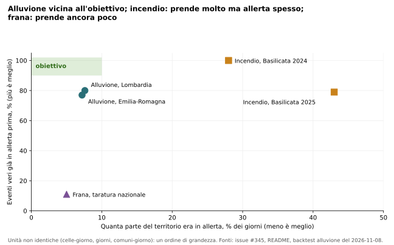
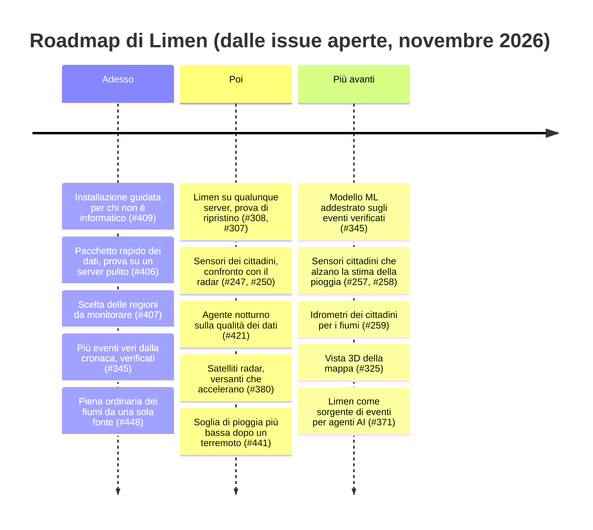

# 10. Partecipare: collaboratori, enti, cittadini, finanziatori, roadmap

!!! abstract "In breve"
    - Limen ha un obiettivo misurabile: **prevedere entro 72 ore il 90 % delle
      frane, alluvioni e incendi veri, tenendo in allerta al massimo il 10 %
      dei comuni-giorno**. Oggi l'alluvione ci si avvicina, l'incendio prende
      molto ma allerta spesso, la frana è lontana.
    - Per arrivarci servono soprattutto **dati veri**: eventi datati e
      localizzati, misure di pioggia sul posto, studi. È qui che enti,
      ricercatori e cittadini contano più del codice.
    - Ogni pubblico ha una porta d'ingresso: chi sviluppa propone modifiche
      al codice, chi fa ricerca rifà le misure e le contesta, un ente prova
      Limen sul suo territorio e condivide i propri eventi, un cittadino
      costruisce un pluviometro, un finanziatore paga ore di lavoro, server e
      dati.
    - La roadmap è pubblica, nelle issue del progetto. Qui è raggruppata in
      «adesso», «poi» e «più avanti», senza date inventate.
    - Oggi il progetto ha **un solo curatore**. È il rischio più grande, e il
      primo motivo per cui serve aiuto.

## Perché partecipare: l'obiettivo, misurato

Il capitolo 5 ha spiegato che Limen non si giudica a parole ma con le
misure. L'obiettivo che il progetto si è dato è scritto in una frase, nella
sua issue principale[^345]:

> Limen deve prevedere **entro 72 ore il 90 % delle frane, delle alluvioni e
> degli incendi** realmente accaduti e riportati dalla cronaca, con **al
> massimo il 10 % dei comuni-giorno in allerta**. Se non raggiunge questo
> obiettivo, la piattaforma non serve.

Le due metà contano insieme. «Prendere il 90 % degli eventi» da sola è facile:
basta accendere tutta la mappa ogni giorno. Il secondo numero (quanti comuni
sono in allerta in un giorno qualunque, il «carico») impedisce il trucco. Un
Comune che riceve un'allerta un giorno su due smette di leggerle.

Dove siamo oggi, rispetto a quel bersaglio:

*Fonte: issue #345; README, sezione «Does it work?»; backtest dell'alluvione
dell'8 novembre 2026 (sola pioggia, previsione come fu emessa). Le misure non
usano tutte la stessa unità (celle, comuni, giorni): la figura dà un ordine di
grandezza.*

In parole:

- **Alluvione: vicina.** In Emilia-Romagna e Lombardia Limen aveva in
  allerta, nei giorni prima, circa l'80 % dei luoghi poi allagati, con circa
  il 7-8 % del territorio in allerta nei giorni qualunque. Mancano dieci punti
  di eventi presi, e restano molti falsi allarmi.
- **Incendio: prende molto, ma allerta spesso.** In Basilicata prende fra
  il 79 e il 100 % degli incendi, ma in piena estate un giorno su tre o quasi
  uno su due è già in classe alta.
- **Frana: lontana.** In Liguria, nel novembre 2019, la classe alta ha preso
  l'11 % delle frane, accendendosi quasi mai (lo 0,17 % del tempo e del territorio);
  sulle dodici finestre di prova del capitolo 5 prende il 49 % dei comuni
  colpiti con il 10 % dei comuni-giorno in allerta. È il pericolo più
  difficile, e lo diciamo dal capitolo 1.

Un'avvertenza in più, scritta nella stessa issue: a fine ottobre 2026 gli
eventi tratti dalla cronaca e verificati erano **otto**. Otto eventi sono un
aneddoto, non una statistica. Il primo collo di bottiglia non è il calcolo, è
il numero di eventi veri su cui misurarlo. Per questo il modo più utile di
aiutare Limen, per chi non scrive codice, è **dare dati**.

## Chi può fare che cosa

### Chi sviluppa software

**Che cosa puoi fare.** Correggere un errore, migliorare la mappa, aggiungere
una fonte di dati, scrivere test. Alcuni lavori aperti, già descritti nel
dettaglio nelle issue:

- aggiungere al modello di apprendimento automatico della frana due segnali
  dei satelliti radar (quanto un versante **accelera** e quanto il suo
  movimento cambia con le stagioni), e misurare se migliorano le previsioni
  (#380);
- un **agente notturno sulla qualità dei dati**: raccoglie ogni notte quali
  fonti sono in ritardo e quali calcoli sono falliti, e ne scrive un
  riassunto in parole, mai in numeri (#421);
- fare di Limen una **sorgente di eventi** per gli assistenti AI esterni,
  seguendo una proposta di estensione del protocollo MCP ancora in bozza
  (#371);
- la **vista in 3D** della mappa, a partire da una prova su un'area pilota
  (#320-#325).

**Che cosa ottieni.** Un progetto con regole scritte e controlli automatici,
dove ogni modifica viene rivista; il nome nelle note di rilascio; un caso
d'uso reale di dati geografici, mappe e intelligenza artificiale usata con
giudizio.

**Come iniziare.** Leggere la guida per chi contribuisce, installare il
progetto in locale con il comando di prova, scegliere una issue aperta e
scrivere un commento prima di cominciare. Alla prima proposta di modifica si
accetta il patto per chi contribuisce (capitolo 8): resti autore del tuo
lavoro, e il lavoro resta libero per tutti.

??? note "Per chi sviluppa"
    - Guida: [`CONTRIBUTING.md`](https://github.com/agent-engineering-studio/limen/blob/main/CONTRIBUTING.md)
      (in inglese): `uv sync --all-groups`, `uv run pre-commit install`,
      `cd frontend && npm ci`; il controllo prima di proporre è `make check`
      (ruff, mypy `--strict`, pytest con copertura ≥ 80 %) più `npm run lint`,
      `npm test`, `npm run build` nella SPA.
    - Le regole da non violare sono la tabella *Locked invariants* di
      [`CLAUDE.md`](https://github.com/agent-engineering-studio/limen/blob/main/CLAUDE.md):
      migrazioni immutabili, nessuna costante nei motori, HTTP solo da
      `limen.integrations._http`, «non misurato» mai uguale a zero, l'LLM che
      non tocca i numeri.
    - Commit nello stile *Conventional Commits*; una dipendenza nuova va
      giustificata nella descrizione della PR.
    - Prova in locale dell'intero sistema: `make demo`.
    - Issue aperte: <https://github.com/agent-engineering-studio/limen/issues>.
      I primi lavori sono etichettati
      [`good first issue`](https://github.com/agent-engineering-studio/limen/labels/good%20first%20issue):
      da novembre 2026 sono sei (#536-#541), ognuno con i file da toccare,
      il comando di verifica e il criterio di accettazione.

### Chi fa ricerca

**Che cosa puoi fare.** Rifare le misure e contestarle. Proporre una soglia o
un peso migliore, **con una misura accanto**. Mettere alla prova il modello
di apprendimento automatico che gira «in ombra» (capitolo 6). Alcune domande
aperte, già formulate:

- dopo un terremoto forte i versanti franano con piogge più deboli per mesi o
  anni: oggi Limen tratta il terremoto come un termine che svanisce in pochi
  giorni. La proposta è **abbassare la soglia di pioggia** dopo il terremoto,
  come suggerisce la letteratura sui grandi terremoti (#441);
- la **piena ordinaria** di ogni tratto di fiume, il metro con cui Limen
  giudica se un fiume è «alto», viene oggi da due serie di dati non del tutto
  confrontabili (#448);
- l'**acqua temporanea e le zone umide** viste dal satellite sono un segnale
  forte dentro le aree a pericolo note, ma nel motore non hanno ancora
  migliorato la previsione (#420, capitolo 5).

**Che cosa ottieni.** Un sistema intero, aperto e riproducibile, su cui
provare un'idea senza costruirlo da zero: dati già allineati su 312.550 celle,
un archivio di eventi veri, misure con il tasso di base accanto. Ogni
punteggio si può smontare fino all'ultimo ingrediente, con la fonte.

**Come iniziare.** Aprire una cella sulla mappa e leggerne la scomposizione;
leggere il capitolo 5 e la pagina «Verifiche» della mappa; scegliere una
domanda aperta; scrivere nella issue che cosa si vuole misurare e come. Una
collaborazione con un ente di ricerca apre anche canali di finanziamento
(vedi più sotto).

??? note "Per chi sviluppa"
    - Scomposizione di una cella: `GET /api/cell/{id}/breakdown` (con i «dati
      di base» e la loro fonte); storia: `GET /api/cell/{id}/history`.
    - Misure: `limen backtest`, `limen backtest-flood`,
      `limen backtest-wildfire`, `limen verifiche-report`,
      `limen anticipo <comune> <pericolo> <istante>`.
    - Modello in ombra e regole di promozione: `docs/ml.md`; la promozione è
      sempre manuale.
    - Accesso per assistenti AI: server MCP `limen-ops`
      (`src/limen/mcp/`), agent card A2A (`src/limen/a2a/`).

### Enti locali e Protezione civile

**Che cosa puoi fare.**

- **Provare Limen sul tuo territorio.** Un Comune guarda la mappa pubblica;
  una Regione può installarne una copia sui propri server e monitorare solo
  le proprie province. L'installazione è pensata per il tecnico informatico
  dell'ente: un comando, poi tutto dal browser (#409).
- **Dare gli eventi veri.** È il contributo più prezioso. Una frana datata al
  giorno, un'area allagata con i suoi confini, l'elenco degli interventi di
  una stagione: ogni evento con data e luogo diventa una riga della «verità»
  su cui Limen si misura. Molti eventi piccoli, senza danni gravi, non
  entrano in nessun catalogo nazionale, ed è proprio lì che il conto di
  Limen è più incerto.
- **Collegare i propri sensori.** Pluviometri, idrometri, inclinometri di un
  ente entrano in Limen al livello più alto di fiducia, l'unico che può far
  scattare un avviso (lo spiega la pagina «Sensori» della mappa).
- **Dire se serve.** Una telefonata con un ufficio di Protezione civile che
  dice «questa informazione la userei, quest'altra no» vale più di una
  settimana di codice.

**Che cosa ottieni.** Una mappa per chilometro quadrato e per Comune, con il
motivo accanto a ogni colore; avvisi sui canali che scegli (email, Telegram,
o un collegamento ai tuoi sistemi); un codice che puoi riusare gratis, come
prevede la legge per il software della pubblica amministrazione, senza legarti
a un fornitore.

**Che cosa non ottieni, e va detto.** Limen **non è un sistema di
allertamento ufficiale** e non sostituisce i Centri Funzionali né IT-Alert. È
uno strumento di supporto alle decisioni, e così va presentato in qualunque
accordo.

**Come iniziare.** Aprire la mappa e cercare il proprio Comune; scrivere al
curatore (per ora l'unico canale è l'email del progetto o il modulo «Sei un
esperto?» nella scheda di una cella); per un'installazione, partire dalla
pagina di installazione.

??? note "Per chi sviluppa"
    - Installazione: `scripts/nuovo_host.sh`, poi `#/installazione`
      (token `INSTALLAZIONE__TOKEN`); scelta delle regioni (#407, PR #461).
    - Registrare un evento verificato: `limen registra-verifica`, tabella
      `verifiche_eventi`; per le frane anche `landslide_events`.
    - Sensori istituzionali (livello 2): `docs/iot.md`,
      `docs/guida/sensori.md`.
    - Costi e modelli di offerta (SaaS o installazione presso una Regione):
      `docs/analisi-offerta-pa.md`; il documento cita ancora la licenza
      Apache 2.0, superata (capitolo 8, gap).

### Cittadini con un sensore

**Che cosa puoi fare.** Costruire un piccolo **pluviometro** (un misuratore
di pioggia) o una stazione meteo con una scheda elettronica economica
(Arduino, ESP32, Raspberry Pi), registrarlo senza creare un account, e
vederlo sulla mappa nel livello «Stazioni dei cittadini». La pagina
«Sensori» della mappa ha tre progetti di esempio con le istruzioni e il
programma da caricare.

Il caso che ha fatto nascere l'idea è il Reggino, 10 ottobre 2026: il modello
meteo stimava circa 50 mm di pioggia, il radar ne vedeva fra 110 e 176[^reggino].
Una rete fitta di pluviometri è esattamente ciò che serve a vedere un
nubifragio che i modelli sbagliano.

**Che cosa ottieni.** Le tue misure, pubblicate con licenza libera (CC BY 4.0)
e confrontate ogni notte con il radar della Protezione civile; un posto su una
mappa nazionale; la possibilità di salire di livello di fiducia dimostrando di
misurare bene.

**Le regole, chiare fin dall'inizio.**

- Un sensore di un cittadino **non fa mai scattare un avviso** e **non
  abbassa mai un punteggio**. Al primo livello serve a confrontare e a
  verificare; al secondo, dopo settimane d'accordo con il radar e insieme ad
  altri sensori di persone diverse, può solo **alzare** la stima della
  pioggia, entro un tetto.
- **Nessuna misura vale un rischio.** Non si installa su versanti in
  movimento, argini, alvei, ponti; non si va a controllare un sensore durante
  un'allerta; su un terreno privato serve il permesso del proprietario.
- La tua email non è mai pubblicata; la posizione del sensore compare
  arrotondata a circa un chilometro (capitolo 8).

**Come iniziare.** La pagina «Sensori» della mappa: scegli un progetto,
costruiscilo, registralo. Il sensore si collega all'installazione di Limen che
lo ha approvato: il suo indirizzo arriva nella mail di approvazione e si
scrive nel sensore, che senza non si collega. Un'installazione senza un
indirizzo pubblico non accetta sensori, e lo dice. Il confronto sistematico fra le stazioni dei
cittadini e il radar (#250) è ancora da fare: i primi sensori sono quelli che
lo renderanno possibile.

??? note "Per chi sviluppa"
    - Epic #247 e figlie #249, #250, #257, #258, #259; guida
      `docs/guida/sensori.md`; firmware di esempio in `firmware/limen-sensore`.
    - Broker MQTT con mTLS e CA privata; protocollo v2; ingresso HTTP
      firmato e LoRaWAN da The Things Network (si accendono con la rete).
    - Broker e webhook TTN si ricavano da `PUBBLICO__URL` (#517); il
      firmware non ha un broker compilato e lo legge dalla NVS
      (`broker=` sulla seriale).

### Finanziatori, fondazioni, amministrazioni

**Che cosa puoi fare.** Pagare le cose che il codice non si dà da solo:
ore di lavoro, server, dati, prove sul campo.

**Che cosa ottieni.** Un'infrastruttura pubblica, aperta e verificabile per
la protezione del territorio, che resta libera per contratto (capitolo 8):
nessun finanziamento può essere chiuso dentro un prodotto privato. Ogni
risultato ha una misura pubblica, con il suo tasso di base, prima e dopo.

**Che cosa serve, in concreto.** La tabella dice che cosa accelererebbe di
più il progetto e come si vedrebbe il risultato.

| Che cosa | Perché | Come si misura il risultato |
|---|---|---|
| **Una seconda persona** che sviluppa, per almeno un anno | oggi c'è un solo curatore: se si ferma lui, si ferma Limen | modifiche esterne accettate; tempo di risposta alle segnalazioni |
| **Eventi veri**: una persona o un ente che raccoglie frane, allagamenti e incendi datati, regione per regione | otto eventi verificati non bastano a dire se l'obiettivo è raggiunto | numero di eventi nel registro delle verifiche, per pericolo e regione |
| **Un partner di ricerca** (un'università, un istituto del CNR) | la frana è il punto debole, e serve competenza geologica oltre al codice | la misura della frana nel capitolo 5, prima e dopo |
| **Un server di riserva** e un archivio fuori sede | oggi un guasto al server ferma la mappa | una prova di ripristino su un server pulito, con il tempo misurato |
| **Una prova pilota con una Regione** | sapere se un ufficio di Protezione civile lo usa davvero, e per che cosa | un rapporto d'uso di una stagione |

Per dare un ordine di grandezza: tenere acceso Limen su un cloud
commerciale costerebbe fra 4.000 e 12.000 dollari l'anno (capitolo 8), e
l'analisi di offerta alla pubblica amministrazione stima in **40-60 mila
euro** il lavoro necessario per rendere Limen acquistabile da un ente (area
riservata agli operatori, qualificazione del servizio cloud presso l'Agenzia
per la cybersicurezza nazionale, conformità)[^offerta]. Sono stime di
ottobre 2026, da ricontrollare.

**Canali di finanziamento.** I documenti del progetto ne citano alcuni, tutti
da verificare prima di una domanda[^costi]:

- **crediti cloud per progetti aperti o di ricerca** (programmi di Amazon,
  Google e Microsoft; il nodo europeo dell'*European Open Science Cloud* per
  chi ha un'affiliazione accademica): pagano server, non persone;
- **bandi per il clima di fondazioni private**, di solito riservati a enti
  non profit o accademici: un partner di ricerca li rende accessibili;
- dal lato degli enti che userebbero Limen, le linee già finanziate: i
  **programmi regionali FESR 2021-2027** (obiettivo «adattamento ai
  cambiamenti climatici e prevenzione dei rischi»), i fondi regionali di
  protezione civile, **Interreg** per i progetti fra Paesi vicini. Il PNRR
  chiude nel 2026 e non conviene contarci[^offerta].

Il repository accetta anche piccole donazioni individuali, dal collegamento
«Sponsor» su GitHub.

??? note "Per chi sviluppa"
    - Programmi e coperture stimate per scenario: `docs/analisi-costi-cloud.md`,
      §4 «Cosa coprono davvero i crediti» (i crediti non pagano Claude su
      nessun cloud).
    - Posizionamento per i programmi di crediti open source:
      `docs/OSS_IMPACT.md`.
    - Donazioni: `.github/FUNDING.yml`.

## La roadmap

La roadmap di Limen è l'elenco delle issue aperte sul repository. Qui le
raggruppiamo per orizzonte e le colleghiamo all'obiettivo: ogni voce dice a
che cosa serve per prendere più eventi veri con meno allerte inutili. Non ci
sono date, perché il progetto non ne ha fissate: «adesso» vuol dire lavori già
iniziati, «poi» lavori descritti e pronti a partire, «più avanti» idee che
aspettano una misura o una decisione.

*Schema: la roadmap per orizzonte, dalle issue aperte all'8 novembre 2026.*

### Adesso: che chiunque possa installarlo, e più eventi su cui misurarlo

- **Installazione guidata** (#409). Chiunque deve poter installare Limen su un
  server e arrivare a un sistema pronto, sapendo quali dati mancano e a che
  punto è il download. Quasi tutte le parti sono fatte; restano da chiudere la
  scelta delle regioni (#407) e il **pacchetto rapido** dei dati già calcolati, da
  provare su un server pulito (#406). *A che cosa serve:* più installazioni
  vuol dire più enti che guardano la mappa e più segnalazioni di errori.
- **Più eventi veri** (#345, primo punto). Il controllo dei fatti sulla
  cronaca deve girare con regolarità, su tutti e tre i pericoli e tutte le
  regioni, con almeno due fonti indipendenti per evento e il «dubbio» come
  esito legittimo. *A che cosa serve:* senza un denominatore più grande, il
  90 % non si può né raggiungere né smentire.
- **La piena ordinaria dei fiumi** da una sola fonte coerente (#448). *A che
  cosa serve:* un fiume non deve sembrare più o meno alto a seconda della
  serie di dati da cui viene il suo metro.

### Poi: robustezza, sensori, segnali nuovi

- **Limen portabile** (#308, #307). La maggior parte delle parti è fatta
  (salvataggio notturno, una sola cartella per i dati, immagini pubbliche,
  un comando d'installazione); manca la **prova di ripristino** su un server
  pulito, ripetuta a ogni versione. *A che cosa serve:* un sistema di
  monitoraggio che non si può ricostruire dopo un guasto non è affidabile.
- **Sensori dei cittadini** (#247). La base è pronta; manca il **confronto
  notturno con il radar** (#250) che dirà quanto valgono davvero i
  pluviometri non ufficiali. *A che cosa serve:* vedere i nubifragi che i
  modelli sbagliano, come a Reggio Calabria il 10 ottobre.
- **Un agente sulla qualità dei dati** (#421). *A che cosa serve:* accorgersi
  in giornata che una fonte tace, prima che un dato mancante sembri una
  giornata tranquilla.
- **Segnali nuovi per la frana**, sempre misurati prima di entrare: i
  versanti che accelerano visti dai satelliti radar (#380), la soglia di
  pioggia più bassa dopo un terremoto forte (#441). *A che cosa serve:* la
  frana è il pericolo più lontano dall'obiettivo.

### Più avanti: l'apprendimento dagli eventi, il 3D, l'apertura agli agenti

- **Un modello di apprendimento automatico addestrato sugli eventi
  verificati** (#345, quarto punto): per ogni situazione, cerca i casi
  passati più simili e il loro esito. Resta in ombra finché non batte il
  motore attuale su entrambe le prove (capitolo 6).
- **I sensori dei cittadini nel calcolo**, solo in salita e solo con più
  sensori d'accordo (#257, #258), e gli **idrometri** dei cittadini per i
  fiumi (#259).
- **La vista in 3D** (#320-#325), decisa dopo una prova su un'area pilota.
  Prima di ogni vista pubblica deve rispettare le stesse regole della mappa:
  colori leggibili da chi è daltonico, «non misurato» in grigio.
- **Limen come sorgente di eventi per agenti AI esterni** (#371), dietro un
  interruttore spento finché la specifica è in bozza.

Due limiti valgono per tutto, e li scrive la stessa issue dell'obiettivo: i
temporali violenti non si localizzano al singolo Comune con 72 ore d'anticipo
da nessun modello meteo, e la cronaca racconta di più i centri abitati che le
montagne. Il 90 % è un obiettivo per pericolo e per area, non una promessa
per ogni Comune.

## Un invito per ciascuno

- **Se sviluppi software:** scegli una issue aperta, scrivi un commento,
  proponi una modifica piccola. Il primo contributo è il più difficile; il
  progetto è fatto per rivederlo con cura.
- **Se fai ricerca:** prendi una misura del capitolo 5 e prova a smontarla.
  Se trovi un errore, è un contributo; se trovi un metodo migliore, misuralo
  e proponilo.
- **Se lavori in un Comune, in una Regione o nella Protezione civile:** apri
  la mappa sul tuo territorio e dicci che cosa è utile e che cosa no. Se hai
  un elenco di eventi datati, condividilo: è il dato che manca di più.
- **Se hai un pluviometro, o vuoi costruirlo:** registralo. Ogni stazione in
  più rende la mappa un po' meno cieca dove i modelli sbagliano.
- **Se puoi finanziare:** scegli una riga della tabella qui sopra. Ognuna ha
  un risultato misurabile, e il risultato sarà pubblico.

Il canale per tutti, per ora, è il tracciatore delle issue del progetto:
<https://github.com/agent-engineering-studio/limen/issues>. Per un rischio
immediato per qualcuno, il posto giusto non è questo: è il numero unico di
emergenza e la Protezione civile del tuo Comune.

## Gap e come chiuderli

Che cosa manca per partecipare facilmente, in breve. Il dettaglio sta nella
issue indicata.

- **Manca una guida per chi non sviluppa.** La guida per chi contribuisce è
  in inglese e parla solo di codice. Un ricercatore, un ufficio comunale o un
  cittadino non trova scritto come dare un evento, una misura o un parere.
  ([#511](https://github.com/agent-engineering-studio/limen/issues/511))
- ~~**Manca un canale di contatto pubblico.**~~ Chiuso: le
  [discussioni del repository](https://github.com/agent-engineering-studio/limen/discussions)
  sono aperte per domande e annunci, e una sezione «Contatti» nella home e nel
  README dà la mail per enti e finanziatori, i tempi di risposta (un solo
  curatore: di solito entro una settimana) e l'avviso che non è un canale di
  emergenza. ([#508](https://github.com/agent-engineering-studio/limen/issues/508))
- ~~**Nessun primo lavoro facile è segnalato.**~~ Chiuso: sei issue
  `good first issue` aperte (#536-#541: la descrizione della riga di comando,
  tre traduzioni in inglese, due gruppi di variabili da documentare), ognuna
  con file, verifica e criterio di accettazione. ([#510](https://github.com/agent-engineering-studio/limen/issues/510))
- **Un solo curatore.** Su 311 modifiche accettate, una sola viene da fuori
  (novembre 2026). È il rischio più serio per un sistema che vuole essere usato per
  proteggere il territorio. ([#514](https://github.com/agent-engineering-studio/limen/issues/514))
- **La roadmap scritta nel repository è vecchia.** Parla solo di frane e
  considera futura l'alluvione, che invece è attiva da mesi; la roadmap vera
  è nelle issue. ([#513](https://github.com/agent-engineering-studio/limen/issues/513))
- **Non c'è un modo semplice per un ente di consegnare i propri eventi.**
  Oggi un evento verificato si registra solo da terminale. *Proposta di dati
  aperti:* chiedere alle Regioni e ai Centri Funzionali di pubblicare gli
  eventi datati (frane, allagamenti) come tabella aperta CC BY 4.0, sul
  modello del catalogo nazionale delle frane innescate da pioggia del CNR
  (e-ITALICA, pubblicato su Zenodo:
  <https://doi.org/10.5281/zenodo.14204473>), e offrire in Limen un modulo
  di importazione per quel formato. ([#509](https://github.com/agent-engineering-studio/limen/issues/509))
- **Manca un piano di finanziamento scritto.** Ci sono analisi dei costi e
  dei canali possibili, ma nessun documento che un finanziatore possa leggere
  in cinque minuti: che cosa si compra con quanto, in quanto tempo, con
  quale misura. ([#512](https://github.com/agent-engineering-studio/limen/issues/512))

## Per approfondire

- L'obiettivo e il suo metro: issue
  [#345](https://github.com/agent-engineering-studio/limen/issues/345).
- Le issue aperte, cioè la roadmap vera:
  <https://github.com/agent-engineering-studio/limen/issues>.
- [Guida per chi contribuisce e patto dei
  contributori](https://github.com/agent-engineering-studio/limen/blob/main/CONTRIBUTING.md);
  [codice di condotta](https://github.com/agent-engineering-studio/limen/blob/main/CODE_OF_CONDUCT.md)
  (Contributor Covenant 2.1); [regole sulla
  sicurezza](https://github.com/agent-engineering-studio/limen/blob/main/SECURITY.md).
- I sensori dei cittadini: [guida ai sensori](https://github.com/agent-engineering-studio/limen/blob/main/docs/guida/sensori.md)
  e l'epic [#247](https://github.com/agent-engineering-studio/limen/issues/247).
- Installazione guidata: epic [#409](https://github.com/agent-engineering-studio/limen/issues/409);
  portabilità: epic [#308](https://github.com/agent-engineering-studio/limen/issues/308).
- Costi e canali di finanziamento:
  [analisi dei costi](https://github.com/agent-engineering-studio/limen/blob/main/docs/analisi-costi-cloud.md),
  [analisi dell'offerta alla pubblica amministrazione](https://github.com/agent-engineering-studio/limen/blob/main/docs/analisi-offerta-pa.md),
  [impatto del codice aperto](https://github.com/agent-engineering-studio/limen/blob/main/docs/OSS_IMPACT.md).
- Riuso del software nella pubblica amministrazione: Developers Italia,
  <https://developers.italia.it>.
- Brunetti, M. T. et al. (2024). *e-ITALICA (enhanced ITAlian
  rainfall-induced LandslIdes CAtalogue)*. Zenodo.
  <https://doi.org/10.5281/zenodo.14204473>

[^345]: Issue #345, «Epica: Limen prevede a 72 h il 90 % degli eventi della
    cronaca, con ≤ 10 % di comuni-giorno in allerta», con il punto di partenza
    al 29 ottobre 2026.
[^reggino]: Epic #247, sezione «Idea».
[^offerta]: `docs/analisi-offerta-pa.md` (11 ottobre 2026), §2 e §6. Le cifre
    sono ipotesi di lavoro del documento, non preventivi.
[^costi]: `docs/analisi-costi-cloud.md` (11 ottobre 2026), §4 e §5. Il
    documento avverte che i programmi e gli importi vanno ricontrollati.
