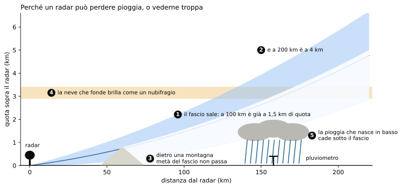
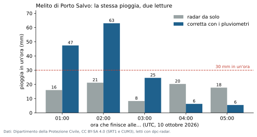
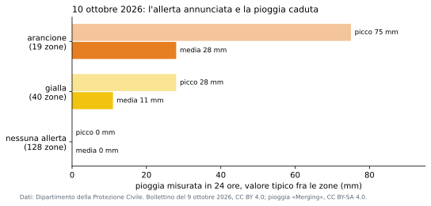

# Appendice E. Il radar, da vicino

!!! abstract "In breve"
    - Il radar meteo è l'unico strumento che vede la pioggia **mentre cade**,
      su tutta Italia, chilometro per chilometro, ogni cinque minuti.
    - Non misura la pioggia: la **stima** da un'eco. Può perderne quasi metà,
      come a Melito di Porto Salvo il 10 ottobre 2026, o vederne dove non c'è.
    - I **pluviometri** misurano la pioggia vera, ma solo dove stanno. La
      Protezione civile unisce i due strumenti in un prodotto chiamato
      **«Merging»**: è il numero di cui fidarsi per i millimetri.
    - Tutti questi dati sono **aperti e gratuiti**, ma durano circa cinque
      mesi e poi spariscono. Chi non li salva li perde.
    - **dpc-radar** è la libreria nata da Limen per leggerli in poche righe.
      Ha cinque quaderni che chiunque può aprire nel browser e quattro piccoli
      programmi d'esempio.

I capitoli [2](02-le-librerie.md) e [3](03-i-dati.md) dedicano al radar poche
righe ciascuno. Qui c'è il resto: come funziona lo strumento, perché sbaglia,
quali dati pubblica la Protezione civile e come si leggono. Serve a chi vuole
capire **quanto fidarsi** di una mappa di pioggia, e a chi vuole usarla per
conto suo: un Comune, un consorzio di bonifica, una scuola, un giornale.

## Perché il radar conta

Una **previsione** dice che cosa probabilmente succederà su un'area larga.
Una **misura** dice che cosa sta succedendo, qui, adesso. In un Paese di
valli corte e ripide la differenza è grande: un temporale può scaricare su una
valle la pioggia di un mese e lasciare asciutta quella accanto.

La mattina del 10 ottobre 2026, a Melito di Porto Salvo, la previsione dava
20 mm. A fine giornata la pioggia misurata era di 192 mm[^melito].
Nessun modello meteorologico a nove chilometri poteva vedere quel temporale.
Il radar sì.

## Come un radar misura la pioggia

### Ascolta un'eco

Un radar meteo è una parabola che gira. Manda un impulso brevissimo di
microonde e ascolta. Se l'impulso incontra delle gocce, una piccola parte
torna indietro.

- **Quanto tempo** ci mette l'eco a tornare dice quanto è lontana la pioggia.
- **Quanto è forte** dice quanta acqua c'è lassù. Questa forza si chiama
  *riflettività*.

La parabola fa un giro intero, si alza di poco e ne fa un altro. In pochi
minuti ha guardato il cielo per circa duecento chilometri intorno. Più radar
insieme, cuciti in un'unica immagine, coprono l'Italia: è il **mosaico**
nazionale.

### Dall'eco ai millimetri: una stima

Qui sta il punto debole. L'eco non dipende solo da *quanta* acqua c'è, ma
moltissimo da *quanto sono grosse* le gocce: una goccia di 4 millimetri
rimanda la stessa eco di circa quattromila gocce da un millimetro[^sesta].
Il radar non può contare le gocce. Usa una formula costruita sulla pioggia
«media». Una delle più usate, detta di Marshall e Palmer, dà questi
valori[^mp]:

| Forza dell'eco | Pioggia | Com'è |
|---|---|---|
| 20 dBZ | circa 0,6 mm all'ora | pioviggine |
| 30 dBZ | circa 3 mm all'ora | pioggia regolare |
| 40 dBZ | circa 12 mm all'ora | pioggia forte |
| 50 dBZ | circa 50 mm all'ora | nubifragio |

Se oggi le gocce sono più grosse o più piccole della media, la pioggia
stimata è sbagliata anche con un radar perfetto. La grandine è il caso
estremo: pochi chicchi fanno l'eco di un diluvio.

### Guarda in alto, non per terra



*Il fascio più basso di un radar, disegnato in scala. La montagna, la nuvola e
la fascia in cui la neve fonde sono un esempio.*

Il fascio parte quasi orizzontale, ma la Terra è curva e gli sfugge da sotto.
A 100 km dal radar il fascio è già a un chilometro e mezzo di quota (1); a
200 km è a quattro chilometri (2)[^fascio]. Quello che il radar vede lassù non
è quello che arriva a terra. Ecco perché sbaglia:

- **Le montagne coprono il fascio (3).** Dietro un crinale il radar vede
  meno, o niente. E l'Italia è quasi tutta montagne.
- **La neve che fonde sembra un nubifragio (4).** In quota la pioggia è
  spesso neve. Mentre fonde si copre d'acqua e fa un'eco molto più forte
  della pioggia che diventerà. Sulla mappa è un anello di pioggia forte che
  non esiste.
- **La pioggia può nascere sotto il fascio (5).** Contro un versante l'aria
  umida sale e le gocce crescono nell'ultimo chilometro prima del suolo. Il
  radar, che guarda più in alto, quell'acqua non la vede. È la spiegazione più
  probabile di Melito.
- **La pioggia forte nasconde quella dietro.** L'impulso si indebolisce
  attraversando un temporale: un secondo temporale più lontano sembra più
  debole di com'è.
- **Non ogni eco è pioggia.** Colline, mare, pale eoliche e, in certi
  giorni, l'aria stessa, che piega il fascio verso terra. Sono gli archi e i
  dischi che compaiono sulla mappa dove non c'è una nuvola.

### Il pluviometro: vero, ma solo dove sta

Un pluviometro è un imbuto su un palo: raccoglie la pioggia e la pesa o la
conta. Misura l'acqua che è arrivata davvero a terra. Ma guarda un cerchio
largo come un piatto, e il pluviometro successivo può stare a dieci
chilometri. Un temporale estivo passa fra due pluviometri e li lascia
asciutti.

### Il «Merging»: il meglio dei due

Ogni strumento ha quello che manca all'altro.

| | Radar | Pluviometro |
|---|---|---|
| **Dove** ha piovuto | dappertutto, ogni chilometro | solo dove c'è lo strumento |
| **Quanto** ha piovuto | una stima, a volte lontana dal vero | una misura |
| **Ogni quanto** arriva | ogni 5 minuti | da minuti a ore |

La Protezione civile li mette insieme: il radar dà la **forma** della pioggia,
i pluviometri correggono la **quantità**. Il risultato si chiama «Merging».
È la cosa più vicina a «quanto ha piovuto davvero, dappertutto» che esista in
Italia, ed è un dato aperto.

Anche il «Merging» ha un limite: dove non c'è un pluviometro vicino e il
radar non vede, non vede nessuno. Il nubifragio di Lipari dello stesso
10 ottobre è rimasto fuori da tutti e due[^lipari].

## I dati aperti del radar

Tutto quello che segue è pubblicato dal Dipartimento della Protezione Civile,
gratis, senza registrazione e senza chiave.

| Prodotto | Che cosa dice | Da dove viene | Dettaglio | Ogni quanto |
|---|---|---|---|---|
| **SRI** | quanto forte piove adesso (mm all'ora) | solo radar | 1 km | 5 minuti |
| **SRT1** | pioggia dell'ultima ora (mm) | solo radar | 1 km | 5 minuti |
| **CUM3, CUM6, CUM12, CUM24** | pioggia delle ultime 3, 6, 12, 24 ore (mm) | «Merging»: radar e pluviometri | circa 1 km | 30 minuti |
| **Bollettino di criticità** | il colore dell'allerta ufficiale, zona per zona, per oggi e domani | Protezione civile e Regioni | zona di allerta | ogni pomeriggio |

A questi si aggiunge **IT-DPC-SRI**: quindici anni del mosaico radar, dal
2010 al 2025, raccolti dalla Fondazione Bruno Kessler in un unico archivio
permanente di 50 GB[^fbk].

**Le licenze.** I prodotti del radar e l'archivio storico sono CC BY-SA 4.0;
i bollettini CC BY 4.0. In pratica: si cita la fonte («Dipartimento della
Protezione Civile») e, se si pubblica qualcosa ricavato dai dati del radar,
lo si condivide con la stessa licenza.

**Tre limiti da conoscere prima di cominciare un progetto.**

1. **Il servizio ha la memoria corta.** Un'immagine più vecchia di circa
   cinque mesi non c'è più. Il «Merging», in particolare, non è archiviato
   da nessuno in forma pubblica: chi non lo salva lo perde, un mese alla
   volta.
2. **Lo storico di quindici anni è solo radar.** Senza la correzione dei
   pluviometri sottostima: serve a studiare *dove e quando* piove, non a
   citare i millimetri.
3. **Non esiste un «Merging» di un'ora.** Il più corto è di tre ore. Per
   sapere quanta pioggia è caduta in un'ora, il dato che conta per le piene
   improvvise, bisogna ricostruirlo (più sotto).

I bollettini invece restano: la Protezione civile li pubblica dal 1° gennaio
2020 e il 15 novembre 2026 l'archivio contava 7.711 file[^bollettini].

## dpc-radar: leggere il radar in poche righe

I dati sono aperti, ma arrivarci non è immediato. Il servizio non ha un
manuale pubblico: le due chiamate che servono si ricavano guardando come
lavora la mappa ufficiale. Le immagini sono file tecnici (GeoTIFF) in due
proiezioni diverse. Dove il radar non guarda c'è un numero convenzionale,
−9999, che un programma distratto legge come «zero pioggia».

**dpc-radar** è il mattone, nato dentro Limen, che toglie di mezzo questo
lavoro[^dpcradar]. Fa cinque cose.

| Cosa fa | Perché conta |
|---|---|
| **Scarica** l'ultima immagine, o quella di un'ora precisa | una riga invece di una settimana di tentativi |
| **Legge la pioggia in un punto** | usa i nove pixel intorno, non uno solo: un pixel sbagliato non diventa un'alluvione |
| **Distingue «asciutto» da «non misurato»** | dove il radar non vede risponde «non so», mai «zero» |
| **Controlla un'immagine** contro quella di prima | scarta i guasti, come i 7.348 mm dell'11 ottobre 2026 ([capitolo 3](03-i-dati.md)) |
| **Tiene un archivio** e ne ricava la pioggia ora per ora | salva il «Merging» prima che sparisca |

In più legge i **bollettini di criticità**: dato un punto, risponde con il
colore dell'allerta ufficiale e i Comuni della zona.

??? note "Per chi sviluppa"
    ```bash
    pip install "dpc-radar[bulletins]"
    ```

    ```python
    import asyncio
    from dpc_radar import RadarClient, bulletins

    ROMA = (12.50, 41.90)  # longitudine, latitudine

    async def main() -> None:
        async with RadarClient() as radar:
            pioggia = await radar.latest("CUM24")       # «Merging», 24 ore
            adesso = await radar.latest("SRI")          # mm/h, solo radar
        print(pioggia.sample([ROMA]))                   # [12.4] oppure [None]
        print(adesso.peak((12.2, 41.7, 12.8, 42.1), threshold=30.0))

        bollettino = await bulletins.latest()
        zona = bollettino.zone_at(*ROMA)
        print(zona.name, zona.colour)

    asyncio.run(main())
    ```

    - `sample` restituisce `None` dove non c'è misura; `peak` dà il massimo
      in un rettangolo e quanti chilometri quadrati superano una soglia.
    - `frame.check(previous, max_step=150)` restituisce un verdetto:
      `consistent`, `pixels_masked`, `previous_wrong`, `rejected`. Sul banco
      di prova dei casi noti supera 17 controlli su 18; il filtro precedente
      di Limen ne superava 8[^banco].
    - `dpc_radar.archive.archive(cartella, radar, start=…, end=…, limit=…)`
      scarica CUM3 e SRT1 che mancano; `MergingArchive(cartella).hourly(…)`
      restituisce la pioggia oraria corretta.
    - Licenza Apache-2.0, Python 3.12 o successivo. Documentazione:
      <https://agentengineering.it/dpc-radar/>.

## Un temporale, letto con i dati

Le due figure che seguono vengono dai quaderni della libreria, rifatti il
15 novembre 2026 sui dati della Protezione civile.

### La pioggia ora per ora

Per le piene improvvise conta la pioggia di **un'ora**, e il «Merging» di
un'ora non esiste. La libreria lo ricostruisce così: il «Merging» di tre ore
dice *quanta* pioggia è caduta, il radar dice *in quale* delle tre ore. Le
tre ore corrette, sommate, danno esattamente il totale del «Merging».



A Melito il radar da solo non arriva mai a 30 mm in un'ora, il valore che in
Limen fa scattare l'attenzione per un temporale violento. La pioggia corretta
ci arriva due volte: 47 e 63 mm. Sull'intera giornata il radar da solo
misurava 115 mm, quella corretta 192: il radar ne aveva visti sei decimi.

La correzione non va in una sola direzione. Nelle due ore dopo, il radar
dava 20 e 18 mm e i pluviometri ne confermano 6: lì il radar vedeva troppo.

### L'allerta annunciata e la pioggia caduta

Il pomeriggio del 9 ottobre il bollettino ufficiale dava **allerta
arancione** per il giorno dopo alla zona «Versante Jonico Meridionale», 120
Comuni fra cui Melito. L'allerta c'era, ed era giusta.



Il confronto su tutta Italia mostra un legame chiaro: nelle 19 zone
arancioni la pioggia tipica è stata di 28 mm in media sulla zona e di 75 nel
punto peggiore; nelle 40 gialle 11 e 28; nelle 128 senza allerta, zero.

È un giorno solo e non è una verifica: una zona di allerta copre decine di
Comuni, e l'allerta parla di *effetti al suolo*, non di millimetri. Ma è il
tipo di confronto che i dati aperti rendono possibile a chiunque, e che il
[capitolo 9](09-cosa-manca.md) mette fra i lavori da fare in modo
sistematico.

## Come Limen usa il radar

Limen usa la libreria in cinque punti. I primi tre sono raccontati nei
capitoli [3](03-i-dati.md), [4](04-i-motori.md) e [7](07-come-gira.md).

1. **La pioggia già caduta nell'alluvione.** La previsione comincia «da
   adesso»: un nubifragio in corso ne esce mentre cade. Limen prende il
   «Merging» delle ultime 24 ore e lo somma alla pioggia prevista per le ore
   che restano; vale il maggiore fra questa lettura e la sola previsione.
2. **La sveglia.** Ogni quarto d'ora Limen guarda l'ultima immagine. Oltre
   30 mm all'ora su un pezzo di regione, quella regione si ricalcola subito.
3. **Il controllo delle immagini.** Ogni «Merging» è confrontato con quello
   di mezz'ora prima. Due immagini così vicine non possono differire di più
   di mezz'ora di pioggia: oltre 150 mm di salto, una delle due è guasta.
4. **La siccità per gli incendi.** L'indice degli incendi scende solo con
   la pioggia, e il modello meteorologico non vede i temporali. Per i giorni
   già passati Limen usa la pioggia del «Merging»[^fwi].
5. **I bollettini ufficiali**, mostrati sulla mappa accanto ai punteggi.

In più Limen tiene il proprio archivio del «Merging», aggiornato ogni notte,
per poter rigiocare gli eventi passati ([capitolo 5](05-misurare.md)).

Vale la solita avvertenza: né il radar, né la libreria, né Limen sono un
sistema di allerta. L'allerta ufficiale è quella della Protezione civile e
delle Regioni.

## Provalo: quaderni e programmi

Un **quaderno** è una pagina che mescola testo, programma e risultati. Si
legge come un articolo; chi vuole può rieseguirlo con i dati di oggi. I
cinque quaderni di dpc-radar si aprono nel browser con un clic, senza
installare niente[^quaderni].

| # | Quaderno | Che cosa si impara |
|---|---|---|
| 1 | *Your first rain map of Italy* | la mappa della pioggia di oggi e la pioggia sulla propria città |
| 2 | *Anatomy of a storm* | il temporale di Melito ora per ora, e quanto ne ha perso il radar |
| 3 | *Trust, but verify* | un'immagine guasta pubblicata davvero, e il controllo che la scarta |
| 4 | *Hourly rain from your own archive* | salvare le immagini e ricavarne la pioggia oraria corretta |
| 5 | *The official alert, next to the radar* | l'allerta annunciata e la pioggia caduta, zona per zona |

I quaderni sono in inglese, come la libreria, perché i dati aperti italiani
servono anche a chi non parla italiano. I quaderni 2, 4 e 5 leggono le
immagini del 10 ottobre 2026, che il servizio terrà fino a circa marzo 2027:
dopo basterà cambiare la data con quella di un temporale recente.

Ci sono anche quattro piccoli programmi, ciascuno in un solo file:

| Programma | Che cosa fa |
|---|---|
| `rain_at.py` | la pioggia in un punto: adesso, nelle ultime 3-24 ore, e l'allerta ufficiale |
| `storm_watch.py` | sorveglia un'area e avvisa quando ci entra un rovescio violento |
| `nightly_archive.py` | tiene aggiornato un archivio; pensato per girare ogni notte |
| `app.py` | un cruscotto della pioggia per qualunque Comune, nel browser |

## A chi serve

- **Un Comune o un consorzio di bonifica**: la pioggia delle ultime sei ore
  su ogni idrovora o sottopasso, e un rapporto dopo ogni evento che chiunque
  può rifare e controllare.
- **Chi fa ricerca o studia**: la pioggia dietro una frana, un anno di
  temporali su un bacino, i dati per addestrare un modello.
- **Chi coltiva o assicura**: quanta pioggia è caduta davvero su un campo, e
  non alla stazione meteo a venti chilometri.
- **Un giornale o un'associazione**: mostrare che cosa è caduto durante un
  temporale, con una fonte che il lettore può verificare.
- **Una scuola**: un temporale finito sui giornali diventa una lezione su
  misura, errore e dati aperti.

## Gap e come chiuderli

| Gap | Perché conta | Proposta di open data | Issue |
|---|---|---|---|
| Il «Merging» non ha un archivio pubblico: dopo circa cinque mesi sparisce. | È la pioggia migliore che abbiamo, e serve proprio a studiare gli eventi passati. Oggi ogni gruppo si fa il suo archivio, da quando ha cominciato. | un archivio permanente del «Merging» con un DOI, come è stato fatto per il solo radar con IT-DPC-SRI | [#625](https://github.com/agent-engineering-studio/limen/issues/625) |
| Non esiste un «Merging» di un'ora. | Le piene improvvise si giocano in un'ora. La ricostruzione della libreria è una stima ragionevole, non un prodotto ufficiale. | la cumulata oraria corretta con i pluviometri, pubblicata accanto a quelle di 3-24 ore | [#626](https://github.com/agent-engineering-studio/limen/issues/626) |
| Il servizio non ha un manuale pubblico né condizioni d'uso scritte. | Chi costruisce un servizio sopra questi dati non sa che cosa può cambiare da un giorno all'altro, né quante richieste è lecito fare. | la documentazione del servizio e una pagina di condizioni d'uso | [#627](https://github.com/agent-engineering-studio/limen/issues/627) |
| Non è pubblicata una mappa di qualità: dove il radar vede bene e dove no. | Oggi «non misurato» si riconosce solo dal dato mancante; una pioggia vista male sembra uguale a una vista bene. | la mappa della copertura e della qualità del mosaico, e la posizione dei pluviometri usati | [#628](https://github.com/agent-engineering-studio/limen/issues/628) |
| Il confronto fra allerta ufficiale e pioggia caduta è fatto su singoli giorni. | Un giorno non dice quanto spesso l'allerta e la pioggia vanno d'accordo. | c'è già tutto: bollettini dal 2020 e, da ora, l'archivio del «Merging» | [#629](https://github.com/agent-engineering-studio/limen/issues/629) |

Le righe sono riportate nel [registro dei gap](appendice-d-gap.md).

I primi quattro gap li può chiudere solo la Protezione civile: la richiesta
è scritta, pronta da inviare, in una
[lettera](https://github.com/agent-engineering-studio/limen/blob/main/docs/lettere/2026-11-richiesta-radar-dpc.md)
pubblica. Nel frattempo Limen misura quello che può. Un solo comando,
`limen misura-radar`, legge l'archivio e scrive un rapporto con cinque
parti: quante immagini ci sono mese per mese e quante erano già perse;
quante richieste Limen fa al servizio; la pioggia caduta in ogni zona di
allerta accanto al colore annunciato, per tutti i giorni dell'archivio;
quanto vede il solo radar rispetto al «Merging», riquadro per riquadro di
dieci chilometri; e l'ora ricostruita messa a confronto con i pluviometri
della Lombardia.

Una cosa si può già dire. Per venti aree sorvegliate Limen fa circa 750
richieste al giorno al servizio, una ogni due minuti, e scarica circa 180
immagini. Il servizio non dichiara un limite; Limen se ne dà uno da solo:
meno di mille richieste al giorno.

I numeri delle altre quattro parti non sono ancora in questa pagina: il
comando deve girare sull'archivio completo, e i rapporti saranno pubblicati
fra le [misure](https://github.com/agent-engineering-studio/limen/tree/main/docs/misure).

## Per approfondire

- La documentazione di dpc-radar, con la teoria, gli esempi e il banco di
  prova: <https://agentengineering.it/dpc-radar/>.
- I quaderni e i programmi d'esempio:
  <https://github.com/agent-engineering-studio/dpc-radar/tree/main/notebooks>
  e <https://github.com/agent-engineering-studio/dpc-radar/tree/main/examples>.
- La mappa ufficiale del radar della Protezione civile:
  <https://radar.protezionecivile.it>.
- I bollettini di criticità in formato aperto:
  <https://github.com/pcm-dpc/DPC-Bollettini-Criticita-Idrogeologica-Idraulica>.
- Fondazione Bruno Kessler, *IT-DPC-SRI*, l'archivio 2010-2025 del mosaico
  radar: <https://doi.org/10.5281/zenodo.18637608>.
- Marshall, J. S., Palmer, W. McK. (1948). The distribution of raindrops
  with size. *Journal of Meteorology* 5, 165-166.

[^melito]: Punto 15,78°E 37,92°N. Il «Merging» di 24 ore emesso alle 00:00
    UTC dell'11 ottobre 2026 dà 192 mm (191,6), riscaricato il 16 novembre 2026. La stessa
    immagine, salvata a ottobre nel banco di prova di dpc-radar, dava 185 mm:
    le due letture differiscono, verosimilmente perché il prodotto è stato
    ricalcolato. La somma delle ore corrette
    dell'archivio dà 190 mm. La somma delle 24
    immagini orarie del solo radar (SRT1) dà 115 mm. La mattina dell'evento,
    alle 06:00 UTC, il «Merging» era a 152 mm: è il numero dei capitoli
    [1](01-il-problema.md) e [3](03-i-dati.md).
[^sesta]: Per gocce piccole rispetto alla lunghezza d'onda, l'eco di una
    goccia cresce con la sesta potenza del suo diametro: 4⁶ = 4.096.
[^mp]: La relazione Z = 200 · R^1,6, dove Z è la riflettività e R la
    pioggia in mm all'ora; i valori della tabella si ricavano da qui. È un
    esempio: questo libro non sa quale relazione usi oggi la Protezione
    civile per i suoi prodotti.
[^fascio]: Conto con la regola dei «4/3 del raggio terrestre», che tiene
    conto di come l'aria piega il fascio, per un fascio a mezzo grado sopra
    l'orizzonte. Lo script della figura è
    `scripts/libro/appE_radar.py`.
[^lipari]: Commento al blocco `observed` di
    [`flood.yaml`](https://github.com/agent-engineering-studio/limen/blob/main/src/limen/config/hazards/flood.yaml):
    a Lipari, il 10 ottobre 2026 alle 06:00 UTC, il «Merging» dava 24 mm.
[^fbk]: Fondazione Bruno Kessler su dati della Protezione civile,
    CC BY-SA 4.0, <https://doi.org/10.5281/zenodo.18637608>. Un'immagine ogni
    15 minuti fino al 2014, ogni 10 fino al 2020, ogni 5 dopo.
[^bollettini]: Archivio
    [`pcm-dpc/DPC-Bollettini-Criticita-Idrogeologica-Idraulica`](https://github.com/pcm-dpc/DPC-Bollettini-Criticita-Idrogeologica-Idraulica),
    cartella `files/geojson`, contata il 15 novembre 2026.
[^dpcradar]: dpc-radar 0.2.1, novembre 2026:
    <https://github.com/agent-engineering-studio/dpc-radar>.
[^banco]: [Banco di prova di dpc-radar](https://agentengineering.it/dpc-radar/benchmark/):
    18 controlli su casi noti, con immagini vere guaste e sane.
[^fwi]: Commento in
    [`wildfire.yaml`](https://github.com/agent-engineering-studio/limen/blob/main/src/limen/config/hazards/wildfire.yaml):
    a Montegiordano, fra il 14 settembre e il 14 ottobre 2026, il modello
    dava 9 mm contro i 35-45 misurati.
[^quaderni]: Quaderni eseguiti il 15 novembre 2026 con dpc-radar 0.2.1. Si
    aprono con Google Colab dal collegamento in testa a ciascuno.
