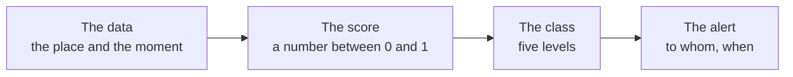

*[Versione italiana](01-limen-in-una-pagina.md)*

# Limen in one page

**If you live, work or farm on a slope, near a watercourse or next to a
wood, Limen tells you every hour how exposed that place is today** — not in
general, not on average: today, with the rain that is falling and the rain
that is forecast. It does this for every one-kilometre square of Italian
territory, and it openly shows the calculation it made to get there.

<!-- schema-fase: avviso -->

## First of all: what Limen is not

We put the limits at the start, because putting them at the end would be an
elegant way of hiding them.

**Limen is not the official warning system.** In Italy the warnings that
count — the ones that close schools, bar access to a road, activate the
municipal operations centres — are issued by the Dipartimento della
Protezione Civile (the national Civil Protection department) and the regional
Centri Funzionali (functional centres). Limen uses the same colour scale
(green, yellow, orange, red) because it is the scale people recognise, but
**its alerts have no legal value whatsoever** and never replace the official
ones. If the two do not match, the official one prevails.

**Limen is not a landslide prediction.** Nobody in the world can say
"tomorrow at 15:00 that slope will give way". Limen estimates an exposure:
how much that place, built the way it is and stressed the way it is today,
resembles the conditions in which landslides have actually happened in
Italy. It is a relative probability, not an appointment.

**Limen is not a chatbot.** There is nothing to talk to, and artificial
intelligence decides nothing of what you see coloured on the map. The colour
is decided by a formula that is written down, readable and can be recomputed
by hand; the AI, when it steps in, only writes the sentence that goes with
it. [Page 3](./03-cosa-fanno-ml-e-ai.md) explains this in detail, because it
is the point that is easiest to misunderstand.

**Limen does not see underground.** It does not know whether that retaining
wall was built properly, whether the drainage network is blocked, whether a
building site cut into the foot of a slope last week. It sees the shape of
the ground, its recorded history of landslides, and the weather.

## What it is, then

Limen is a system that every hour takes three things:

- **what the place is like** — the slope, the landslides that have already
  happened nearby and are recorded in the national inventories, the zones
  that the hydrogeological plans (Piani di Assetto Idrogeologico) classify
  as hazardous, the type of rock;
- **what is happening now** — how much rain has fallen and how intensely,
  how soaked the ground already is, whether there has been an earthquake
  nearby in the last few days, whether the wood burned in recent months,
  whether a river flood is about to arrive;
- **what history says** — more than six thousand dated Italian landslides,
  with the rain that triggered them, against which the system is replayed to
  see whether it would have worked.

From these three things it calculates a number between 0 and 1 for every
one-square-kilometre cell, translates it into one of the five colour
classes, and — if the class is high — sends an alert on the configured
channels.

Coverage is **national: all twenty regions**, about **312,000 cells** of one
square kilometre (the exact count and the grid are in the
[project README](../../README.md)). The pilot on which the system was first
validated is Puglia and Basilicata.

## Who it is for

**People who live on a slope.** The practical question is always the same —
"it's going to rain hard tonight, should I worry?" — and an honest answer is
hard to find today: the regional warning covers a large, uniform zone, while
two slopes of the same valley can behave very differently. Limen goes down
to the square kilometre and, above all, shows you *why*: how much the rain
weighs, how much the place weighs.

**Municipalities and local Civil Protection.** A municipal technical office
has to decide where to send the team when reports all arrive at once. Limen
produces a ranking by municipality and by cell, with the reason next to each
row: not "red zone", but "rain well above the threshold on a slope with
recorded landslides a few hundred metres away".

**People who farm land on a slope.** Damage rarely comes as a surprise: it
comes after weeks in which the ground has been loading up with water and
nobody noticed. Limen keeps count of that load day by day — it is the
component we call *antecedent rain* — and shows it before the intense event
arrives on top of it.

**People who want to check.** Researchers, journalists, students, municipal
technicians: everything Limen calculates can be reconstructed. There is a
web address that returns, for a single cell, every one of the numbers that
made up the score. [Page 6](./06-trasparenza-e-riproducibilita.md) explains
how to use it.

## What it actually does when it rains hard

The normal cycle is **every hour**: the system downloads the updated
weather, recalculates the cells, saves the scores, and sends alerts only for
cells that exceed the threshold and for which it has not already alerted
recently (the same alert repeated every hour is noise, and noise makes
people stop looking).

But a thunderstorm does not wait for the hour to strike. So there are two
shortcuts:

- **the Protezione Civile weather radar**, read every few minutes: if the
  rain seen by the radar exceeds an intensity threshold over a region, that
  region is recalculated at once, without waiting its turn;
- **the NASA satellite hotspots**, read continuously: when a fire is
  detected, the "ground burned by fire" factor switches on within a few
  hours instead of waiting for the official map of the burnt perimeter,
  which arrives much later.

Then there is a look ahead: a **48-hour forecast** cycle that repeats the
very same calculation using the *forecast* rain instead of the rain that
has fallen. The alerts it produces are labelled **FORECAST** (PREVISIONE),
because saying "it is happening" is one thing, and saying "it could happen"
is another.

## Where to look

- **The map** — the web application: the coloured cells, the ranking of
  municipalities, the national overview of the twenty regions, the recent
  alerts. It opens without signing up and without a login: the data are
  public, and putting a door in front of a public page only gives the
  impression of a security that is not there.
- **The simulator** — in the «How it works» (Come funziona) section of the
  application (`#/come-funziona`) you move the sliders for rain and slope
  and watch the score change. It is not a demo with fake numbers: it uses
  the production formula.
- **The complete guide** — in the application, under «How it works», a
  single page brings together the whole engine: data, formulas, forecast, ML
  and AI (source: [`docs/guida/limen.en.md`](../guida/limen.en.md)).

## From here on

If you want to understand the calculation, the next page is
[How your cell's risk is calculated](./02-come-si-calcola-il-rischio.md).
If instead the question you care about is "how far can I trust it", skip to
[What ML and AI do, and what they don't](./03-cosa-fanno-ml-e-ai.md): the
final part describes the verification measurements, including the ones the
system does not pass today.
