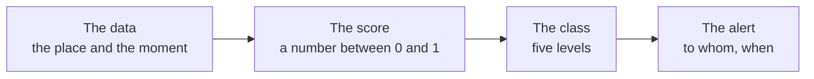

*[Versione italiana](04-fonti-dati-open.md)*

# The data sources: all open, all free of charge

**Every number Limen uses comes from public data you have already paid for
with your taxes, and that anyone can download without asking permission and
without paying for a subscription.** There is not a single commercial dataset
in the system, no paid access key, no supplier that could raise the price or
turn off the tap and leave the platform silent. This page lists the sources
one by one: who produces them, what they contain, how often we read them, and
how they become a number per cell.

<!-- schema-fase: dati -->

As always: Limen works alongside the official warning system and does not
replace it, and none of its alerts has any legal value.

## Landslides that have already happened: the ISPRA IFFI inventory

It is produced by the **Italian Institute for Environmental Protection and
Research** (ISPRA) together with the Regions and the Autonomous Provinces, and
it is the national census of Italian landslides: where they are, what type
they are, how large they are. It is the most important body of knowledge the
country has on this phenomenon.

It contains the polygons and points of the mapped landslides across the whole
territory, divided by type (point landslides, landslide areas, deep-seated
gravitational slope deformations).

We read it **once when the system starts and then with a weekly
synchronisation**: an inventory does not change from one hour to the next.

It becomes a number per cell in two ways: by counting how many landslides fall
within 500 metres of the cell's edge (`iffi_density_500`) and by measuring
the distance to the nearest mapped landslide (`distance_to_iffi_m`). The first
of the two is the heaviest ingredient among the slow factors.

Licence **CC BY-SA 4.0**, portal <https://idrogeo.isprambiente.it/>: whoever
redistributes derived data publishes it under the same licence. Each area has
its own licence PDF, and we read all twenty-one of them: they say the same
thing. Citation: «ISPRA – Regione …, Inventario dei Fenomeni Franosi in
Italia (IFFI), idrogeo.isprambiente.it» [ISPRA – Region …, Italian Landslide
Inventory (IFFI)].

## Areas already mapped as hazardous: the ISPRA PAI mosaics

Again ISPRA, which collects the hazard maps produced by the River Basin
Authorities in their Hydrogeological Plans (PAI) and harmonises them into a
single national mosaic.

It contains two separate mosaics: **landslide hazard areas** and **hydraulic
hazard areas**, both classified on a scale from moderate to very high.

These too are read at start-up and then weekly.

Landslide hazard becomes the factor `pai_class_norm`, that is, the class
mapped onto a scale from 0 to 1. Hydraulic hazard feeds the `H` component of
the landslide score and, above all, is the basis of the flood hazard: it
covers about **132,000 cells** in Italy.

Licence **CC BY-SA 4.0**, same IdroGeo portal: the PDF inside each ZIP says
so, and derived data is redistributed under the same licence.

## The historical truth: the CNR-IRPI e-ITALICA catalogue

It is produced by the **Research Institute for Geo-Hydrological Protection of
the National Research Council** (CNR-IRPI), and it is what makes this project
measurable rather than a matter of opinion.

It contains Italian **rainfall-induced landslides, with dates**, with the
rainfall event reconstructed from rain gauges: in the loaded version, **6,312
landslides between 1996 and 2021**, and **5,974 intensity-duration pairs**
used to recalibrate the rainfall thresholds.

We read it **only once**, downloading it automatically from a permanent
Zenodo identifier fixed in the code: so anyone who redoes the calculations two
years from now uses exactly the same catalogue.

It does not become a number per cell: it becomes the **yardstick**. It is the
truth against which the past is replayed to calculate how many landslides the
system would have anticipated, and it is the material the challenger model is
trained on.

Licence **CC-BY 4.0**, permanent identifier
<https://doi.org/10.5281/zenodo.14204473>.

## The weather now and to come: Open-Meteo

It is a European service that redistributes, through a simple interface and
without registration, the data of the main public weather models — including
those of the European Centre for Medium-Range Weather Forecasts.

From it we take observed and forecast hourly rain, soil moisture at two
depths (0–7 and 7–28 centimetres), snow on the ground, and — from two
separate interfaces — **river discharge** from the European GloFAS system and
wave height near the coast.

We read it **continuously, at every hourly cycle**, with a local copy that
lasts half an hour so as not to ask the same question dozens of times.

It becomes almost all of the weather component: the intensity and duration of
the rainfall event for the Caine threshold, the rain of the previous thirty
days for the antecedent rainfall index, and soil moisture for the S-curve.

Interfaces: <https://api.open-meteo.com/v1/forecast>,
<https://archive-api.open-meteo.com/v1/archive>,
<https://flood-api.open-meteo.com/v1/flood>. The data is under the
**CC BY 4.0** licence, with the citation «Weather data by Open-Meteo.com»;
the public API is free for non-commercial use, which is one more reason
Limen runs its own instance. That instance downloads the **open data of the
European Centre (ECMWF)**, also CC BY 4.0, which asks for «© [anno] ECMWF»
[© [year] ECMWF] and a precise sentence: «*ECMWF does not accept any
liability whatsoever for any error or omission in the data*», meaning the
Centre is not answerable for errors or omissions in the data. Limen writes it
wherever it shows forecast rain: on the map, in the cell panel, in the page
footer and on the Sources page.

## The weather of the past: the ERA5 and CERRA archives

These are the **reanalyses** of the European Copernicus programme: consistent
reconstructions of past weather, hour by hour, going back decades. CERRA is
the one specific to Europe, with a **5.5-kilometre** grid.

They contain rain, temperature, humidity and much more for every hour from the
1980s to today.

We read them **only when replaying the past**: they are not needed for daily
operation.

They become the rain of the backtests and of the model's training samples.
This is a delicate point and it must be said: the rain used to verify the
system *is not* the rain the system works with every day, and over a localised
thunderstorm the two can differ considerably.

Licence: that of the **Copernicus Climate Change Service**, free reuse citing
«Contains modified Copernicus Climate Change Service information».

## Earthquakes: INGV

The **National Institute of Geophysics and Volcanology** publishes the
catalogue of Italian seismic events and, for the strongest events, maps of the
shaking actually estimated at the ground.

We take events of magnitude **3.5** or above from the last **seven days**
within the bounding box of the monitored area, and the shaking grid
(ShakeMap) when it exists.

We read it **at every cycle**, and it is a quick read because the window is
short.

It becomes the `E` component: for each event we take the ground shaking, let
it decay with the time elapsed, keep the maximum and pass it through an
S-curve.

Interfaces: <https://webservices.ingv.it/fdsnws/event/1/query> and
<https://shakemap.ingv.it/>. Licence **CC BY 4.0**.

## Wildfires, afterwards: the EFFIS perimeters

The **European Forest Fire Information System**, part of the Copernicus
emergency services, publishes the perimeters of burnt areas detected by
satellite all over Europe.

It contains the geometry of every significant fire with its start date: for
Basilicata alone, **515 perimeters from 2012 to today**.

We read it on a **weekly cycle**.

It becomes the count of months since the last fire touching the area, which is
the input of the post-fire bell curve of the `F` component.

A note is worth making, because it cost this project a year of missing data:
the service **requires no credentials at all**. For a long time the opposite
had been concluded, and the fire table stayed empty; the fault was in our
program, not in a missing accreditation. It is the kind of mistake you make
when you take for granted that public data is hard to obtain.

Service: <https://maps.effis.emergency.copernicus.eu/gwis>. Licence
**CC BY 4.0**, with the citation «© European Union, European Forest Fire
Information System (EFFIS), Copernicus EMS».

## Wildfires, while they burn: NASA FIRMS hotspots

**NASA** publishes, a few hours late, the points where its satellites have
detected an anomalous heat source.

It contains individual detections with position, date, radiative power and a
code that distinguishes a vegetation fire from an industrial plant or a
volcano. The Italian archive starts in 2000 and counts hundreds of thousands
of detections: how many remain after the filters depends on the installation
and on the years loaded, and `limen data-status` tells you.

We read it **continuously** for real-time use, and only once for the
historical archive.

It serves two purposes: switching on the post-fire factor within a few hours
instead of waiting for the official perimeter, and measuring how intense a
fire was through the density of energy released.

Here too an instructive note: without the filter on the type of detection,
the most "burnt" cell in Italy turned out to be the Taranto steelworks, with
3,308 days of fire — because a blast furnace is a very reliable heat source.

Service: <https://firms.modaps.eosdis.nasa.gov/>. NASA data is **CC0**,
unless restrictions are stated, with the recommended citation «We
acknowledge the use of data from NASA LANCE FIRMS
(https://earthdata.nasa.gov/firms), part of NASA ESDIS.»

## Floods that actually happened: Copernicus EMS

The **European emergency management service** activates rapid satellite
mapping when a country requests it, and publishes the perimeters of what the
satellite saw.

For Italy it contains **14 activations, 15,865 polygons, 1,029 square
kilometres flooded over 3,593 cells in 9 regions** — and, alongside them, the
observation masks that say where the satellite looked.

We read it **once**, and keep it in cache.

It is the yardstick of the flood hazard, exactly as e-ITALICA is for
landslides. The observation masks are what make it possible to tell a false
alarm apart from an alert that simply cannot be verified.

Licence: **© Unione Europea, Copernicus EMS — libero uso con attribuzione**
[© European Union, Copernicus EMS — free use with attribution], no
credentials required. Service:
<https://rapidmapping.emergency.copernicus.eu/>.

## Rain seen by radar: Civil Protection

The **Civil Protection Department** publishes the mosaic of the national
radar network at a resolution of **one kilometre, updated every five
minutes**.

It contains the instantaneous estimate of rain intensity over the whole of
Italy.

We read it **every few minutes**.

Today it does not enter the score: it acts as an **alarm clock**. When the
radar sees rain above an intensity threshold over a region, that region is
recalculated immediately instead of waiting for its hourly turn. Bringing it
into the calculation as a rainfall measurement is one of the things still
missing.

Licence **CC-BY-SA 4.0**, service <https://radar-api.protezionecivile.it>.

## The shape of the ground: the CNR-IRPI HR-DTM digital model

The digital terrain model of the whole of Italy at **5 metres**, published by
the **Research Institute for Geo-Hydrological Protection of the CNR** (Panza
and colleagues) on Zenodo: it is the one the installation downloads, in
version 1.2. Those who prefer can use INGV's **TINITALY** at 10 metres
instead, under the same licence.

It contains ground elevation on a dense regular grid.

We read it **only once**, while preparing the data.

It becomes the cell's mean slope (`slope_deg`) and, in the future, slope
aspect, curvature and the topographic wetness index.

Licence **CC BY 4.0**, citation «Panza et al., CNR-IRPI, HR-DTM of Italy 5 m
v1.2, doi:10.5281/zenodo.18921767»; record <https://zenodo.org/records/18921767>.

## The type of rock: the lithological map of the National Geoportal

The lithological map of Italy at 1:500,000 scale, published by the
**Ministry of the Environment and Energy Security** on the National
Geoportal.

It contains the polygons of the lithological units and the main faults.

Read **only once**.

It becomes the cell's lithological weight: for each cell we take the dominant
class by area and translate it into a number through an explicit conversion
table, readable in the code.

Licence **CC BY 4.0** for the data of the download service, citation
«Ministero dell'Ambiente e della Sicurezza Energetica, Geoportale Nazionale»
[Ministry of the Environment and Energy Security, National Geoportal];
portal <https://gn.mase.gov.it>. The legal notes also mention «utilizzi
istituzionali» [institutional uses]: until the Ministry clarifies, Limen does
not redistribute the values derived from this map and recomputes them in
every installation.

## Land cover: CORINE Land Cover

Produced by the **Copernicus Land Monitoring Service** programme, it is the
European map of what is on the ground: woodland, arable land, urban fabric,
vineyards, bare rock.

It contains the classification on 100-metre pixels.

Read **only once**.

It becomes two things: the fuel type for the wildfire hazard, and the
recognition of urban fabric to calculate exposure — that is, how much it is
worth alerting for a cell, which depends not only on how hazardous it is but
also on who and what is inside it.

Licence: the **Copernicus** data policy (EU Reg. 1159/2013), free and open
access, with the citation «Generated using European Union's Copernicus Land
Monitoring Service information»; catalogue <https://land.copernicus.eu/>.

## Sealed soil: Imperviousness Density

Again from Copernicus Land, it is the share of sealed surface (asphalt,
concrete, roofs) at every point of the territory.

It becomes a single number per cell, which **amplifies only the pluvial branch
of the flood hazard**: concrete does not make a river rise, it makes the same
rain run off the surface that elsewhere would soak in. It is the mechanism of
sudden urban flooding.

Read only once. Licence: the same as CORINE, with the same citation.

## Roads, railways, buildings: OpenStreetMap

The collaborative world map, built by volunteers.

It contains the road and rail network with a level of detail that no official
Italian dataset matches in uniform coverage.

Read **only once**.

It becomes the distances to the nearest road and railway, which enter the
calculation of exposure: a cell with a main road two hundred metres away
weighs more than an isolated cell with the same hazard.

Licence **ODbL — dati © contributori OpenStreetMap** [data © OpenStreetMap
contributors].

## Administrative boundaries: ISTAT

The **Italian National Institute of Statistics** publishes the official
boundaries of regions, provinces and municipalities.

It contains the geometries and the official identification codes.

Read **only once**.

They become the way the map speaks people's language: the score is calculated
per cell, but the ranking you read is per **municipality**, because nobody can
say off the top of their head which cell they live in.

Licence **CC BY 4.0**, citation «ISTAT, Confini delle unità amministrative a
fini statistici» [ISTAT, Boundaries of administrative units for statistical
purposes]; portal <https://www.istat.it/>.

## Ground movement: EGMS

The Copernicus **European Ground Motion Service** measures millimetre-scale
ground displacement across Europe from satellite.

It is already connected to the system but **does not yet feed the score**: we
list it here for completeness and because it is, potentially, the most
interesting ingredient of all — a slope that slides a few millimetres a year
says so before it gives way.

Updated yearly. Licence: that of **Copernicus Land**, free use with the
citation «Generated using European Union's Copernicus Land Monitoring
Service information».

## The point, in full

None of these sources requires a contract. None requires a credit card. The
few that require a free access key — NASA's real-time hotspots — are set up
so that the system works anyway when the key is missing: the feature stays
off, nothing breaks.

This has three consequences worth spelling out in full.

**There is no lock-in to any supplier.** If a service closed tomorrow, its
part would be replaced without the rest of the system noticing: every external
source sits behind an interface, and a source that does not answer returns
"I don't know" instead of bringing everything down. The same holds the other
way round: an administration wishing to replace a national source with its
own, more precise local data can do so.

**The running cost is the cost of the server.** There is no cost per
monitored cell, per alert sent, or per user. A municipality wishing to host
Limen for its own territory would pay for the machine and nothing else — and
[page 5](./05-ai-che-gira-in-casa.md) explains why the artificial
intelligence part also respects this rule.

**Anyone can redo everything.** There is no piece of this system that depends
on data only we can see. A research group, a region, an association can take
the code, download the same data and get the same numbers — or show that they
are wrong, which is even more useful.
[Page 6](./06-trasparenza-e-riproducibilita.md) explains how.

These data, in the end, we have all already paid for.
