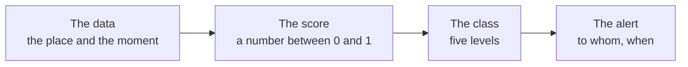

*[Versione italiana](glossario.md)*

# Glossary

The words that appear in these pages without being obvious. They follow the
order of the Italian glossary, which is alphabetical in Italian. Each one
comes with an example, because a definition without an example is forgotten
in thirty seconds.

<!-- schema-fase: tutte -->

**Lead time** (*anticipo*) — How many hours before an event the warning was
already active. It is the number that says whether a warning was of any use:
flagging a landslide ten minutes before it happens is correct and useless.
The goal Limen has set itself is **at least 18 hours**. *Example:* in the
backtest of the floods in Emilia-Romagna, the measured average lead time was
50 hours.

**AOI** (*area of interest*) — The territory the system assesses in a single
round of calculation. In Limen it normally coincides with a region.
*Example:* `it-basilicata` is an AOI, and it contains a few thousand cells.

**Backtest** — Replaying the past: taking a historical window, running the
system day by day as if nobody knew what had happened, and comparing its
warnings with the events that actually occurred. It is the only honest way to
say whether a warning system works. *Example:* Liguria from 1 November to
5 December 2019, 5,884 cells, 131 dated landslides.

**Briefing** — The paragraph of text that accompanies a risk situation,
written by the language model *after* the numbers have already been
calculated and saved. It cannot change them. If the model is switched off,
the deterministic explanation appears in its place. *Example:* «On three
cells of the eastern slope, the rain of the last 24 hours exceeds the local
threshold; the ground was already close to saturation.»

**Champion and challenger** (*campione* and *sfidante*) — The champion is the
engine that actually decides: in Limen it is the deterministic formula. The
challenger is a candidate model that runs alongside it, is measured, and
decides nothing until a person promotes it. *Example:* the landslide
challenger scores an AUC-PR of 0.60 against 0.28 for the champion, and it
still remains a challenger.

**Cell** (*cella*) — The square, one kilometre on each side, into which Italy
is divided: about 312,000 in all. It is the smallest unit to which Limen
assigns a score. It does not match any administrative boundary, because
landslides do not respect them. *Example:* «your cell» is the one-kilometre
square that contains your home.

**Deterministic** — A calculation that, given the same inputs, always returns
exactly the same result, anywhere and at any time. It does not learn, it
does not adapt, it does not vary. It is the property that lets anyone check
Limen's score by hand. *Example:* the weighted sum of the six components.

**DTM and slope** — The DTM (*digital terrain model*) is the height of the
ground, point by point. From the height comes the **slope** in degrees, one
of the ingredients of the score, saturating at 45°. *Example:* a cell with an
average slope of 27 degrees contributes 0.6 out of 1 to the slope term.

**False alarm** (and its rate, *FAR*) — A warning not followed by any event.
The false alarm rate is the share of warnings of this kind; Limen's goal is
to stay at or below 30%. Read it with care: a "false" alarm may be an event
that really happened but that no catalogue recorded. *Example:* a landslide
in a wood, with no damage, often does not make it into any inventory.

**IFFI** — The Inventario dei Fenomeni Franosi in Italia, kept by ISPRA
(Italy's environmental protection and research institute) together with the
Regions: the national landslide inventory. In Limen it is the source of the
heaviest of the static factors, namely how many landslides have already
happened within 500 metres of the cell. It is incomplete by construction, and
the system takes that into account. *Example:* four recorded landslides
within 500 metres give 0.5, on a scale that saturates at eight.

**PAI** — Piano di Assetto Idrogeologico (hydrogeological plan): the tool the
river basin authorities use to map hazardous areas, classifying them from P1
(moderate) to P4 (very high). ISPRA publishes a national mosaic of them.
*Example:* a cell classified as high hazard enters the calculation with 0.75
out of 1.

**Antecedent precipitation** — The rain that fell in the previous days and
weeks, which matters because a slope already loaded with water reacts very
differently to the same storm. Limen calculates it with a counter that every
day discounts the past by 5%. *Example:* 95 mm accumulated against a seasonal
normal of 80 give a factor of 0.56.

**Forecast** (*previsione*) — The cycle that redoes the same calculation using
the *forecast* rain instead of the rain that fell, typically 48 hours ahead.
The alerts it produces are labelled **FORECAST** (*PREVISIONE*) and tracked
separately. It is not a landslide forecast: it is the score the cell would
have if the forecast rain really fell.

**Score** (*punteggio*) — The number between 0 and 1 that sums up how exposed
a cell is at a given moment. It becomes one of the five colour classes
through fixed, declared thresholds (0.15 / 0.35 / 0.55 / 0.75). *Example:*
0.411 is the Moderate (*Moderata*) class.

**Shadow** (*ombra*, shadow mode) — The arrangement in which a model runs on
the same data as the official engine, writes its own results to a separate
table, and has no influence whatsoever on the map or the alerts. It serves
to measure the model in real conditions without risking anything.
*Example:* the ML challenger runs in the shadows once a night.

**Rain threshold** (Caine's threshold) — The curve that says, for each
duration of rain, the intensity beyond which landslides really start to
happen. It rises with duration much more slowly than time does, because the
ground absorbs water if it is given time. In Limen it has been recalibrated
on Italian landslides that actually happened. *Example:* 7.2 mm in one hour
is enough, but 28.4 mm are needed over a day.

**Base rate** — How often the system flags in general, regardless of events.
It must always be read next to the share of events flagged in advance,
because a system that always flags anticipates 100% of events without
telling anything apart. *Example:* 79% of wildfires flagged in advance
against a base rate of 43% means the system discriminates; 79% against 78%
would mean nothing.

**Ground truth** (*truth set*) — The list of events that really happened,
against which the system is measured. For landslides it is the e-ITALICA
catalogue, for floods the flooded areas observed by European satellites, for
wildfires the EFFIS perimeters. Without ground truth, a warning system cannot
be assessed: it can only be believed.
