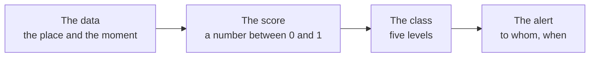

# How Limen works

**Limen looks at the Italian territory one square kilometre at a time and,
for each one, estimates every hour how exposed it is to three hazards:
landslides, flooding and wildfires.** It does so with public data, with
formulas that are written down and readable, and with a forecast up to 72
hours ahead. This page explains the whole engine — the data, the
calculations, the forecast, machine learning, artificial intelligence, the
geography — because only someone who knows how a number comes about can read
it properly, and use it to anticipate a disaster instead of chasing it.

> Limen **works alongside** the official warning system of the Protezione
> Civile (Italy's civil-protection department) and does not replace it: the
> warning with legal force is the one in the bulletin. But a bulletin gives
> one colour per zone and for two days; Limen says **where** within the
> zone, **why**, and **what comes next**. The map shows them side by side,
> and when Limen sees something the bulletin does not, it says so: that is
> its job.

<!-- schema-fase: tutte -->



## What it adds to the bulletin

| | Criticality bulletin (bollettino di criticità) | Limen |
|---|---|---|
| **Where** | A warning zone: dozens of municipalities (comuni) together (187 in Italy) | Every square kilometre: which slope, which stretch of plain |
| **When** | Today and tomorrow, issued once a day by 16:00 | Every hour, plus the forecast up to 72 hours |
| **What** | Hydrogeological and hydraulic risk, thunderstorms | Landslides, flooding **and wildfires** |
| **Why** | A colour | The numbers that produce it: rain against threshold, river discharge, drought, slope, past landslides |
| **Legal force** | Yes: it is the warning | No: it is an early indication to be checked |

The comparison in the list of municipalities is by type of risk —
landslides against hydrogeological, flooding against hydraulic — and has
three outcomes:

- **Limen sees it first**: a high hazard, or one forecast to be high, where
  the zone has no warning. The row says on how many cells, with what rain
  and when the peak arrives, even if it falls beyond the bulletin's two
  days. This is the case Limen exists for: a local signal to keep an eye on
  before it becomes a warning.
- **Limen confirms and says where**: both raise a signal; Limen points to the
  cells.
- **The bulletin is more severe**: follow the bulletin. Often it is a
  thunderstorm, which the bulletin forecasts at zone scale and a weather grid
  cannot yet see.

For wildfires the hydrogeological bulletin says nothing: there the signal
comes from Limen alone.

## In brief

| Question | Answer |
|---|---|
| What it measures | The **hazard** of landslide, flooding and wildfire, cell by cell, now and up to 72 hours ahead |
| Over what | **312,550 cells** of 1 km² across all **20 regions**, grouped into the **7,901 municipalities** of ISTAT (Italy's national statistics institute) |
| How often | Every **hour** for now; every **6 hours** for the forecast at +24, +48, +72 hours |
| With what data | Only public **open data**: ISPRA, Protezione Civile, INGV, Copernicus, ECMWF, NASA, ISTAT, OpenStreetMap |
| Who decides the number | A **deterministic formula** for each hazard, written in readable configuration files |
| What role AI plays | It **explains** the numbers in words and checks them; it **never changes them** |
| What role machine learning plays | It **challenges** the formula in the shadows and replaces it only if it beats it on real events, by human decision |

## How to read the map

### The colour says how much, the letter says what

The map uses **a single colour scale** for all three hazards, from almost
invisible to red: none, low (petrol green), moderate (yellow), high
(orange), very high (red). It is the order of the Protezione Civile
warnings, which readers already know. The scale is chosen so that **every
pair of classes remains distinguishable even for people with colour-vision
deficiency** (deuteranopia, protanopia, tritanopia): an automated test
checks this on every change.

The colour says **how much**; the hazard is given by the letters **F**
(flood), **L** (landslide), **W** (wildfire) inside cells in the high class (from zoom 10), by the coloured
border of those same cells and by the «Active layer»
heading at the top left. In the «All hazards» view each
cell shows the worst of the three: the letter is how you know which one.

| Class | Operational meaning |
|---|---|
| None | Ordinary conditions. It does not mean «safe»: it means «no signal» |
| Low | Some ingredient is active, but not together |
| Moderate | The system starts to say something: a trigger on a predisposed place |
| High | Several heavy ingredients together |
| Very high | The worst condition the model can recognise |

> **A red cell is not a red warning.** The colours follow the order of the
> warning colours because they can be read without a legend, but they show
> the **estimated hazard** from Limen in that square kilometre. The warning,
> with its colour, is only the one in the bulletin: on the map in the
> «Civil Protection warnings» layer, in the list in each municipality's row.

Each hazard has its own thresholds between classes, because the numbers do
not mean the same thing: they are in the section on the engines.

### Grey does not mean calm

A **grey** cell has not been measured: the data it needed (the weather for
wildfire, the rain or the discharge for flooding) did not arrive. For an
engine that multiplies, missing data would give zero — indistinguishable
from a genuinely calm cell. It is the only way a warning system could go
wrong **in the reassuring direction**, and Limen prevents it: the grey is
the same as for cells never assessed, and these cells are left out of every
count.

### The tools above the map

| Tool | What it is for |
|---|---|
| **National overview** (column) | One row per hazard with the number of areas and the class; clicking it filters the map. «All hazards» shows the worst in each cell |
| **Above threshold only** | Hides cells below Moderate: a quarter of Italy is in the low class and would cover the map. Unmeasured cells remain visible |
| **Layers** | Context to overlay: today's official warnings, recorded landslides (IFFI, the national landslide inventory), PAI hazard zones, hydraulic hazard, observed floods, burnt areas |
| **Timeline** Now / +24 / +48 / +72 h | Steps through the per-cell forecast; under each lead time is the actual moment, and a lead time already past says so |
| **Inspector** (click on a cell) | The score of each hazard, its components, the forecast rain; for the future it shows the forecast value and states that the rest is from now. At the bottom, **«How this number is made»**: who did what (formula, weather, ML, AI), the rain according to five weather models and the link to the region's account in «Regions to watch» |
| **Search** (⌘K) | Takes the map to the municipality and highlights its boundary |
| **Regions to watch** (menu) | The twenty regions in order of estimated hazard, with the official warning, the municipalities to watch and the AI's account of each one; the report can be downloaded as a PDF, for all of Italy or for one region |

### The list of municipalities

The municipality is the unit on which decisions are taken, and the column
sorts them from most exposed. For each one:

- the **number at the top** is the municipality's **worst hazard**, from 0
  to 1, with its name. It is not an average: a high wildfire hazard does not
  become low because it is not raining today;
- the **F / A / I** chips give the three values side by side, always all of
  them. Next to flooding, the forecast rain against the threshold; next to
  wildfire, the FWI and **how unusual it is for the month** at that spot
  («unusual for October (P96)» or «normal for
  October»);
- the **arrow** shows the direction towards 72 hours, comparing only the
  hazards that have a forecast;
- the **Allerta ufficiale** (official warning) row reports the Protezione
  Civile bulletin for the municipality's zone, today and tomorrow, and says
  when Limen diverges from it.

The **order** of the list is not just the score: a municipality moves up if
its worst hazard is close to houses, roads and railways (the **exposure**),
and it gets a 15% boost for each additional hazard above the threshold at
the same time. The «Top because» row gives the reason,
in words.

## The territory in cells

### Why a 1 km grid

Italy is divided into **312,550 squares one kilometre on a side**. A
landslide or a river overflowing does not know municipal boundaries: a
mountain municipality may contain an unstable slope and a stable plateau,
and giving it a single colour would mean wrongly alarming half the
municipality or wrongly reassuring the other half. The kilometre is the
resolution the data actually reach: weather models work on meshes of
kilometres, and a finer grid would give the appearance of a detail that the
underlying data do not have.

### From cells to municipalities and warning zones

| Geographic level | How it is built | What it is for |
|---|---|---|
| **Cell** (1 km²) | Regular grid per region | The calculation |
| **Municipality** (7,901) | ISTAT boundaries; each cell belongs to the municipalities it intersects | The list, the search, the highlighted boundary |
| **Region** (20) | Unit of calculation and forecasting | The small-scale overview |
| **Warning zone** DPC (187) | Polygons of the national bulletin | The comparison with the official warning: a municipality takes the zone of its interior point |
| **Weather node** | Regular lattice: 0.1° for the flooding rain, 0.25° for the wildfire index | Each cell reads the nearest node: one number per region copied onto every cell would be wrong by tens of millimetres |

Geometries are stored in geographic coordinates (EPSG:4326); distances and
areas are calculated in the European equal-area projection (EPSG:3035),
where a kilometre is a kilometre throughout Italy.

### What you see at which zoom

At national scale a cell is smaller than a pixel: the map shows the
**regions** until the cells appear, the **municipalities** between zooms 7
and 11, the **cells** from zoom 8 (from 7 for flooding, wildfire and the forecast). The per-cell forecast
appears from zoom 7: further out, a single request would weigh megabytes.

## The data layer: open data

Every Limen number comes from public data that anyone can download without
contracts or subscriptions. No commercial source, no paid key required.

### Slow data: what the place is like

| Data | Source | Use | Coverage |
|---|---|---|---|
| Past landslides (IFFI) | ISPRA (Italy's environmental protection and research institute) | How many landslides fall within 500 m of the cell: the most predictive indicator there is | all cells |
| Landslide hazard (PAI) | ISPRA, mosaic of the Piani di Assetto Idrogeologico (hydrogeological plans) | The official P1-P4 classification | 167,693 cells (inside the mapped areas) |
| Hydraulic hazard | ISPRA, PGRA mosaic | How floodable the cell is | 132,535 cells (studied basins) |
| Shape of the terrain | TINITALY digital model (INGV, Italy's national institute of geophysics and volcanology) | Mean slope of the cell | 99.7% |
| Rock type | ISPRA geological map | Lithological weight (clays and flysch slide more than limestones) | 99.8% |
| Land use | CORINE Land Cover (Copernicus) | Fuel for wildfire, urban fabric for exposure | all |
| Sealed soil | Copernicus Imperviousness | Amplifies the flooding rain in towns | all |
| Roads, railways | OpenStreetMap | Exposure: how much it matters to warn a cell | all |
| Boundaries | ISTAT | Municipalities and regions | 7,901 municipalities |

### Fast data: what is happening

| Data | Source | Frequency | Use |
|---|---|---|---|
| Rain, soil moisture, temperature, wind | Open-Meteo (ECMWF and ICON models), **instance hosted on this server** | every hour | Landslide trigger, flooding rain, wildfire index |
| River discharge | GloFAS (Copernicus), via public Open-Meteo | every 6 hours | River branch of flooding |
| Waves and storm surges | Open-Meteo Marine | every hour | Hydrological component of coastal landslides |
| Earthquakes | INGV (catalogue and ShakeMap) | every hour | Seismic component of landslides |
| Active fires | NASA FIRMS | every 45 minutes | Opens the post-fire window within a few hours |
| Burnt areas | Copernicus EFFIS | at every synchronisation | Perimeters of past fires: they open the post-fire window |
| Rain seen by radar | Protezione Civile (national radar mosaic, 1 km, 5 minutes) | every 15 minutes | Wake-up call: immediately recalculates the region where the radar sees a cloudburst |
| Criticality bulletin | Protezione Civile | every hour (issued by 16:00) | The official warning alongside ours |

Why our own weather instance: the public Open-Meteo interface has a cap of
10,000 requests a day, and the hourly calculation for all of Italy asks for
ten thousand on every round. When the cap was exceeded, flooding and
wildfire gave zero across all of Italy for **lack of data**, not because
things were calm. Today forecasts and archive come from an instance on the
server; only the river discharge (GloFAS) remains public, because it cannot
be hosted.

### Ground-truth data: to know whether it works

| Data | Source | Use |
|---|---|---|
| Rain-triggered landslides, dated | e-ITALICA catalogue, CNR-IRPI (6,312 landslides, 1996-2021) | Calibrate the rain thresholds and check the landslide engine |
| Floods observed by satellite | Copernicus Emergency Management Service | Check the flooding engine |
| Wildfire perimeters | Copernicus EFFIS | Check the wildfire engine |
| Weather reanalysis | ERA5 and CERRA (Copernicus) | Replay the past, build the climatologies |

## The three engines

Each hazard has its own formula, because each hazard has its own physics.
All three are **pure functions**: given the same ingredients they return the
same number, on any computer, without consulting the network or a language
model. Every weight and every threshold sits in a readable configuration
file (`config/hazards/<pericolo>.yaml`), and tests check that none are
hidden in the code.

### Landslides: a weighted sum

```
score = 0.35 × the place (S)
      + 0.40 × the rain (M)
      + 0.15 × the earthquake (E)
      + 0.07 × the fire (F)
      + 0.03 × the water (H)
```

| Component | What it contains |
|---|---|
| **S** — the place (35%) | IFFI landslides within 500 m (37.5%, saturating at 8), slope (30%, saturating at 45°), PAI class (22.5%), lithology (10%) |
| **M** — the rain (40%) | Excess over Caine's triggering threshold (45%), rain of the previous days (30%), soil moisture (25%); bonus for rain on snow |
| **E** — the earthquake (15%) | Ground shaking from events of magnitude ≥ 3.5 in the last 7 days, decaying over time |
| **F** — the fire (7%) | A bell curve peaking 6 months after a fire that touched the cell, zero beyond 24 months |
| **H** — the water (3%) | Hydraulic hazard, pushed up by forecast rain, river floods and storm surges |

<!-- componente: figura-frane -->

**Caine's threshold** gives, for each duration, the intensity beyond which
landslides really start to happen: 7.2 mm are enough if they fall in one
hour, 28.4 are needed over a day. The thresholds have been recalculated on
the e-ITALICA catalogue (5,974 rain events with a landslide): 95% of real
landslides lie above the threshold.

Classes: none below 0.15, low up to 0.35, moderate up to 0.55, high up to
0.75, very high above.

<!-- componente: simulatore -->

### Flooding: the place times the strongest push

The hazard is called **flooding** (allagamento) and not flood (alluvione):
the engine estimates water building up where the area is floodable — heavy
rain on ground that cannot absorb it, or a river above its ordinary high
flow — not a flood in progress.

```
score = hydraulic susceptibility × max(rain, river)
```

- **Susceptibility**: how floodable the cell is according to the ISPRA
  mosaic. It multiplies rather than adds, because water runs downhill: a
  ridge does not flood however hard it rains in the valley. A cell outside
  the studied zones gets a cautious value (0.15), not zero: «not studied» is
  not «not floodable».
- **Rain**: the rain **forecast over the next 72 hours** at the cell's node,
  above the 40 mm threshold, up to saturation at 120 mm; damped if the soil
  is dry, amplified where the ground is sealed.
- **River**: the discharge forecast by GloFAS divided by the **ordinary high
  flow of that watercourse** (not by a regional value: the Po and a torrent
  cannot be compared). A river without a reference is «I don't know», not
  «low».
- It is a **maximum**, not a sum: rain and river are two different ways of
  ending up under water, and adding two moderate signals would invent a
  severe one.
- **Post-fire cascade**: a slope burnt a few months ago lets rain run off
  instead of absorbing it. The rain branch grows by up to 1.6 times, peaking
  at 4 months and zero beyond 18, **only in cells actually touched** by an
  EFFIS perimeter or by FIRMS fires.

<!-- componente: figura-alluvione -->

**How rare that rain is there.** The rain thresholds are the same across
Italy, and the climate is not: 105 mm in three days happens about once a
year in Trieste, and never in Bari in the decade 2016-2025. For each node,
Limen keeps the ten-year distribution of 72-hour rainfall (ERA5), and in the
list of municipalities it writes next to the millimetres how often they
occur at that spot: «happens here about once a year», or «happens here
once every ~8 years».

We also tried using this distribution to **shift the thresholds** in rainy
climates. Measured against floods observed by satellite, it removed false
signals but lost real floods: in Lombardy the 73 % of events flagged fell to
64 %. For a system meant to anticipate, losing events is the worst flaw, so
the thresholds stay as calibrated and rarity remains a piece of information
next to the number.

> The flooding number **looks ahead**: it can be high under a clear sky, if
> the deterioration is expected in the next three days. That is why the map
> says «next 72 h» and not «now».

Classes: none below 0.10, low up to 0.25, moderate up to 0.45, high up to
0.70, very high above.

> The river branch uses GloFAS: contains modified Copernicus Emergency
> Management Service information, 2026. The score is not a flood warning:
> issuing warnings is the responsibility of national and regional authorities.

### Wildfire: the weather, modulated by the terrain

```
score = normalised FWI × (0.25 + 0.60 × fuel + 0.15 × slope)
```

- **FWI** (Fire Weather Index, Van Wagner 1987) is the fire weather index
  used by Copernicus EFFIS. It combines three fuel-moisture codes — from the
  litter (FFMC) to the deep soil (DC) — with the wind. It is calculated once
  a day on midday conditions, per 0.25° weather node, as a chain: each day
  starts from the one before.
- The **Drought Code DC** is the long memory: above 500 the soil and the
  heavy fuels are very dry, as at the end of summer, and they come down only
  with abundant rain. It is why the hazard can stay high in a mild October,
  if it has not rained for weeks.
- The **terrain modulates the weather, it does not add to it**: under a
  January downpour no pine forest should come out as dangerous. The fixed
  25% share is the hazard of a fire arriving from outside: bare rock in
  extreme conditions is not worth zero.

> It is the **potential** hazard: how far a fire would spread if it
> started. It is **not** the probability that one starts, and it does not
> say a fire is in progress.

Classes, aligned with the EFFIS bands: none below 0.12 (FWI 6), low up to
0.24 (FWI 12), moderate up to 0.42 (FWI 21), high up to 0.76 (FWI 38),
very high above.

**Compared with usual.** The classes are absolute: FWI 36 is «high» in
August as in October. That is why Limen also keeps a **climatology**: for
each node and each month, the distribution of the FWI over ten years of
archive (2016-2025). The inspector uses it to say, for example, «higher than
98% of October days at this spot»: the same value in August would be
ordinary. The same comparison appears in the list of municipalities, next to
the wildfire value.

**Why the classes are not lowered in autumn.** One might think that a
«high» in October is worth less than one in August, given that October
burns 1 % of the year's area. We measured it: replaying the index on 300
nodes from 2016 to 2024 and comparing it with fires observed by satellite
(NASA FIRMS) on natural vegetation, on a high-class day the probability of
a fire is 1.18 % in July-August and 0.97 % in October. October burns little
because it has few high days — 7 % against 38 % — not because «high» is
worth less. The classes remain those of EFFIS, and the comparison with the
month serves to say when a high day is rare, not to scale it down.

| Month | Fire on a «high» day | On a «very high» day | High days or above |
|---|---|---|---|
| July-August | 1.18 % | 3.49 % | 38 % |
| September | 0.78 % | 1.66 % | 21 % |
| October | 0.97 % | 1.92 % | 7 % |
| November | 0.81 % | 0.85 % | 2 % |

A caveat on the comparison with the month: the climatology is calculated on
the ERA5 reanalysis, today's value on the forecast models, which on the
same days give an FWI about 10 % higher (a few km/h more wind). The
percentile shown is therefore somewhat inflated: «P96» should be read as
«among the driest days of the month», not as an exact figure.

## The forecast

### Three cadences

| Cadence | What it does | Why this way |
|---|---|---|
| **Every hour** | Calculates the current state of all three hazards across Italy, saves the changed cells, sends the alerts | It must fit within the hour: no language models, no challengers |
| **Every 10 minutes** (asynchronous) | Writes the explanations in words for the regions that have changed | Nobody waits for them: the map shows the deterministic text until they arrive |
| **Every 6 hours** (02:20, 08:20, 14:20, 20:20 UTC) | Per-cell forecast at +24, +48, +72 hours | Follows the new runs of the weather models: a forecast made at night and left on the map for 24 hours goes stale just when the weather changes |
| **Every night** (02:00 UTC) | Machine-learning measurements; maintenance | The night measures, the day operates |

### How a forecast number comes about

The forecast uses **the same formulas** as the current state, with the
weather **forecast** by the models (rain, humidity, temperature, wind) in
place of the observed weather. For each cell the lead times above Moderate
are saved; for each municipality, all of them. Two consequences:

- a cell with no forecast row, for a hazard whose forecast has run, is
  **forecast below Moderate**: an answer, not a gap;
- if a run is skipped (a restart, a failure), the timeline marks the lead
  times as **past** instead of presenting them as the future.

A second forecast, **per region**, runs every 6 hours over 48 hours and
sends the forecast alerts.

### The limit of every forecast: the models disagree

Over Trieste, on 6 October 2026, the rain forecast over 72 hours ranged from
29 mm (GFS) to 93 mm (ECMWF IFS) depending on the weather model. The score
reads a single model; the cell inspector shows the spread of all five, so
you can see how uncertain that number is. Weighting them properly is the
first job of machine learning, described below.

## The machine-learning layer

### The champion and the challengers

The operational score always comes from the **deterministic formula**, the
*champion*. Alongside it a machine-learning model can run, the *challenger*
(LightGBM), which sees the same data, calculates its own probability and
writes it to a separate table: it colours nothing, it sends nothing. The
rules are written in the code:

- validation is **by geographic blocks**: whole tiles of territory are
  either in training or in testing, never straddling both, because a model
  tested on neighbouring cells recognises the place instead of learning the
  phenomenon;
- to be promoted it must beat the formula **and** pass absolute thresholds
  on landslides found, false alarms, lead time and calibration;
- promotion is **a command that a person types**: no model promotes itself.

During development the landslide challenger measured an AUC-PR of 0.60
against 0.28 for the formula, and the wildfire one 0.35 against 0.24. These
are development measurements, not reproduced on this server: **in
production today the challenger is switched off** (`champion_only`) and the
formula decides.

### The multi-model rain corrector (under construction)

A model that learns, from past cases, how much weight to give each weather
model — ICON, Météo-France, ECMWF, GFS and **AIFS**, ECMWF's neural-network
model — and how wide the uncertainty is. It returns the probable rain and a
range (10th-90th percentile) instead of a single number. The dataset is
gathered at night (forecasts since 2024 with their lead time, ERA5 observed
rain); it will be adopted only if it reduces the error on heavy rain,
measured together with the base rate.

### How a disaster forecast is measured

A system that says «hazard» every summer day finds every wildfire and is of
no use. That is why every check reports **two numbers together**: how often
the real event had been flagged (*hit rate*) and how often the system flags
in general (*base rate*). An example measured in Basilicata on the 2025
wildfires: 79% of days with a real fire flagged, against a base rate of
43%.

## The AI layer

### What it does and what it cannot do

The language models **rephrase**: they turn the numerical result into a
text that a duty operator understands at first reading, and extract from it
a structured diagnosis (dominant cause, anomalies, attention window,
confidence). **They never touch the numbers**: scores, classes and alerts
are deterministic, and an automated test fails if a model response changes
a single value. The alerts contain no generated text.

### Explanations per hazard

Each hazard has its own prompt, written for its physics: the flooding one
says that the number looks ahead and that a river marked «n/a» (not
available) is not a low river; the wildfire one that it is a potential
hazard, not the probability of a fire. A hazard without a prompt stays
without an explanation: a voice that narrates landslides while talking
about a wildfire is worse than silence. A region is re-explained only when
its dominant class changes, or after 24 hours. The explanation can be read
on the **Regions to watch** page, once per
region and next to the numbers it comes from, with the time it was
written; the brand of the model provider is in the header. The order of the regions is decided by the numbers — the highest
class, now or forecast, then the areas in the high class —: the AI tells a
region's story, it does not choose it. If the model has not responded, the
text is not attributed to the AI.

### The models and where they run

| Name in the gateway | Model | Where | Use |
|---|---|---|---|
| `fast`, `chat`, `extract` | Qwen3 4B and 8B | Server GPU (llama.cpp) | Short tasks, extraction for the knowledge graph |
| `embed` | Qwen3-Embedding 0.6B | Server CPU | Semantic search in documents |
| `quality-local` | GLM-5.2 (colibrì) | server, from disk | Night jobs only: generates at tens of seconds per word |
| `quality-cloud` | Claude Sonnet 5.5 (Anthropic) | API, with a spending cap | Explanations and diagnoses of the regions |

All traffic goes through **a single gateway** (LiteLLM), which picks the
model by name, applies the spending cap and switches to a fallback model if
one does not respond. The slow models run only at night, because there is
only one server and by day it serves the map.

## Reading the data to anticipate a disaster

A sequence that uses everything Limen can do:

1. **Official warning first of all.** The «Allerte Protezione Civile
   (oggi)» layer and the row in the list of municipalities: that is the
   warning that counts.
2. **National overview.** Which hazard has areas in the high class, and how
   up to date the data are (next to each row).
3. **Most exposed municipalities, now and in 72 hours.** The second ordering
   finds the municipality that is calm today and rising tomorrow: it is what
   the forecast exists for.
4. **Timeline.** Step through +24, +48, +72 over the region; check that the
   lead times are not «past».
5. **Inspector.** What the number comes from: rain over threshold or
   predisposed terrain? FWI with underlying drought or an isolated windy
   day? For wildfire, how unusual it is for the month.
6. **Context.** Recorded landslides, PAI areas, recently burnt areas, past
   floods: they often say more than the number.
7. **Divergences.** When Limen sees it before the bulletin, the row says
   what, where and when: it is the early notice a zone bulletin cannot
   give, to be checked on the ground. When the bulletin is more severe,
   follow the bulletin.

## Stated limits

- **The landslide engine has not yet passed its checks** on real events
  (issue #122): until it does, the landslide map should be read in a
  **relative** way — which cells are darker than their neighbours — rather
  than by the name of the class.
- **Earthquake and fire** together account for 22% of the landslide score
  and are zero in ordinary conditions: the high class is hard to reach with
  rain alone.
- **The forecast depends on a weather model**, and on a localised
  thunderstorm it can be quite wrong; the rain used in the checks (ERA5) is
  not the rain the system works with every day.
- **A kilometre is large** for a landslide thirty metres wide; the bank
  undercut by last month's excavation, the blocked ditch, the landslide never
  recorded are in no dataset.

## The technology

| Layer | Components |
|---|---|
| Data | PostgreSQL 16 with PostGIS; hot tables partitioned by day; materialised views for the maps |
| Computation | Python 3.12; a *worker* process with the scheduler (a single instance); pure, tested engines |
| Weather | Own Open-Meteo instance (forecast and archive) |
| Services | REST API (FastAPI); MCP server for agents; A2A protocol |
| Maps | pg_tileserv (vector tiles from SQL views and functions); MapLibre |
| Interface | React 19, Mantine 9, TypeScript, Vite |
| Inference | LiteLLM gateway, llama.cpp/llama-swap on GPU, colibrì (GLM-5.2), Claude via API |
| Operations | Docker Compose on a single server, ports on loopback behind a reverse proxy; no cloud provider |

Everything is reproducible: EUPL-1.2 code, public data, readable
configurations. The inference stack has its own Compose file to replicate it
on another computer. The APIs are documented on the **Integrazioni**
(integrations) page.

## Glossary

| Term | Meaning |
|---|---|
| **Cell** | 1 km² square on which everything is calculated |
| **Score** | Number between 0 and 1 that sums up a cell's hazard |
| **Class** | Band of the score, from «none» to «very high» |
| **Exposure** | How much it matters to warn a cell: nearby houses, roads, railways |
| **Not measured** | The data needed did not arrive: grey, never «calm» |
| **Caine's threshold** | Rain intensity beyond which landslides start to happen, for each duration |
| **Antecedent precipitation (API)** | The rain of the previous days, which the ground remembers |
| **FWI** | Fire Weather Index: the fire weather index |
| **DC** | Drought Code: deep drought in the wildfire index |
| **GloFAS** | The European river-flood forecasting system |
| **IFFI** | ISPRA's national landslide inventory |
| **PAI** | Piani di Assetto Idrogeologico: the areas mapped as hazardous |
| **Champion / challenger** | The formula that decides / the model that challenges it in the shadows |
| **Base rate** | How often the system flags in general: without it, the hit rate cannot be read |
| **Criticality bulletin** | The official warning of the Protezione Civile, per zone, today and tomorrow |
